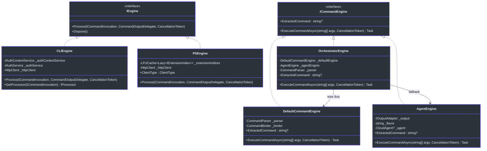
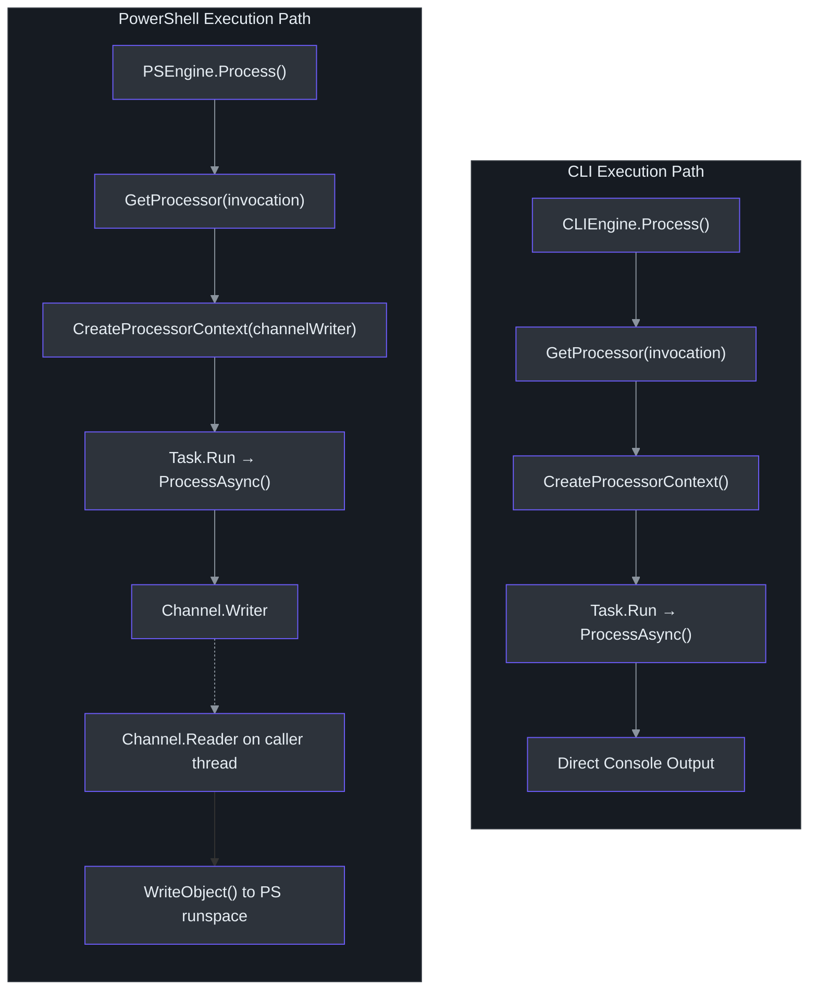

# Core Engine & Orchestration

The engine layer is the beating heart of Cirrus. Every command — whether a structured CLI invocation like `azv2 group create --name test` or a natural-language query like _"create a resource group for me"_ — passes through the same orchestration pipeline. This page traces the complete lifecycle of a command from raw `string[]` args to executed result.

## Engine Interface Hierarchy

Cirrus defines two distinct engine contracts that serve different execution models (`src/Core/Core.Abstractions/IEngine.cs:5-25`):

| Interface | Purpose | Consumers |
|---|---|---|
| `IEngine` | Synchronous command processing with output delegates. Extends `IDisposable`. | `CLIEngine`, `PSEngine` (extension-based pipeline) |
| `ICommandEngine` | Async command execution from `string[]` args. Exposes `ExtractedCommand` for AI-to-structured bridging. | `OrchestratorEngine`, `DefaultCommandEngine`, `AgentEngine` |

The `ClientType` enum (`src/Core/Core.Abstractions/ClientType.cs:7-10`) distinguishes between the two host environments:

```csharp
public enum ClientType
{
    PowerShell,  // PSEngine path — runspace-aware, channel-based output
    CLI          // CLIEngine path — direct console output
}
```



## Bootstrapper & Dependency Injection

The `Bootstrapper` class (`src/Core/Core.Engine/Bootstrapper.cs:25`) is a static service-locator that lazily initializes the DI container on first access:

```csharp
public static Task<IServiceProvider> ServiceProviderAsync => _serviceProvider.Value;
private readonly static Lazy<Task<IServiceProvider>> _serviceProvider = new(() => StartAsync());
```

The `RegisterServices` method (`src/Core/Core.Engine/Bootstrapper.cs:49-111`) wires every component:

**Original registrations** (lines 53-58) — foundation services:
- `ILoggingService` → `ConsoleLoggingService`
- `IAuthService` → `MsalAuthService`
- `IAuthContextService` → `AuthContextService`
- `ITelemetryService` → `TelemetryService`

**AI-integration registrations** (lines 62-105) — added for the orchestrator pattern:
- `IOutputAdapter` → `ConsoleOutputAdapter` — abstracts console output so engines don't call `Console.WriteLine` directly (`src/Core/Core.Engine/Bootstrapper.cs:65`)
- `CommandParser` and `CommandBinder` as singletons (`src/Core/Core.Engine/Bootstrapper.cs:70,75`)
- `AgentEngine` with a factory that reads `AZURECLI_FLAVOR` at construction time (`src/Core/Core.Engine/Bootstrapper.cs:85-91`)
- `ICommandEngine` → `OrchestratorEngine` — the actual engine returned to `Program.cs` (`src/Core/Core.Engine/Bootstrapper.cs:98-105`)

### AZURECLI_FLAVOR Environment Variable

The flavor variable is read in two places:

1. **Bootstrapper** (line 87): `Environment.GetEnvironmentVariable("AZURECLI_FLAVOR") ?? "azure cli"` — passed to `AgentEngine` constructor to control prompt template flavor substitution.
2. **OrchestratorEngine** (line 63): Same read — determines whether to use the full orchestration loop or the direct-to-AI PowerShell path.

When PowerShell cmdlets invoke the CLI, they set `AZURECLI_FLAVOR=azure powershell`, which bypasses structured parsing entirely and routes all input through the AI agent.

## OrchestratorEngine: The Heart of the System

`OrchestratorEngine` (`src/Core/Core.Engine/OrchestratorEngine.cs:33`) is the `ICommandEngine` implementation returned by the Bootstrapper. It coordinates the two sub-engines:

### Execution Flow

The `ExecuteCommandAsync` method (`src/Core/Core.Engine/OrchestratorEngine.cs:60-119`) implements a two-phase strategy:

**Phase 1 — Flavor check** (lines 63-70): If `AZURECLI_FLAVOR == "azure powershell"`, skip the structured path entirely and send args directly to `AgentEngine`. PowerShell users interact via natural language exclusively.

**Phase 2 — Retry loop** (lines 72-115): For CLI users, a `while` loop with `maxTries = 5` attempts:

1. **Try `DefaultCommandEngine`** (line 84) — if the args match a known structured command, execute it and return.
2. **`NotImplementedException`** (lines 87-92) — command is recognized but not yet implemented. Show a warning and exit gracefully (not an error).
3. **Any other exception** (lines 94-114) — fall back to `AgentEngine`. If the AI generates an `executable_command`, parse it (`extractedCommand.Split(' ').Skip(1).ToArray()` on line 112), display a retry message, and loop again through `DefaultCommandEngine` with the new args.

If all 5 attempts fail, a final exception is thrown (line 118).

```mermaid
sequenceDiagram
    autonumber
    participant User
    participant Orchestrator as OrchestratorEngine
    participant Default as DefaultCommandEngine
    participant Parser as CommandParser
    participant Binder as CommandBinder
    participant Agent as AgentEngine
    participant Cloud as CloudAgent

    User->>Orchestrator: ExecuteCommandAsync(args)
    Orchestrator->>Orchestrator: Read AZURECLI_FLAVOR

    alt flavor == "azure powershell"
        Orchestrator->>Agent: ExecuteCommandAsync(args)
        Agent->>Cloud: RunStreamingAsync(userInput)
        Cloud-->>Agent: JSON response stream
        Agent-->>Orchestrator: done
    else flavor == "azure cli"
        loop attempt < 5
            Orchestrator->>Default: ExecuteCommandAsync(args)
            Default->>Parser: Parse(args)
            Parser-->>Default: ParseResult
            Default->>Binder: Bind(parseResult)
            alt command found
                Binder-->>Default: ICommand
                Default->>Default: command.ExecuteAsync()
                Default-->>Orchestrator: success
            else command not found
                Binder-->>Default: null / exception
                Default-->>Orchestrator: throws Exception
                Orchestrator->>Agent: ExecuteCommandAsync(args)
                Agent->>Cloud: RunStreamingAsync(userInput)
                Cloud-->>Agent: JSON response
                Agent-->>Orchestrator: ExtractedCommand?
                alt has extracted command
                    Orchestrator->>Orchestrator: parse extracted args, retry
                else no command extracted
                    Orchestrator-->>User: informational response
                end
            end
        end
    end

    style User fill:#2d333b,stroke:#6d5dfc,color:#e6edf3
    style Orchestrator fill:#2d333b,stroke:#6d5dfc,color:#e6edf3
    style Default fill:#2d333b,stroke:#6d5dfc,color:#e6edf3
    style Parser fill:#2d333b,stroke:#6d5dfc,color:#e6edf3
    style Binder fill:#2d333b,stroke:#6d5dfc,color:#e6edf3
    style Agent fill:#2d333b,stroke:#6d5dfc,color:#e6edf3
    style Cloud fill:#2d333b,stroke:#6d5dfc,color:#e6edf3
```

## DefaultCommandEngine: The Structured Path

`DefaultCommandEngine` (`src/Core/Core.Engine/DefaultCommandEngine.cs:24`) is a primary-constructor class injecting `CommandParser`, `CommandBinder`, and `ILoggingService`. Its `ExecuteCommandAsync` method (lines 31-48) is deliberately simple:

1. **Parse** — `_parser.Parse(args)` → `ParseResult` (line 34)
2. **Bind** — `_binder.Bind(parseResult)` → `ICommand?` (line 37)
3. **Validate** — throws `InvalidOperationException` if command is null (line 42), which triggers the orchestrator's AI fallback
4. **Execute** — `command.ExecuteAsync(await Bootstrapper.ServiceProviderAsync, parseResult.Options, cancellationToken)` (line 46)

### CommandParser

`CommandParser` (`src/Core/Core.Engine/CommandParser.cs:7`) separates args into commands (positional tokens) and options (key-value pairs). It supports three option formats:

| Format | Example | Handling |
|---|---|---|
| `--key=value` | `--name=test` | Split on `=`, trim `--` prefix (line 27-30) |
| `--key value` | `--name test` | Consume next arg as value (line 33-45) |
| `-k value` | `-n test` | Short option, single char (line 48-60) |

Flags without values default to `"true"` (lines 44, 59). Non-option tokens are collected as commands (line 65). The result is a `ParseResult` (`src/Core/Core.Engine/ParseResult.cs:6`) with `Commands` and `Options` properties.

### CommandBinder

`CommandBinder` (`src/Core/Core.Engine/CommandBinder.cs:9`) dynamically loads modules at runtime. Given a `ParseResult`, it:

1. Takes the first command token as the module name (line 23)
2. Calls `LoadModule(moduleName)` which searches `AppContext.BaseDirectory/{moduleName}/` for a DLL (lines 72-106)
3. Loads the assembly via `Assembly.LoadFrom()` (line 110) and handles `ReflectionTypeLoadException` for partial loads (lines 119-123)
4. Finds the `IModule` implementation and calls `GetCommands()` (lines 126-131)
5. Matches the subcommand to a command type name using case-insensitive `Contains` (line 54-55)

## AgentEngine: The AI Fallback

`AgentEngine` (`src/Core/Core.Engine/AgentEngine.cs:32`) wraps `CloudAgent` in a conversation loop with interactive UI:

### Conversation Loop Architecture

The `ExecuteCommandAsync` method (lines 53-230) implements:

1. **Lazy agent creation** — `_agent ??= await CloudAgent.CreateAsync(_flavor)` (line 59). The agent is reused across retry attempts, preserving conversation history.

2. **User input** — args joined into a single string (line 64).

3. **Spinner UI** — For CLI mode only (`_flavor != "azure powershell"`, line 75), a background task displays animated frames `["⠋", "⠙", "⠹", "⠸", "⠼", "⠴", "⠦", "⠧", "⠇", "⠏"]` with 100ms interval (lines 78-91).

4. **Streaming** — Response is streamed via `_agent.RunStreamingAsync(userInput)` returning `IAsyncEnumerable<AgentRunResponseUpdate>` (line 98).

5. **JSON parsing** — The raw response is deserialized into an `AgentResponse` with `Response` and `Type` properties (lines 47-51, 126-141).

6. **Response type handling** (lines 151-222):

| Type | Action | Line |
|---|---|---|
| `executable_command` | Store in `_extractedCommand`, display cyan, exit loop. For PowerShell: also emit `__PSEXEC__` marker | 153-168 |
| `sample_command` | Display syntax in cyan, set `_extractedCommand = null`, exit | 170-177 |
| `exit` | Display goodbye, set `_extractedCommand = null`, exit | 179-186 |
| `confirmation` / `question` | Display message; in CLI mode prompt for input and continue loop; in PowerShell mode exit immediately | 188-215 |

## CLIEngine vs PSEngine

Both implement `IEngine` but differ in threading and output models:

### CLIEngine

`CLIEngine` (`src/Core/Core.Engine/CLIEngine.cs:15`) is for CLI binary consumers. Key characteristics:

- **Extension loading** — uses `BuiltinExtensionLoader` and `MultiVersionExtensionLoader` (lines 58-62) with a static prefix `"Microsoft.Azure.Cirrus.Extensions."` (line 32)
- **Processor context** — `CreateProcessorContext` (lines 129-162) assembles `AuthHandler`, `OutputHandler`, `TelemetryHandler`, and `HttpPipeline`
- **Execution** — `ExecuteCommandAsync` wraps `command.ProcessAsync()` in `Task.Run` (lines 168-180)

### PSEngine

`PSEngine` (`src/Core/Core.Engine/PSEngine.cs:21`) is designed for PowerShell runspace affinity:

- **Channel-based output** — uses `System.Threading.Channels.Channel.CreateUnbounded<object>()` (lines 63-67) to pump output on the caller's thread while the command runs in a background task
- **Extension caching** — `LFUCache<Lazy<IExtensionIndex>>` with capacity 512 (line 26) avoids reloading extension indices
- **Thread model** — worker task runs command in background; caller's thread pumps channel items for PowerShell `WriteObject()` calls (lines 76-83)



## Error Handling & Resilience

The orchestration pipeline has several safety nets:

1. **`NotImplementedException` escape** (`src/Core/Core.Engine/OrchestratorEngine.cs:87-92`) — recognized-but-unimplemented commands produce a warning, not an AI fallback. This prevents the AI from re-interpreting known future commands.

2. **Max retry cap** — 5 iterations prevent infinite loops between `DefaultCommandEngine` and `AgentEngine` (`src/Core/Core.Engine/OrchestratorEngine.cs:73`).

3. **Silent agent failure** — `AgentEngine` catches all exceptions and sets `_extractedCommand = null` (`src/Core/Core.Engine/AgentEngine.cs:225-229`), allowing the orchestrator to exit gracefully.

4. **`ReflectionTypeLoadException` tolerance** — `CommandBinder` handles partial assembly loads (`src/Core/Core.Engine/CommandBinder.cs:119-123`), critical when PowerShell types can't load in a CLI-only context.

## Key Design Decisions

- **Lazy `ServiceProvider`** — `Bootstrapper.ServiceProviderAsync` uses `Lazy<Task<>>` to defer startup cost until first command execution. The provider is never disposed; CLI processes are short-lived and OS reclaims resources (`src/Core/Core.Engine/Bootstrapper.cs:108-110`).

- **Agent reuse across retries** — `AgentEngine._agent` is preserved between `OrchestratorEngine` retry iterations, maintaining conversation context so the AI's multi-turn memory is not lost (`src/Core/Core.Engine/AgentEngine.cs:59`).

- **Skip(1) on extracted commands** — When the AI returns `"azv2 group create --name test"`, the orchestrator skips the first token (`azv2`) since the DefaultCommandEngine expects args without the program name (`src/Core/Core.Engine/OrchestratorEngine.cs:112`).

## References

| Source File | Key Lines | Purpose |
|---|---|---|
| `src/Core/Core.Engine/OrchestratorEngine.cs` | 33, 60-119 | Orchestrator with retry loop |
| `src/Core/Core.Engine/DefaultCommandEngine.cs` | 24, 31-48 | Structured command pipeline |
| `src/Core/Core.Engine/AgentEngine.cs` | 32, 53-230 | AI conversation engine |
| `src/Core/Core.Engine/Bootstrapper.cs` | 25-111 | DI container setup |
| `src/Core/Core.Engine/CommandParser.cs` | 7, 14-72 | Argument parsing |
| `src/Core/Core.Engine/CommandBinder.cs` | 9, 16-141 | Module loading and command binding |
| `src/Core/Core.Engine/ParseResult.cs` | 6-16 | Parse result data class |
| `src/Core/Core.Engine/CLIEngine.cs` | 15, 111-162 | CLI execution engine |
| `src/Core/Core.Engine/PSEngine.cs` | 21, 58-87 | PowerShell execution engine |
| `src/Core/Core.Abstractions/IEngine.cs` | 5-25 | Engine interface definitions |
| `src/Core/Core.Abstractions/ClientType.cs` | 7-10 | CLI/PowerShell enum |
