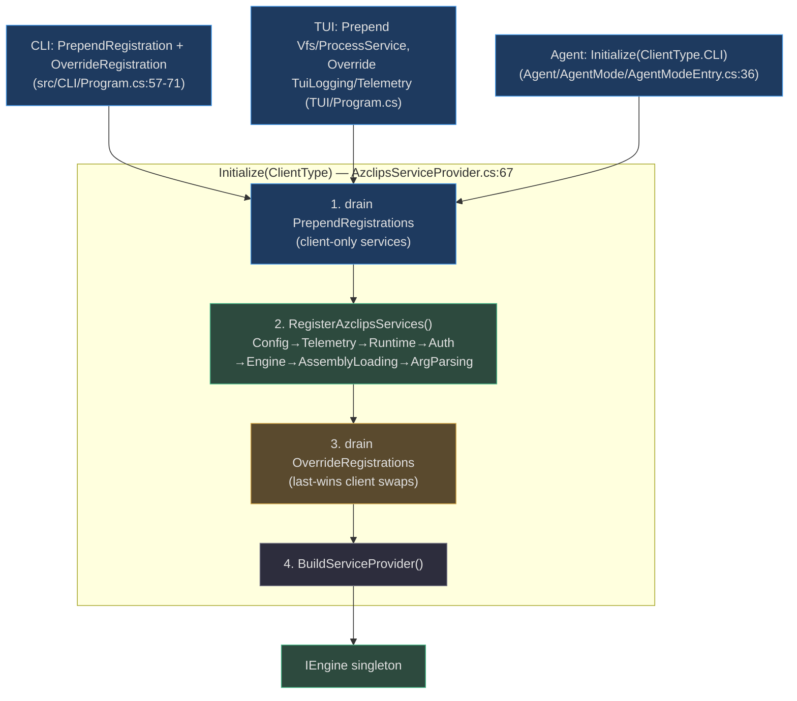
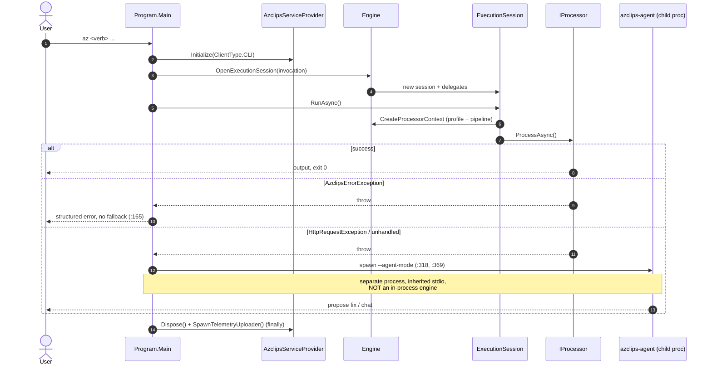

# Core Engine & Orchestration

## Why This Is the Most Important Page

Four client surfaces — the `az` CLI, PowerShell cmdlets, the Terminal UI, and the AI agent — all funnel through **one** composition root and **one** engine contract. If you understand this page, the rest of the architecture is detail. The two ideas that carry everything: (1) a **static service locator**, `AzclipsServiceProvider`, that each client customizes *before* it is frozen; and (2) a **mediator `Engine`** that mints an isolated `ExecutionSession` per command, wiring output routing, the HTTP pipeline, and authentication together. Orchestration — what happens when a command fails — is deliberately *not* an in-process "agent engine"; it is a separate OS process.

The code lives in `Azure/cirrus` under the `Azclips` identity.

## Part 1 — The Composition Root

`AzclipsServiceProvider` (`src/Core/Core.DependencyInjection/AzclipsServiceProvider.cs:17`) is a static holder around a single `IServiceProvider`. It is not constructor-injected; clients reach it through `GetRequiredService<T>()`. It exposes three phases:

| Phase | Method | Semantics | Source |
| --- | --- | --- | --- |
| **Prepend** | `PrependRegistration` | Runs *before* the default registrations; used to add client-only services | `src/Core/Core.DependencyInjection/AzclipsServiceProvider.cs:29` |
| **Defaults** | `RegisterAzclipsServices` | Chains every module's `Register*Services()` extension | `src/Core/Core.DependencyInjection/AzclipsServiceProvider.cs:53` |
| **Override** | `OverrideRegistration` | Runs *after* defaults; DI last-wins lets a client replace a default | `src/Core/Core.DependencyInjection/AzclipsServiceProvider.cs:44` |

`Initialize(ClientType)` (`src/Core/Core.DependencyInjection/AzclipsServiceProvider.cs:67`) is idempotent — the first call builds the container under a lock; later calls no-op (`:69-70`). Inside, it seeds the immutable `ClientType`, drains the prepend queue, registers defaults, drains the override queue, and builds the provider (`:77-89`).

The default chain fixes the module order (`src/Core/Core.DependencyInjection/AzclipsServiceProvider.cs:53-61`):

```
Config → Telemetry → Runtime → Authentication → Engine → AssemblyLoading → ArgumentParsing
```



### Per-client customization

| Client | Customization | Source |
| --- | --- | --- |
| CLI | Prepends extension loaders + dispatcher; overrides assembly-loading, arg-parsing, telemetry, User-Agent providers | `src/CLI/Program.cs:57-71` |
| PowerShell | `ModuleInitializer.OnImport` overrides PS providers, then `Initialize(ClientType.PowerShell)` | `src/PS/Login/ModuleInitializer.cs:16-25` |
| TUI | Prepends `ArmClient`/`AzureVfs`/`ProcessService`/`AppState`, overrides logging + telemetry, then `Initialize(ClientType.TUI)` | `TUI/Program.cs` |
| Agent | Reuses `Initialize(ClientType.CLI)` — no distinct agent client type | `Agent/AgentMode/AgentModeEntry.cs:36` |

## Part 2 — The Engine

`Engine` is a `partial` class using the **mediator** pattern (`src/Core/Core.Engine/Engine.cs:22`) implementing `IEngine` (`src/Core/Core.Abstractions/IEngine.cs:8`). Its primary-constructor dependencies are the services it orchestrates: `HttpClient`, `IProfileService`, `IAuthService`, `ITelemetryService`, `IAssemblyLoadingService`, `IArgumentParsingService`, `IConfigurationService`, `IHttpPipelineService`.

`OpenExecutionSession` (`src/Core/Core.Engine/Engine.cs:39`) builds a per-invocation `ExecutionSession` and hands it a set of delegates rather than services, keeping the session decoupled:

- Extension indices are cached in an `LFUCache<Lazy<IExtensionIndex>>` (`src/Core/Core.Engine/Engine.cs:36`) so each extension's command table initializes exactly once, even under concurrency (`CacheGetOrAdd`, `:81`).
- `session.LoadAssembly`, `session.BindProcessor`, and `session.CreateProcessorContext` are bound to the engine's services (`src/Core/Core.Engine/Engine.cs:53-58`).

### CreateProcessorContext — where auth meets HTTP

`CreateProcessorContext` (`src/Core/Core.Engine/Engine.cs:99`) is the assembly point for a command's runtime:

1. Resolve the active `Profile` (explicit `--profile` override, else active pointer, else `null`) via `ResolveProfileAsync` (`src/Core/Core.Engine/Engine.cs:151`).
2. Build an `AuthHandler` whose `AcquireTokenAsyncDefault` is `authService.AcquireTokenSilentlyAsync` (`src/Core/Core.Engine/Engine.cs:106`) — the bridge from auth to HTTP.
3. Construct an `HttpPipeline` with retry counts from `session.Option.Http` and **prepend** the auth handler, then the User-Agent and terminating steps, and **append** tracing (`src/Core/Core.Engine/Engine.cs:116-137`).
4. Publish `ProcessorContextCreated` so telemetry can enrich the root span with profile-derived tags (`src/Core/Core.Engine/Engine.cs:141`).

The pipeline mechanics are covered in [HTTP Pipeline & Runtime](/02-deep-dive/http-pipeline-runtime); profile/token details in [Authentication (MSAL)](/02-deep-dive/authentication).

## Part 3 — ExecutionSession

`ExecutionSession` (`src/Core/Core.Engine/ExecutionSession.cs:12`) is the unit of isolation. Each session owns its own `RuntimeEventBus` and installs a **scoped logger** so concurrent commands never cross output streams (`src/Core/Core.Engine/ExecutionSession.cs:39-43`).

Two drive methods exist for two threading models:

| Method | Used by | Behavior | Source |
| --- | --- | --- | --- |
| `RunAsync()` | CLI, agent, TUI | Async; resolves the processor and awaits `ProcessAsync` | `src/Core/Core.Engine/ExecutionSession.cs:57` |
| `Run()` | PowerShell | Synchronous with an unbounded output **channel** pumped back to `$PSCmdlet` (cmdlet thread-affinity) | `src/Core/Core.Engine/ExecutionSession.cs:78` |

Both paths resolve the `IProcessor` via `GetExtensionIndex()` (cached or transient, `src/Core/Core.Engine/ExecutionSession.cs:46`) and publish `ProcessorAcquired` before executing.

## Part 4 — Orchestration & the Fallback Boundary

The orchestrator is `Program.Main`'s `try/catch` (`src/CLI/Program.cs:140-181`). It is intentionally simple, and its most important property is **negative**: there is no in-process `OrchestratorEngine` or `AgentEngine`. When a command fails in a way worth escalating, the CLI spawns a *separate operating-system process*, `azclips-agent`, via `TryAgentFallbackAsync` (`src/CLI/Program.cs:318`).



Why a process boundary? Three reasons visible in the code: the agent carries its own DI container and heavy Copilot-SDK dependencies it should not force onto every `az` invocation; inherited stdio lets it own the terminal for approvals and device-code prompts (`src/CLI/Program.cs:381-387`); and the `AZCLIPS_IN_AGENT_MODE` recursion guard (`src/CLI/Program.cs:26`) cleanly prevents an agent-spawned `az` from spawning another agent. See [Agent Architecture](/02-deep-dive/agent-architecture) for the child-process internals.

## Component Reference

| Component | Responsibility | Source |
| --- | --- | --- |
| `AzclipsServiceProvider` | Static composition root; prepend/override/init | `src/Core/Core.DependencyInjection/AzclipsServiceProvider.cs:17` |
| `IEngine` / `Engine` | Mediator; opens sessions, builds processor context | `src/Core/Core.Abstractions/IEngine.cs:8`, `src/Core/Core.Engine/Engine.cs:22` |
| `ExecutionSession` | Per-command isolation, output routing, processor drive | `src/Core/Core.Engine/ExecutionSession.cs:12` |
| `TryAgentFallbackAsync` | Out-of-process fallback orchestration | `src/CLI/Program.cs:318` |

## References

- `src/Core/Core.DependencyInjection/AzclipsServiceProvider.cs:17,29,44,53,67` — composition root
- `src/Core/Core.Engine/Engine.cs:22,36,39,99,106,151` — mediator engine + processor context
- `src/Core/Core.Abstractions/IEngine.cs:8` — the engine contract
- `src/Core/Core.Engine/ExecutionSession.cs:12,57,78` — session isolation and drive methods
- `src/CLI/Program.cs:57-71` — CLI DI customization
- `src/CLI/Program.cs:140-181,318` — orchestration ladder and out-of-process fallback
- `src/PS/Login/ModuleInitializer.cs:16-25` — PowerShell `Initialize(ClientType.PowerShell)`
- `Agent/AgentMode/AgentModeEntry.cs:36` — agent reuses `ClientType.CLI`
