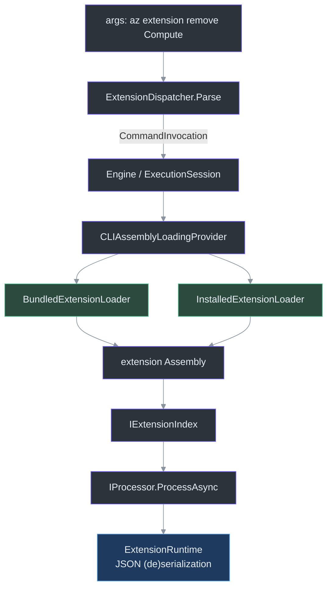
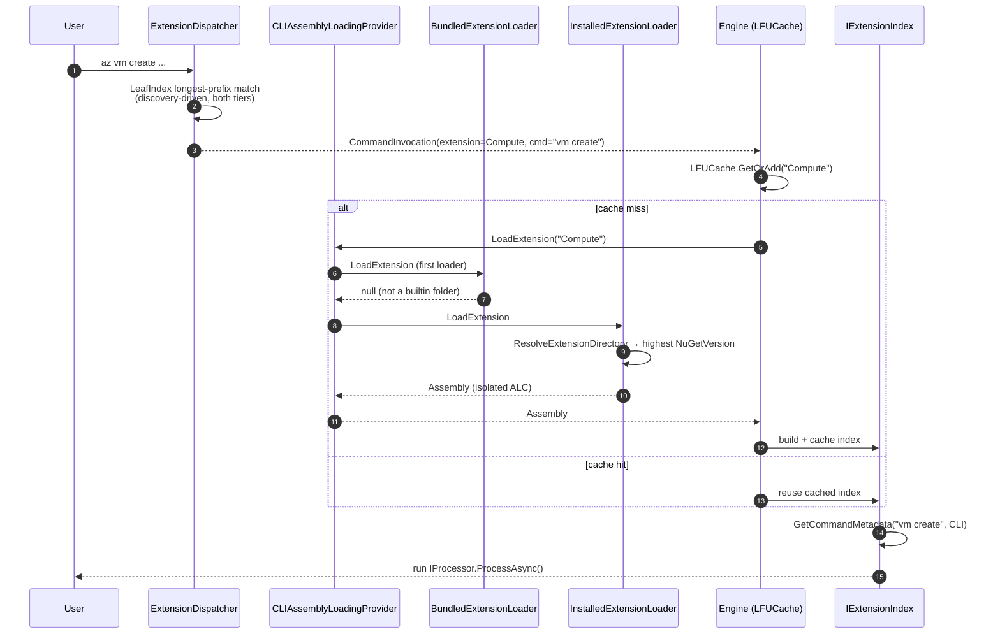
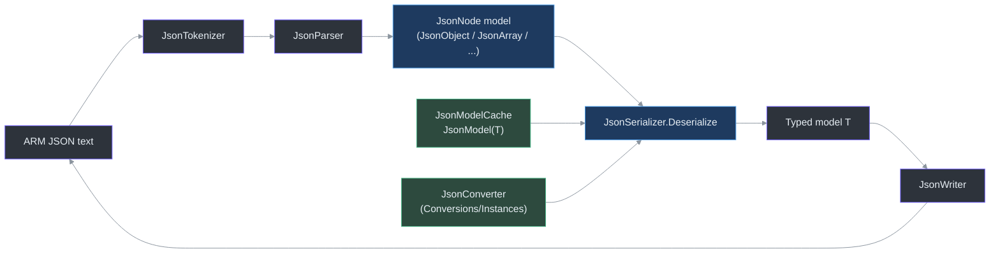

# Extension System

## Overview — why extensions

Azclips ships a small self-contained host (`az`) and delivers essentially all of its command
surface as **extensions** — independently versioned .NET class libraries loaded at runtime. This
keeps the host binary lean, lets Azure service teams ship their own command modules on their own
cadence, and allows multiple versions of an extension to coexist on one machine. The same extension
assemblies are consumed by two host surfaces, the CLI and the PowerShell modules
(`eng-docs/spec/extension-framework.md`).

An extension is anything that provides three things (`eng-docs/spec/extension-framework.md`):

- an **`IExtensionIndex`** — the command registry that maps a command name + client surface to
  metadata (`src/Core/Core.Abstractions/IExtensionIndex.cs:10`);
- one or more **`IProcessor`** classes — the actual command implementations
  (`src/Core/Core.Abstractions/CLIContracts.cs:11`);
- a build that produces a loadable, dependency-carrying `.nupkg` / DLL.

This page traces the four moving parts end to end: **(1)** anatomy of an extension, **(2)**
discovery & loading, **(3)** the extension-management commands, and **(4)** the `ExtensionRuntime`
serialization framework. For generation-time concerns, see
[TypeSpec Code Generation](./typespec-code-generation.md); the ACE compiler is not part
of runtime extension dispatch.



## 1. Anatomy of an extension

### The command registry: `IExtensionIndex`

`IExtensionIndex` is the contract every extension implements to declare its commands
(`src/Core/Core.Abstractions/IExtensionIndex.cs:10`). Its members are keyed by `ClientType` (CLI vs
PowerShell) so a single index serves both surfaces:

| Member                                 | Role                                                        | Source                  |
| -------------------------------------- | ----------------------------------------------------------- | ----------------------- |
| `GetCommandMetadata(name, clientType)` | Resolve one command's metadata                              | `IExtensionIndex.cs:12` |
| `GetCommandTable(clientType)`          | The full keyed command table for a surface                  | `IExtensionIndex.cs:18` |
| `GetAllCommands(clientType)`           | Enumerate commands (help system)                            | `IExtensionIndex.cs:24` |
| `GetCommandKeys(clientType)`           | Leaf keys (e.g. `"vm create"`) used at `extension add` time | `IExtensionIndex.cs:33` |
| `GetVerbs()`                           | Top-level verbs the extension contributes                   | `IExtensionIndex.cs:42` |

A concrete index is just a set of static `CommandMetadata` records wired into a per-surface table.
The built-in **Extension** module's own index is a good reference implementation
(`src/Extensions/Extension/ExtensionIndex.cs:9`): it declares one `CommandMetadata` per command
(`src/Extensions/Extension/ExtensionIndex.cs:12`) and assembles them into a full-path CLI table
keyed by `"extension add"`, `"extension list"`, … (`src/Extensions/Extension/ExtensionIndex.cs:121`).
Lookup simply switches on `ClientType` and indexes the table
(`src/Extensions/Extension/ExtensionIndex.cs:132`), while `GetVerbs()` returns `["extension"]`
(`src/Extensions/Extension/ExtensionIndex.cs:169`). The `[ExtensionVerb("extension")]` attribute on
the class declares its top-level verb to the host.

### The command implementations: `IProcessor`

Commands are `IProcessor` implementations with just two methods
(`src/Core/Core.Abstractions/CLIContracts.cs:11`):

```csharp
public interface IProcessor
{
    Task ProcessAsync();
    IProcessor Init(ProcessorContext context);
}
```

`Init(context)` injects the per-invocation `ProcessorContext` (HTTP pipeline, event publisher,
auth handler, output handler, resolved profile); `ProcessAsync()` runs the command. Parameters are
declared with `[ArgumentInfo(...)]` attributes on public properties
(`src/Core/Core.Abstractions/CLIContracts.cs:24`) and mirror the `ParameterMetadata` entries in the
index. For example `AddExtensionProcessor` declares `--name`, `--version`, `--feed-url`, `--path`,
`--pin`, `--force` as `[ArgumentInfo]` properties (`src/Extensions/Extension/Add.cs:11`) that
exactly match the `s_addExtension_CLI` metadata in the index
(`src/Extensions/Extension/ExtensionIndex.cs:12`). Richer service extensions add **Orchestrators**
that compose multiple processors (see `src/Extensions/Resources/` and `src/Extensions/Compute/`).

## 2. Discovery & loading

### Routing model: verbs, leaves, and the discovery-driven registry

Routing is `{(verb, path) → packageId}` with O(1) lookup; a top-level verb is a _shared namespace_
and each full `(verb, path)` leaf is owned by exactly one extension
(`eng-docs/spec/extension-management.md`). The runtime keeps no static verb seed — every leaf
comes from discovery. `CliExtensionServiceRegistration.BuildLeafIndexWithDiscovery` uses
`ExtensionRoutingDiscovery` to enumerate both loaders without loading their assemblies, reads
each adjacent `<PackageId>.commands.json`, and projects its verbs and leaf keys into an
`ExtensionRegistry`. Missing, unreadable, invalid, or version-incompatible sidecars trigger
DLL-based index discovery only for the affected extension. Empty contracts remain valid.
The selected extension is loaded for execution after dispatch; detailed help and completions
retain full engine discovery. With `--debug`, discovery reports major stages, fallback reasons,
and a timing table separating sidecar reads from DLL fallbacks. The
on-disk `registry.json` under `~/.azclips/extensions/` (`src/Core/Core.Abstractions/HomePaths.cs:14`)
layers preferences (pin state, source, installedAt) on top; leaves themselves come from discovery.
When the same package id appears in both tiers, `ExtensionCandidateSelector` picks the winner (pin
first, then highest version, then a deterministic tiebreak).

### Dispatch: `ExtensionDispatcher.Parse`

`ExtensionDispatcher.Parse` turns raw `args` into a `CommandInvocation`
(`src/CLI/Parser/ExtensionDispatcher.cs:44`). Its DI-injected constructor builds a `LeafIndex` from
the discovery-driven registry (`src/CLI/CliExtensionServiceRegistration.cs`). Resolution
proceeds in stages:

1. **Help / version handled upstream** — `GlobalArgParser.Parse` classifies bare `az`, `az --help`,
   `az help <group>`, `az <group> … --help`, `az version`, and `az --version` into `GlobalArgs.Help` /
   `GlobalArgs.Version` before `ExtensionDispatcher.Parse` runs; `Program.Main` dispatches them
   directly through `RuntimeHelpDispatcher` / `RuntimeVersionDispatcher`. Bare `az` additionally
   triggers the welcome banner in `Program.Main`. The dispatcher itself only sees real
   extension-routing invocations.
2. **Longest-prefix leaf match** — the leading non-flag tokens after the verb are matched against
   the `LeafIndex` from the longest prefix down; the first hit wins and yields a `ResolvedExtension`
   (`src/CLI/Parser/ExtensionDispatcher.cs:71`).
3. **Verb-only fallback** — if no leaf matches, the `IExtensionResolver` resolves the bare verb
   (`src/CLI/Parser/ExtensionDispatcher.cs:85`). If even that misses, a hint table can raise
   `ExtensionNotInstalledException` (suggesting the package to install), otherwise a generic
   `KeyNotFoundException` lets the orchestrator hand off to the AI fallback
   (`src/CLI/Parser/ExtensionDispatcher.cs:90`).
4. **Prefix strip + parse** — the known package prefix is stripped (the loader re-prepends it) and
   the remaining args are parsed into a `CommandInvocation` carrying the extension name and
   command name (`src/CLI/Parser/ExtensionDispatcher.cs:104`, `:134`).

### Assembly loading: chain of loaders + isolated ALCs

Once dispatch names an extension, `CLIAssemblyLoadingProvider` loads its assembly by trying each
registered `IExtensionLoader` in order and taking the first non-null result
(`src/CLI/AssemblyLoading/CLIAssemblyLoadingProvider.cs:11`). Two loaders are registered at startup,
in priority order (`src/CLI/Program.cs:56`):

```csharp
services.AddSingleton<IExtensionLoader, BundledExtensionLoader>();       // Program.cs:58
services.AddSingleton<IExtensionLoader, InstalledExtensionLoader>();     // Program.cs:59
```

| Loader                     | Layout it understands                       | Version selection                                           | Source                                           |
| -------------------------- | ------------------------------------------- | ----------------------------------------------------------- | ------------------------------------------------ |
| `BundledExtensionLoader`   | Flat extension folders next to the host     | Single version                                              | `src/CLI/AssemblyLoading/ExtensionLoader.cs:52`  |
| `InstalledExtensionLoader` | `…/<package>/<version>/` version subfolders | Exact version if requested, else **highest `NuGetVersion`** | `src/CLI/AssemblyLoading/ExtensionLoader.cs:358` |

Both loaders isolate each extension in its own `AssemblyLoadContext` (ALC). The ALC's `Load`
override deliberately **returns `null` for `Core.*` and `Microsoft.Extensions.DependencyInjection`
assemblies** so those shared contracts come from the host rather than the extension's own copy —
this is what lets a processor's `ProcessorContext` be the _same_ type the host created
(`src/CLI/AssemblyLoading/ExtensionLoader.cs:71`, `:377`). Managed assemblies are read into memory
and loaded via `LoadFromStream`, so the on-disk DLL is not locked
(`src/CLI/AssemblyLoading/ExtensionLoader.cs:62`).

`InstalledExtensionLoader.ResolveExtensionDirectory` walks candidate package-folder names under
the configured installed extensions root, and when no exact version is requested it parses each version
subfolder name as a `NuGetVersion` and selects the highest
(`src/CLI/AssemblyLoading/ExtensionLoader.cs:419`). Loaded `(context, assembly)` pairs are memoised
in a static `ConcurrentDictionary` so repeated invocations in a long-running host reuse the same ALC
(`src/CLI/AssemblyLoading/ExtensionLoader.cs:360`, load entry point at `:480`).

### Index caching: `LFUCache` in the Engine

Building an extension's `IExtensionIndex` has a cost, so the Engine caches resolved indices in an
`LFUCache` keyed by `name` (and version, when present)
(`src/Core/Core.Engine/Engine.cs:81`). The cache is created lazily with a configurable size
(`Engine.ExtensionIndexCacheSize`) and stores `Lazy<IExtensionIndex>` so concurrent misses build the
index exactly once (`src/Core/Core.Engine/Engine.cs:83`). The backing structure is a
least-frequently-used eviction cache (`src/Core/Core.Engine/utils/LFUCache.cs`).



## 3. Extension management commands

The built-in **Extension** module (`src/Extensions/Extension/`) implements the full lifecycle CRUD
surface. Each verb is a processor paired with its `CommandMetadata` in `ExtensionIndex`, and each has
help authored under `src/CLI/Help/Docs/extension/`:

| Command                   | Processor file | Purpose                                                                                 |
| ------------------------- | -------------- | --------------------------------------------------------------------------------------- |
| `extension add`           | `Add.cs`       | Install from a NuGet feed (`--name`) or a local `.nupkg` (`--path`), optionally `--pin` |
| `extension list`          | `List.cs`      | List installed extensions (optionally regrouped `--by-verb`)                            |
| `extension show`          | `Show.cs`      | Show one extension's details                                                            |
| `extension remove`        | `Remove.cs`    | Uninstall an extension                                                                  |
| `extension update`        | `Update.cs`    | Update to a newer version (skips pinned unless forced)                                  |
| `extension pin` / `unpin` | `Pin.cs`       | Pin/unpin a version so `update` skips it                                                |

The install workhorse is `ExtensionInstaller`, which uses the official NuGet client APIs to fetch and
extract packages (`src/Extensions/Extension/ExtensionInstaller.cs:19`). It defaults its install path
to `HomePaths.GetDefaultExtensionsRoot()` (`~/.azclips/extensions/`) and targets a `.NETCoreApp`
framework matching the running runtime (`src/Extensions/Extension/ExtensionInstaller.cs:27`).
`InstallExtensionAsync` resolves the latest version when none is specified, then downloads and lays
out the package (`src/Extensions/Extension/ExtensionInstaller.cs:47`). Supporting types include
`LocalArtifactProbe` (inspecting a local `.nupkg`, `src/Extensions/Extension/LocalArtifactProbe.cs`)
and `Compatibility` (host↔extension version checks, `src/Extensions/Extension/Compatibility.cs`).

To populate `list`/`show`, `DiscoveryBackedExtensionRegistry` runs a discovery session,
groups all discovered candidates by package ID, and applies `ExtensionCandidateSelector`.
Bundled entries are included; there is no static built-in seed to exclude. Persisted pin,
source, and installation-time preferences are merged onto the selected discovered entries.
The method also retains the full candidate selections for callers that need every copy
(`src/Extensions/Extension/DiscoveryBackedExtensionRegistry.cs:10`,
`src/Extensions/Extension/DiscoveryBackedExtensionRegistry.cs:33`).

## 4. ExtensionRuntime — the (de)serialization framework

Extensions talk to ARM using JSON payloads, so `src/Extensions/ExtensionRuntime/` provides a
self-contained JSON object model + serializer that extensions use to (de)serialize ARM models
without taking a dependency on a specific system JSON stack. It is organised as:

| Area                         | Responsibility                                                                 | Representative source                                                    |
| ---------------------------- | ------------------------------------------------------------------------------ | ------------------------------------------------------------------------ |
| `Conversions/`               | Type-conversion framework (`JsonConverter<T>`, factory, per-type converters)   | `src/Extensions/ExtensionRuntime/Conversions/JsonConverter.cs:7`         |
| `Conversions/Instances/`     | Built-in converters (`Guid`, `DateTimeOffset`, `Enum`, collections, …)         | `src/Extensions/ExtensionRuntime/Conversions/Instances/GuidConverter.cs` |
| `Nodes/` & `Customizations/` | The JSON node model (`JsonObject`, `JsonArray`, `JsonString`, `JsonNumber`, …) | `src/Extensions/ExtensionRuntime/Nodes/JsonObject.cs`                    |
| `Parser/`                    | Tokenizer + parser + readers that turn text into nodes                         | `src/Extensions/ExtensionRuntime/Parser/JsonParser.cs`                   |
| `Writers/`                   | Serialize nodes back to JSON text                                              | `src/Extensions/ExtensionRuntime/Writers/JsonWriter.cs`                  |
| `Serialization/` & `Models/` | Contract-driven object (de)serialization + model cache                         | `src/Extensions/ExtensionRuntime/Serialization/JsonSerializer.cs:19`     |

The conversion framework is anchored by the abstract, generic `JsonConverter<T>` which bridges a
strongly-typed converter to the non-generic `IJsonConverter` interface
(`src/Extensions/ExtensionRuntime/Conversions/JsonConverter.cs:7`). Object (de)serialization is
contract-driven: `JsonSerializer.Deserialize<T>` looks up a cached `JsonModel` for the target type
from `JsonModelCache`, then maps each JSON field to a member, guarding against runaway recursion with
a depth cap (`src/Extensions/ExtensionRuntime/Serialization/JsonSerializer.cs:19`). The `JsonModel`
cache (`src/Extensions/ExtensionRuntime/Models/JsonModelCache.cs`) means reflection over a model
type happens once and is reused across payloads — the same "build once, reuse" principle the Engine
applies to extension indices.



## Key design invariants

- **Shared contracts come from the host, not the extension.** ALCs refuse to load `Core.*`, so
  extension and host agree on `IProcessor`/`ProcessorContext` identity
  (`src/CLI/AssemblyLoading/ExtensionLoader.cs:42`).
- **Dispatch is uniform.** Every verb — `login`, `vm`, `group` — takes the same discovery-driven
  code path. There is no compile-time "Core tier" that outranks discovered state.
- **Leaf ownership is exclusive.** Many extensions may share a verb namespace, but each `(verb, path)`
  leaf is owned by one package (`eng-docs/spec/extension-management.md`).
- **Everything expensive is cached once.** Extension indices via `LFUCache`
  (`src/Core/Core.Engine/Engine.cs:81`); loaded ALCs via a static dictionary
  (`src/CLI/AssemblyLoading/ExtensionLoader.cs:199`); reflection models via `JsonModelCache`.

## References

- `src/Core/Core.Abstractions/IExtensionIndex.cs:10` — the command-registry contract
- `src/Core/Core.Abstractions/CLIContracts.cs:11` — the `IProcessor` contract + `[ArgumentInfo]`
- `src/Extensions/Extension/ExtensionIndex.cs:121` — a concrete CLI command table
- `src/CLI/Parser/ExtensionDispatcher.cs:44` — arg → `CommandInvocation` dispatch
- `src/CLI/CliExtensionServiceRegistration.cs` — discovery-driven leaf index build
- `src/CLI/Program.cs:58` — loader registration order (`BundledExtensionLoader`, `InstalledExtensionLoader`)
- `src/CLI/AssemblyLoading/ExtensionLoader.cs:358` — installed extensions loader + isolated ALCs
- `src/CLI/AssemblyLoading/CLIAssemblyLoadingProvider.cs:11` — chain-of-loaders resolution
- `src/Core/Core.Engine/Engine.cs:81` — `LFUCache` of extension indices
- `src/Extensions/Extension/ExtensionInstaller.cs:47` — NuGet-based install
- `src/Extensions/Extension/DiscoveryBackedExtensionRegistry.cs:14` — discovery-backed registry
- `src/Extensions/ExtensionRuntime/Conversions/JsonConverter.cs:7` — converter framework
- `src/Extensions/ExtensionRuntime/Serialization/JsonSerializer.cs:19` — contract-driven (de)serialization
- `eng-docs/spec/extension-framework.md` — extension loading, ALC isolation, processor contract
- `eng-docs/spec/extension-management.md` — registry, routing, and lifecycle model
