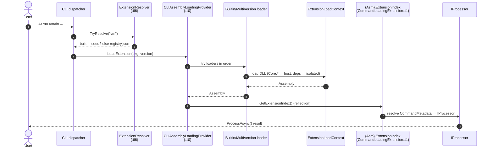
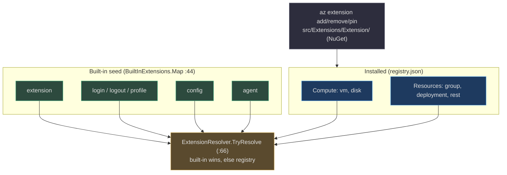

# Extension System

## Why Everything Is an Extension

Azclips keeps its core tiny and pushes all real command surface — `vm`, `group`, `config`, `login`, `agent` — into **extensions**: DLLs that declare top-level verbs and map them to `IProcessor` implementations. This buys two things. First, the `az` binary can ship "lean" (a few built-ins) or "full," and users can `az extension add` more without rebuilding the host. Second, extensions load in **isolated `AssemblyLoadContext`s** that share the host's `Core.*` types but keep their own private dependencies apart — so two extensions can depend on different versions of the same NuGet package without colliding.

There are **6** built-in extensions in the tree today — `Compute`, `Config`, `Extension`, `ExtensionRuntime`, `Login`, `Resources` (`azclips.slnx:18-25`). This page traces how one goes from a verb on the command line to a loaded processor. The code is in `Azure/cirrus` under the `Azclips` identity.

## Anatomy of an Extension

Every extension ships a class named `ExtensionIndex` implementing `IExtensionIndex` (`src/Core/Core.Abstractions/IExtensionIndex.cs:10`), decorated with one or more `[ExtensionVerb(...)]` attributes (`src/Core/Core.Abstractions/ExtensionVerbAttribute.cs:29`, `AllowMultiple = true`). The index maps command names to `CommandMetadata` (which points at the `IProcessor` type) per client surface.

```csharp
[ExtensionVerb("vm")]
[ExtensionVerb("disk")]
public class ExtensionIndex : IExtensionIndex   // src/Extensions/Compute/ExtensionIndex.cs:11-13
```

| Concept | Contract | Example |
| --- | --- | --- |
| Verb declaration | `[ExtensionVerb("vm")]` | `src/Extensions/Compute/ExtensionIndex.cs:11` |
| Command table | `IExtensionIndex.GetCommandTable(clientType)` | `src/Core/Core.Abstractions/IExtensionIndex.cs:18` |
| Command → processor | `CommandMetadata.ProcessorType : IProcessor` | `src/Extensions/Compute/ExtensionIndex.cs:22` |
| Shared command base | `ConfigCommandBase : IProcessor` (Get/Set/List/Delete/Info config) | `src/Extensions/Config/Commands/ConfigCommandBase.cs:15` |

The `Agent.Commands` project is itself an extension: `[ExtensionVerb("agent")]` on `Agent/Commands/ExtensionIndex.cs:11` re-exposes the internal agent tools as first-class `az agent tool ...` commands.

## Resolution: Built-in Seed Wins, Then Registry

When you type `az <verb> ...`, `ExtensionResolver.TryResolve` (`src/Core/Core.Extensions/ExtensionResolver.cs:66`) decides which package owns the verb, consulting two sources in strict order:

1. **Built-in seed** — `BuiltInExtensions.Map` (`src/Core/Core.Extensions/BuiltInExtensions.cs:44`) always wins on conflict. It maps `extension`, `login`, `logout`, `profile`, `config`, and `agent` to their host-shipped packages (`src/Core/Core.Extensions/BuiltInExtensions.cs:48-65`).
2. **On-disk registry** — otherwise it scans `registry.json` under `~/.azclips/extensions/` for an installed extension claiming the verb (`src/Core/Core.Extensions/ExtensionResolver.cs:84-101`).

The registry document (`src/Core/Core.Extensions/ExtensionRegistry.cs:20`) records each installed package's version, pinned flag, and contributed leaves; `ExtensionRegistryEntry` (`src/Core/Core.Extensions/ExtensionRegistry.cs:67`) tolerates a legacy v1 shape (single `verb` field) and migrates it to the v2 `(verb, path)` contribution model (`CurrentSchemaVersion = 2`, `src/Core/Core.Extensions/ExtensionRegistry.cs:42`). It is persisted by `FileExtensionRegistryStore` (`src/Core/Core.Extensions/FileExtensionRegistryStore.cs`); built-ins are never written to it — they are merged from the static seed at startup.

## Loading: Isolated but Sharing the Host

Once resolved, the verb's package is loaded through the engine's assembly-loading seam. `Engine.OpenExecutionSession` binds `session.LoadAssembly = assemblyLoadingService.LoadExtension` (`src/Core/Core.Engine/Engine.cs:54`), which delegates to the client's provider.

For the CLI that provider is `CLIAssemblyLoadingProvider` (`src/CLI/AssemblyLoading/CLIAssemblyLoadingProvider.cs:10`), which tries each registered `IExtensionLoader` in order and returns the first non-null assembly (`src/CLI/AssemblyLoading/CLIAssemblyLoadingProvider.cs:15-22`):

| Loader | Loads from | Isolation | Source |
| --- | --- | --- | --- |
| `BuiltinExtensionLoader` | Host install / artifact dir | Custom `ExtensionLoadContext` (ALC) | `src/CLI/AssemblyLoading/ExtensionLoader.cs:28` |
| `MultiVersionExtensionLoader` | `~/.azclips/extensions/<pkg>/<version>/` | Process-wide ALC cache `s_cache` | `src/CLI/AssemblyLoading/ExtensionLoader.cs:266` |

The isolation trick is in the ALC's `Load` override: it **returns `null` for `Core.*` and `Microsoft.Extensions.DependencyInjection`** (`src/CLI/AssemblyLoading/ExtensionLoader.cs:44-58`), so those resolve from the host and every extension shares the *same* `IProcessor`, DI, and abstraction types — while an `AssemblyDependencyResolver` loads the extension's private deps in isolation. Package names follow the `Microsoft.Azure.Azclips.Extensions.` prefix convention (`src/CLI/AssemblyLoading/Constants.cs:8`).

Finally, `CommandLoadingExtension.GetExtensionIndex` (`src/Core/Core.Runtime/CommandLoadingExtension.cs:11`) reflects the `{AssemblyName}.ExtensionIndex` type out of the loaded assembly and instantiates it — the convention that ties the whole system together.



## Built-in vs. Installable



The `extension` verb itself is an extension (`src/Extensions/Extension/`): `Add.cs`, `Remove.cs`, `List.cs`, `Show.cs`, `Pin.cs`, `Update.cs`, backed by `ExtensionInstaller` (`src/Extensions/Extension/ExtensionInstaller.cs:19`), which resolves and extracts packages into `~/.azclips/extensions/` using **official NuGet.Protocol APIs** (`src/Extensions/Extension/ExtensionInstaller.cs:30`).

## Compatibility Guarding

Each extension declares a supported host range via `[assembly: AzclipsCompatibility(MinCoreVersion = "1.0.0")]` (e.g. `src/Extensions/Compute/Compatibility.cs:9`). `CompatibilityGuard` (`src/Core/Core.Extensions/CompatibilityGuard.cs:38`) enforces it at two sites: **install** (hard fail) and **load** (warn-and-skip). It reads the attribute via a `MetadataLoadContext` — no extension code runs during validation — which matters for installing untrusted packages.

## Supporting Cast

| Component | Role | Source |
| --- | --- | --- |
| `ExtensionCandidateSelector` | Picks among installed versions | `src/Core/Core.Extensions/ExtensionCandidateSelector.cs` |
| `ExtensionAddPlanner` | Plans an `extension add` (conflict detection) | `src/Core/Core.Extensions/ExtensionAddPlanner.cs` |
| `LeafIndex` / `LeafReader` / `ExtensionVerbReader` | Metadata plumbing (verb/leaf discovery without executing code) | `src/Core/Core.Extensions/` |
| `ExtensionRuntime` | JSON serialization / type-conversion layer extensions use for ARM payloads | `src/Extensions/ExtensionRuntime/` |

## References

- `src/Core/Core.Abstractions/IExtensionIndex.cs:10` — the per-extension index contract
- `src/Core/Core.Abstractions/ExtensionVerbAttribute.cs:29` — `[ExtensionVerb]` (multiple allowed)
- `src/Extensions/Compute/ExtensionIndex.cs:11` — concrete index declaring `vm`/`disk`
- `src/Extensions/Config/Commands/ConfigCommandBase.cs:15` — shared `IProcessor` base
- `Agent/Commands/ExtensionIndex.cs:11` — `agent` verb extension
- `src/Core/Core.Extensions/ExtensionResolver.cs:66` — verb → package resolution
- `src/Core/Core.Extensions/BuiltInExtensions.cs:44` — built-in seed map
- `src/Core/Core.Extensions/ExtensionRegistry.cs:20,67` — `registry.json` model
- `src/Core/Core.Extensions/CompatibilityGuard.cs:38` — compatibility enforcement
- `src/CLI/AssemblyLoading/CLIAssemblyLoadingProvider.cs:10` — loader provider
- `src/CLI/AssemblyLoading/ExtensionLoader.cs:28,44,266` — ALC isolation + multi-version cache
- `src/CLI/AssemblyLoading/Constants.cs:8` — package prefix convention
- `src/Core/Core.Runtime/CommandLoadingExtension.cs:11` — reflect `{Asm}.ExtensionIndex`
- `src/Extensions/Extension/ExtensionInstaller.cs:19` — NuGet-based install
