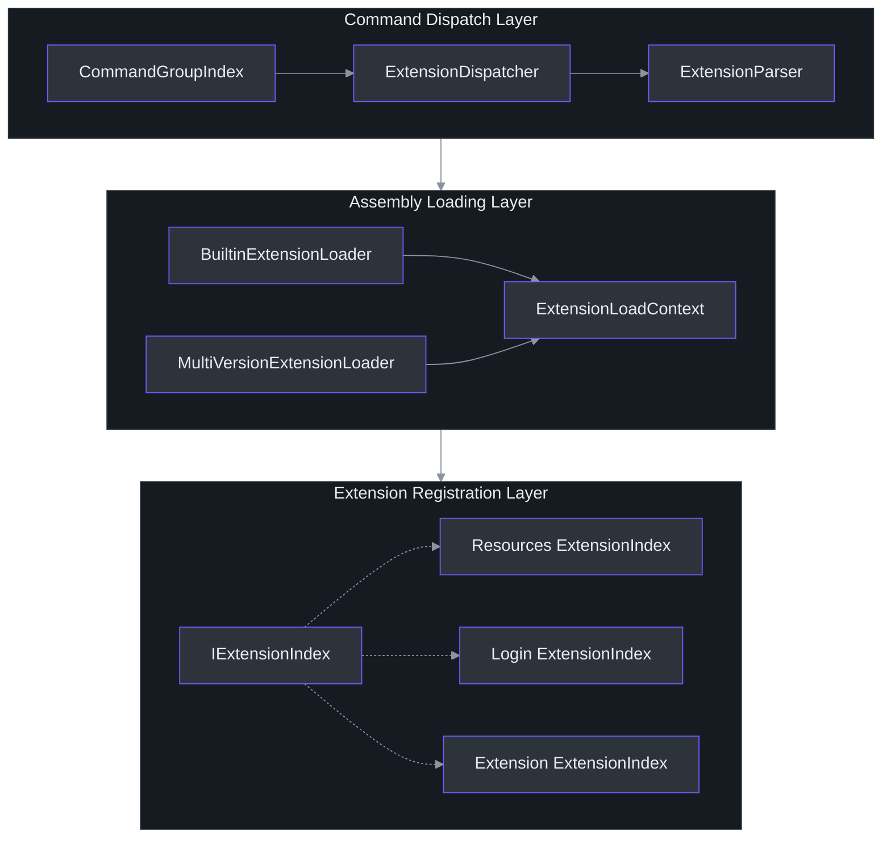

# Extension System & Dynamic Loading

Cirrus uses a plugin-based extension architecture where each functional domain (resource groups, login, extension management) ships as an independently loadable assembly. Extensions are discovered at runtime, loaded into isolated `AssemblyLoadContext` instances, and wired into the command dispatch pipeline. This design enables side-by-side versioning, user-installed extensions from NuGet, and hot-reloading without restarting the host process.

## Architecture Overview

The extension system spans three layers: **dispatch** (routing commands to extensions), **loading** (finding and loading assemblies), and **registration** (mapping command names to types inside each extension).



## IExtensionIndex Interface

Every extension must expose an `IExtensionIndex` implementation (`src/Core/Core.Abstractions/IExtensionIndex.cs:7-16`):

```csharp
public interface IExtensionIndex
{
    ICommandMetadata GetCommandMetaData(string name, ClientType clientType);
    IEnumerable<ICommandMetadata> GetAllCommands(ClientType clientType);
}
```

This interface serves as the extension's manifest. When an engine loads an extension, it instantiates the `ExtensionIndex` class and calls `GetCommandMetaData` to resolve a specific command or `GetAllCommands` to enumerate all available commands for a given `ClientType`.

Each extension maintains separate command dictionaries for CLI and PowerShell (`src/Extensions/Resources/ExtensionIndex.cs:10-11`):

```csharp
private IDictionary<string, ICommandMetadata> _psTable;
private IDictionary<string, ICommandMetadata> _cliTable;
```

The `IModule` interface (`src/Core/Core.Abstractions/IModule.cs:3-5`) is a simpler variant used by the `CommandBinder` path:

```csharp
public interface IModule
{
    IEnumerable<ICommand> GetCommands();
}
```

And `ICommand` (`src/Core/Core.Abstractions/ICommand.cs:3-11`) defines the execution contract:

```csharp
public interface ICommand
{
    Task ExecuteAsync(IServiceProvider serviceProvider,
        IDictionary<string, string> options,
        CancellationToken cancellationToken = default);
}
```

## Extension Loaders

Two loader implementations provide different strategies for locating extension assemblies (`src/Core/Core.Engine/ExtensionLoader.cs:8-11`):

```csharp
public interface IExtensionLoader
{
    Assembly? LoadExtension(string extensionFolderName,
        string extensionName, string? version = null);
}
```

### BuiltinExtensionLoader

`BuiltinExtensionLoader` (`src/Core/Core.Engine/ExtensionLoader.cs:13-64`) loads extensions bundled alongside the CLI binary. It constructs the DLL path as `{extensionsDir}/{extensionFolderName}/{extensionName}.dll` (line 55) and returns `null` if a specific version is requested (line 51-54) — version-pinned extensions must go through the multi-version loader.

### MultiVersionExtensionLoader

`MultiVersionExtensionLoader` (`src/Core/Core.Engine/ExtensionLoader.cs:66-137`) handles user-installed extensions with semantic versioning. When no version is specified, it scans the extension directory for subdirectories, parses each as a `NuGetVersion`, and selects the highest version (lines 114-119):

```csharp
NuGetVersion.TryParse(dir, out var nugetVersion)
```

This enables side-by-side installation of multiple extension versions.

### Assembly Load Contexts & Isolation

Both loaders create isolated `ExtensionLoadContext` instances inheriting from `AssemblyLoadContext` (`src/Core/Core.Engine/ExtensionLoader.cs:15-45`, `68-87`). These contexts prevent extension dependencies from conflicting with the host:

- **Builtin context** — uses `AssemblyDependencyResolver` (line 17) to resolve dependencies from the extension's directory. Assemblies starting with `Core.` or `Microsoft.Extensions.DependencyInjection` are skipped (lines 22-26), allowing the extension to share the host's core types.
- **Multi-version context** — resolves from the extension's versioned directory, with the same skip-list pattern for shared contracts (line 73-86).

The skip-list is critical: without it, each extension would load its own copy of `Core.Abstractions`, making cross-boundary `IExtensionIndex` casts fail due to type identity mismatches.

## Command Dispatch Pipeline

### CommandGroupIndex

`CommandGroupIndex` (`src/CLI/Parser/CommandGroupIndex.cs:12-31`) is a static registry mapping user-facing command group names to extension names:

```csharp
static CommandGroupIndex()
{
    _commandGroups["Group"] = "Resources";       // line 17
    _commandGroups["Login"] = "Login";           // line 18
    _commandGroups["Extension"] = "Extension";   // line 19
}
```

The `getExtensionNameByCommandGroupName` method (lines 22-29) performs a dictionary lookup and throws `KeyNotFoundException` for unregistered groups.

### ExtensionDispatcher

`ExtensionDispatcher` (`src/CLI/Parser/ExtensionDispatcher.cs:7-78`) parses raw CLI args into a structured `CLICommandInvocation`:

1. Check for empty args → throw `ArgumentException` (line 34)
2. Check for help flags (`--help`, `-h`) → throw `DispatchHelpException` (line 36)
3. Resolve the extension name via `CommandGroupIndex.getExtensionNameByCommandGroupName()` (line 37)
4. Create an `ExtensionParser` and parse the remaining args (lines 42-43)
5. Return a `CLICommandInvocation` with extension name, command name, and parameters (line 44)

The dispatcher also has its own `ExtensionLoadContext` inner class (lines 9-26) that skips `SharedContracts` and `Core.SharedContracts` assemblies during loading (line 15).

```mermaid
sequenceDiagram
    autonumber
    participant User
    participant Dispatcher as ExtensionDispatcher
    participant Index as CommandGroupIndex
    participant Parser as ExtensionParser
    participant Loader as IExtensionLoader
    participant Context as ExtensionLoadContext
    participant ExtIdx as IExtensionIndex
    participant Engine as CLIEngine

    User->>Engine: Process("group create --name test")
    Engine->>Dispatcher: Parse(args)
    Dispatcher->>Index: getExtensionNameByCommandGroupName("Group")
    Index-->>Dispatcher: "Resources"
    Dispatcher->>Parser: Parse(remaining args)
    Parser-->>Dispatcher: CLICommandInvocation

    Engine->>Loader: LoadExtension("Resources", extensionName)
    Loader->>Context: new ExtensionLoadContext(path)
    Context->>Context: LoadFromAssemblyPath(dll)
    Context-->>Loader: Assembly

    Engine->>ExtIdx: GetCommandMetaData("create", CLI)
    ExtIdx-->>Engine: ICommandMetadata
    Engine->>Engine: Activator.CreateInstance(CommandType)
    Engine->>Engine: Set properties via reflection
    Engine->>Engine: command.ProcessAsync()

    style User fill:#2d333b,stroke:#6d5dfc,color:#e6edf3
    style Dispatcher fill:#2d333b,stroke:#6d5dfc,color:#e6edf3
    style Index fill:#2d333b,stroke:#6d5dfc,color:#e6edf3
    style Parser fill:#2d333b,stroke:#6d5dfc,color:#e6edf3
    style Loader fill:#2d333b,stroke:#6d5dfc,color:#e6edf3
    style Context fill:#2d333b,stroke:#6d5dfc,color:#e6edf3
    style ExtIdx fill:#2d333b,stroke:#6d5dfc,color:#e6edf3
    style Engine fill:#2d333b,stroke:#6d5dfc,color:#e6edf3
```

## Extension Registration: How Extensions Declare Commands

Each extension's `ExtensionIndex` constructor populates command tables mapping string names to `ICommandMetadata` instances. The pattern is consistent across all extensions:

### Resources Extension

`src/Extensions/Resources/ExtensionIndex.cs:8-84` registers commands for both CLI and PowerShell:

**PowerShell table** (lines 15-32):
- `"New-ResourceGroup"` → `CreateResourceGroupCommand`
- `"Get-ResourceGroup_Get"` → Get by name
- `"Get-ResourceGroup_List"` → List all

**CLI table** (lines 33-50):
- `"create"` → `CreateResourceGroupCommand`
- `"list"` → List command
- `"get"` → Get command

### Login Extension

`src/Extensions/Login/ExtensionIndex.cs:8-85` provides authentication commands:

**PowerShell table** (lines 15-32):
- `"Connect-CirrusAccount"` → `LoginCommand`
- `"Disconnect-CirrusAccount"` → `LogoutCommand`
- `"Get-CirrusAccount"` → Show account

**CLI table** (lines 34-51):
- `""` (empty string for bare `login`) → `LoginCommand`
- `"logout"` → `LogoutCommand`
- `"show"` → Show account

### Extension Manager Extension

`src/Extensions/Extension/ExtensionIndex.cs:5-49` handles extension installation:

**CLI only** (lines 12-17):
- `"add"` → `AddExtensionCommand`

The `GetCommandMetaData` method uses a `switch` on `ClientType` to select the appropriate table (e.g., `src/Extensions/Resources/ExtensionIndex.cs:53-73`).

## Extension Installation via NuGet

`ExtensionInstaller` (`src/Extensions/Extension/ExtensionInstaller.cs:16-298`) enables users to install extensions from NuGet feeds at runtime.

### Installation Flow

The `InstallExtensionAsync` method (lines 46-68) orchestrates:

1. **Resolve sources** — `GetSourceRepositories()` returns configured NuGet feeds, or falls back to default repositories (`src/Extensions/Extension/ExtensionInstaller.cs:132-141`)
2. **Version resolution** — if no version specified, `GetLatestVersionAsync()` queries all repositories and selects the highest version via `OrderByDescending` (lines 166-200)
3. **Folder setup** — `InitializeExtensionFolder()` creates `{InstallPath}/{packageId}/{version}/` and deletes any existing version (lines 101-126)
4. **Package extraction** — `ExtractPackageAssembliesAsync()` first checks the NuGet global packages folder, then downloads from remote feeds (lines 205-250)
5. **DLL extraction** — `ExtractLibItemsAsync()` finds the nearest matching target framework using `NuGetFrameworkUtility` and extracts only `.dll` files (lines 255-297, filter on line 281)

### Default Paths

The default install path (`src/Extensions/Extension/ExtensionInstaller.cs:27-29`):
```
{Environment.SpecialFolder.UserProfile}/.cirrus/extensions
```

The target framework is detected from the current runtime version (line 31), ensuring extensions match the running .NET version.

## CLIEngine Extension Loading

`CLIEngine.GetCommand()` (`src/Core/Core.Engine/CLIEngine.cs:52-109`) demonstrates the complete load-to-execute flow:

1. Validate extension name against the `_prefix` (`"Microsoft.Azure.Cirrus.Extensions."`, line 32)
2. Build extension folder name from the short name (line 55)
3. Create loader array: `[MultiVersionExtensionLoader, BuiltinExtensionLoader]` (lines 58-62) — versioned extensions take priority
4. Attempt load through each loader sequentially (line 63)
5. Locate `ExtensionIndex` type in the loaded assembly (lines 65-66)
6. Instantiate via reflection with exception handling (lines 68-79)
7. Retrieve `ICommandMetadata` for the requested command (line 81)
8. Create command instance via `Activator.CreateInstance(metadata.CommandType)` (line 83)
9. Set properties via reflection using `PropertyParser` (lines 85-106)

## PSEngine Extension Caching

`PSEngine` (`src/Core/Core.Engine/PSEngine.cs:21`) adds a performance optimization: an LFU (Least Frequently Used) cache of extension indices (line 26):

```csharp
private readonly LFUCache<Lazy<IExtensionIndex>> _extensionIndices = new(512);
```

The `GetCommand` method (lines 154-178) wraps index creation in a `Lazy<IExtensionIndex>` and caches it by extension name. This avoids reloading assemblies on every cmdlet invocation in a long-running PowerShell session.

## Creating a New Extension

Follow these steps to add a new extension to Cirrus:

### Step 1: Create the Project

Create a new class library under `src/Extensions/{YourExtension}/`:
```
src/Extensions/YourExtension/
├── YourExtension.csproj
├── ExtensionIndex.cs
├── Commands/
│   └── YourCommand.cs
└── Business/
    └── YourService.cs
```

### Step 2: Implement IExtensionIndex

Model after `src/Extensions/Resources/ExtensionIndex.cs`:
```csharp
public class ExtensionIndex : IExtensionIndex
{
    private IDictionary<string, ICommandMetadata> _cliTable;

    public ExtensionIndex()
    {
        _cliTable = new Dictionary<string, ICommandMetadata>
        {
            ["mycommand"] = new CommandMetadata("mycommand", "...",
                "YourAssembly", typeof(MyCommand))
        };
    }

    public ICommandMetadata GetCommandMetaData(string name, ClientType clientType)
        => clientType switch
        {
            ClientType.CLI => _cliTable[name],
            _ => throw new NotSupportedException()
        };
}
```

### Step 3: Register in CommandGroupIndex

Add the mapping to `src/CLI/Parser/CommandGroupIndex.cs:15-21`:
```csharp
_commandGroups["YourGroup"] = "YourExtension";
```

### Step 4: Configure ExcludeAssets

In your `.csproj`, ensure shared dependencies use `ExcludeAssets="runtime"` to avoid duplicating core assemblies:
```xml
<PackageReference Include="Core.Abstractions" ExcludeAssets="runtime" />
```

### Step 5: Build and Deploy

The extension DLL must be placed in the extensions directory (builtin or versioned) following the naming convention:
```
Microsoft.Azure.Cirrus.Extensions.{Name}.dll
```

The `CLIEngine._prefix` constant (`src/Core/Core.Engine/CLIEngine.cs:32`) enforces this naming:
```csharp
private static readonly string _prefix = "Microsoft.Azure.Cirrus.Extensions.";
```

## References

| Source File | Key Lines | Purpose |
|---|---|---|
| `src/Core/Core.Engine/ExtensionLoader.cs` | 8-137 | `IExtensionLoader`, `BuiltinExtensionLoader`, `MultiVersionExtensionLoader` |
| `src/Core/Core.Abstractions/IExtensionIndex.cs` | 7-16 | Extension manifest interface |
| `src/Core/Core.Abstractions/IModule.cs` | 3-5 | Module interface for `CommandBinder` path |
| `src/Core/Core.Abstractions/ICommand.cs` | 3-11 | Command execution contract |
| `src/CLI/Parser/CommandGroupIndex.cs` | 12-31 | Static command-group-to-extension registry |
| `src/CLI/Parser/ExtensionDispatcher.cs` | 7-78 | CLI arg parsing and extension dispatch |
| `src/Extensions/Resources/ExtensionIndex.cs` | 8-84 | Resources extension command registration |
| `src/Extensions/Login/ExtensionIndex.cs` | 8-85 | Login extension command registration |
| `src/Extensions/Extension/ExtensionIndex.cs` | 5-49 | Extension manager registration |
| `src/Extensions/Extension/ExtensionInstaller.cs` | 16-298 | NuGet-based extension installation |
| `src/Core/Core.Engine/CLIEngine.cs` | 15, 32, 52-109 | CLI extension loading and execution |
| `src/Core/Core.Engine/PSEngine.cs` | 21, 26, 154-178 | PowerShell extension caching |
