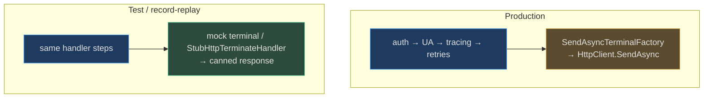

# HTTP Pipeline & Runtime

## Why the Runtime Is a Chain of Handlers

Every ARM call an extension command makes travels through **one composable chain of delegating handlers**, assembled fresh for each invocation. Rather than a monolithic `HttpClient` with baked-in policy, `Core.Runtime` models the request path as a sequence of `SendAsyncStep` delegates — each receives the request plus a `next` link, does its bit (stamp a User-Agent, inject a bearer token, publish a trace event, retry a 429), and calls `next`. The chain bottoms out at a **terminal factory** that performs the actual wire send.

This design exists for one reason above all: **the same command code must run unchanged in production, under mocking, and under record/replay tests.** The only things that change are which steps are inserted and which terminal factory sits at the bottom. This page traces how the pipeline is built, the exact runtime order of the handlers, where retry policy comes from, and how the runtime's event bus and scoped logging carry side-effects out of the chain.

The runtime lives under the `Core.Runtime` namespace of the **Azclips** codebase (`Azure/cirrus`), targeting `net10.0`.

## The Building Blocks

The pipeline is expressed with a handful of small delegate and interface types (`src/Core/Core.Abstractions/Runtime/delegates.cs`, `src/Core/Core.Abstractions/Runtime/ISendAsync.cs`):

| Type | Shape | Role | Source |
| --- | --- | --- | --- |
| `SendAsync` | `(request, callback) → Task<HttpResponseMessage>` | A fully-composed, callable pipeline | `delegates.cs:12` |
| `SendAsyncStep` | `(request, callback, next) → Task<...>` | One handler that may call `next` | `delegates.cs:13` |
| `ISendAsync` | `SendAsync(request, callback)` | A materialized link in the chain | `ISendAsync.cs:9` |
| `ISendAsyncFactory` | `Create(next) → ISendAsync` | Wraps a step around a `next` link | `ISendAsync.cs:25` |
| `ISendAsyncTerminalFactory` | `Create() → ISendAsync` | The bottom of the chain (real send or mock) | `ISendAsync.cs:17` |
| `IRuntimeHttpPipeline` | `Prepend`/`Append` + `SendAsync` | The mutable builder + entry point | `ISendAsync.cs:30` |

`HttpPipeline` (`src/Core/Core.Runtime/HttpPipeline.cs:15`) is the concrete `IRuntimeHttpPipeline`. `SendAsyncFactory` (`src/Core/Core.Runtime/SendAsyncFactory.cs:12`) turns a `SendAsyncStep` into a chain link via its nested `Sender` (`Create(next)`, `src/Core/Core.Runtime/SendAsyncFactory.cs:25`). `SendAsyncTerminalFactory` (`src/Core/Core.Runtime/SendAsyncTerminalFactory.cs:11`) wraps whatever performs the final send.

## How the Engine Assembles a Pipeline

The pipeline is not a singleton — the `Engine` builds one per invocation inside `CreateProcessorContext` (`src/Core/Core.Engine/Engine.cs:99`). Retry counts come from config (`session.Option.Http`, `src/Core/Core.Engine/Engine.cs:116-119`), the auth handler is prepended first, then User-Agent and the terminating step, and tracing is appended (`src/Core/Core.Engine/Engine.cs:126-137`):

```csharp
HttpPipeline: httpPipeline.Prepend(authHandler.SendAsync),   // Engine.cs:126
httpPipeline.Prepend(httpPipelineService.HttpAddUserAgentStep);          // :133
httpPipeline.Prepend(httpPipelineService.HttpPipelineTerminatingStep);   // :135  (passthrough by default)
httpPipeline.Append(httpPipelineService.HttpRequestMessageTracingStep);  // :137
```

`HttpPipelineService` (`src/Core/Core.Runtime/HttpPipelineService.cs:10`) simply surfaces those three steps from their handlers.

### Runtime order (this is subtle)

`Prepend` appends to an internal `steps` list; `Append` inserts at the front (`src/Core/Core.Runtime/HttpPipeline.cs:184-244`). The `Pipeline` getter then wraps them innermost-first around the terminal, so the *last* item prepended ends up **outermost** — i.e. `Prepend` means "executes earlier." The retry steps are woven in just above the terminal (`src/Core/Core.Runtime/HttpPipeline.cs:141-180`). The resulting execution order for a real ARM call is:


## The Handlers

| Handler | Behavior | Source |
| --- | --- | --- |
| Terminating step | **Passthrough** by default (`await next.SendAsync`); short-circuits only when a test swaps in a mock | `src/Core/Core.Runtime/Handler/DefaultHttpTerminateHandler.cs:15` |
| User-Agent | Default is a no-op; CLI overrides to stamp `AZURECLI/{version} azclips/private-preview` | `src/Core/Core.Runtime/Handler/DefaultUserAgentHandler.cs:12`, `src/CLI/CLIUserAgentHandler.cs:14` |
| Auth | Injects `Authorization: Bearer` **only when a `Profile` is resolved**; publishes `AuthBeforeTokenAcquisition`/`AuthAfterTokenAcquisition` | `src/Core/Core.Runtime/Handler/AuthHandler.cs:28` |
| Tracing | Publishes the request message onto the event bus for telemetry/recording | `HttpPipelineService.cs:13` |

The auth handler's token source is `AcquireTokenAsyncDefault`, wired by the engine to `IAuthService.AcquireTokenSilentlyAsync` (`src/Core/Core.Engine/Engine.cs:106`) — the single seam between authentication and the HTTP layer (see [Authentication (MSAL)](/02-deep-dive/authentication)).

## Retry Policy

Two retry steps sit closest to the wire, both reading their limits from config:

| Policy | Triggers on | Loop bound | Source |
| --- | --- | --- | --- |
| `Retry429` | HTTP 429 **with** a `Retry-After` delta; waits that delta | `core.http.maxRetriesFor429` (default 5) | `src/Core/Core.Runtime/HttpPipeline.cs:71` |
| `RetryError` | ≥ 500 (except 501/505), 408, or 429 **without** `Retry-After` | `core.http.maxRetries` (default 3) | `src/Core/Core.Runtime/HttpPipeline.cs:114` |

Both clone the request before each attempt (`CloneWithContent`) so a retried body is intact. The `Pipeline` getter builds terminal → `Retry429` → `RetryError` → other steps (`src/Core/Core.Runtime/HttpPipeline.cs:164-176`).

> **Codegen artifact worth knowing:** the getter guards the retry insertion with `if (Convert.ToBoolean(@"true"))` (`src/Core/Core.Runtime/HttpPipeline.cs:166`) — vestigial generated code that is always true. It does not affect behavior but explains the odd shape if you read the source.

## The Test Seam

Because the terminal factory is injectable, tests substitute a mock at the bottom of the chain instead of touching command code:



`SendAsyncTerminalFactory` (`src/Core/Core.Runtime/SendAsyncTerminalFactory.cs:11`) and `SendAsyncFactory` (`src/Core/Core.Runtime/SendAsyncFactory.cs:12`) are the two injection points; the terminating step's passthrough default (`DefaultHttpTerminateHandler.cs:15`) means the mock can also short-circuit mid-chain.

## Cross-Cutting Runtime Services

The pipeline emits side-effects through two runtime services rather than writing to globals:

| Service | Role | Source |
| --- | --- | --- |
| `RuntimeEventBus` | Per-session `Publish`/`Subscribe` for lifecycle events (`ProcessorContextCreated`, `AuthBeforeTokenAcquisition`, tracing) | `src/Core/Core.Runtime/RuntimeEventBus.cs:10` |
| `ScopedLoggingService` | `AsyncLocal` logger so concurrent sessions never race stdout; `UseScope` swaps the sink | `src/Core/Core.Runtime/ScopedLoggingService.cs:13,43` |
| `ConsoleOutputAdapter` | Default console output/prompt implementation | `src/Core/Core.Runtime/ConsoleOutputAdapter.cs:11` |
| `CommandLoadingExtension` | Reflects the `{AssemblyName}.ExtensionIndex` type and instantiates an `IProcessor` | `src/Core/Core.Runtime/CommandLoadingExtension.cs:11` |

`ScopedLoggingService.UseScope` (`src/Core/Core.Runtime/ScopedLoggingService.cs:43`) is exactly the hook the **agent** process replaces: it swaps the sink for a `RendererLoggingService` so Azclips-internal `Warn`/`Error` logs draw under the renderer's lock instead of racing the spinner (`Agent/AgentMode/AgentModeEntry.cs:90`). The engine and PowerShell use the same mechanism to route logs into the per-session `OutputStreams` (`src/Core/Core.Engine/ExecutionSession.cs:43`).

## The `IProcessor` / `ProcessorContext` Contract

Every extension command implements `IProcessor` and receives a `ProcessorContext` carrying the composed `HttpPipeline`, the event `Publisher`, the `AuthHandler`, the `OutputHandler`, and the resolved `Profile` (`src/Core/Core.Engine/Engine.cs:124-131`). The processor calls `context.HttpPipeline` for ARM traffic and `context.OutputHandler.WriteOutput` for results — never a raw `HttpClient` — which is what keeps the retry/auth/trace policy uniform across every command and every client surface.

## References

- `src/Core/Core.Runtime/HttpPipeline.cs:15,71,114,141,166,184` — the pipeline, retries, builder, codegen artifact
- `src/Core/Core.Runtime/HttpPipelineService.cs:10` — the three composed steps
- `src/Core/Core.Runtime/SendAsyncFactory.cs:12,25` — step-wrapping factory (test seam)
- `src/Core/Core.Runtime/SendAsyncTerminalFactory.cs:11` — terminal factory (real send vs. mock)
- `src/Core/Core.Runtime/Handler/AuthHandler.cs:28` — bearer injection gated on a resolved profile
- `src/Core/Core.Runtime/Handler/DefaultHttpTerminateHandler.cs:15` — passthrough terminate
- `src/Core/Core.Runtime/RuntimeEventBus.cs:10` — runtime event bus
- `src/Core/Core.Runtime/ScopedLoggingService.cs:13,43` — `AsyncLocal` scoped logging + `UseScope`
- `src/Core/Core.Runtime/CommandLoadingExtension.cs:11` — `IProcessor` reflection loader
- `src/Core/Core.Engine/Engine.cs:99,106,116-137` — per-invocation pipeline assembly
- `Agent/AgentMode/AgentModeEntry.cs:90` — agent swaps the logging scope
- `src/Core/Core.Abstractions/Runtime/delegates.cs:12-13`, `ISendAsync.cs:9-30` — the delegate/interface contracts
