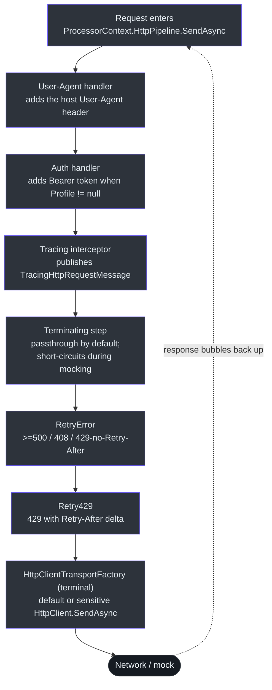
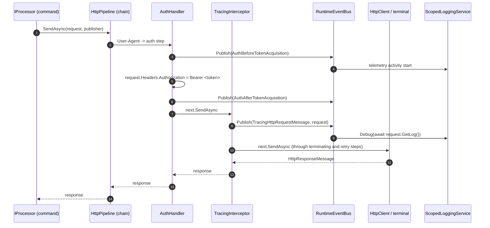

# HTTP Pipeline & Runtime

## Overview

Every network call an extension command makes goes through **one composable pipeline of delegating handlers**, assembled fresh per invocation. Rather than a monolithic `HttpClient` with baked-in policy, `Core.Runtime` models the request path as a chain of `SendAsyncStep` delegates — each one receives the request and a `next` link, does its work (add an auth header, publish a trace event, retry on 429), and calls `next`. The chain terminates at a factory that performs the actual wire send.

This design exists so that the same command code runs unchanged in production, under mocking, and under record/playback tests: the *only* thing that changes is which steps get inserted and which terminal factory sits at the bottom. This page traces how the pipeline is built, the exact order handlers execute, where retry policy and configuration come from, and how the runtime's event bus and logging/output adapters carry side-effects out of the pipeline.

> Naming: the runtime lives under the `Core.Runtime` namespace of the **Azclips** codebase, targeting **net10.0**.

---

## 1. The building blocks

The pipeline is expressed with a handful of small delegate and interface types (`src/Core/Core.Abstractions/Runtime/delegates.cs`, `src/Core/Core.Abstractions/Runtime/ISendAsync.cs`):

| Type | Shape | Role |
| --- | --- | --- |
| `SendAsync` | `(request, callback) -> Task<HttpResponseMessage>` | A fully-composed, callable pipeline. |
| `SendAsyncStep` | `(request, callback, next) -> Task<HttpResponseMessage>` | One handler that may call `next`. |
| `ISendAsync` | `SendAsync(request, callback)` | A materialized link in the chain. |
| `ISendAsyncFactory` | `Create(next) -> ISendAsync` | Wraps a step around a `next` link. |
| `ISendAsyncTerminalFactory` | `Create() -> ISendAsync` | The bottom of the chain (real send or mock). |
| `IRuntimeHttpPipeline` | `Prepend/Append` + `SendAsync` | The mutable builder + entry point. |

The `callback` parameter is an `IEventPublisher` — the session's event bus — so any handler can publish events and read the cancellation `Token` (`src/Core/Core.Abstractions/Runtime/ISendAsync.cs:9-11`).

### The two factory implementations

- `SendAsyncFactory` wraps a `SendAsyncStep` into an `ISendAsync` link by capturing `next` in a small `Sender` object whose `SendAsync` simply invokes `implementation(request, callback, next)` (`src/Core/Core.Runtime/SendAsyncFactory.cs:14-25`).
- `HttpClientTransportFactory` is the default **terminal** factory: its `Create()` returns itself, and its `SendAsync` selects the configured default or sensitive client and calls `HttpClient.SendAsync` with `HttpCompletionOption.ResponseHeadersRead` and the callback's cancellation token (`src/Core/Core.Runtime/HttpClientTransportFactory.cs`). `SendAsyncTerminalFactory` is an alternate terminal used to wrap an arbitrary delegate for tests (`src/Core/Core.Runtime/SendAsyncTerminalFactory.cs`).

---

## 2. `HttpPipeline`: composition and the counter-intuitive `Prepend`/`Append`

`HttpPipeline` implements `IRuntimeHttpPipeline` (`src/Core/Core.Runtime/HttpPipeline.cs:15`). Internally it keeps a `List<ISendAsyncFactory> steps`, a terminal factory, and lazily builds the composed `pipeline` on first use (`HttpPipeline.cs:19-26`).

The naming of the mutators is the single most important thing to understand, because it is *the opposite* of what the list operations suggest:

| Public method | Internal op | Resulting execution position |
| --- | --- | --- |
| `Prepend(factory)` | `steps.Add(item)` (end of list) | **Outer** — runs *earlier*, first to see the request |
| `Append(factory)` | `steps.Insert(0, item)` (front of list) | **Inner** — runs *later*, closest to the wire |

(`HttpPipeline.cs:184-192` for `Prepend`; `HttpPipeline.cs:236-244` for `Append`.)

The reason lives in the lazy builder `Pipeline` getter (`HttpPipeline.cs:141-180`). It starts from the terminal and *wraps outward*, iterating `steps` in list order:

```csharp
var next = terminal.Create();                 // bottom of the chain
next = new SendAsyncFactory(Retry429).Create(next) ?? next;   // built-in
next = new SendAsyncFactory(RetryError).Create(next) ?? next; // built-in
foreach (var factory in steps)
    next = factory.Create(next) ?? next;      // each wraps the previous 'next'
```

Because each `foreach` iteration wraps the *previous* result, the **last** item in `steps` becomes the **outermost** handler. `Prepend` appends to the list → becomes last → outermost. `Append` inserts at index 0 → stays innermost. The build is guarded by a double-checked lock with a `Volatile` read/write so concurrent first-callers don't each build and abandon a chain (`HttpPipeline.cs:145-178`). Any `Prepend`/`Append` nulls the cached `pipeline`, forcing a rebuild on next use (`HttpPipeline.cs:189`, `:241`).

### Built-in retry policy

Two retry steps are *always* inserted just above the terminal, so they wrap the real send but sit inside every custom step (`HttpPipeline.cs:165-170`):

| Step | Trigger | Bound | Citation |
| --- | --- | --- | --- |
| `Retry429` | HTTP 429 **with** a `Retry-After` delta; honors the delta via `Task.Delay` | `_maxRetryFor429` | `HttpPipeline.cs:71-86` |
| `RetryError` | ≥ 500 (except 501/505), 408 Request Timeout, or 429 **without** `Retry-After` | `_maxRetry` | `HttpPipeline.cs:88-126` |

Both clone the request before each attempt (`request.CloneWithContent()`) so the retried send has a fresh, re-readable body, and both publish `"Debug"` events per attempt through the callback (`HttpPipeline.cs:73-84`, `:116-123`). The bounds come from configuration (next section). `PollingInterval` is a separate long-running-operation knob defaulting to 30 but set to 15 by the engine (`HttpPipeline.cs:26`; overridden at `Engine.cs:121`).

---

## 3. How the engine composes the per-invocation chain

`Engine.CreateProcessorContext` builds the pipeline for one invocation (`src/Core/Core.Engine/Engine.cs`). It constructs a `HttpPipeline` over the injected `ISendAsyncTerminalFactory`, sized from `CoreOptions.Http`, and then layers four steps. DI supplies `HttpClientTransportFactory`, which reuses the configured default or sensitive named client:

```csharp
IRuntimeHttpPipeline httpPipeline = new HttpPipeline(
    httpTransportFactory,
    session.Option.Http.MaxRetries,
    session.Option.Http.MaxRetriesFor429)
{ PollingInterval = 15 };

ProcessorContext context = new ProcessorContext(
    HttpPipeline: httpPipeline.Prepend(authHandler.SendAsync),  // (1) auth
    Publisher: session.EventBus,
    AuthHandler: authHandler,
    OutputHandler: outputHandler,
    Profile: session.Profile);

httpPipeline.Prepend(httpPipelineService.HttpAddUserAgentStep);
httpPipeline.Append(httpPipelineService.HttpRequestMessageTracingStep);
httpPipeline.Append(httpPipelineService.HttpPipelineTerminatingStep);
```

`HttpPipelineService` exposes three configurable steps from injected handlers (`src/Core/Core.Runtime/HttpPipelineService.cs`):

- `HttpAddUserAgentStep` adds the host's User-Agent header before authentication and tracing.
- `HttpPipelineTerminatingStep` ← `IHttpTerminateHandler`. The default `DefaultHttpTerminateHandler` is **pure passthrough** — it just calls `next` (`src/Core/Core.Runtime/Handler/DefaultHttpTerminateHandler.cs:14`). During client mocking, this handler is replaced with one that *terminates* the chain (returns a canned response without calling `next`).
- `HttpRequestMessageTracingStep` ← `ITracingInterceptor`. The default `DefaultTracingInterceptor` publishes `Events.TracingHttpRequestMessage` with the outgoing request, then calls `next` — the hook used for record/playback in tests (`src/Core/Core.Runtime/Handler/DefaultTracingInterceptor.cs:11-16`).

The `AuthHandler` step attaches a `Bearer` token only when a profile is resolved; with no profile it acquires no token and passes through, so auth-requiring commands fail later at point of use with a clear error (`src/Core/Core.Runtime/Handler/AuthHandler.cs:27-42`).

### The resulting execution order

The builder holds `steps = [terminating, tracing, auth, userAgent]` and wraps them from the terminal outward. The composed chain from request entry to the wire is:



Why this order is deliberate:

- **User-Agent and authentication run before tracing**, so record/playback observes the headers that would be sent.
- **Terminating runs after tracing** and can return a canned response without reaching retries or the real transport. It does not bypass authentication; offline tests must also isolate authentication.
- **Retry steps are innermost** so a retry re-issues the already-authenticated, already-traced request straight to the wire without re-running outer steps.

---

## 4. Configuration: `CoreOptions.Http`

Retry bounds are not hard-coded in the pipeline; they are read from strongly-typed options (`src/Core/Core.Abstractions/CoreOptions.cs`):

| Option | Default | Consumed at |
| --- | --- | --- |
| `Http.MaxRetries` | `3` | `RetryError` bound (`Engine.cs:117` → `HttpPipeline.cs:119`) |
| `Http.MaxRetriesFor429` | `5` | `Retry429` bound (`Engine.cs:118` → `HttpPipeline.cs:76`) |
| `Engine.ExtensionIndexCacheSize` | `512` | extension-index cache size (`Engine.cs:83`) |

`session.Option` is `configurationService.GetConfiguration<CoreOptions>()`, injected by the engine when the session is opened (`src/Core/Core.Engine/Engine.cs:76-79`). `PollingInterval` remains a code default (15) pending a config binding — the source flags this with a `TODO` (`Engine.cs:120-121`).

---

## 5. `ProcessorContext`: the extension command contract

Extension commands never see the pipeline internals — they receive a `ProcessorContext` record and are handed it via `IProcessor.Init(context)` (`src/Core/Core.Abstractions/CLIContracts.cs:11-14`). The record bundles everything a command needs to make authenticated, observable calls (`src/Core/Core.Abstractions/Models/ProcessorContext.cs`):

| Member | Type | Purpose |
| --- | --- | --- |
| `HttpPipeline` | `IRuntimeHttpPipeline` | Composed request path (call `SendAsync`). |
| `Publisher` | `IEventPublisher` | Publish lifecycle/trace events + read cancellation token. |
| `AuthHandler` | `IAuthHandler` | Inspect/override token acquisition. |
| `OutputHandler` | `IOutputHandler` | Write results to the session's output channel. |
| `Profile` | `Profile?` | The resolved profile (may be null). |

A command calls `context.HttpPipeline.SendAsync(request, context.Publisher)`, which enters the chain at its outermost step (`HttpPipeline.SendAsync` → `Pipeline.SendAsync`, `HttpPipeline.cs:289`).

---

## 6. `RuntimeEventBus` and side-effect routing

The `callback`/`Publisher` threaded through every step is a `RuntimeEventBus` — an internal, per-session pub/sub keyed by event id (`src/Core/Core.Runtime/RuntimeEventBus.cs:10`). It supports **named** subscriptions and a **global** subscriber, and its `Publish` core checks cancellation first, then dispatches the global subscriber before named ones (`RuntimeEventBus.cs:67-97`). Dozens of typed `Publish` overloads let handlers attach a request, response, message, or magnitude to the `EventData` (`RuntimeEventBus.cs:100-128`).

The engine attaches all subscribers when the session opens (`Engine.SubscribeAll`), so pipeline events surface as logs and telemetry. For example, `Events.TracingHttpRequestMessage` published by the tracing interceptor is subscribed to log the full request via `request.GetLog()` (`src/Core/Core.Engine/Engine.Subscriptions.cs:68-73`), and `AuthBeforeTokenAcquisition`/`AuthAfterTokenAcquisition` are turned into paired telemetry activities (`Engine.Subscriptions.cs:177-189`).



### Output and logging adapters

The runtime keeps *output* (command results) separate from *logs*:

- `ConsoleOutputAdapter` is the default `IOutputAdapter`, writing lines/warnings/errors to the console and exposing `IsInteractive` from `Console.IsInputRedirected` (`src/Core/Core.Runtime/ConsoleOutputAdapter.cs:11-40`).
- `ScopedLoggingService` is the default `ILoggingService`. It uses an `AsyncLocal<ILoggingService?>` so each async session flow sees its own logger via `UseScope`, falling back to a `ConsoleLoggingService` outside any session (`src/Core/Core.Runtime/ScopedLoggingService.cs:13-47`). This is what lets concurrent invocations log in isolation without threading a logger through every constructor. Hosts can override it — the TUI swaps in a silent `TuiLoggingService` so log lines can't corrupt the rendered UI (`TUI/Program.cs:37`).

All of these are wired in `RegisterRuntimeServices` as singletons alongside the terminating/tracing handlers and `HttpPipelineService` (`src/Core/Core.Runtime/DIRegisterExtensions.cs:18-25`).

---

## Key takeaways

- The HTTP path is a **chain of `SendAsyncStep` handlers** wrapping a terminal factory; the terminal is real `HttpClient.SendAsync` in production and a mock in tests (`HttpClientTransportFactory.cs`, `SendAsyncTerminalFactory.cs`).
- `Prepend` = **outer/earlier**, `Append` = **inner/closer to the wire** — the reverse of the underlying `List` ops, because the builder wraps outward (`HttpPipeline.cs:184`, `:236`, `:141-178`).
- Per-invocation order is **User-Agent → auth → tracing → terminating → RetryError → Retry429 → real send** (`Engine.cs`).
- Retry bounds come from `CoreOptions.Http` (`MaxRetries=3`, `MaxRetriesFor429=5`); 429 honors `Retry-After` (`CoreOptions.cs`, `HttpPipeline.cs:71-126`).
- Commands consume the pipeline only through the `ProcessorContext` record and drive observability through `RuntimeEventBus`, which the engine subscribes for logging + telemetry (`ProcessorContext.cs`, `RuntimeEventBus.cs:10`, `Engine.Subscriptions.cs:68`).

## References

- `src/Core/Core.Runtime/HttpPipeline.cs` — pipeline builder, retry policy, `Prepend`/`Append` (`:15`, `:71`, `:141`, `:184`, `:236`)
- `src/Core/Core.Runtime/HttpPipelineService.cs` — exposes terminating + tracing steps (`:10`)
- `src/Core/Core.Runtime/HttpClientTransportFactory.cs` / `SendAsyncTerminalFactory.cs` / `SendAsyncFactory.cs` — terminal + step factories
- `src/Core/Core.Runtime/Handler/AuthHandler.cs`, `DefaultHttpTerminateHandler.cs`, `DefaultTracingInterceptor.cs`, and the host's `IUserAgentHandler` — the four composed steps
- `src/Core/Core.Engine/Engine.cs` — `CreateProcessorContext` chain assembly (`:115-135`)
- `src/Core/Core.Abstractions/Models/ProcessorContext.cs`, `Runtime/ISendAsync.cs`, `Runtime/delegates.cs` — contracts
- `src/Core/Core.Abstractions/CoreOptions.cs` — `HttpOptions` retry configuration
- `src/Core/Core.Runtime/RuntimeEventBus.cs` — event publication (`:10`, `:67`)
- `src/Core/Core.Engine/Engine.Subscriptions.cs` — how the engine consumes pipeline events (`:68`, `:177`)
- `src/Core/Core.Runtime/ScopedLoggingService.cs`, `ConsoleOutputAdapter.cs`, `DIRegisterExtensions.cs` — output/log routing + DI
