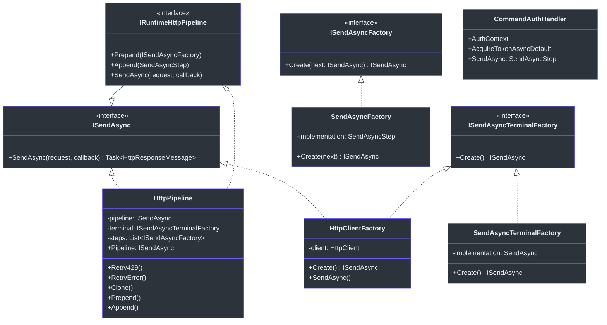
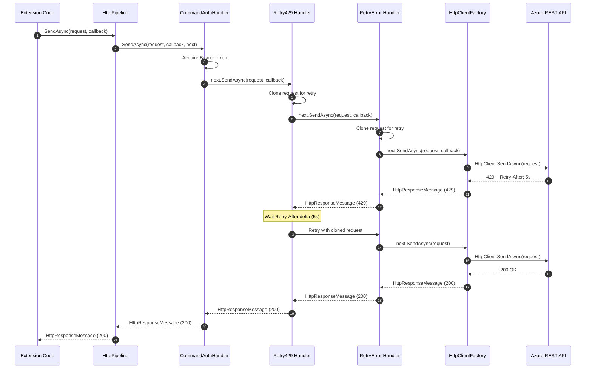

# HTTP Pipeline & Runtime

The Cirrus HTTP pipeline implements a **chain-of-responsibility** pattern that wraps every outgoing HTTP request in a composable series of handlers. Each handler can inspect, modify, or short-circuit the request before delegating to the next link in the chain. This architecture cleanly separates cross-cutting concerns—authentication, telemetry, retry logic—from the business logic that constructs API calls.

## Architecture Overview



## Core Interfaces

Three interfaces define the pipeline contract, all declared in `Core.Abstractions.Runtime` (`src/Core/Core.Abstractions/Runtime/ISendAsync.cs:6`):

| Interface | Responsibility | Key Method |
|---|---|---|
| `ISendAsync` | Send an HTTP request through a handler | `SendAsync(HttpRequestMessage, IEventListener)` |
| `ISendAsyncFactory` | Create a pipeline step wrapping the next step | `Create(ISendAsync next)` |
| `ISendAsyncTerminalFactory` | Create the terminal (last) handler | `Create()` |

The `IRuntimeHttpPipeline` interface extends `ISendAsync` and adds `Prepend`/`Append` methods for composing the chain (`src/Core/Core.Abstractions/Runtime/ISendAsync.cs:27`). The delegate types powering the pipeline are defined in `delegates.cs` (`src/Core/Core.Abstractions/Runtime/delegates.cs:9`):

- **`SendAsync`** — `Task<HttpResponseMessage>(HttpRequestMessage, IEventListener)` — basic send delegate
- **`SendAsyncStep`** — `Task<HttpResponseMessage>(HttpRequestMessage, IEventListener, ISendAsync next)` — step with delegation
- **`SendAsyncStepExpand`** — expanded delegate for out-of-module delegation supporting `CancellationToken`, `Cancel`, and `SignalEvent` parameters (`src/Core/Core.Abstractions/Runtime/delegates.cs:11`)

## HttpPipeline Class

The `HttpPipeline` class (`src/Core/Core.Runtime/HttpPipeline.cs:10`) is the central implementation of `IRuntimeHttpPipeline`. It maintains:

- A **terminal factory** (`ISendAsyncTerminalFactory`) — defaults to `HttpClientFactory` (`src/Core/Core.Runtime/HttpPipeline.cs:17`)
- A **list of step factories** (`List<ISendAsyncFactory>`) that wrap around the terminal
- A **cached pipeline** reference invalidated whenever steps change

### Pipeline Construction

The `Pipeline` property getter builds the handler chain lazily (`src/Core/Core.Runtime/HttpPipeline.cs:155`):

1. Creates the terminal handler via `terminal.Create()`
2. Wraps it with `Retry429` and `RetryError` handlers
3. Iterates through all registered `steps`, wrapping each around the current chain
4. Caches the result for reuse

```csharp
// Simplified view of pipeline assembly (HttpPipeline.cs:166-177)
var next = terminal.Create();
next = new SendAsyncFactory(Retry429).Create(next) ?? next;
next = new SendAsyncFactory(RetryError).Create(next) ?? next;
foreach (var factory in steps)
{
    next = factory.Create(next) ?? next;
}
return this.pipeline = next;
```

### Prepend vs Append

The naming follows the **execution order** convention:

- **`Prepend`** adds a step that runs **first** (outermost wrapper) — adds to the end of the steps list (`src/Core/Core.Runtime/HttpPipeline.cs:183`)
- **`Append`** adds a step that runs **last** before retry/terminal — inserts at position 0 in the steps list (`src/Core/Core.Runtime/HttpPipeline.cs:235`)

Both methods invalidate the cached pipeline (`pipeline = null`), forcing reconstruction on the next call.

## Handler Chain

### CommandAuthHandler

The `CommandAuthHandler` (`src/Core/Core.Runtime/Handler/CommandAuthHandler.cs:11`) implements `ICommandAuthHandler` and provides token-based authentication. Its `SendAsync` property is a `SendAsyncStep` delegate that:

1. Starts a telemetry activity for the auth step (`src/Core/Core.Runtime/Handler/CommandAuthHandler.cs:27`)
2. Selects between `AcquireTokenAsyncOverride` and `AcquireTokenAsyncDefault` based on `ApplyOverride` flag (`src/Core/Core.Runtime/Handler/CommandAuthHandler.cs:29`)
3. Acquires a Bearer token and sets the `Authorization` header (`src/Core/Core.Runtime/Handler/CommandAuthHandler.cs:32`)
4. Delegates to the next handler via `next.SendAsync(request, callback)`

### HttpClientFactory (Terminal Handler)

`HttpClientFactory` (`src/Core/Core.Runtime/HttpClientFactory.cs:10`) implements both `ISendAsyncTerminalFactory` and `ISendAsync`. It is the **terminal handler** — the last link in the chain that actually sends the HTTP request:

```csharp
// HttpClientFactory.cs:21 - Sends using HttpClient with ResponseHeadersRead
public Task<HttpResponseMessage> SendAsync(HttpRequestMessage request, IEventListener callback)
    => client.SendAsync(request, HttpCompletionOption.ResponseHeadersRead, callback.Token);
```

Using `ResponseHeadersRead` ensures streaming responses are handled efficiently without buffering the entire body.

### CommandOutputHandler and CommandTelemetryHandler

- **`CommandOutputHandler`** (`src/Core/Core.Runtime/Handler/CommandOutputHandler.cs:9`) — holds a `CommandOutputDelegate` for writing command output
- **`CommandTelemetryHandler`** (`src/Core/Core.Runtime/Handler/CommandTelemetryHandler.cs:8`) — holds a `StartActivityDelegate` for creating telemetry activities

## SendAsyncFactory Wrappers

### SendAsyncFactory

`SendAsyncFactory` (`src/Core/Core.Runtime/SendAsyncFactory.cs:8`) wraps a `SendAsyncStep` delegate into an `ISendAsyncFactory`. It contains an inner `Sender` class (`src/Core/Core.Runtime/SendAsyncFactory.cs:10`) that implements `ISendAsync` by calling the delegate with the `next` handler reference.

The constructor also supports `SendAsyncStepExpand` delegates (`src/Core/Core.Runtime/SendAsyncFactory.cs:28`) for out-of-module compatibility with Azure PowerShell cmdlets. This translates the expanded signature (with `CancellationToken`, `Cancel`, `SignalEvent`) back into the standard `ISendAsync` pattern.

### SendAsyncTerminalFactory

`SendAsyncTerminalFactory` (`src/Core/Core.Runtime/SendAsyncTerminalFactory.cs:8`) wraps either a `SendAsync` delegate or an existing `ISendAsync` instance into an `ISendAsyncTerminalFactory`. This is useful for injecting custom terminal handlers (e.g., mock handlers in tests).

## Retry Logic

The pipeline includes two built-in retry mechanisms, both inserted automatically during pipeline construction.

### 429 Throttling Retry

The `Retry429` method (`src/Core/Core.Runtime/HttpPipeline.cs:51`) handles HTTP 429 (Too Many Requests) responses **with** a `Retry-After` header:

1. Clones the request for reuse (`src/Core/Core.Runtime/HttpPipeline.cs:70`)
2. Sends the request through the next handler
3. If 429 with `Retry-After`, waits for the specified `Delta` duration (`src/Core/Core.Runtime/HttpPipeline.cs:78`)
4. Signals a debug event with retry count and wait time
5. Retries up to a configurable maximum (env vars `PS_HTTP_MAX_RETRIES_FOR_429` / `AZURE_PS_HTTP_MAX_RETRIES_FOR_429`, default: `int.MaxValue`)

### 5xx / Timeout Retry

The `RetryError` method (`src/Core/Core.Runtime/HttpPipeline.cs:111`) handles server errors and timeouts:

- **Retryable**: status >= 500 (except 501 Not Implemented and 505 HTTP Version Not Supported), 408 Request Timeout, and 429 without `Retry-After` header (`src/Core/Core.Runtime/HttpPipeline.cs:85`)
- **Max retries**: `DefaultMaxRetry = 3` (`src/Core/Core.Runtime/HttpPipeline.cs:12`), overridable via `PS_HTTP_MAX_RETRIES` / `AZURE_PS_HTTP_MAX_RETRIES`
- Unlike `Retry429`, there is no wait between retries — it retries immediately



## IEventListener & Signal System

The `IEventListener` interface (`src/Core/Core.Abstractions/Runtime/IEventListener.cs:28`) defines the communication mechanism for signaling events during remote calls:

```csharp
public interface IEventListener
{
    Task Signal(string id, CancellationToken token, GetEventData createMessage);
    StartActivityDelegate StartActivity { get; set; }
    CancellationToken Token { get; }
    Action Cancel { get; }
}
```

### EventListener Implementation

The `EventListener` class (`src/Core/Core.Runtime/EventListener.cs:15`) extends `CancellationTokenSource` and implements `IEventListener`. It maintains a dictionary of named event handlers (`Dictionary<string, Event>`) and an optional tracer that receives all events.

The `Signal` method (`src/Core/Core.Runtime/EventListener.cs:71`) dispatches events within a `NoSynchronizationContext` scope:

1. Looks up a registered listener by `id`
2. Creates the `EventData` message via the lazy `createMessage` delegate
3. Invokes both the specific listener and the tracer (if registered)
4. Checks for cancellation and throws `OperationCanceledException` if requested

### EventData

`EventData` (`src/Core/Core.Runtime/EventData.cs:6`) carries event payload through the pipeline. Key fields:

| Field | Type | Purpose |
|---|---|---|
| `Id` | `string` | Event type identifier |
| `Message` | `string` | Human-readable message |
| `Parameter` | `string` | Parameter name (validation events) |
| `Value` | `double` | Numeric value (progress events) |
| `RequestMessage` | `object` | The HTTP request being processed |
| `ResponseMessage` | `object` | The HTTP response received |
| `Cancel` | `Action` | Cancellation callback |

The constructor accepting `dynamic sourceValue` (`src/Core/Core.Runtime/EventData.cs:74`) enables cross-assembly compatibility by dynamically mapping properties with exception isolation via the private `To<T>` helper method (`src/Core/Core.Runtime/EventData.cs:94`).

### Well-Known Event IDs

The `Events` static class (`src/Core/Core.Abstractions/Runtime/Events.cs:12`) defines 28 well-known event identifiers organized into categories:

- **Lifecycle**: `RequestCreated`, `ResponseCreated`, `URLCreated`, `BeforeCall`, `Finally`
- **Validation**: `Validation`, `ValidationWarning`, `AfterValidation`
- **Pipeline**: `HeaderParametersAdded`, `BodyContentSet`, `BeforeResponseDispatch`
- **Pagination**: `FollowingNextLink`, `DelayBeforePolling`, `Polling`, `Progress`
- **Cmdlet**: `CmdletBeginProcessing`, `CmdletProcessRecordStart`, `CmdletEndProcessing`, etc.
- **Logging**: `Log`, `Verbose`, `Debug`, `Information`, `Error`, `Warning`

## Signal Extension Methods

The `RuntimeExtensions` class (`src/Core/Core.Runtime/RuntimeExtensions.cs:8`) provides 25+ overloaded `Signal` extension methods on `IEventListener` for ergonomic event dispatching. These overloads cover common patterns:

- Signal with just an ID (`src/Core/Core.Runtime/RuntimeExtensions.cs:24`)
- Signal with message text (`src/Core/Core.Runtime/RuntimeExtensions.cs:25`)
- Signal with request/response objects (`src/Core/Core.Runtime/RuntimeExtensions.cs:26`)
- Signal with magnitude values for progress (`src/Core/Core.Runtime/RuntimeExtensions.cs:28`)
- Signal with URI (`src/Core/Core.Runtime/RuntimeExtensions.cs:36`)

### Validation Extensions

The class also provides validation helper methods that signal `Events.ValidationWarning`:

| Method | Line | Purpose |
|---|---|---|
| `AssertNotNull` | `RuntimeExtensions.cs:38` | Validates parameter is not null |
| `AssertMinimumLength` | `RuntimeExtensions.cs:45` | Validates string minimum length |
| `AssertMaximumLength` | `RuntimeExtensions.cs:52` | Validates string maximum length |
| `AssertRegEx` | `RuntimeExtensions.cs:60` | Validates string matches regex pattern |
| `AssertEnum` | `RuntimeExtensions.cs:67` | Validates value is in allowed set |
| `AssertObjectIsValid` | `RuntimeExtensions.cs:74` | Calls `IValidates.Validate` if implemented |
| `AssertIsLessThan` | `RuntimeExtensions.cs:82` | Validates numeric upper bound |
| `AssertIsGreaterThan` | `RuntimeExtensions.cs:89` | Validates numeric lower bound |
| `AssertIsMultipleOf` | `RuntimeExtensions.cs:110` | Validates divisibility (Int64, double, decimal) |

### NoSynchronizationContext

The `NoSynchronizationContext` helper (`src/Core/Core.Runtime/RuntimeExtensions.cs:192`) sets `SynchronizationContext.Current` to null within a `using` scope, restoring the original on dispose. This eliminates the need for `ConfigureAwait(false)` on every `await` in library code—a pattern used in the `EventListener.Signal` method (`src/Core/Core.Runtime/EventListener.cs:73`).

## CommandContext

`CommandContext` (`src/Core/Core.Runtime/CommandContext.cs:6`) is the composition root that wires all handlers together for a command execution. Each command invocation gets an isolated context:

```csharp
public class CommandContext : ICommandContext
{
    public ICommandAuthHandler CommandAuthHandler { get; set; }
    public ICommandOutputHandler CommandOutputHandler { get; set; }
    public ICommandTelemetryHandler CommandTelemetryHandler { get; set; }
    public IRuntimeHttpPipeline HttpPipeline { get; set; }
}
```

The `ICommandContext` interface (`src/Core/Core.Abstractions/Runtime/ICommandContext.cs:12`) documents the lifecycle: a new instance is created per command invocation, the engine initializes it, and extensions may modify members (e.g., override auth) during execution without affecting other commands.

## Request Cloning

The `RuntimeExtensions` class provides HTTP request cloning utilities used by the retry handlers:

- `Clone` (`src/Core/Core.Runtime/RuntimeExtensions.cs:250`) — clones without content
- `CloneWithContent` — clones with content for retryable requests
- `CloneAndDispose` (`src/Core/Core.Runtime/RuntimeExtensions.cs:227`) — clones and disposes the original
- `GetFirstHeader` (`src/Core/Core.Runtime/RuntimeExtensions.cs:169`) — utility for extracting response headers

## References

| Source File | Key Elements |
|---|---|
| `src/Core/Core.Runtime/HttpPipeline.cs` | `HttpPipeline` class, `Retry429`, `RetryError`, pipeline construction |
| `src/Core/Core.Runtime/HttpClientFactory.cs` | Terminal handler using `HttpClient` |
| `src/Core/Core.Runtime/SendAsyncFactory.cs` | Step factory with `Sender` inner class |
| `src/Core/Core.Runtime/SendAsyncTerminalFactory.cs` | Terminal factory wrapper |
| `src/Core/Core.Runtime/EventData.cs` | Event payload carrier |
| `src/Core/Core.Runtime/EventListener.cs` | Event dispatch implementation |
| `src/Core/Core.Runtime/RuntimeExtensions.cs` | Signal overloads, validation, `NoSynchronizationContext` |
| `src/Core/Core.Runtime/CommandContext.cs` | Handler composition root |
| `src/Core/Core.Runtime/Handler/CommandAuthHandler.cs` | Bearer token injection |
| `src/Core/Core.Runtime/Handler/CommandOutputHandler.cs` | Output delegate holder |
| `src/Core/Core.Runtime/Handler/CommandTelemetryHandler.cs` | Telemetry activity delegate |
| `src/Core/Core.Abstractions/Runtime/ISendAsync.cs` | Pipeline interfaces |
| `src/Core/Core.Abstractions/Runtime/delegates.cs` | Delegate type definitions |
| `src/Core/Core.Abstractions/Runtime/IEventListener.cs` | Event listener interface |
| `src/Core/Core.Abstractions/Runtime/Events.cs` | Well-known event IDs |
| `src/Core/Core.Abstractions/Runtime/ICommandContext.cs` | Command context interface |
