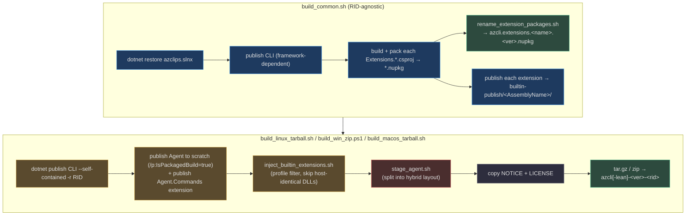
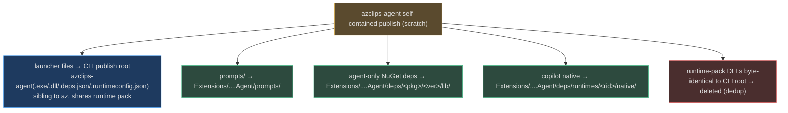
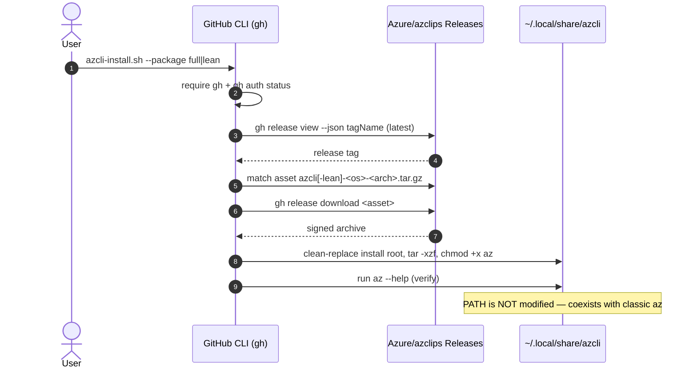

# Packaging & Distribution

## Why this shape

Azclips ships **one repository** as **three product families**, and the packaging system exists to slice a single `dotnet` build into those deliverables without duplication or drift:

1. A **self-contained `az` CLI** — per-RID tarball (Linux/macOS) or zip (Windows), in a **lean** or **full** flavor.
2. **CLI extension NuGet packages** (`azcli.extensions.*.nupkg`) plus an all-extensions roll-up.
3. **PowerShell `Az.*` module packages** plus an all-modules roll-up.

Two cross-cutting constraints shape every script:

- **Coexistence with classic `azure-cli`.** The end-user installers deliberately do **not** modify `PATH`, so the new `az` installs in isolation next to the old one (`install/azcli-install.sh:143`).
- **The agent ships inside the CLI, but as a separate process.** `azclips-agent` is published separately and stitched into a **hybrid layout**: its launcher sits next to `az` (sharing the .NET runtime pack) while its private dependencies live under an extension directory (`devops/scripts/packaging/common/stage_agent.sh:2`).

Distribution is via **GitHub Releases**, pulled by `gh`-authenticated install scripts — no public feed, no PATH surgery.

## The shared build shape

Every project imports `Shared.props`, which fixes the product identity and the output convention (`Shared.props:3`):

| Property | Value | Line |
|---|---|---|
| `<Product>` | `Azclips` | `Shared.props:3` |
| `<OutputPath>` | `artifacts/$(Configuration)/$(ExtName)/` | `Shared.props:9` |
| Release signing | `SignAssembly=true`, `DelaySign=true`, key `src/MSSharedLibKey.snk` | `Shared.props:22-27` |
| Debug signing | `DelaySign=false` (dev/test load normally) | `Shared.props:18-20` |

So each buildable unit lands in its own `artifacts/<Config>/<ExtName>/` directory keyed by its `ExtName`. The CLI itself is `ExtName=Core.Cli`, `AssemblyName=az`, `OutputType=Exe` (`src/CLI/Core.Cli.csproj:3-6`); it also copies authored help markdown to `help/<ext>/<key>.md` and shell completions to `completions/` at publish time (`src/CLI/Core.Cli.csproj:40-54`).

## Lean vs full: which extensions get bundled

The lean/full distinction is a **profile filter** applied at inject time, not two different builds. The profile configs are plain include-lists:

| Profile | Config file | Contents |
|---|---|---|
| lean | `devops/scripts/packaging/config/lean_package.config:5` | `Extension`, `Login`, `Config`, `Agent` |
| full | `devops/scripts/packaging/config/full_package.config:6` | `*` (all discovered extensions) |

`build_common.sh` builds *all* extensions once — discovering every `src/Extensions/*/Extensions.*.csproj`, packing each to a `.nupkg`, and publishing each to `builtin-publish/<AssemblyName>/` (`devops/scripts/packaging/common/build_common.sh:25`, `:43-62`). The per-platform script then injects only the profile's subset.

## The per-platform build pipeline



Tracing the Linux script concretely (`devops/scripts/packaging/linux/tarball/build_linux_tarball.sh`):

1. **Self-contained CLI publish** — `dotnet publish Core.Cli.csproj -c Release -r $RID --self-contained true` (`build_linux_tarball.sh:99-104`).
2. **Agent to scratch** — the daemon is published to a scratch dir with `-p:IsPackagedBuild=true`, and the `Agent.Commands` extension is published into `builtin-publish/` so inject picks it up alongside Login/Config (`build_linux_tarball.sh:112-128`).
3. **Inject built-ins** — `inject_builtin_extensions.sh` copies each selected extension's DLLs into `<publish>/Extensions/<AssemblyName>/`, **skipping DLLs byte-identical to the host** via `cmp -s` to avoid duplication (`devops/scripts/packaging/common/inject_builtin_extensions.sh:120-144`).
4. **Stage the agent** — `stage_agent.sh` splits the agent publish into the hybrid layout (next section) (`build_linux_tarball.sh:136-146`).
5. **Legal + archive** — copy `NOTICE`/`LICENSE`, then `tar -czf` the whole publish dir (`build_linux_tarball.sh:147-153`).

The Windows (`build_win_zip.ps1`) and macOS (`build_macos_tarball.sh`) scripts follow the same five phases with `zip`/`tar` and RID-appropriate publishes.

## The agent hybrid layout (packaging ↔ runtime seam)

The single most subtle piece of packaging is why `azclips-agent` isn't just dropped into the CLI folder. `AgentInstallLayout` is the runtime's single source of truth for "where do my assets live," and it has two modes baked in at compile time (`Agent/AgentInstallLayout.cs:22`):

- **Packaged** (`IsPackaged=true`) — set when the csproj is built with `/p:IsPackagedBuild=true`, which suppresses the `AGENT_DEV_BUILD` constant (`Agent/Core.Agent.csproj:22`). Assets resolve under `Extensions/Microsoft.Azure.Azclips.Extensions.Agent/` (`AgentInstallLayout.cs:32`), with prompts at `.../prompts` and native copilot at `.../deps/runtimes/<rid>/native` (`AgentInstallLayout.cs:35-45`).
- **Dev-loop** (`IsPackaged=false`) — plain `dotnet build`; prompts sit next to the exe and NuGet leaves native binaries in place.

`stage_agent.sh` produces exactly the packaged layout by splitting the agent's self-contained publish (`devops/scripts/packaging/common/stage_agent.sh:2`):



The launcher move puts `azclips-agent` next to `az` so both share the .NET runtime pack (`stage_agent.sh:66-75`); prompts move to the extension dir (`stage_agent.sh:77-83`); agent-only NuGet deps are re-laid under `deps/<pkg>/<ver>/lib/` by parsing `azclips-agent.deps.json` (`stage_agent.sh:180-205`); and any runtime-pack member that is byte-identical to the CLI's copy is deleted rather than duplicated (`stage_agent.sh:167-178`). This is precisely why the CLI probes for `azclips-agent.exe` *next to `az`* first when it needs to spawn the agent (`src/CLI/Program.cs:460-470`).

## Component roll-ups & PowerShell modules

`create_component_archives.sh` produces two convenience bundles (`devops/scripts/packaging/common/create_component_archives.sh:44-45`):

- `azcli-extensions-<version>.tar.gz` — all **add-on** extension `.nupkg`s (the built-in `extension`/`login`/`config` packages are excluded from this roll-up) (`create_component_archives.sh:104`).
- `azps-cmdlets-<version>.tar.gz` — the PowerShell `Az.*` module packages.

PowerShell module packaging has its own quirk. The committed `src/PS/<Module>/<Module>.psd1` manifests reference DLLs via `../../../artifacts/Debug/...` relative paths for the local dev-import workflow. `Set-ModuleConfiguration.ps1` stages transformed copies under `artifacts/<Config>/PS/<Module>/`, rewriting those relative references to **absolute** paths — a workaround for PowerShell's `RequiredAssemblies` resolver silently failing on `..`-relative paths outside the `src/` tree (`build/Set-ModuleConfiguration.ps1:12-19`, `:47`). The heavier NuGet packaging of the modules is handled by `devops/scripts/packaging/powershell/package_az_modules.ps1`.

## Artifact naming

Naming is centralized so scripts stay consistent (`devops/scripts/packaging/config/artifact_naming.config:5`):

| Artifact family | Stem | Line |
|---|---|---|
| CLI (full) | `azcli` | `artifact_naming.config:5` |
| CLI (lean) | `azcli-lean` | `:6` |
| Extensions roll-up | `azcli-extensions` | `:8` |
| PowerShell roll-up | `azps-cmdlets` | `:9` |
| GitHub release name suffix | `(Private Preview)` | `:10` |
| RID labels | `linux-x64`, `linux-arm64`, `win-x64`, `win-arm64`, `macos-arm64`, `macos-x86_64` | `:12-17` |

> The `artifact_version_suffix` key ships **empty** in this config (`artifact_naming.config:7`). The scripts fall back to a literal `preview` only if the key is *absent*; because it is present-but-empty, the resolved suffix is empty unless overridden by the release pipeline (`create_component_archives.sh:95`).

## End-user installation

The installers download the latest signed release via an authenticated `gh` session and install in isolation. Per `install/README.md`, the one-liner pipes the raw script through `bash`/PowerShell:

```bash
gh api repos/Azure/azclips/contents/install/azcli-install.sh -H 'Accept: application/vnd.github.raw' | bash
```



Install specifics, verified against the scripts:

| Aspect | Linux/macOS (`azcli-install.sh`) | Windows (`azcli-install.ps1`) |
|---|---|---|
| Source repo | `Azure/azclips` (`azcli-install.sh:21`) | `Azure/azclips` (`azcli-install.ps1:28`) |
| Default package | `full` (`azcli-install.sh:22`) | `full` (`azcli-install.ps1:21`) |
| Install root | `~/.local/share/azcli` (`azcli-install.sh:23`) | `%LOCALAPPDATA%\Programs\azcli` (`azcli-install.ps1:29`) |
| Auth | requires `gh` + `gh auth status` (`azcli-install.sh:52-57`) | same |
| PATH | not modified (`azcli-install.sh:143`) | not modified |

Platform detection rejects unsupported combinations up front — notably **macOS Intel (x86_64) is explicitly refused** (`install/azcli-install.sh:73-75`). The supported matrix is Windows/Linux ×64/Arm64 plus macOS Arm64 only, and a release contains the six CLI archives, the two component roll-ups, the extension `.nupkg`s, and the `Az.*` module packages (`install/README.md:97-110`).

## Signing and the MSIX manifest

Release assemblies are **delay-signed** at build with the Microsoft shared public key (`Shared.props:22-27`); the matching private key is applied later by ESRP in the release pipeline (comment at `Shared.props:14-17`), with post-sign verification under `devops/scripts/packaging/signing/verify_signed_outputs.ps1`. The full CI/ESRP flow is covered on the [Testing & Build Pipeline](./testing-and-build.md) page.

An MSIX/appx manifest exists — `src/CLI/Core.Cli.appxmanifest` declares identity `Azclips.CLI`, an `az.exe` execution alias, and `runFullTrust` (`src/CLI/Core.Cli.appxmanifest:8`, `:28`, `:39`) — but **no packaging script references it**; it is present-but-unwired in the current release flow and should be treated as aspirational.

## References

- `Shared.props` — product identity, `OutputPath` by `ExtName`, delay-sign configuration
- `src/CLI/Core.Cli.csproj` — `az` exe, help/completions content, package references
- `src/CLI/Core.Cli.appxmanifest` — MSIX manifest (present, unwired)
- `Agent/AgentInstallLayout.cs` / `Agent/Core.Agent.csproj` — packaged-vs-dev asset resolution and the `IsPackagedBuild` constant
- `devops/scripts/packaging/config/{lean_package.config,full_package.config,artifact_naming.config}` — profile filters and naming policy
- `devops/scripts/packaging/common/build_common.sh` — RID-agnostic restore/publish/pack/rename
- `devops/scripts/packaging/common/inject_builtin_extensions.sh` — profile-filtered injection with host-DLL dedup
- `devops/scripts/packaging/common/stage_agent.sh` — the agent hybrid-layout split
- `devops/scripts/packaging/common/create_component_archives.sh` / `rename_extension_packages.sh` — roll-ups and package renaming
- `devops/scripts/packaging/linux/tarball/build_linux_tarball.sh` (+ `windows/zip/build_win_zip.ps1`, `macos/tarball/build_macos_tarball.sh`) — per-platform archive builds
- `devops/scripts/packaging/powershell/package_az_modules.ps1`, `build/Set-ModuleConfiguration.ps1` — PowerShell module packaging and manifest staging
- `install/azcli-install.sh` / `azcli-install.ps1` / `README.md` — end-user installers and release contents
- `src/CLI/Program.cs` — `FindAgentExe` probing the packaged hybrid layout
