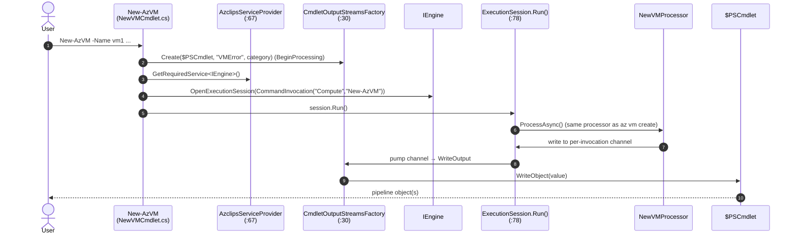
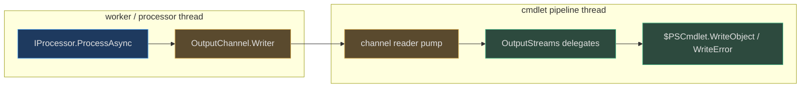

# PowerShell Cmdlet Architecture

## Why the Cmdlets Are Not a Second Implementation

The most important thing to internalize about the PowerShell surface is what it *isn't*: it is **not** a parallel port of the CLI. A `New-AzVM` cmdlet does almost nothing itself — it packs its parameters into a `CommandInvocation`, resolves the *same* `IEngine` the `az` binary uses, and opens an `ExecutionSession`. The Compute extension's `NewVMProcessor` then runs identically to how it runs under `az vm create`. The cmdlet's only real responsibility is **adapting** two things to PowerShell's world: bootstrapping DI at module import, and routing the engine's abstract output back to `$PSCmdlet`.

This page traces that adapter layer. For the engine itself, see [Core Engine & Orchestration](/02-deep-dive/core-engine-orchestration). The code is in `Azure/cirrus` under the `Azclips` identity.

## Module Layout

`src/PS/` has six folders, playing three roles:

| Folder | Role | Notes |
| --- | --- | --- |
| `Login` | **Binary module + DI host** | `ModuleInitializer` bootstraps the container |
| `Compute`, `Config`, `Resources` | Binary cmdlet modules | Each declares `Login` (directly/transitively) in `RequiredModules` |
| `Az` | **Rollup** manifest | Requires Login/Compute/Resources/Config (`src/PS/Az/Az.psd1:11-16`) |
| `Common` | Shared library | Hosts `CmdletOutputStreamsFactory` |

Plus `src/PS/TelemetryHelper.ps1`, a script that starts/stops per-cmdlet telemetry activities against the shared `ITelemetryService`.

## DI Is Bootstrapped Once, at Import

The shared container is initialized when the `Login` module imports, not on every cmdlet call. `Login` implements `IModuleAssemblyInitializer`; its `OnImport` registers PowerShell-specific providers and calls `AzclipsServiceProvider.Initialize(ClientType.PowerShell)` (`src/PS/Login/ModuleInitializer.cs:16-25`). Because `Initialize` is idempotent — later calls no-op behind a lock (`src/Core/Core.DependencyInjection/AzclipsServiceProvider.cs:69-70`) — importing several modules is harmless, and `OnRemove` disposes the container (`src/PS/Login/ModuleInitializer.cs:27-30`).

> **Precision:** individual cmdlets do **not** call `Initialize`. Their `BeginProcessing` simply *resolves* an already-initialized `IEngine` (`src/PS/Compute/Cmdlets/NewVMCmdlet.cs:90`). The DI bootstrap lives entirely in the module initializer, which is why every binary module depends on `Login`.

## A Cmdlet Is an Adapter

Take `New-AzVM` (`src/PS/Compute/Cmdlets/NewVMCmdlet.cs:12`) — the pattern is identical for `Get-AzVM` and `Remove-AzVM`:

1. **`BeginProcessing`** builds an `OutputStreams` bound to the live cmdlet and resolves the engine (`src/PS/Compute/Cmdlets/NewVMCmdlet.cs:87-91`).
2. **`ProcessRecord`** collects bound parameters into a dictionary, constructs `new CommandInvocation("Compute", "New-AzVM", parameters, false, moduleName, moduleVersion)` (`src/PS/Compute/Cmdlets/NewVMCmdlet.cs:130`), opens the session, and calls the **synchronous** `session.Run()` (`src/PS/Compute/Cmdlets/NewVMCmdlet.cs:133-134`).
3. **`StopProcessing`** cancels the shared `CancellationTokenSource` (`src/PS/Compute/Cmdlets/NewVMCmdlet.cs:142`).

The invocation's first argument is the **extension name** (`"Compute"`) and the second is the **`InvocationName`** the extension index registered for that client. `Get-AzVM` even maps its parameter set into distinct invocation names — `Get-AzVM_Get` vs `Get-AzVM_List` (`src/PS/Compute/Cmdlets/GetVMCmdlet.cs:58,66`) — which line up with the `CommandMetadata` entries in the Compute index (`src/Extensions/Compute/ExtensionIndex.cs:45-66`).

## Why `Run()` and Not `RunAsync()`

The CLI drives sessions with `RunAsync()`; cmdlets use the synchronous `Run()` (`src/Core/Core.Engine/ExecutionSession.cs:78`). The reason is PowerShell's **thread affinity**: `WriteObject`/`WriteError` must be called on the pipeline thread. `Run()` creates an unbounded output **channel**; the processor (possibly on a worker thread) writes results to the channel, while the cmdlet's own thread pumps them and invokes the `OutputStreams` delegates (`src/Core/Core.Engine/ExecutionSession.cs:83-90`). That preserves thread affinity while still letting the engine's async internals run.

## The Output Bridge: CmdletOutputStreamsFactory

`OutputStreams` is the engine's surface-agnostic output contract. `CmdletOutputStreamsFactory.Create` (`src/PS/Common/CmdletOutputStreamsFactory.cs:30`) builds one whose delegates call the cmdlet's native streams, and applies severity gating from `core.logging.level`:

| Engine channel | PowerShell target | Source |
| --- | --- | --- |
| `WriteOutput` | `WriteObject` (enumerated when `enumerateOutput`) | `src/PS/Common/CmdletOutputStreamsFactory.cs:43-47` |
| `WriteError` | `WriteError(new ErrorRecord(...))` with the cmdlet's `errorId`/category | `src/PS/Common/CmdletOutputStreamsFactory.cs:91-98` |
| `WriteVerbose` | `WriteVerbose` / host UI, honoring `-Verbose` | `src/PS/Common/CmdletOutputStreamsFactory.cs:52-64` |
| `WriteDebug` | `WriteDebug` / host UI, honoring `-Debug` | `src/PS/Common/CmdletOutputStreamsFactory.cs:67-80` |
| `WriteWarning` / `WriteInformation` | `WriteWarning` / `WriteInformation`, gated by level | `src/PS/Common/CmdletOutputStreamsFactory.cs:82-108` |

Because this factory is the *only* place output shape differs, the engine, extensions, and HTTP pipeline stay completely surface-agnostic — the same code that writes lines to `Console.WriteLine` under `az` emits typed pipeline objects under PowerShell.

## Component Reference

| Component | Responsibility | Source |
| --- | --- | --- |
| `ModuleInitializer` | `Initialize(ClientType.PowerShell)` at import, dispose on remove | `src/PS/Login/ModuleInitializer.cs:14` |
| `NewVMCmdlet` / `GetVMCmdlet` / `RemoveVMCmdlet` | Adapters: build `CommandInvocation`, drive `session.Run()` | `src/PS/Compute/Cmdlets/NewVMCmdlet.cs:12`, `GetVMCmdlet.cs:13` |
| `CmdletOutputStreamsFactory` | Bridge engine `OutputStreams` → `$PSCmdlet` | `src/PS/Common/CmdletOutputStreamsFactory.cs:28` |
| `ExecutionSession.Run()` | Synchronous, channel-based drive for cmdlet thread affinity | `src/Core/Core.Engine/ExecutionSession.cs:78` |
| Extension `ExtensionIndex` | Maps PowerShell `InvocationName` → `IProcessor` | `src/Extensions/Compute/ExtensionIndex.cs:16` |

## References

- `src/PS/Login/ModuleInitializer.cs:14-30` — DI bootstrap at import (idempotent), dispose on remove
- `src/Core/Core.DependencyInjection/AzclipsServiceProvider.cs:67` — the shared composition root
- `src/PS/Compute/Cmdlets/NewVMCmdlet.cs:87-134` — cmdlet adapter (`BeginProcessing`/`ProcessRecord`)
- `src/PS/Compute/Cmdlets/GetVMCmdlet.cs:58-70` — parameter-set → invocation-name mapping
- `src/PS/Common/CmdletOutputStreamsFactory.cs:30` — output bridge to `$PSCmdlet`
- `src/Core/Core.Engine/ExecutionSession.cs:78` — synchronous channel-based `Run()`
- `src/Extensions/Compute/ExtensionIndex.cs:16` — PowerShell command metadata (`New-AzVM`, `Get-AzVM_*`)
- `src/PS/Compute/Compute.psd1:80` — cmdlet exports + `RequiredModules: Login`
- `src/PS/TelemetryHelper.ps1:10` — shared telemetry activity helper
