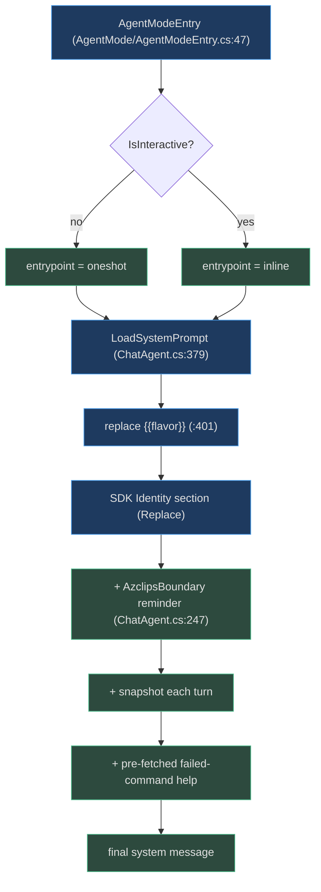
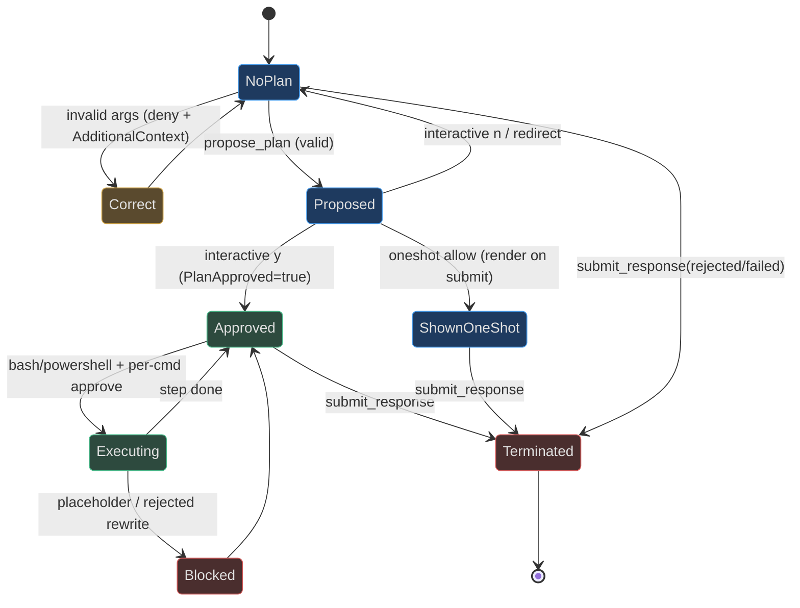

# Prompts & Plan Mode

## Why plan mode exists

An AI agent that can run `az` — including `vm delete` and `group delete` — needs
a hard safety boundary between *proposing* and *executing*. Azclips implements
that boundary as **plan mode**: the model must call `propose_plan` and get the
user's approval before any shell command is allowed to run, and every session
ends with exactly one `submit_response`. The rules are taught by two system
prompts and *enforced* by a single pre-tool-use hook that can deny, rewrite, or
allow each tool call. This "unified-mind" protocol is what makes the fallback
safe to hand a failed command.

## The two prompts

The agent ships two prompt files, selected by session style:

| Style | Prompt file | Identity | Source |
|-------|-------------|----------|--------|
| interactive | `Agent/prompts/inline.md` | "interactive agent … work with the user, run commands once they approve" | `Agent/prompts/inline.md:2` |
| one-shot | `Agent/prompts/oneshot.md` | "error-recovery agent … one complete, ready-to-run plan" | `Agent/prompts/oneshot.md:2` |

`AgentModeEntry` chooses the entrypoint from `AgentOptions.IsInteractive`
(`Agent/AgentMode/AgentModeEntry.cs:47`), and the files are copied to the build
output by the `.csproj` `<None Update="prompts\*.md">` item
(`Agent/Core.Agent.csproj:72`). `ChatAgent.LoadSystemPrompt`
(`Agent/ChatAgent.cs:379`) validates the entrypoint is exactly `oneshot` or
`inline`, resolves the file through `AgentInstallLayout.PromptsDir`, and
substitutes `&#123;&#123;flavor&#125;&#125;` (from `AZURECLI_FLAVOR`, default "azure cli")
(`Agent/ChatAgent.cs:401`).

Both prompts enforce the same core rules (`Agent/prompts/oneshot.md:6`,
`Agent/prompts/inline.md:6`):

- **This `az` is a next-generation Azure CLI, NOT classic `azure-cli`** — training
  knowledge may be wrong; verify every command with `get_command()`.
- **Every turn must be a tool call** — a bare-prose turn is a bug.
- **Reject out-of-scope requests** via `submit_response(status="rejected",
  message="OUT_OF_SCOPE_…")`.
- **Fast path vs Gather path** error recovery, and browser-first sign-in with
  device-code only as a fallback.

The difference: one-shot is a single self-contained response (it can't wait on
the user), while inline collaborates across turns.

## Context injection: environment + failed-command help

The prompts assume the model already holds three things at session start. Two are
injected via the `OnSessionStart` hook (`Agent/ChatAgent.cs:309`):

- **The `<environment>` snapshot.** `EnvSnapshotFormatter.Format`
  (`Agent/Common/EnvSnapshotFormatter.cs:15`) turns the JSON from
  `az agent tool env` into a block of runtime facts (os/shell/cwd),
  interactivity (ssh/browser/stdin), auth (signed-in/subscription/tenant), and
  azclips version/flavor. It re-runs every turn via `OnUserPromptSubmitted`
  (`Agent/ChatAgent.cs:330`), so state-changing commands like `az login` are
  reflected next turn. An error payload collapses to an empty block.
- **The failed command's help.** `FailedCommandHelp.BuildContextAsync`
  (`Agent/Plan/FailedCommandHelp.cs:21`) conservatively extracts a command verb
  from the failed input via `ExtractCommandName` (`Agent/Plan/FailedCommandHelp.cs:84`)
  — only when it looks like an `az` invocation (lowercase ascii tokens up to the
  first flag, capped at four) — and pre-fetches that command's help through the
  same path `get_command` uses. On any error payload it skips injection rather
  than seeding the session with an error blob. If the snapshot reports
  signed-out, `login` help is pre-fetched too (`Agent/ChatAgent.cs:322`).

This saves the agent from burning a turn re-discovering the command it was
triggered by.

## The gate: PreToolUseHook

`PreToolUseHook.HandleAsync` (`Agent/Hooks/PreToolUseHook.cs:19`) runs before
every tool call and returns allow / deny / rewrite. Its checks run in a specific
order:

| # | Check | Behavior | Source |
|---|-------|----------|--------|
| 1 | post-terminator gate | after `submit_response` this turn, deny further tools (without cancelling) | `PreToolUseHook.cs:30` |
| 2 | `submit_response` | validate → deny+correct, or render outcome + set `SubmitRendered`/`SubmittedThisTurn` | `PreToolUseHook.cs:42` |
| 3 | `propose_plan` | validate → deny+correct, or capture plan; one-shot allows, interactive asks y/n | `PreToolUseHook.cs:89` |
| 4 | plan-before-execute | deny `bash`/`powershell` until `PlanApproved` | `PreToolUseHook.cs:161` |
| 5 | placeholder guard | deny commands containing unfilled placeholders | `PreToolUseHook.cs:184` |
| 6 | `az` rewrite + approve | rewrite bare `az` to the absolute path, take approval, allow with `ModifiedArgs` | `PreToolUseHook.cs:193` |

`submit_response` is the **sole session terminator** — `propose_plan` is a
mid-turn artifact that never ends the session
(`Agent/Hooks/PreToolUseHook.cs:268`). Denials do **not** cancel the turn
(cancellation would surface as `OperationCanceledException` and be misread as
Ctrl+C); instead they return a deny plus `AdditionalContext` so the model
self-corrects.

## Two-stage approval

Plan mode approves at two granularities:

- **Stage 1 — plan direction.** In interactive mode, `propose_plan` calls
  `RequestPlanAsync` (`Agent/Hosting/ConsoleApprovalPrompt.cs:323`) for a single
  y/n on the whole plan. `yes` sets the session-level `PlanApproved` gate and
  tells the model to carry it out (`Agent/Hooks/PreToolUseHook.cs:125`).
- **Stage 2 — per command.** Even with a plan approved, each individual
  `bash`/`powershell` command is still confirmed once more — either through the
  SDK's `OnPermissionRequest` or, for a rewritten `az` command, through
  `RequestRewriteAsync` (`Agent/Hooks/PreToolUseHook.cs:200`).

**Reject semantics.** A plan `n` rolls `PlanApproved` back to false and asks the
model to re-propose (`Agent/Hooks/PreToolUseHook.cs:149`). Free-text typed at any
y/n prompt becomes `ApprovalOutcome.Redirect(feedback)`
(`Agent/Hosting/ConsoleApprovalPrompt.cs:372`); the host aborts the in-flight
turn and replays that text as the next prompt.

## Pure, testable validation

`PlanArgsParser` (`Agent/Plan/PlanArgsParser.cs:12`) keeps validation pure — no
session state, no I/O — so it round-trips deny+correction instead of throwing:

- **`submit_response`** (`Agent/Plan/PlanArgsParser.cs:20`): `status` ∈
  {`completed`, `rejected`, `failed`}; `rejected`/`failed` require a `message`;
  `rejected` must start with `OUT_OF_SCOPE_`.
- **`propose_plan`** (`Agent/Plan/PlanArgsParser.cs:42`): at least one `issue`
  and at least one `step` with both `label` and `cmd`.

**Destructive backstop.** A step is marked destructive if the model flagged it OR
its command contains a **danger verb** — matched whole-word, case-insensitive:
`delete`, `remove`, `purge`, `destroy`, `rm`, `drop`, `wipe`, `erase`, `format`,
`uninstall` (`Agent/Plan/PlanArgsParser.cs:169`, checked by `HasDangerVerb`, `:172`).

**Placeholder guard.** `PlaceholderDetector.TryDetect`
(`Agent/Hooks/PlaceholderDetector.cs:16`) denies any command still containing an
unfilled token — `<name>`, `&#123;&#123;...&#125;&#125;`, `YOUR_*`/`MY_*`, or `*-PLACEHOLDER` — so the
agent can't run a command with a secret it never obtained.

### Tool schemas

| `propose_plan` field | Shape | Meaning |
|----------------------|-------|---------|
| `issues` | `string[]` (≥1) | what went wrong, one point each |
| `steps` | `{id, label, cmd, destructive?}[]` (≥1) | the ordered fix commands |
| `placeholders?` | `{name, description}[]` | secrets only the user can supply (`<name>`) |
| `defaults?` | `{flag, note}[]` | non-secret flags the agent chose/derived |

| `submit_response` field | Shape | Meaning |
|-------------------------|-------|---------|
| `status` | `completed` \| `rejected` \| `failed` | session outcome |
| `message?` | string | required for `rejected` (`OUT_OF_SCOPE_*`) / `failed` |

## The protocol as a state machine

One-shot and interactive diverge on `propose_plan`: one-shot renders nothing and
just allows (the plan is shown by `submit_response`, or by a fallback render if
the agent stops early) (`Agent/Hooks/PreToolUseHook.cs:118`), whereas interactive
pauses for y/n. This is also why `IsClosingTool` counts `propose_plan` as closing
only in interactive mode (`Agent/Hooks/PreToolUseHook.cs:261`).

## Related pages

- [Agent Architecture](./agent-architecture.md) — where `SessionState` and the turn loop drive this protocol.
- [Agent Tools](./agent-tools.md) — the `propose_plan` / `submit_response` tool definitions.
- [Rendering & Terminal UX](./rendering-and-terminal-ux.md) — how plans and approvals are drawn.

## References

- `Agent/prompts/oneshot.md` / `Agent/prompts/inline.md` — the two system prompts.
- `Agent/ChatAgent.cs:379` — `LoadSystemPrompt`, selection + `&#123;&#123;flavor&#125;&#125;` substitution.
- `Agent/Plan/FailedCommandHelp.cs:21` — pre-fetching the failed command's help.
- `Agent/Plan/PlanArgsParser.cs:20` — `submit_response` validation.
- `Agent/Plan/PlanArgsParser.cs:42` — `propose_plan` validation + danger verbs.
- `Agent/Hooks/PreToolUseHook.cs:19` — `HandleAsync`, the allow/deny/rewrite gate.
- `Agent/Hooks/PlaceholderDetector.cs:16` — the unfilled-placeholder guard.
- `Agent/Common/EnvSnapshotFormatter.cs:15` — the `<environment>` block.
