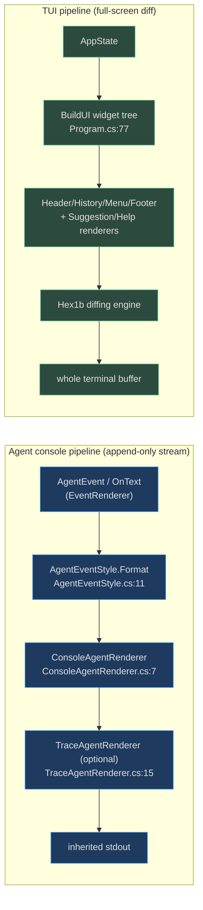
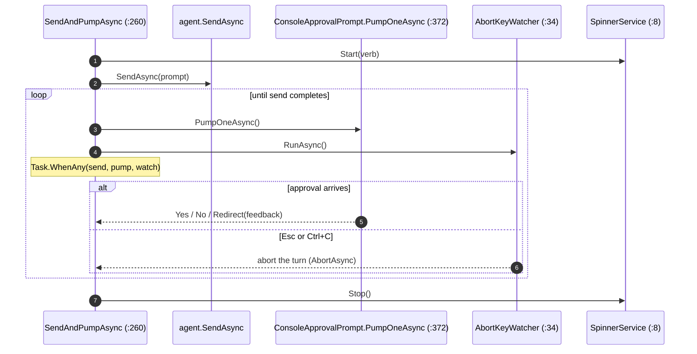

# Rendering & Terminal UX

## Why two rendering systems

Azclips draws the terminal two completely different ways, because the two client
surfaces have opposite constraints:

- **The agent** runs as a child process with **inherited stdio**
  (`src/CLI/Program.cs:369`). Its output has to remain readable as a plain,
  append-only stream that interleaves cleanly with whatever launched it — even
  when its stdout is captured by a parent (as when the TUI runs `az`). So the
  agent uses a **host-agnostic, line-oriented renderer** behind the
  `IAgentRenderer` interface.
- **The Terminal UI** owns the entire terminal buffer and repaints via the
  **Hex1b** widget library's diffing engine. It uses a declarative **widget
  tree** assembled per frame.

Understanding the split prevents a common mistake: the agent's renderer is *not*
the TUI's renderer, and neither hosts the other.

## The agent console pipeline

### The host-agnostic contract

`IAgentRenderer` (`Agent/Hosting/IAgentRenderer.cs:4`) is the seam every host
implements — console today, potentially TUI or web later:

| Member | Purpose |
|--------|---------|
| `OnText(chunk)` | streamed LLM text |
| `OnEvent(AgentEvent)` | structured tool/LLM/error events |
| `OnSpinnerFrame(frame, verb)` / `OnSpinnerStop()` | busy indicator |
| `RunExclusive(action)` | serialize an external writer (approval prompt) against internal writes |

Colors are expressed as semantic `AgentColorRole`s
(`Agent/Hosting/AgentColorRole.cs:4`) — `Default`, `Muted`, `Success`,
`Warning`, `Error`, `Highlight` — and the renderer maps them to concrete colors.

### Pure event styling

`AgentEventStyle.Format` (`Agent/Hosting/AgentEventStyle.cs:11`) is a **pure**
mapping from an `AgentEvent` to a list of styled segments, shared by any renderer.
Two policies live here: `ShowsResult` (`Agent/Hosting/AgentEventStyle.cs:141`)
returns true only for `bash`/`powershell` — those are the tool results the user
wants; query/plan tool output is internal scaffolding — and `SanitizeToolResult`
(`Agent/Hosting/AgentEventStyle.cs:154`) strips ANSI escapes, `\r`/`\b` overwrite
runs, and collapses repeated lines before display.

### The console implementation

`ConsoleAgentRenderer` (`Agent/Hosting/ConsoleAgentRenderer.cs:7`) implements the
contract for a real console. Its behavior is shaped by two flags and one latch:

- **`quiet`** (one-shot): suppresses streaming prose and tool-event lines; only
  the spinner and the final plan/errors show (`Agent/Hosting/ConsoleAgentRenderer.cs:49`).
- **`verbose`** (interactive, `agent.interactive.verbose`): additionally shows
  the args/output of non-shell tools (`Agent/Hosting/ConsoleAgentRenderer.cs:113`).
- **`_finalRendered`**: once `submit_response` has rendered, `MarkFinalRendered`
  (`Agent/Hosting/ConsoleAgentRenderer.cs:43`) drops any trailing prose the model
  streams past the terminator — wired from the host via
  `agent.SetOnFinalRendered(...)` (`Agent/AgentMode/AgentModeEntry.cs:108`).

Tool lifecycle events render through Spectre.Console for word-wrap and
indentation (`Agent/Hosting/ConsoleAgentRenderer.cs:107`); everything else uses
the flat segment path, with roles resolved to `ConsoleColor` by `Resolve`
(`Agent/Hosting/ConsoleAgentRenderer.cs:236`):

| `AgentColorRole` | `ConsoleColor` |
|------------------|----------------|
| `Muted` | `DarkGray` |
| `Success` | `Green` |
| `Warning` | `Yellow` |
| `Error` | `Red` |
| `Highlight` | `Cyan` |

### The trace decorator

When `agent.trace.enabled`, the host wraps the console renderer in
`TraceAgentRenderer` (`Agent/Hosting/TraceAgentRenderer.cs:15`), a decorator that
forwards every call to the inner renderer and *also* appends a structured JSONL
trace. It serializes each event against its **runtime type** so concrete fields
(tool name, args, token counts) survive (`Agent/Hosting/TraceAgentRenderer.cs:54`).
The host resolves the trace path — expanding a leading `~` that .NET does not
(`Agent/AgentMode/AgentModeEntry.cs:355`) — and announces the file even in quiet
mode (`Agent/AgentMode/AgentModeEntry.cs:73`).

### Keeping internal logs off the spinner

Azclips's own services (auth, engine) log through `ILoggingService` and used to
race the spinner on stdout. In agent mode, `RendererLoggingService`
(`Agent/Hosting/RendererLoggingService.cs:12`) replaces that channel: it drops
Verbose/Debug/Info and promotes Warn/Error to `HostLogEmitted` events the
renderer draws under its own lock (`Agent/Hosting/RendererLoggingService.cs:23`).
It is installed via `ScopedLoggingService.UseScope`
(`Agent/AgentMode/AgentModeEntry.cs:90`).

## Spinner, approval, and abort — sharing one stdin

Three components cooperate over a single stdin/stdout during a busy turn:

- `SpinnerService` (`Agent/Hosting/SpinnerService.cs:8`) drives a braille spinner
  and swaps its verb per tool via `VerbForTool`
  (`Agent/Hosting/SpinnerService.cs:92`). It can `Pause`/`Resume` so another
  reader can take stdin (`Agent/Hosting/SpinnerService.cs:57`).
- `ConsoleApprovalPrompt` (`Agent/Hosting/ConsoleApprovalPrompt.cs:27`) uses a
  producer→consumer channel: SDK callbacks post a request + a
  `TaskCompletionSource`, and only the host's pump thread ever touches stdin. Its
  `PumpOneAsync` (`Agent/Hosting/ConsoleApprovalPrompt.cs:372`) pauses the spinner
  and abort watcher, writes the prompt through `RunExclusive`, and reads y/n.
- `AbortKeyWatcher` (`Agent/Hosting/AbortKeyWatcher.cs:34`) polls
  `Console.KeyAvailable` (becoming a no-op on redirected stdin) so **Esc** aborts
  the turn and **Ctrl+C** quits the session
  (`Agent/Hosting/AbortKeyWatcher.cs:88`).

`SendAndPumpAsync` (`Agent/AgentMode/AgentModeEntry.cs:260`) races the send `Task`
against the approval pump and the watcher with `Task.WhenAny`, so an approval
prompt can interrupt an in-flight turn without a stdin race:

## The TUI rendering pipeline

The Terminal UI builds a **declarative widget tree** each frame in `BuildUI`
(`TUI/Program.cs:77`; the root `VStack` is at `TUI/Program.cs:87`). Composable
renderers under `TUI/Rendering/` produce the sub-trees:

| Renderer | Role | Source |
|----------|------|--------|
| `MenuBarRenderer` | top mode/menu bar | `TUI/Rendering/MenuBarRenderer.cs` |
| `HeaderRenderer` | welcome header | `TUI/Rendering/HeaderRenderer.cs` |
| `HistoryRenderer` | scrollable history, styled per `HistoryItemType` | `TUI/Rendering/HistoryRenderer.cs:8` |
| `SuggestionRenderer` | autocomplete panel | `TUI/Rendering/SuggestionRenderer.cs` |
| `HelpRenderer` | F1 help panel | `TUI/Rendering/HelpRenderer.cs` |
| `FooterRenderer` | status footer | `TUI/Rendering/FooterRenderer.cs` |

Theming comes from `TuiTheme`: `TuiTheme.Load()` reads user overrides
(`TUI/Rendering/TuiTheme.cs:208`) and `CreateBaseTheme()` clones a Hex1b base
theme (`TUI/Rendering/TuiTheme.cs:281`). Raw truecolor ANSI helpers live in
`TUI/Rendering/Ansi.cs:5` (24-bit `Fg`/`Bg` plus a named palette). Unlike the
agent's append-only stream, the TUI hands its widget tree to Hex1b, which diffs
and repaints only the changed cells of the whole buffer.

> `HistoryRenderer` has a `HistoryItemType.ToolCall` case
> (`TUI/Rendering/HistoryRenderer.cs:49`), but no code path produces a `ToolCall`
> entry — it is a latent hook, not evidence of an in-TUI agent. See
> [TUI Agent Mode & Fallback Interplay](./tui-agent-mode.md).

## Contrast at a glance

| Aspect | Agent renderer | TUI renderer |
|--------|----------------|--------------|
| Output model | append-only line stream | full-screen diffed buffer |
| Abstraction | `IAgentRenderer` + pure `AgentEventStyle` | Hex1b widget tree |
| Owns the terminal? | no (inherits stdio) | yes |
| Color | `AgentColorRole` → `ConsoleColor`/Spectre | `TuiTheme` + truecolor `Ansi` |
| Extras | spinner, approval channel, JSONL trace | menu/header/history/footer widgets, mouse |

## Related pages

- [Agent Architecture](./agent-architecture.md) — the loop that drives the agent renderer.
- [Copilot SDK Integration](./copilot-sdk-integration.md) — `EventRenderer`, the source of `AgentEvent`s.
- [Terminal UI Quickstart](../01-getting-started/tui-quickstart.md) — the TUI from a user's view.

## References

- `Agent/Hosting/IAgentRenderer.cs:4` — the host-agnostic renderer contract.
- `Agent/Hosting/ConsoleAgentRenderer.cs:7` — the console implementation.
- `Agent/Hosting/AgentEventStyle.cs:11` — pure event → styled-segment mapping.
- `Agent/Hosting/TraceAgentRenderer.cs:15` — the JSONL trace decorator.
- `Agent/Hosting/SpinnerService.cs:8` — the braille spinner.
- `Agent/Hosting/AbortKeyWatcher.cs:34` — Esc/Ctrl+C handling.
- `TUI/Program.cs:77` — `BuildUI`, the Hex1b widget-tree assembly.
- `TUI/Rendering/TuiTheme.cs:208` / `TUI/Rendering/Ansi.cs:5` — theming and ANSI helpers.
