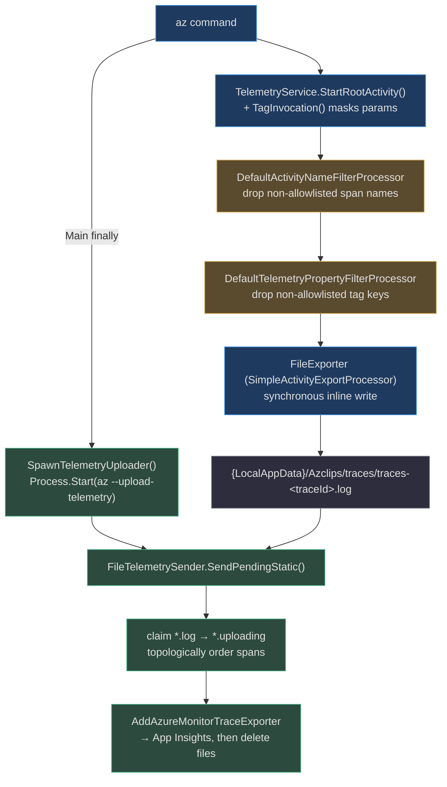
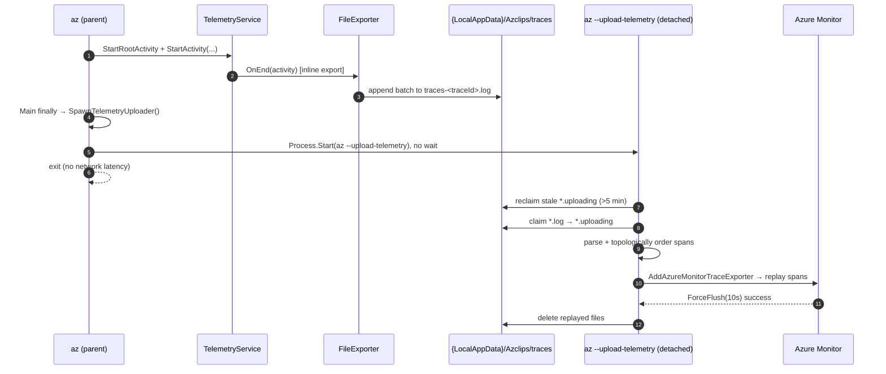

# Telemetry & Observability

## Why this design

An `az` invocation is a **short-lived** process — often milliseconds — yet its telemetry must reach Azure Monitor *reliably* and *without adding user-visible latency*. Those two goals fight each other: synchronous network upload on every command would tax interactive UX, while fire-and-forget in-process upload would be killed when the process exits. `Core.Telemetry` resolves the tension with a three-part strategy:

1. **Uniform capture.** Everything is a `System.Diagnostics.Activity` (an OpenTelemetry span). Any code wrapped in `using var _ = source.StartActivity(...)` is captured automatically — no per-call-site instrumentation (`src/Core/Core.Telemetry/TelemetryService.cs:25`).
2. **Privacy by construction.** Two deny-by-default allowlist processors run on every span's `OnEnd`, and parameter *values* are masked at the source. What leaves the machine is the *shape* of a command, never its arguments (`src/Core/Core.Telemetry/DefaultTelemetryPropertyFilter.cs:13`).
3. **Decoupled delivery.** Spans are written to local files during the command, then a **detached** `az --upload-telemetry` child process replays them to Azure Monitor after the parent exits — so the user never waits on the network (`src/Core/Core.Telemetry/FileTelemetrySender.cs:43`, `src/CLI/Program.cs:486`).

Telemetry is **on by default**; a single `az config set --key telemetry.enabled --value false` short-circuits provider construction before any exporter is attached.

## The pipeline



## Capturing activities

`TelemetryService` is the core-facing API (`src/Core/Core.Telemetry/TelemetryService.cs:13`). It opens a **root activity** per process and per-command child spans from a client-specific `ActivitySource`:

- `StartRootActivity()` opens the top-level span (`"CLI.Activity.Root"`, `"TUI.Activity.Root"`, …) and stamps per-process invariants: installation id, product name/version, schema/telemetry version, and client type (`TelemetryService.cs:28`).
- `TagInvocation(...)` walks to the root and stamps the command name, module, and **masked** parameters (`TelemetryService.cs:41`).
- `StartActivity("AzureCLI.ProcessCommand")` wraps the actual execution (`src/CLI/Program.cs:101`).

The CLI drives this explicitly around dispatch: `StartRootActivity` at `src/CLI/Program.cs:89`, `TagInvocation` at `:99`, and the per-command span at `:101`.

## Privacy model: deny-by-default

Two `BaseProcessor<Activity>` implementations are registered for **all** clients via `RegisterTelemetryServices` and run on `OnEnd` of every span (`src/Core/Core.Telemetry/DIRegisterExtensions.cs:19`). Anything not explicitly allowed is discarded.

| Processor | Backing allowlist | Behavior | Source |
|---|---|---|---|
| `DefaultActivityNameFilterProcessor` | `DefaultTelemetryActivityNameFilter` | Clears the `Recorded` flag on disallowed span *names*, so the exporter skips them | `src/Core/Core.Telemetry/DefaultActivityNameFilterProcessor.cs:31` |
| `DefaultTelemetryPropertyFilterProcessor` | `DefaultTelemetryPropertyFilter` | Deletes every tag whose *key* isn't allowlisted via `SetTag(key, null)` | `src/Core/Core.Telemetry/DefaultTelemetryPropertyFilterProcessor.cs:30` |

**What the property allowlist keeps and drops** is telling (`src/Core/Core.Telemetry/DefaultTelemetryPropertyFilter.cs:13`): it permits command name, module, masked parameters, subscription/tenant/authType, and HTTP `method`/`status_code`/`host`/`user-agent` — but **URL and path attributes are deliberately excluded**, and while `exception.type` and `exception.stacktrace` are kept, the exception *message* is **not** (`DefaultTelemetryPropertyFilter.cs:34-46`). Values whose keys survive are still safe because parameter values were already masked upstream.

**The span-name allowlist** permits only known roots, the CLI entrypoint span `AzureCLI.ProcessCommand`, a handful of engine events, and specific service/processor prefixes such as `MsalAuthService.`, `ProfileService.`, and `SetConfigCommand.` (`src/Core/Core.Telemetry/DefaultTelemetryActivityNameFilter.cs:13`, `:33`).

**Value masking at the source.** `TelemetryService.FormatParameters` renders every parameter as `-name ***`, so a command's parameter *shape* is captured with zero argument content (`TelemetryService.cs:80`). Dropped counts are tracked internally but never logged — surfacing a dropped key could itself leak the existence of a sensitive tag (`DefaultTelemetryPropertyFilterProcessor.cs:23`).

**Pseudonymous installation id.** The `InstallationId` tag is `SHA256(primaryMAC | MachineName)` computed once — stable per machine, not personally identifying (`src/Core/Core.Telemetry/TelemetryPropertyResolver.cs:26`).

### Tag catalog

The emitted tag keys are centralized so they can't drift across call sites (`src/Core/Core.Abstractions/TelemetryTags.cs:12`):

| Category | Tags |
|---|---|
| Per-process invariants | `InstallationId`, `productName`, `productVersion`, `schemaVersion`, `telemetryVersion`, `clientType`, `eventName` |
| Per-command | `command`, `module.name`, `module.version`, `parameter`, `subscriptionId`, `tenantId`, `authType`, `mode` |
| Reserved | `properties.*` prefix (product-vetted channel) |

## Per-client providers

`ITelemetryProvider` owns the `ActivitySource` and the configured `TracerProvider`. The default is a no-op `"Default"` source (`src/Core/Core.Telemetry/DefaultTelemetryProvider.cs:13`); each client subclasses it and builds a real pipeline **only after** checking the opt-out flag:

| Provider / sender | Client | Export strategy | Source |
|---|---|---|---|
| `DefaultTelemetryProvider` | fallback | no-op `TracerProvider.Default` | `src/Core/Core.Telemetry/DefaultTelemetryProvider.cs:13` |
| `CLITelemetryProvider` | `ClientType.CLI` | `FileTelemetrySender` (buffer to disk) | `src/CLI/Telemetry/CLITelemetryProvider.cs:16` |
| `TUITelemetryProvider` | `ClientType.TUI` | `FileTelemetrySender` (buffer to disk) | `TUI/Telemetry/TUITelemetryProvider.cs:13` |
| `DirectTelemetrySender` | PowerShell | Azure Monitor **inline**, no buffering | `src/Core/Core.Telemetry/DirectTelemetrySender.cs:14` |

Each provider reads `TelemetryOptions.Enabled` and **returns immediately** when telemetry is off, leaving the no-op base in place (`src/CLI/Telemetry/CLITelemetryProvider.cs:20`; `TUI/Telemetry/TUITelemetryProvider.cs:17`). When enabled, they add HTTP-client instrumentation, register the same filter processors, and attach their exporter (`CLITelemetryProvider.cs:29-44`).

The CLI registers its provider as a DI override at startup (`src/CLI/Program.cs:68`); the TUI does the same via `AzclipsServiceProvider.OverrideRegistration` (`TUI/Program.cs:31`, `:37`). The PowerShell surface uses a different delivery model entirely — see below.

## Buffer and replay

For the CLI/TUI, `FileTelemetrySender.ConfigureExporter` attaches a `SimpleActivityExportProcessor` wrapping a custom `FileExporter`, so export happens **synchronously inline** on span end (which is why `TelemetryService.Dispose` can skip `ForceFlush`) (`src/Core/Core.Telemetry/FileTelemetrySender.cs:32`; `TelemetryService.cs:95`). `FileExporter` serializes each batch to `traces-{traceId}.log` under `{LocalAppData}/Azclips/traces`, appending a timestamped JSON batch per write (`src/Core/Core.Telemetry/FileExporter.cs:27`, `:88`; `FileTelemetrySender.cs:26`).

After the command finishes and DI is disposed, `Main`'s `finally` block calls `SpawnTelemetryUploader`, which starts a detached child re-invoking the same executable with `--upload-telemetry` (`src/CLI/Program.cs:186`, `:486`). That child's very first branch calls `FileTelemetrySender.SendPendingStatic()` and exits (`src/CLI/Program.cs:43`). The uploader only runs when the host executable is `az`/`az.exe`, so in-process benchmark runs never attempt a flush (`src/CLI/Program.cs:494`).



`SendPendingStatic` is engineered for concurrent, crash-tolerant delivery (`src/Core/Core.Telemetry/FileTelemetrySender.cs:43`):

- **Crash reclaim** — stale `.uploading` files older than 5 minutes (from a crashed uploader) are renamed back to `.log` (`FileTelemetrySender.cs:49`).
- **Atomic claim** — each file is renamed to `.uploading` before reading, so concurrent uploaders never process the same file or read a partially-written one (`FileTelemetrySender.cs:64`).
- **Hierarchy-preserving replay** — because the OTel API assigns fresh SpanIds, `ReplayEntries` topologically orders parents-before-children and rewrites each child's parent context to the parent's *new* SpanId, keeping the original `TraceId` and tree intact (`FileTelemetrySender.cs:202`).
- **Delete only on success** — files are deleted only if `ForceFlush(10_000)` succeeds; otherwise they remain for the next attempt (`FileTelemetrySender.cs:128`).

## Endpoints & the PowerShell path

The Azure Monitor destination is a hard-coded connection string in `WellKnownEndpoints` (`src/Core/Core.Telemetry/WellKnownEndpoints.cs:8`). Both the buffered `FileTelemetrySender` replay and the inline `DirectTelemetrySender` target it (`FileTelemetrySender.cs:115`; `DirectTelemetrySender.cs:18`).

PowerShell cmdlets don't spawn an uploader — they use the **inline** `DirectTelemetrySender`, exporting straight to Azure Monitor through the `TracerProvider` (`src/Core/Core.Telemetry/DirectTelemetrySender.cs:14`). The bridge from PowerShell into the shared telemetry service is `src/PS/TelemetryHelper.ps1`: `Get-TelemetryService` resolves `ITelemetryService` from the DI container, and `Start-CmdletActivity` calls into `TelemetryExtensions.StartPowerShellActivity` (`src/PS/TelemetryHelper.ps1:16`, `:43`).

## Opt-out & diagnostics

**Opt-out.** Setting `telemetry.enabled=false` (or `Set-AzConfig`) makes every provider's constructor return before it wires an exporter, so nothing is captured or written (`src/CLI/Telemetry/CLITelemetryProvider.cs:20`; schema key `telemetry.enabled` at `src/Core/Core.Configuration/Schema/ConfigurationSchema.cs:20`).

```bash
az config set --key telemetry.enabled --value false
```

**Opt-in timing.** `TimingActivityListener` is a separate, local-only observability aid: when `AZCLIPS_TIMING` is set, it installs an `ActivityListener` that prints each stopped activity's elapsed time as an indented tree, reusing the *same* activities the telemetry pipeline captures (`src/Core/Core.Telemetry/TimingActivityListener.cs:19`). Ordinary users see no timing noise.

**Diagnostics logging (distinct from telemetry).** Console verbosity is governed independently by `CliLoggingPolicy`: the effective level comes from `core.logging.level` (default `error`) unless `--debug` overrides it, and severity gating decides what reaches the user (`src/CLI/CliLoggingPolicy.cs:27`, `:55`). This is the local, human-facing channel; telemetry is the remote, machine-facing one.

## References

- `src/Core/Core.Telemetry/TelemetryService.cs` — root/per-command activities, parameter masking, inline-export dispose
- `src/Core/Core.Telemetry/DefaultTelemetryPropertyFilter.cs` / `DefaultTelemetryPropertyFilterProcessor.cs` — tag-key allowlist and scrubbing
- `src/Core/Core.Telemetry/DefaultTelemetryActivityNameFilter.cs` / `DefaultActivityNameFilterProcessor.cs` — span-name allowlist and dropping
- `src/Core/Core.Telemetry/FileExporter.cs` — synchronous JSON batch append to `traces-<traceId>.log`
- `src/Core/Core.Telemetry/FileTelemetrySender.cs` — claim/reclaim/topological-replay/upload lifecycle
- `src/Core/Core.Telemetry/DirectTelemetrySender.cs` — inline Azure Monitor export (PowerShell)
- `src/Core/Core.Telemetry/WellKnownEndpoints.cs` — hard-coded Azure Monitor connection string
- `src/Core/Core.Telemetry/TelemetryPropertyResolver.cs` — pseudonymous installation id
- `src/Core/Core.Abstractions/TelemetryTags.cs` — emitted tag key catalog
- `src/Core/Core.Telemetry/DefaultTelemetryProvider.cs` / `DIRegisterExtensions.cs` — provider base and registration
- `src/Core/Core.Telemetry/TimingActivityListener.cs` — opt-in `AZCLIPS_TIMING` tree
- `src/CLI/Telemetry/CLITelemetryProvider.cs`, `TUI/Telemetry/TUITelemetryProvider.cs`, `TUI/Program.cs` — per-client providers and registration
- `src/CLI/Program.cs` — `--upload-telemetry` entrypoint and detached uploader spawn
- `src/CLI/CliLoggingPolicy.cs` — severity-gated diagnostics logging
- `src/PS/TelemetryHelper.ps1` — PowerShell → `ITelemetryService` bridge
