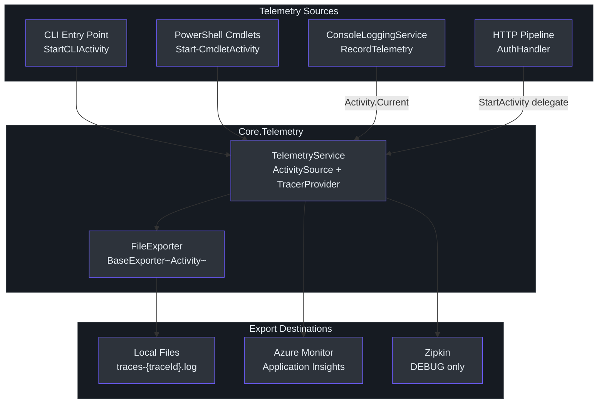
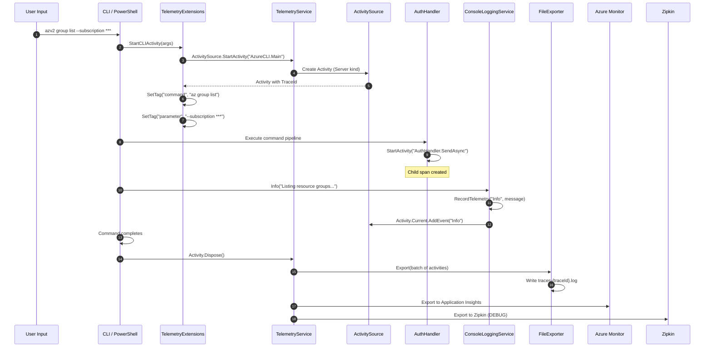

# Telemetry & Observability

Cirrus integrates OpenTelemetry as its distributed tracing backbone, routing telemetry data to three export destinations simultaneously: local trace files, Azure Monitor (Application Insights), and Zipkin (in development builds). This gives operators production-grade observability while providing developers with local debugging tools out of the box.

## Architecture Overview



## ITelemetryService Interface

The `ITelemetryService` interface (`src/Core/Core.Abstractions/ITelemetryService.cs:9`) extends `IDisposable` and defines the telemetry contract:

```csharp
public interface ITelemetryService : IDisposable
{
    ActivitySource ActivitySource { get; }           // line 14
    Activity StartActivity(string name, ActivityKind kind = ActivityKind.Internal);  // line 16
    void Flush();                                     // line 21
}
```

The `ActivitySource` property provides direct access to the OpenTelemetry `ActivitySource` for creating custom activities. `StartActivity` is a convenience wrapper, and `Flush` forces all pending telemetry data to be exported.

## TelemetryService Implementation

`TelemetryService` (`src/Core/Core.Telemetry/TelemetryService.cs:16`) is the singleton implementation registered via DI. Its constructor builds the entire OpenTelemetry pipeline:

### ActivitySource Initialization

```csharp
// TelemetryService.cs:25
ActivitySource = new ActivitySource(serviceName, serviceVersion);
```

The default `serviceName` is `"AzureCLI"` and `serviceVersion` is `"1.0.0"` (`src/Core/Core.Telemetry/TelemetryService.cs:23`).

### TracerProvider Configuration

The `TracerProvider` is built with four components (`src/Core/Core.Telemetry/TelemetryService.cs:33`):

1. **HttpClient auto-instrumentation** — records exceptions and enriches activities with the `User-Agent` header (`src/Core/Core.Telemetry/TelemetryService.cs:35`)
2. **Resource configuration** — tags all activities with service name and version (`src/Core/Core.Telemetry/TelemetryService.cs:44`)
3. **FileExporter processor** — writes traces to local disk via `SimpleActivityExportProcessor` (`src/Core/Core.Telemetry/TelemetryService.cs:48`)
4. **Azure Monitor exporter** — sends traces to Application Insights (`src/Core/Core.Telemetry/TelemetryService.cs:49`)
5. **Zipkin exporter** (DEBUG only) — sends traces to Zipkin endpoint (`src/Core/Core.Telemetry/TelemetryService.cs:54`)

### Three Export Destinations

| Destination | Availability | Configuration |
|---|---|---|
| **Local files** | Always | `%LOCALAPPDATA%/AzureCLI/traces/traces-{traceId}.log` |
| **Azure Monitor** | Always | Hardcoded connection string with instrumentation key |
| **Zipkin** | DEBUG builds only | `ZIPKIN_ENDPOINT` env var, default `http://localhost:9411/api/v2/spans` |

The Azure Monitor connection string is set at (`src/Core/Core.Telemetry/TelemetryService.cs:51`). The Zipkin exporter is conditionally compiled via `#if DEBUG` directive (`src/Core/Core.Telemetry/TelemetryService.cs:53`).

### Disposal Pattern

The `Dispose` method (`src/Core/Core.Telemetry/TelemetryService.cs:69`) implements safe disposal with a `_disposed` guard:

1. Forces a final flush of the TracerProvider (`src/Core/Core.Telemetry/TelemetryService.cs:73`)
2. Disposes the TracerProvider and ActivitySource
3. Calls `GC.SuppressFinalize(this)` (`src/Core/Core.Telemetry/TelemetryService.cs:78`)

## FileExporter

`FileExporter` (`src/Core/Core.Telemetry/FileExporter.cs:13`) is a custom OpenTelemetry exporter that extends `BaseExporter<Activity>`. It writes structured JSON trace data to local files for offline analysis.

### File Path Strategy

The file path is determined lazily on the first export call using the first activity's `TraceId` (`src/Core/Core.Telemetry/FileExporter.cs:29`):

```
{rootDirectory}/traces-{traceId}.log
```

This groups all spans from the same trace into a single file. The root directory is typically `%LOCALAPPDATA%/AzureCLI/traces/`.

### Export Format

Each batch is serialized as JSON and appended with a timestamp header (`src/Core/Core.Telemetry/FileExporter.cs:85`):

```
--- Batch at 2025-01-15T10:30:00.0000000Z ---
[{ "TraceId": "...", "SpanId": "...", ... }]
```

The trace object includes 13 properties (`src/Core/Core.Telemetry/FileExporter.cs:56`):

| Property | Source |
|---|---|
| `TraceId`, `SpanId`, `ParentSpanId` | Activity identifiers |
| `OperationName`, `DisplayName` | Activity metadata |
| `StartTime` | UTC ISO 8601 format |
| `Duration` | Total milliseconds |
| `Status`, `StatusDescription` | Activity status |
| `Kind` | Activity kind (Internal, Server, etc.) |
| `Tags` | Activity tag objects |
| `Events` | Extracted via `GetEvents()` helper (`src/Core/Core.Telemetry/FileExporter.cs:97`) |
| `Resource` | Service name/version via `GetResource()` (`src/Core/Core.Telemetry/FileExporter.cs:112`) |

Thread safety is ensured via a `lock` object (`src/Core/Core.Telemetry/FileExporter.cs:77`) protecting file writes.

## DI Registration

`DIRegisterExtensions` (`src/Core/Core.Telemetry/DIRegisterExtensions.cs:6`) provides a single extension method:

```csharp
// DIRegisterExtensions.cs:11
public static IServiceCollection RegisterTelemetryServices(this IServiceCollection services)
{
    services.AddSingleton<ITelemetryService, TelemetryService>();
    return services;
}
```

The `TelemetryService` is registered as a **singleton** (`src/Core/Core.Telemetry/DIRegisterExtensions.cs:13`), ensuring a single `ActivitySource` and `TracerProvider` instance across the application lifetime.

## TelemetryExtensions

`TelemetryExtensions` (`src/Core/Core.Telemetry/TelemetryExtensions.cs:9`) provides two entry-point methods for creating root activities:

### StartCLIActivity

`StartCLIActivity` (`src/Core/Core.Telemetry/TelemetryExtensions.cs:11`) creates the root activity for CLI invocations:

1. Creates an activity named `"AzureCLI.Main"` with `ActivityKind.Server` (`src/Core/Core.Telemetry/TelemetryExtensions.cs:13`)
2. Parses CLI arguments into commands and parameters:
   - Non-flagged args are treated as command tokens (e.g., `az group list`)
   - Flagged args (`-` prefix) are parameters with values **masked as `***`** for privacy (`src/Core/Core.Telemetry/TelemetryExtensions.cs:38`)
3. Sets two tags: `"command"` and `"parameter"` (`src/Core/Core.Telemetry/TelemetryExtensions.cs:50`)

### StartPowerShellActivity

`StartPowerShellActivity` (`src/Core/Core.Telemetry/TelemetryExtensions.cs:57`) creates the root activity for PowerShell cmdlet invocations:

1. Creates an activity named `"AzurePS.Cmdlet"` with `ActivityKind.Server` (`src/Core/Core.Telemetry/TelemetryExtensions.cs:59`)
2. Sets `"command"` tag to the cmdlet name
3. Builds sanitized parameters as `-Key ***` pairs (`src/Core/Core.Telemetry/TelemetryExtensions.cs:70`)

Both methods mask parameter values to prevent sensitive data (passwords, keys) from appearing in telemetry.

## Activity Lifecycle



## ConsoleLoggingService

`ConsoleLoggingService` (`src/Core/Core.Runtime/ConsoleLoggingService.cs:10`) implements `ILoggingService` and bridges console output with OpenTelemetry activities. Every log method follows the same pattern:

1. Writes colored output to the console
2. Calls `RecordTelemetry(level, message)` to attach the log as an `ActivityEvent` to the current trace

### Console Color Mapping

| Method | Color | Prefix |
|---|---|---|
| `Log` (`src/Core/Core.Runtime/ConsoleLoggingService.cs:12`) | Default | (none) |
| `Info` (`src/Core/Core.Runtime/ConsoleLoggingService.cs:18`) | Default | `[INFO]` |
| `Error` (`src/Core/Core.Runtime/ConsoleLoggingService.cs:24`) | `ConsoleColor.Red` | `[ERROR]` |
| `Warn` (`src/Core/Core.Runtime/ConsoleLoggingService.cs:32`) | `ConsoleColor.Yellow` | `[WARN]` |
| `Verbose` (`src/Core/Core.Runtime/ConsoleLoggingService.cs:40`) | `ConsoleColor.DarkGray` | `[VERBOSE]` |
| `Debug` (`src/Core/Core.Runtime/ConsoleLoggingService.cs:48`) | `ConsoleColor.DarkGray` | `[DEBUG]` |

### Telemetry Integration

The `RecordTelemetry` private method (`src/Core/Core.Runtime/ConsoleLoggingService.cs:56`) creates an `ActivityTagsCollection` with three tags—`"message"`, `"level"`, and `"logger"`—and attaches it as an `ActivityEvent` to `Activity.Current` (`src/Core/Core.Runtime/ConsoleLoggingService.cs:66`):

```csharp
Activity.Current?.AddEvent(new ActivityEvent(level, tags: tags));
```

This means every console log automatically appears as an event in the distributed trace—no explicit wiring required.

## PowerShell Telemetry

`TelemetryHelper.ps1` (`src/PS/TelemetryHelper.ps1`) provides PowerShell-native telemetry integration using the same `Core.Telemetry` backend.

### Get-TelemetryService

The `Get-TelemetryService` function (`src/PS/TelemetryHelper.ps1:7`) lazily initializes and caches a module-scoped telemetry service:

```powershell
$script:TelemetryService = [Core.DependencyInjection.CirrusServiceProvider]::GetRequiredService(
    [Core.Abstractions.ITelemetryService])
```

This retrieves the same singleton `TelemetryService` from the DI container (`src/PS/TelemetryHelper.ps1:13`), ensuring PowerShell cmdlets share the same `ActivitySource` and export pipeline as CLI commands.

### Start-CmdletActivity

`Start-CmdletActivity` (`src/PS/TelemetryHelper.ps1:22`) accepts a mandatory `$CmdletName` and optional `$Parameters` dictionary (`src/PS/TelemetryHelper.ps1:29`). It calls the C# extension method as a static method:

```powershell
[Core.Telemetry.TelemetryExtensions]::StartPowerShellActivity($service, $CmdletName, $Parameters)
```

(`src/PS/TelemetryHelper.ps1:40`)

### Complete-CmdletActivity

`Complete-CmdletActivity` (`src/PS/TelemetryHelper.ps1:49`) finalizes an activity with success/error status:

- **Success**: Sets `ActivityStatusCode::Ok` (`src/PS/TelemetryHelper.ps1:69`)
- **Failure**: Sets `ActivityStatusCode::Error` with message, creates an error `ActivityEvent` with the message tag (`src/PS/TelemetryHelper.ps1:72`)
- Always calls `$Activity.Dispose()` (`src/PS/TelemetryHelper.ps1:80`)

### Stop-Telemetry

`Stop-Telemetry` (`src/PS/TelemetryHelper.ps1:88`) disposes the telemetry service and clears the cached reference. The module exports three functions (`src/PS/TelemetryHelper.ps1:100`):

```powershell
Export-ModuleMember -Function Start-CmdletActivity, Complete-CmdletActivity, Stop-Telemetry
```

## Zipkin Dev Container Integration

The dev container is configured for Zipkin integration via Docker Compose. The `docker-compose.yml` (`.devcontainer/docker-compose.yml`) runs two services:

- **app** — the development container with `ZIPKIN_ENDPOINT=http://zipkin:9411/api/v2/spans`
- **zipkin** — the `openzipkin/zipkin` image with health checks

The `devcontainer.json` (`.devcontainer/devcontainer.json`) forwards port 9411 with a `"Zipkin UI"` label and sets `ZIPKIN_ENDPOINT` in `remoteEnv`. When the TelemetryService is built in DEBUG mode, the Zipkin exporter reads this environment variable (`src/Core/Core.Telemetry/TelemetryService.cs:56`).

## Application Insights Configuration

The Azure Monitor exporter uses a hardcoded connection string (`src/Core/Core.Telemetry/TelemetryService.cs:51`) pointing to an East US Application Insights resource. This connection string includes:

| Component | Value |
|---|---|
| Instrumentation Key | `75095e49-0ed7-43bf-9a9b-145ce55963c5` |
| Ingestion Endpoint | `https://eastus-8.in.applicationinsights.azure.com/` |
| Live Endpoint | `https://eastus.livediagnostics.monitor.azure.com/` |

The benchmark project (`tests/Benchmark/AppInsightsExporter.cs:20`) uses the same connection string for exporting benchmark metrics, creating a unified observability backend.

## HttpClient Auto-Instrumentation

The TracerProvider configuration includes HttpClient instrumentation (`src/Core/Core.Telemetry/TelemetryService.cs:35`) that:

- Automatically creates child spans for all `HttpClient` calls
- Records exceptions (`RecordException = true`, `src/Core/Core.Telemetry/TelemetryService.cs:37`)
- Enriches request spans with the `User-Agent` header via the `EnrichWithHttpRequestMessage` callback (`src/Core/Core.Telemetry/TelemetryService.cs:38`)

This means every HTTP request through the pipeline (via `HttpClientFactory`) generates a child span automatically, without any explicit instrumentation in the pipeline handlers.

## References

| Source File | Key Elements |
|---|---|
| `src/Core/Core.Telemetry/TelemetryService.cs` | `TelemetryService`, TracerProvider, ActivitySource, three exporters |
| `src/Core/Core.Telemetry/FileExporter.cs` | Custom file-based trace exporter |
| `src/Core/Core.Telemetry/DIRegisterExtensions.cs` | Singleton DI registration |
| `src/Core/Core.Telemetry/TelemetryExtensions.cs` | `StartCLIActivity`, `StartPowerShellActivity` |
| `src/Core/Core.Runtime/ConsoleLoggingService.cs` | Console logging with activity event integration |
| `src/Core/Core.Abstractions/ITelemetryService.cs` | Telemetry service interface |
| `src/PS/TelemetryHelper.ps1` | PowerShell telemetry functions |
| `.devcontainer/docker-compose.yml` | Zipkin container configuration |
| `.devcontainer/devcontainer.json` | Port forwarding and environment setup |
