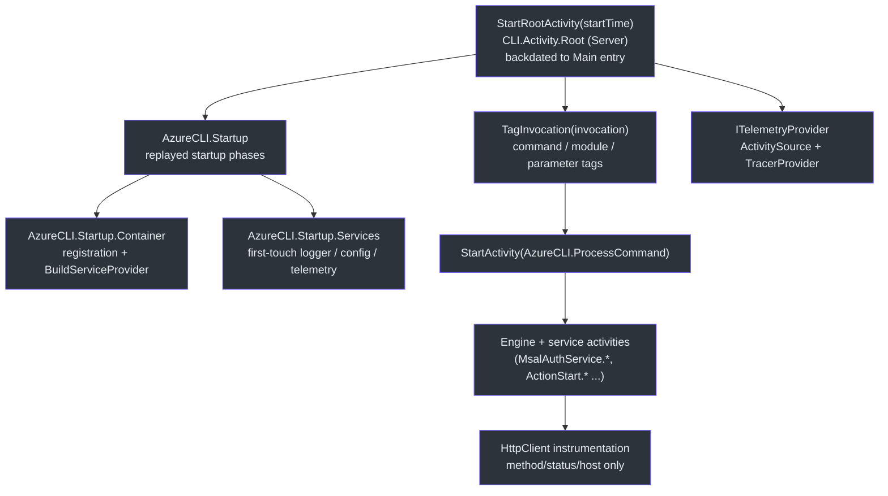

# Telemetry & Observability

## Overview — why this design

Azclips is a short-lived command-line process: a single `az` invocation may last only milliseconds, yet its telemetry must reach Azure Monitor reliably without adding user-visible latency. `Core.Telemetry` reconciles three competing goals:

1. **Privacy first.** Only command *names*, parameter *names*, success/failure, and basic environment data leave the machine — never parameter values, URLs, or other personal content (`README.md:153`). This is enforced structurally by allow-list processors, not by trusting call sites.
2. **Zero blocking on exit.** The CLI must not wait on a network round-trip to App Insights. Activities are exported synchronously to *local files*, and a **detached** background process replays them later (`src/CLI/Program.cs`).
3. **Uniform capture.** Everything is a `System.Diagnostics.Activity` (an OpenTelemetry span). Any code that wraps work in `using var _ = source.StartActivity(...)` is captured automatically (`eng-docs/spec/telemetry.md`).

Telemetry is built on OpenTelemetry for .NET and is **on by default**; opt out with `telemetry.enabled=false` (`README.md:157-166`). Targets `net10.0`; the internal assembly namespace is `Azclips`.

## Activity capture

`TelemetryService` is the core-facing API. It starts a **root activity** per process and per-command child activities from a client-specific `ActivitySource` (`src/Core/Core.Telemetry/TelemetryService.cs:19-40`). The CLI drives it explicitly: `StartRootActivity` opens the greatest ancestor span, `TagInvocation` stamps the command/module/parameter tags onto that root, and `StartActivity("AzureCLI.ProcessCommand")` wraps the actual execution (`src/CLI/Program.cs`).



### Startup phases

`CLITelemetryProvider` creates both the `ActivitySource` and the `TracerProvider` that
listens to it, so until DI has resolved it there is no listener and `StartActivity`
returns `null` — the container build cannot be traced live. `PerformanceTimeline`
(`src/Core/Core.Telemetry/PerformanceTimeline.cs`) closes that gap: it notes `DateTime.UtcNow`
the phases as spans once telemetry exists, passing the recorded times through the
`startTime` parameter OpenTelemetry provides for work that has already happened. The root
activity is backdated to the first line of `Main` so the replayed phases nest beneath it.

`Container` covers the registration callbacks and `BuildServiceProvider()`; `Services`
covers the first-touch construction of `ILoggingService`, `IConfigurationService`, and
`ITelemetryService` — the last of which builds the entire OpenTelemetry pipeline. They are
measured separately because `BuildServiceProvider()` only builds the container's metadata
graph: singletons are constructed lazily on first `GetRequiredService`.

`--upload-telemetry`, `--print-probe`, `--completions`, and `--completion-candidates` all
return before the root activity starts and emit nothing.

The root span is enriched with per-process invariants — a machine-derived `Id`, Microsoft-internal flag, product name/version, schema/telemetry version, and `ClientType` — resolved once by `TelemetryPropertyResolver` (`src/Core/Core.Telemetry/TelemetryService.cs:28-40`; `src/Core/Core.Telemetry/TelemetryPropertyResolver.cs:14-33`).

### PowerShell module import

The PowerShell client is long-lived: one process serves many cmdlets, each opening its own
root activity. Module import happens once, before any of them, so it is emitted as its own
trace rather than nested under a cmdlet — attaching backdated phases to a cmdlet root would
put a child before its parent, which renders incorrectly in Jaeger and Application Insights.

```
PowerShell.Activity.Root          importKind = cold | warm
└── PowerShell.Startup
    └── PowerShell.Startup.Container
```

`ModuleInitializer.OnImport` records the phases with `PerformanceTimeline` and hands the
emit to a background thread (`ImportTelemetry.EmitInBackground`). It cannot emit inline:
resolving `ITelemetryService` builds the whole OpenTelemetry pipeline, which costs about
84 ms against a 21.6 ms import, so inline instrumentation would roughly quadruple import
time and report a figure inflated by its own cost. Running it in the background also
pre-warms the stack, so the first cmdlet no longer pays for it.

`importKind` distinguishes the first import in a process (`cold`) from later ones (`warm`);
PowerShell does not unload the module assembly on `Remove-Module`, so a static counter
survives a remove/re-import cycle. `PowerShell.Startup.Container` measures the same
work as `CLI.Startup.Container`, so DI container build cost is comparable across
clients.

Two limits are worth knowing. `OnImport` runs near the end of PowerShell's module load
sequence, so assembly loading, manifest processing, and cmdlet export processing are not
captured. And because the emit is deferred, a process that exits immediately after import
emits nothing — such a session runs no cmdlets, so it produces no telemetry either way.

### Per-client providers

`ITelemetryProvider` owns the `ActivitySource` and the configured `TracerProvider`. Each client subclasses `DefaultTelemetryProvider` and builds its own pipeline (`src/Core/Core.Telemetry/DefaultTelemetryProvider.cs:13-22`):

| Provider | Client | Exporter | Source |
| --- | --- | --- | --- |
| `CLITelemetryProvider` | `ClientType.CLI` | `FileTelemetrySender` (file buffer) | `src/CLI/Telemetry/CLITelemetryProvider.cs:16-45` |
| `TUITelemetryProvider` | `ClientType.TUI` | `FileTelemetrySender` (file buffer) | `TUI/Telemetry/TUITelemetryProvider.cs:14-45` |
| `DirectTelemetrySender` (PowerShell) | — | Resolved targets inline, no buffering | `src/Core/Core.Telemetry/DirectTelemetrySender.cs` |

The `telemetry.enabled` opt-out is enforced in `TelemetryService.StartActivity` / `StartRootActivity` at call time — the service reads `TelemetryOptions.Enabled` via `IConfigurationService` on every span and returns `null` when disabled, so `Set-AzConfig` / `az config set` take effect on the very next cmdlet without a module reload (`src/Core/Core.Telemetry/TelemetryService.cs`, `src/Core/Core.Abstractions/TelemetryOptions.cs:6-8`). Providers always build the full pipeline regardless of the config value, so the opt-out is symmetric in both directions. All providers register the same filter processors, HTTP-client instrumentation, and resource service name via `ProcessUtils.GetRunningProcess()` (`src/CLI/Telemetry/CLITelemetryProvider.cs:25-44`).

## Export targets

Where telemetry goes is resolved separately from whether it is collected. `TelemetryTargetResolver`
returns a never-empty set of targets:

| Build | Default targets | Notes |
| --- | --- | --- |
| Debug | Local **and** Remote | Jaeger for fast feedback, Azure Monitor to prove the remote path still works |
| Release | Remote | Unchanged from previous behaviour |

In a Debug build the default can be overridden with `AZCLIPS_TELEMETRY_TARGET`, which accepts
exactly `local`, `remote`, or `both`. Anything else — including an empty value — falls back to the
compiled default. There is no `none`: disabling remote export while developing is
`AZCLIPS_TELEMETRY_TARGET=local`, and disabling telemetry entirely is `telemetry.enabled=false`.

```bash
# Debug only: stop sending your local runs to Application Insights.
AZCLIPS_TELEMETRY_TARGET=local az group list
```

**Release ignores the variable completely.** The suppression lives in the resolver's environment
reader rather than in its parser, so a shipped binary has no override path at all. This is
deliberate: once the resolver can express more than one target, honouring the variable in Release
would let anything able to set an environment variable redirect a user's telemetry to a local
collector, on a port that `AZCLIPS_OTLP_PORT` also controls.

Because Debug spans go to the same Application Insights resource as production traffic, and no tag
distinguishes them, locating your own runs means correlating on `InstallationId`. Marking dev traffic
with a build-configuration tag is deferred: the value is available from
`AssemblyConfigurationAttribute`, and the key would also need adding to
`DefaultTelemetryPropertyFilter`'s allow-list, which is deny-by-default.

## Privacy model — the allow-list processors

Two `BaseProcessor<Activity>` implementations run on `OnEnd` of every activity and are registered for all clients via `RegisterTelemetryServices` (`src/Core/Core.Telemetry/DIRegisterExtensions.cs:19-28`). They implement a **deny-by-default** model: anything not explicitly allowed is dropped.

| Processor | Filter | Effect |
| --- | --- | --- |
| `DefaultActivityNameFilterProcessor` | `DefaultTelemetryActivityNameFilter` | Clears the `Recorded` flag on disallowed activity *names*, so the exporter skips them entirely (`src/Core/Core.Telemetry/DefaultActivityNameFilterProcessor.cs:31-41`) |
| `DefaultTelemetryPropertyFilterProcessor` | `DefaultTelemetryPropertyFilter` | Deletes every tag whose *key* isn't allow-listed via `SetTag(key, null)` (`src/Core/Core.Telemetry/DefaultTelemetryPropertyFilterProcessor.cs:30-54`) |

The name filter permits only known roots (`CLI.Activity.Root`, `TUI.Activity.Root`, …), `AzureCLI.ProcessCommand`, specific engine events, and a handful of service/processor prefixes (`src/Core/Core.Telemetry/DefaultTelemetryActivityNameFilter.cs:13-58`). The property filter's allow-list is telling: it keeps `http.method`, `http.status_code`, and `http.host`, but **URL/path attributes are deliberately excluded**, and `exception.type`/`exception.stacktrace` are kept while the exception *message* is not (`src/Core/Core.Telemetry/DefaultTelemetryPropertyFilter.cs:33-46`).

Even parameter **values** are masked at the source: `TelemetryService.FormatParameters` renders every parameter as `-name ***`, so a command's shape is captured without any argument content (`src/Core/Core.Telemetry/TelemetryService.cs:81-94`). Dropped counts are tracked internally but never logged — surfacing a dropped key could itself leak the existence of a sensitive tag (`src/Core/Core.Telemetry/DefaultTelemetryPropertyFilterProcessor.cs:23-28`).

## Async export path

For the CLI/TUI, `FileTelemetrySender.ConfigureExporter` attaches a `SimpleActivityExportProcessor` wrapping a custom `FileExporter` — export happens **synchronously inline** on activity end (which is why `TelemetryService.Dispose` skips `ForceFlush`) (`src/Core/Core.Telemetry/FileTelemetrySender.cs`; `src/Core/Core.Telemetry/TelemetryService.cs:96-106`). Note that `ConfigureExporter` no longer takes a directory argument — the trace directory is owned by `TraceFileStore.DefaultDirectory` (`src/Core/Core.Telemetry/TraceFileStore.cs`). `FileExporter` serializes each batch to `traces-{traceId}.log` under `%LocalAppData%/Azclips/traces`, appending a timestamped JSON batch per write (`src/Core/Core.Telemetry/FileExporter.cs:27-89`).

After the command finishes and DI is disposed, `Main`'s `finally` fires `SpawnTelemetryUploader`, which starts a **detached** child process re-invoking the same executable with `--upload-telemetry` — fire-and-forget, so the CLI exits immediately (`src/CLI/Program.cs`). That child's very first branch calls `TelemetryUpload.RunPending()` and returns (`src/Core/Core.Telemetry/TelemetryUpload.cs`).

Because that child outlives `az`, it must not inherit the CLI's stdio. A pipe reader (`az ... | jq`) only sees EOF once *every* writer has closed its end, so an inherited stdout would make the shell wait for the upload instead of for the command. Two things prevent that: the child's three streams are redirected (on Unix, exec replaces descriptors 0–2 outright), and on Windows `DetachedStdio.SuppressStandardHandleInheritance` first clears `HANDLE_FLAG_INHERIT` on our standard handles — `Process.Start` always calls `CreateProcess` with `bInheritHandles: true`, which would otherwise duplicate them into the child regardless of redirection (`src/CLI/Telemetry/DetachedStdio.cs`).

```mermaid
sequenceDiagram
    autonumber
    participant Cmd as az (foreground)
    participant Exp as FileExporter
    participant Disk as ~/AppData/.../Azclips/traces
    participant Up as az --upload-telemetry (detached)
    participant AM as Azure Monitor
    Cmd->>Exp: activity OnEnd (filtered)
    Exp->>Disk: append traces-{traceId}.log
    Cmd->>Cmd: dispose DI, return exit code
    Cmd->>Up: SpawnTelemetryUploader() (Process.Start, no wait)
    Cmd-->>Cmd: process exits
    Up->>Disk: claim .log -> rename .uploading (TraceFileStore)
    Up->>Up: parse batches, group by service.name (TraceUploader)
    Up->>Up: topologically order + remap SpanIds (TraceReplayer)
    Up->>AM: replay + ForceFlush(10s) (TracerProviderExportSink)
    AM-->>Up: flush ok
    Up->>Disk: delete uploaded files

    style Cmd fill:#2d333b,stroke:#6d5dfc,color:#e6edf3
    style Exp fill:#2d333b,stroke:#6d5dfc,color:#e6edf3
    style Disk fill:#2d333b,stroke:#6d5dfc,color:#e6edf3
    style Up fill:#2d333b,stroke:#6d5dfc,color:#e6edf3
    style AM fill:#2d333b,stroke:#6d5dfc,color:#e6edf3
```

### The uploader (`TraceUploader`)

`TraceUploader.Run` is engineered for concurrent, crash-tolerant delivery (`src/Core/Core.Telemetry/TraceUploader.cs`):

- **Stale reclaim** — `.uploading` files older than 5 minutes (from a crashed uploader) are renamed back to `.log`.
- **Atomic claim** — each `.log` is renamed to `.uploading` before reading, so concurrent uploaders and in-flight writers never process the same file. This claim protocol is owned by `TraceFileStore.ClaimPending` (`src/Core/Core.Telemetry/TraceFileStore.cs`).
- **Group by service** — `TraceUploader.Run` groups traces by original `service.name` so each replays with the correct `cloud_RoleName` (CLI vs PowerShell) in App Insights (`src/Core/Core.Telemetry/TraceUploader.cs`).
- **Hierarchy-preserving replay** — because the OTel API assigns fresh SpanIds, `TraceReplayer.ReplayEntries` topologically orders parents-before-children and rewrites each child's parent context to the parent's *new* SpanId, keeping the original `TraceId` and tree intact (`src/Core/Core.Telemetry/TraceReplayer.cs`).
- **Delete only on success** — `TracerProviderExportSink.TryExport` returns false on a failed flush, leaving files on disk for `TraceUploader.Run` to retry on the next attempt. With more than one target it builds **one provider per target** and flushes each independently, then reports the verdict of the highest-ranked target present (Remote outranks Local). A stopped Jaeger container therefore never pins trace files on a developer's machine, while a developer who asked for local-only still gets retries.

The Azure Monitor destination is a hard-coded connection string in `WellKnownEndpoints` (`src/Core/Core.Telemetry/WellKnownEndpoints.cs`), used by both Debug and Release builds. Note the uploader itself only runs when the host executable is `az`/`az.exe`, so in-process benchmark runs never attempt to flush (`src/CLI/Program.cs`).

## Local timing — `TimingActivityListener`

For local diagnostics, `TimingActivityListener` provides an opt-in `ActivityListener` that prints each stopped activity's elapsed time as an indented tree. It installs only when `AZCLIPS_TIMING` is set, so ordinary users see no timing noise, and it reuses the *same* activities the telemetry pipeline captures — no per-call-site stopwatch wiring (`src/Core/Core.Telemetry/TimingActivityListener.cs:19-56`).

## Opt-out

Setting `telemetry.enabled=false` short-circuits provider construction before any exporter is attached (`src/CLI/Telemetry/CLITelemetryProvider.cs:20-21`):

```bash
# CLI
az config set --key telemetry.enabled --value false
```
```powershell
# PowerShell
Set-AzConfig -Key telemetry.enabled -Value false
```

With telemetry disabled, the client keeps the base `DefaultTelemetryProvider` whose `TracerProvider` is `TracerProvider.Default` — activities may start but nothing is exported to disk or Azure Monitor (`src/Core/Core.Telemetry/DefaultTelemetryProvider.cs:18-22`).

## References

- `src/Core/Core.Telemetry/TelemetryService.cs` — root/child activities, tag enrichment, parameter masking
- `src/Core/Core.Telemetry/DefaultTelemetryPropertyFilter.cs` / `DefaultTelemetryActivityNameFilter.cs` — allow-lists
- `src/Core/Core.Telemetry/DefaultTelemetryPropertyFilterProcessor.cs` / `DefaultActivityNameFilterProcessor.cs` — OnEnd scrubbing
- `src/Core/Core.Telemetry/FileExporter.cs` — synchronous JSON file buffer
- `src/Core/Core.Telemetry/FileTelemetrySender.cs` — configures the file-buffer exporter
- `src/Core/Core.Telemetry/TraceFileStore.cs` — trace directory, file naming, claim protocol
- `src/Core/Core.Telemetry/TraceFileFormat.cs` — on-disk batch format, shared by writer and reader
- `src/Core/Core.Telemetry/TraceReplayer.cs` — hierarchy-preserving replay
- `src/Core/Core.Telemetry/TraceUploader.cs` / `TelemetryUpload.cs` — orchestration and composition root
- `src/Core/Core.Telemetry/DirectTelemetrySender.cs`, `WellKnownEndpoints.cs` — direct export + Azure Monitor endpoint
- `src/Core/Core.Telemetry/TimingActivityListener.cs`, `DIRegisterExtensions.cs` — local timing + DI wiring
- `src/CLI/Program.cs` — root activity, `--upload-telemetry`, detached spawn
- `eng-docs/spec/telemetry.md`, `README.md:151-166` — telemetry spec and opt-out
