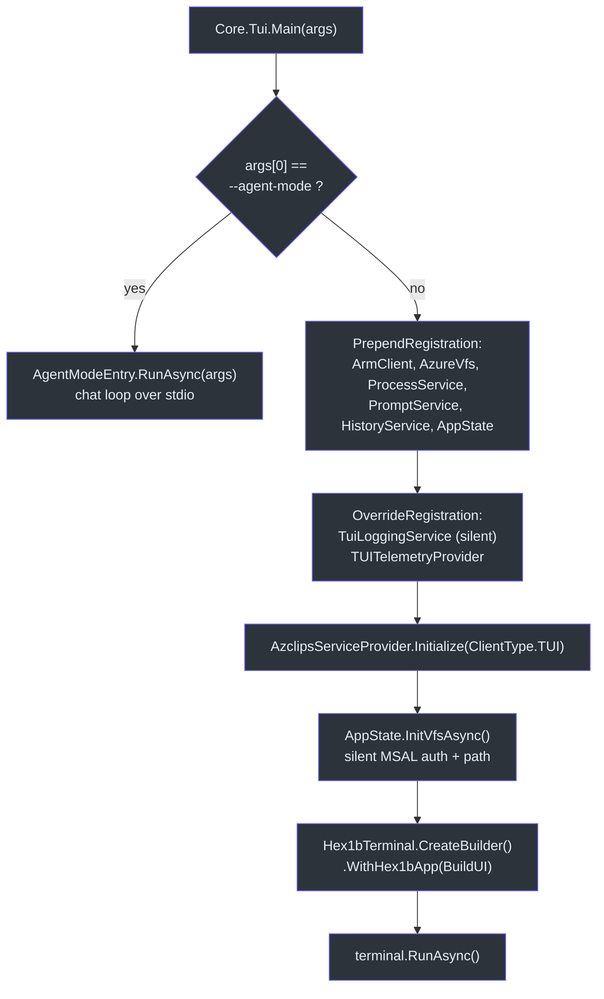
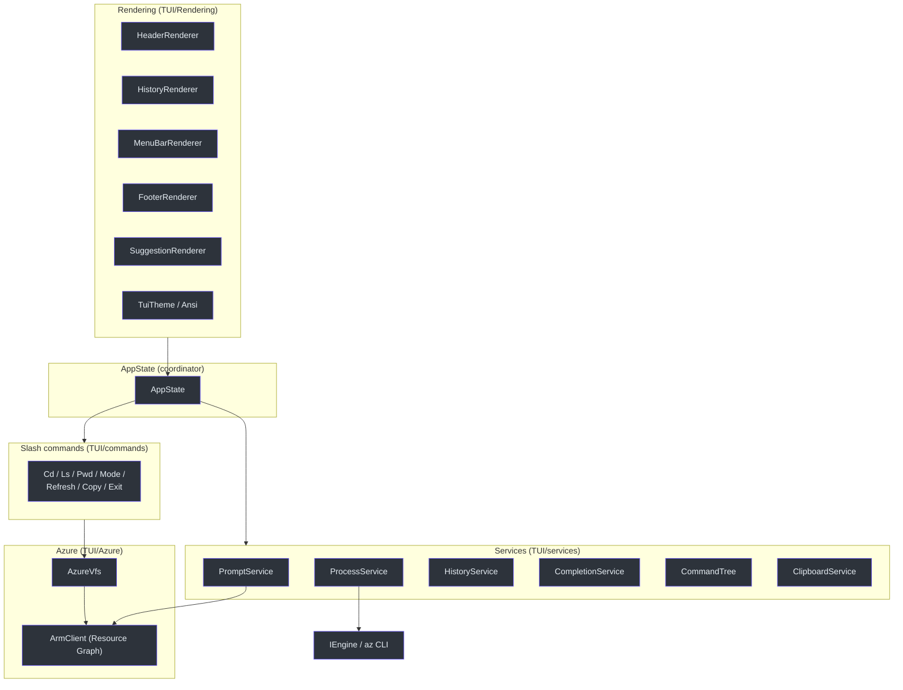

# Terminal UI (TUI)

## Overview — why a separate project

`Core.Tui` is a standalone executable (`OutputType=Exe`, `RootNamespace=Core.Tui`) that exists to solve two very different problems with one binary (`TUI/Core.Tui.csproj:4-7`):

1. **Agent-mode recovery process.** When a classic `az` command fails, the CLI does *not* run the AI agent in-process. Instead it spawns `Core.Tui.exe --agent-mode` as a child process that inherits the terminal's stdio (`src/CLI/Program.cs:320-361`). Isolating the agent in its own process keeps the agent's streaming output, `y/n` approval pump, and device-code links from corrupting the parent CLI, and lets the child own `Ctrl+C` cancellation cleanly.
2. **Interactive full-screen Azure shell.** Run with no arguments, the same binary boots a full-screen TUI on the **Hex1b** widget/layout library, presenting Azure resources as a navigable virtual filesystem with slash commands, autocompletion, and dual Azure/Local shell modes.

Both modes share the **same** `AzclipsServiceProvider` DI container and the same `IEngine`/`IAuthService`/`IProfileService` core services — the TUI is a *client* (`ClientType.TUI`) sitting on top of the identical core the CLI and PowerShell clients use (`TUI/Program.cs:43`, `TUI/AgentMode/AgentModeEntry.cs:33`).

> Terminology: the project codename is **Azclips**; the DI container, telemetry service names, and the on-disk `~/.azclips` folder all use the `Azclips` name. Targets `net10.0`.

## Entry point: mode selection

`Program.Main` branches on the very first argument before touching DI. A leading `--agent-mode` short-circuits into the agent chat loop; anything else falls through to the interactive shell (`TUI/Program.cs:21-43`).



### TUI-specific DI overrides

Because the interactive shell paints the whole terminal, any stray console write corrupts the display. Two registrations are swapped in *before* `Initialize` (`TUI/Program.cs:25-41`):

| Override | Replaces | Why |
| --- | --- | --- |
| `TuiLoggingService` | `ScopedLoggingService`/`ConsoleLoggingService` | A **silent** `ILoggingService` — every method is a no-op, so `[VERBOSE]`/`[DEBUG]` text can't leak onto the canvas (`TUI/services/TuiLoggingService.cs:11-19`). |
| `TUITelemetryProvider` | `DefaultTelemetryProvider` | Builds a TUI-scoped OpenTelemetry pipeline (`ActivitySource("TUI")`) writing to the shared file buffer (`TUI/Telemetry/TUITelemetryProvider.cs:14-45`). |

`PrependRegistration` additionally wires the shell-only singletons (`ArmClient`, `AzureVfs`, `ProcessService`, `PromptService`, `HistoryService`, `AppState`) into the same container the core already populates (`TUI/Program.cs:25-33`).

## Mode A — agent mode (`AgentModeEntry`)

`AgentModeEntry.RunAsync` is the process the CLI spawns on failure. It owns the chat loop, the banner, and — critically — a **single stdin reader** so the approval pump and the `> ` prompt never fight over the console (`TUI/AgentMode/AgentModeEntry.cs:10-15`).

### Prompt selection & quiet mode

The agent's entrypoint prompt is chosen by interaction mode, read from `AgentOptions` (`TUI/AgentMode/AgentModeEntry.cs:42-48`):

| `agentOpts.IsInteractive` | `entrypoint` | Banner | Behaviour |
| --- | --- | --- | --- |
| `true` | `inline` | shown | Opens a `> ` chat loop after the first turn |
| `false` (one-shot) | `oneshot` | suppressed (`quiet`) | Proposes a fix, closes with `submit_response`, never opens a prompt |

The CLI passes the failed command and error text as `--failed-command` / `--error`, which become the agent's first prompt (`TUI/AgentMode/AgentModeEntry.cs:30-31,109-111`).

### Optional JSONL trace

When `agent.trace.enabled` is set, the console renderer is wrapped by a `TraceAgentRenderer` that records a JSONL file under `agent.trace.path` (default `%LOCALAPPDATA%/.azclips/agent/trace`). Because .NET does not expand a leading `~`, `AgentModeEntry` expands it manually so the trace lands under the user profile rather than a literal `~` directory (`TUI/AgentMode/AgentModeEntry.cs:59-72,353-361`).

### Escape-valve turn limits

The chat loop counts *user → agent* messages (internal self-correction re-sends are excluded) and never resets. Two hard-coded MVP thresholds bound a runaway session (`TUI/AgentMode/AgentModeEntry.cs:17-22,197-206`):

| Constant | Value | Effect |
| --- | --- | --- |
| `EscapeValveSoftTurns` | `12` | Prints a soft reminder to type `exit` / `Ctrl+C` |
| `EscapeValveHardTurns` | `20` | Aborts the agent and ends the session |

A second guard, `MaxToolEnforcementRetries = 3`, re-prompts the model if a turn produced only prose instead of calling `propose_plan`/`submit_response` — the host-side backstop for the "always act through tools" contract (`TUI/AgentMode/AgentModeEntry.cs:214-254`).

### Single-reader stdin & the pump

```mermaid
sequenceDiagram
    autonumber
    participant CLI as az (parent)
    participant TUI as Core.Tui --agent-mode
    participant Agent as ChatAgent
    participant Pump as ConsoleApprovalPrompt
    CLI->>TUI: spawn (stdio inherited, AZCLIPS_IN_AGENT_MODE=1)
    TUI->>TUI: PrintBanner + build first prompt
    TUI->>Agent: SendAsync(prompt)
    loop until sendTask completes
        TUI->>Pump: PumpOneAsync (reads y/n)
        Pump-->>TUI: approve / reject+feedback / abort
        alt reject + free-text feedback
            TUI->>Agent: AbortAsync + replay feedback as next turn
        end
    end
    Agent-->>TUI: submit_response (SessionClosed)
    TUI-->>CLI: exit code (0 / 130 / 1)

    style CLI fill:#2d333b,stroke:#6d5dfc,color:#e6edf3
    style TUI fill:#2d333b,stroke:#6d5dfc,color:#e6edf3
    style Agent fill:#2d333b,stroke:#6d5dfc,color:#e6edf3
    style Pump fill:#2d333b,stroke:#6d5dfc,color:#e6edf3
```

A shared `AbortKeyWatcher` is *paused* (not destroyed) while the approval pump reads `y/n`, which is how one reader stays authoritative over stdin; `Task.WhenAny` races the in-flight send against the pump and the watcher (`TUI/AgentMode/AgentModeEntry.cs:75-83,276-308`).

### Recursion guard — `AZCLIPS_IN_AGENT_MODE`

A failed `az` invoked *from inside* an already-running agent-mode TUI (e.g. via a proposed command) must not spawn yet another agent. The CLI sets `AZCLIPS_IN_AGENT_MODE=1` on the child's environment when it spawns the TUI (`src/CLI/Program.cs:339`), and its agent-fallback path returns early whenever that variable is already `1` (`src/CLI/Program.cs:313-318`). The same fallback also bails out when stdio is redirected (CI / pipes), keeping the agent strictly interactive-only (`src/CLI/Program.cs:308-311`).

## Mode B — the interactive shell

The interactive shell is a Hex1b application. `BuildUI` composes a vertical stack — menu bar, scrollable history panel (or welcome/help), a running-spinner slot, suggestions, and the prompt + `TextBox` — and registers global key bindings (`F1` help, `F2` mode toggle, `Enter`, `Esc`, `Ctrl+C`, `Tab`, arrows, `Ctrl+L`) (`TUI/Program.cs:80-321`). The base look is Hex1b's `Ocean` theme cloned as `"azclips"` (`TUI/Rendering/TuiTheme.cs:281`).

### Component map



### `AppState` — the coordinator

`AppState` is the single mutable state object bound to the Hex1b app. It holds the shared `TextBoxState` (so the widget and the state operate on one cursor/buffer), a thread-safe history list, the current `ShellMode`, and delegates to the four services. `Invalidate`/`RequestStop` callbacks are wired from the Hex1b `app` so services can request a repaint or shutdown (`TUI/AppState.cs:14-56,92-112`). `ExecuteCommand` routes input three ways: slash commands (`/…`), local shell commands, or `az` CLI invocations — with a special case that re-authenticates the VFS after a successful `login` (`TUI/AppState.cs:254-321`).

### `AzureVfs` — Azure as a filesystem

`AzureVfs` maps the Azure hierarchy onto POSIX-style paths (`TUI/Azure/AzureVfs.cs:6-17`):

```
/ (root)
└─ {tenant}
   └─ {subscription}
      └─ {resourceGroup}
         └─ {resource} [{type}]
```

It supports `cd` (absolute, relative, `..`, `~`), `ls`, `tree`, and prefix/substring path completion, resolving each level lazily and caching the full resource tree in memory (`TUI/Azure/AzureVfs.cs:106-265`). The tenant comes from the active profile (`IProfileService`); subscriptions, resource groups, and resources all come from a single **Azure Resource Graph** query issued by `ArmClient`, which acquires tokens silently from the shared MSAL cache via `IAuthService` (`TUI/Azure/AzureVfs.cs:32-55`, `TUI/Azure/ArmClient.cs:12-54`). A background preload kicks off after the initial path is set so navigation feels instant (`TUI/Azure/AzureVfs.cs:92-98`).

### Slash commands

Each command is a self-contained `ISlashCommand` with a `Verb`, `Description`, `Execute`, and optional async completion (`TUI/commands/ISlashCommand.cs:28-53`). They receive a `CommandContext` carrying the VFS, history sink, mode, cwd, and callbacks (`TUI/commands/ISlashCommand.cs:8-22`).

| Verb | Purpose | Source |
| --- | --- | --- |
| `/cd` | Navigate Azure VFS or local FS; supports completion in both modes | `TUI/commands/CdCommand.cs:11-27` |
| `/ls` | List children of current/target path | `TUI/commands/LsCommand.cs` |
| `/pwd` | Print working path (Azure or local) | `TUI/commands/PwdCommand.cs` |
| `/mode` | Toggle Azure ⇆ Local shell mode | `TUI/commands/ModeCommand.cs:20-27` |
| `/refresh` | Drop the cached resource tree | `TUI/commands/RefreshCommand.cs:14-22` |
| `/copy [n]` | Copy last command's output to the system clipboard (ANSI stripped) | `TUI/commands/CopyCommand.cs:16-72` |
| `/exit` | Request Hex1b app stop | `TUI/commands/ExitCommand.cs:11-15` |

`AppState` registers them into a case-insensitive dictionary and dispatches by verb (`TUI/AppState.cs:99-105,397-418`).

### Services

| Service | Responsibility | Source |
| --- | --- | --- |
| `PromptService` | Builds the prompt string from mode/VFS path/context; resolves git branch | `TUI/services/PromptService.cs:12-35` |
| `ProcessService` | Runs `az` and local shell processes, streaming stdout/stderr to callbacks | `TUI/services/ProcessService.cs:14-45` |
| `HistoryService` | Dual-mode (Azure/Local) history persisted under `~/.azclips/tui_history_*.txt` | `TUI/services/HistoryService.cs:6-36` |
| `CompletionService` | Central suggestion engine over slash verbs, the `CommandTree`, history, and VFS | `TUI/services/CompletionService.cs:10-45` |
| `CommandTree` | Static autocomplete model of CLI groups/commands/args | `TUI/services/CommandTree.cs:10-42` |
| `ClipboardService` | Cross-platform clipboard via `clip.exe`/`pbcopy`/`xclip` | `TUI/services/ClipboardService.cs:11-38` |
| `AzclipsShellWorkload` | Alternative raw-ANSI line-editing workload (`IHex1bTerminalWorkloadAdapter`) | `TUI/services/AzclipsShellWorkload.cs:13-34` |

## References

- `TUI/Program.cs` — entry point, mode selection, DI overrides, Hex1b UI + key bindings
- `TUI/AgentMode/AgentModeEntry.cs` — agent chat loop, escape valves, trace, single-reader stdin
- `TUI/AppState.cs` — state coordinator and command routing
- `TUI/Azure/AzureVfs.cs`, `TUI/Azure/ArmClient.cs` — Azure virtual filesystem over Resource Graph
- `TUI/commands/ISlashCommand.cs` (+ `Cd`/`Ls`/`Pwd`/`Mode`/`Refresh`/`Copy`/`Exit`) — slash commands
- `TUI/services/*` — prompt, process, history, completion, command tree, clipboard, workload
- `TUI/Rendering/TuiTheme.cs` — theme (Ocean-derived) and suggestion styling
- `TUI/services/TuiLoggingService.cs`, `TUI/Telemetry/TUITelemetryProvider.cs` — TUI DI overrides
- `src/CLI/Program.cs:308-361` — CLI-side spawn of `--agent-mode` and `AZCLIPS_IN_AGENT_MODE` recursion guard
