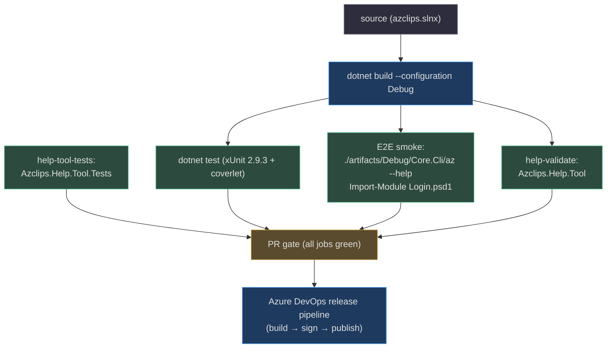
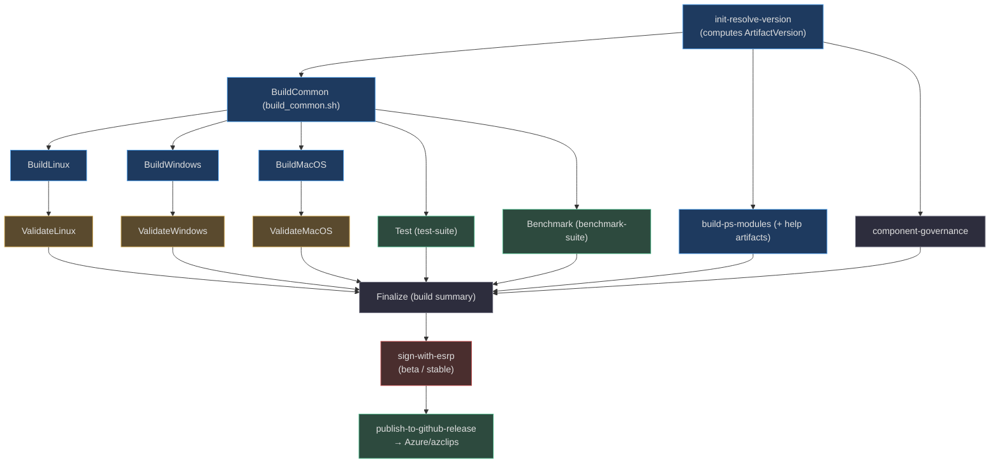

# Testing & Build Pipeline

## Why two build systems

Azclips deliberately runs **two** CI systems because they answer different questions:

- **GitHub Actions** gives **fast PR feedback** — build, unit tests, help validation, and lightweight end-to-end smoke on every pull request (`.github/workflows/build-and-test.yml:1`).
- **Azure DevOps** produces **signed, multi-platform releases** — a matrixed build across RIDs and lean/full flavors, ESRP signing, and publish to GitHub Releases (`.azure-pipelines/azclips-alpha-build.yml:1`).

The test strategy underneath is layered xUnit — pure unit tests, seam/contract tests using a shared stub kit, subprocess end-to-end tests, and a BenchmarkDotNet startup harness — with help authoring enforced by a dedicated validation tool. This page traces the whole path from `dotnet test` to a published release asset.

## Test projects

All test projects target `net10.0` and share one central config. They are enumerated in `azclips.slnx` and split between `tests/` (core/CLI/PS) and `Agent/tests/` (agent):

| Project | Focus | Source |
|---|---|---|
| `Cli.Tests` | CLI host, dispatch, extension-add contract; adds Moq | `tests/Cli.Tests/Cli.Tests.csproj:10` |
| `Cmdlets.Tests` | PowerShell cmdlet behavior | `tests/Cmdlets.Tests/Cmdlets.Tests.csproj` |
| `Core.Engine.Tests` | Engine/`ExecutionSession` seams | `tests/Core.Engine.Tests/ExecutionSessionSeamTests.cs:14` |
| `Core.Extensions.Tests` | Extension resolution/loading | `tests/Core.Extensions.Tests/` |
| `Core.Telemetry.Tests` | Telemetry filters/senders | `tests/Core.Telemetry.Tests/` |
| `Tests.Common` | Shared stubs & utilities | `tests/Common/Tests.Common.csproj` |
| `Benchmark` | BenchmarkDotNet startup harness | `tests/Benchmark/Benchmark.csproj:16` |
| `Fixtures/SharedAlpha`, `SharedBeta` | Multi-version extension fixtures | `tests/Fixtures/SharedAlpha/Azclips.Tests.Fixtures.SharedAlpha.csproj` |
| `Core.Agent.Tests` | Agent pure-logic + snapshots | `Agent/tests/Core.Agent.Tests/Core.Agent.Tests.csproj` |

Frameworks and versions are centralized in `tests/Directory.Build.props` — xUnit **2.9.3**, xunit.runner.visualstudio **3.1.4**, coverlet.collector **6.0.4**, and Microsoft.NET.Test.Sdk **17.14.1** (`tests/Directory.Build.props:16-21`). The agent tests inherit the exact same settings by importing that file (`Agent/tests/Directory.Build.props:2`), so there is one xUnit configuration for the whole repo.

### Seam and contract testing

`Core.Engine.Tests` demonstrates the house style: rather than spin up the real engine, `ExecutionSessionSeamTests` constructs an `ExecutionSession` with injected seams — a stub processor, a stub index, and lambda hooks for version lookup, cache, binding, and context creation — so the dispatch seam is verified in isolation and without parallelism interference (`tests/Core.Engine.Tests/ExecutionSessionSeamTests.cs:10`, `:47-60`).

`Cli.Tests` references the CLI, the core libraries, **all** extensions, and `Agent/Commands`, then pulls in the `SharedAlpha`/`SharedBeta` fixtures with `ReferenceOutputAssembly="false"` — the fixture DLLs are built but *not* linked, so the test stages them into temp dirs and reads them via reflection to verify the extension-add contract without a live NuGet feed (`tests/Cli.Tests/Cli.Tests.csproj:14-36`).

### Agent tests: pure logic isolated from the live SDK

The agent suite splits deliberately. Most tests exercise **pure** validation/parsing logic without touching the GitHub Copilot SDK — for example, `ProposePlanValidationTests` drives `PlanArgsParser.ValidateProposePlan` (the pre-tool-use hook run before a plan is rendered) against SDK-shaped `JsonElement` args and asserts the real rules (`Agent/tests/Core.Agent.Tests/ProposePlanValidationTests.cs:8-14`). Companions include `ClosingToolPredicateTests`, `SubmitResponseValidationTests`, `ExtractCommandNameTests`, `ExtractPlanStepsTests`, `PlanGateTests`, `EnvironmentProberTests`, and `ShellOutHelperTests`. The live-SDK-dependent subset is quarantined in `AgentToolsLiveTests` so the bulk of the suite runs fast and offline. Rendered agent output is locked down with snapshot tests (`Agent/tests/Core.Agent.Tests/EventRendererSnapshotTests.cs` against `Snapshots/*.txt`).

### Benchmarks

`tests/Benchmark` is a BenchmarkDotNet **0.13.12** harness that also references `Microsoft.PowerShell.SDK` 7.6.1 and `Microsoft.ApplicationInsights` for cold/warm CLI+PowerShell startup timing (`tests/Benchmark/Benchmark.csproj:16-18`). It runs as its own Azure DevOps stage (below).

## Build & help-generation scripts

`build/build.ps1` is the local build entry point: it builds `azclips.slnx`, then stages PowerShell manifests via `Set-ModuleConfiguration.ps1` (`build/build.ps1:17-21`). With `-GenerateHelpArtifacts` it also installs pinned dependencies and runs the help validation tool (`build/build.ps1:229-247`).

Help generation is PlatyPS-based and pinned. `Install-BuildDependencies.ps1` installs **Microsoft.PowerShell.PlatyPS 1.0.1** idempotently (`build/Install-BuildDependencies.ps1:9`). Because PlatyPS 1.0.1 has a quirk where `Export-MamlCommandHelp` leaves fenced example bodies in `<maml:para>` instead of `<dev:code>`, `build.ps1` runs PlatyPS in an isolated child `pwsh` and then repairs each MAML file so `Get-Help -Examples` renders correctly (`build/build.ps1:56-123`, `:137-144`). Markdown help sources are produced by `build/New-PSHelpMarkdown.ps1`.

## GitHub Actions: the PR gate

`build-and-test.yml` triggers on PRs to `main` and manual dispatch, pinning the SDK via `global.json` (`.github/workflows/build-and-test.yml:3-6`, `:20-23`). It runs three jobs:

| Job | What it does | Source |
|---|---|---|
| `build-and-test` | restore, build, `dotnet test`, CLI `--help` smoke, import `Login.psd1` | `build-and-test.yml:13` |
| `help-validate` | run `Azclips.Help.Tool` against `artifacts/Debug` | `build-and-test.yml:55` |
| `help-tool-tests` | build + test `Azclips.Help.Tool.Tests` | `build-and-test.yml:79` |

> **Known issue worth surfacing.** CI builds **Debug, not Release**, with an inline comment explaining why: Release currently has "(a) … locating extension dll and (b) … the RequiredAssemblies property" problems (`.github/workflows/build-and-test.yml:28-30`). The E2E steps therefore run `./artifacts/Debug/Core.Cli/az --help` and import the Login module from source (`build-and-test.yml:35-53`).

Other workflows round out the GitHub side: `build.yml` (Debug/Release on win-x64), `benchmark.yml` + `benchmark-comment.yml` (startup benchmarks), and `build-wiki.yml` (this documentation site). Note `.github/workflows/CODEOWNERS` **exists but is empty (0 bytes)** — a placeholder, not an active ownership map.

## The help validation tool

`tools/Help/Azclips.Help.Tool` backs both `az`'s own help surface and the CI `help-validate` job; its test project `Azclips.Help.Tool.Tests` enforces authoring quality with validators for completeness, example syntax, markdown structure, and frontmatter (`tools/Help/Azclips.Help.Tool.Tests/HelpCompletenessValidatorTests.cs`, `ExampleSyntaxValidatorTests.cs`, `MarkdownStructureValidatorTests.cs`, `FrontmatterParserTests.cs`). These run as the `help-tool-tests` job above.

## Azure DevOps: the release pipeline

Three top-level pipelines cover the release channels — `azclips-alpha-build.yml` (PR / `pr-alpha`), `azclips-beta-build.yml` (+ `azclips-beta-sign.yml`), and `azclips-stable-release.yml` (`.azure-pipelines/`). The alpha pipeline triggers on PRs and runs two stages: `validate-pull-request`, then `build-unsigned-distribution` with `release_channel: pr-alpha` (`.azure-pipelines/azclips-alpha-build.yml:15-33`). Shared settings — agent pools, ESRP service connection, `github_target_repo: Azure/azclips`, macOS bundle id — live in `templates/variables.yml` (`.azure-pipelines/templates/variables.yml:2-12`).

The heavy lifting is the `build-unsigned-distribution` stage template, which fans out a full stage graph (`.azure-pipelines/templates/dist/stages/build-unsigned-distribution.yml:39`):

The stage order is `init-resolve-version` → `component-governance` → `BuildCommon` → per-platform builds + `build-ps-modules` → `Test`/`Benchmark` → per-platform `Validate*` → `Finalize`, each depending on the resolved `ArtifactVersion` output (`build-unsigned-distribution.yml:40-232`). Signing and publishing are separate stage templates in the same `templates/dist/stages/` folder — `sign-with-esrp.yml` and `publish-to-github-release.yml` — engaged by the beta/stable pipelines rather than the PR-time alpha build. `BuildCommon` and the per-platform build jobs invoke the same shell scripts documented on the [Packaging & Distribution](./packaging-and-distribution.md) page.

## The PR-metadata gate

`devops/scripts/ci/check_pull_request.py` enforces PR-title and history-note grammar: it maps imperative verbs to their past/gerund forms and validates component prefixes, markdown links, and list shapes (`devops/scripts/ci/check_pull_request.py:10-27`). This keeps changelog-derived notes consistent across the repo.

## Design-doc workflow: OpenSpec

Larger changes are proposed through the `openspec/` workflow before implementation, and `AGENTS.md` points contributors to it. `openspec/changes/profile-management/` is a complete worked example: a `proposal.md` (Why / What Changes / Capabilities / Impact), a `design.md`, a `tasks.md` checklist, and per-capability `specs/*/spec.md` files (`openspec/changes/profile-management/proposal.md:1`). That change is what introduced the `Profile`/`ProfileService` model documented on the [Configuration Management & Profiles](./configuration-management.md) page — a useful cross-reference for how a spec becomes code and tests.

## References

- `azclips.slnx` — solution enumerating all test projects
- `tests/Directory.Build.props` / `Agent/tests/Directory.Build.props` — centralized xUnit/coverlet versions
- `tests/Core.Engine.Tests/ExecutionSessionSeamTests.cs` — seam-injection test style
- `tests/Cli.Tests/Cli.Tests.csproj` — CLI test references and non-linked fixtures
- `tests/Benchmark/Benchmark.csproj` — BenchmarkDotNet startup harness
- `Agent/tests/Core.Agent.Tests/ProposePlanValidationTests.cs` (+ `ClosingToolPredicateTests.cs`, `AgentToolsLiveTests.cs`) — pure-logic vs live-SDK split
- `build/build.ps1` / `build/Install-BuildDependencies.ps1` / `build/New-PSHelpMarkdown.ps1` — build + PlatyPS help generation
- `.github/workflows/build-and-test.yml` — PR gate (build/test/help), Debug-build known issue
- `.github/workflows/CODEOWNERS` — present but empty
- `.azure-pipelines/azclips-alpha-build.yml` / `templates/variables.yml` — release channels and shared variables
- `.azure-pipelines/templates/dist/stages/build-unsigned-distribution.yml` (+ `init-resolve-version.yml`, `sign-with-esrp.yml`, `publish-to-github-release.yml`) — release stage graph
- `devops/scripts/ci/check_pull_request.py` — PR-metadata grammar gate
- `tools/Help/Azclips.Help.Tool.Tests/` — help authoring validators
- `openspec/changes/profile-management/` — design-doc process example
