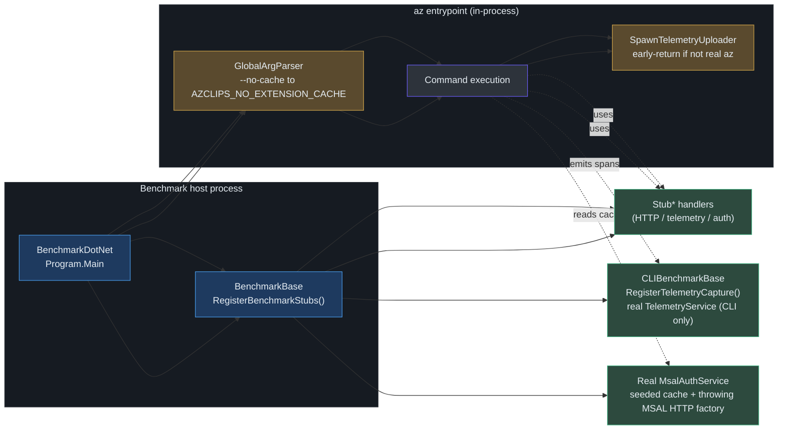

# Testing & Benchmarking

## Overview

Azclips ships as a re-implementation of the Azure CLI/PowerShell experience, so a regression in argument parsing, extension loading, or HTTP request shaping is a regression in a tool people script against. The test strategy therefore optimizes for two properties that matter more than raw count:

- **Determinism** — no test may reach the network. Every processor is exercised through hand-written fakes or stub DI registrations, so the same inputs always produce the same result on a laptop or in CI.
- **Speed as a merge gate** — correctness (xUnit) _and_ performance (BenchmarkDotNet) both block merges. A change that keeps the tests green but makes `az` start 20% slower is treated as a failure.

Every test project targets `net10.0` and pulls its framework/coverage packages from a single `Directory.Build.props`, so the toolchain (xUnit 2.9.3, Coverlet 6.0.4, Test SDK 17.14.1) is uniform across the solution (`tests/Directory.Build.props:17`).

> **Note:** the product is `Azclips` (see `<Product>Azclips</Product>` in `Shared.props:3`); the repository name `azclips` and the `Azclips.*` assembly prefixes are legacy naming that CI actively guards against re-introducing.

## Test project map

All test projects are members of the solution `azclips.slnx` and split across the top-level `/tests/` folder, the Agent's own test tree, and the help tool's tests (`azclips.slnx:31`, `azclips.slnx:34-45`).

| Project                      | Location (slnx)      | What it covers                                                                                                                                       |
| ---------------------------- | -------------------- | ---------------------------------------------------------------------------------------------------------------------------------------------------- |
| `Cli.Tests`                  | `azclips.slnx:35`    | CLI integration — structured command dispatch, agent fallback, typo correction, extension add/pin/remove, profile CLI, REST processor URL validation |
| `Cmdlets.Tests`              | `azclips.slnx:37`    | PowerShell cmdlet behavior                                                                                                                           |
| `Core.Extensions.Tests`      | `azclips.slnx:39`    | Extension resolution / compatibility guard / leaf index                                                                                              |
| `Core.Telemetry.Tests`       | `azclips.slnx:40`    | Telemetry senders, filters, activity naming                                                                                                          |
| `Tests.Common`               | `azclips.slnx:38`    | Shared stubs & utilities (not a test project — `IsPackable=false`, referenced by others)                                                             |
| `SharedAlpha` / `SharedBeta` | `azclips.slnx:44-45` | Fixture extension assemblies for assembly-loading / multi-version tests                                                                              |
| `Core.Agent.Tests`           | `azclips.slnx:31`    | Agent tools, approval prompt, plan validation, snapshot rendering                                                                                    |
| `Azclips.Help.Tool.Tests`    | `azclips.slnx:41`    | Build-time help validators (frontmatter, completeness, example syntax)                                                                               |

### Shared conventions

The test props file enables nullable + implicit usings, marks projects non-packable, and — importantly — relaxes analyzer rule `CA1707` so that underscores are allowed in test method names (`tests/Directory.Build.props:13`). That exception exists specifically to permit the mandated naming convention:

```
MethodName_ShouldBehavior_WhenCondition
```

For example, `ProcessAsync_RejectsNonHttpsAbsoluteUrl_BeforeSending` reads as a sentence describing the guarantee under test (`tests/Cli.Tests/RestProcessorTests.cs:45`). The convention is documented in `AGENTS.md:38` and enforced by convention/review rather than by a linter.

## HTTP record / playback: no test touches the network

Azclips routes every outbound Azure request through a composable HTTP pipeline whose two "ends" are exposed as `SendAsyncStep` delegates: a **tracing step** (`HttpRequestMessageTracingStep`) that observes requests and a **terminating step** (`HttpPipelineTerminatingStep`) that produces the final response (`src/Core/Core.Abstractions/IHttpPipelineService.cs:8-9`). _(See the [HTTP Pipeline](./http-pipeline.md) page for the full step chain.)_ Tests exploit this seam two ways.

**1. Stub the terminating step at the DI level.** `StubHttpTerminateHandler` (in `tests/Common/Stubs/`) short-circuits every outgoing request so benchmarks never call Azure. It resolves a minimal, correctly-shaped ARM response per resource type via `StubResponseMappings` (backed by JSON fixtures under `Stubs/Fixtures/`), and sets `Retry-After: 0` so long-running-operation polling does not wait. Unmapped paths return `{}`. This lets orchestrated creates (e.g. Compute `vm create`: VNet -> NSG -> NIC -> VM) run to completion under benchmark conditions (`tests/Common/Stubs/StubHttpTerminateHandler.cs:14-18`).

**2. Fake the pipeline directly for unit tests.** `RestProcessorTests` injects a `FakeHttpPipeline` implementing `IRuntimeHttpPipeline`; the test supplies a `Func<HttpRequestMessage, IEventPublisher, HttpResponseMessage>` responder and asserts on `SendCount` to prove whether a request was actually dispatched (`tests/Cli.Tests/RestProcessorTests.cs:535-550`). This lets a test assert that a non-HTTPS URL is rejected **before** any send happens (`SendCount == 0`), a security-sensitive guarantee (`tests/Cli.Tests/RestProcessorTests.cs:55`).

```mermaid
sequenceDiagram
    autonumber
    participant T as Test method
    participant P as Processor / Engine
    participant PIPE as HTTP pipeline<br>(tracing → terminating)
    participant STUB as StubHttpTerminateHandler<br>/ FakeHttpPipeline responder
    T->>P: ProcessAsync() with fixture inputs
    P->>PIPE: build & send HttpRequestMessage
    PIPE->>PIPE: tracing step observes request
    PIPE->>STUB: terminating step
    STUB-->>PIPE: canned HttpResponseMessage (200 / custom)
    PIPE-->>P: response
    P-->>T: result + SendCount / written values
    T->>T: assert (no real network hit)
    style T fill:#1e3a5f,stroke:#4a9eed,color:#e6edf3
    style P fill:#2d333b,stroke:#6d5dfc,color:#e6edf3
    style PIPE fill:#2d333b,stroke:#6d5dfc,color:#e6edf3
    style STUB fill:#2d4a3e,stroke:#4aba8a,color:#e6edf3
```

## Agent tests: predicates, validation, and snapshots

`Core.Agent.Tests` covers the interactive agent from three angles:

- **Protocol predicates** — `ClosingToolPredicateTests` pins the turn-protocol logic: `ChatAgent.IsClosingTool` recognizes `propose_plan`/`submit_response`, and only `submit_response` terminates a session. `[Theory]`/`[InlineData]` matrices cover one-shot vs interactive behavior (`Agent/tests/Core.Agent.Tests/ClosingToolPredicateTests.cs:16-34`).
- **Structured validation** — e.g. `ProposePlanValidationTests`, `SubmitResponseValidationTests`, and `PlanGateTests` assert the agent's plan/response contracts.
- **Snapshot rendering** — `EventRendererSnapshotTests` and `AgentEventStyleSnapshotTests` render agent events to text and diff them against baselines under `Agent/tests/Core.Agent.Tests/Snapshots/*.txt`.

The snapshot harness is a hand-rolled `SnapshotAssert.Matches(name, actual)`: it locates a baseline file, and on mismatch writes `<name>.actual.txt` and fails with a diff. Setting `UPDATE_SNAPSHOTS=1` rebaselines locally; a **missing** baseline in CI is a hard failure so uncommitted snapshots can't sneak through (`Agent/tests/Core.Agent.Tests/SnapshotTesting/SnapshotAssert.cs:15-37`).

## Fixture assemblies for assembly-loading tests

`SharedAlpha` and `SharedBeta` are minimal extension assemblies (each just references `Core.Abstractions` and defines an `ExtensionIndex`) built purely as _fixtures_ (`tests/Fixtures/SharedAlpha/Azclips.Tests.Fixtures.SharedAlpha.csproj:4-11`). `ExtensionAddPlannerTests` stages these DLLs into temp directories and registers both under the same verb (`sharedverb`) to exercise multi-version / conflicting-assembly resolution paths that can't be reproduced with in-memory stubs (`tests/Cli.Tests/ExtensionAddPlannerTests.cs:46-73`).

## Benchmarking with BenchmarkDotNet

`tests/Benchmark` is an executable (`OutputType=Exe`) BenchmarkDotNet 0.13.12 project that references the real CLI, Runtime, DI, and Resources projects plus `Tests.Common` (`tests/Benchmark/Benchmark.csproj:4-8,17-25`). It measures cold-start and command execution for both the CLI and PowerShell surfaces, selectable via a `--product` filter, with `--local` and `--ci` modes controlling output paths and App Insights upload (`tests/Benchmark/Program.cs:22-42`).

Authentication is the deliberate exception. `IAuthService` is **not** stubbed, because a real `az`
invocation pays to read the MSAL token cache off disk and the benchmarks are meant to include that
cost. Instead, `MsalClientOptions` points the real `MsalAuthService` at a scratch cache directory
seeded from a committed synthetic cache document (`tests/Benchmark/Fixtures/MsalCache.seed.json`),
and hands MSAL a `ThrowingMsalHttpClientFactory`. The seeded token's expiry is stamped nine years
ahead on every seed, so
MSAL always resolves from cache and never has a reason to reach the network; the throwing factory
is a tripwire that converts any lapse into a benchmark failure rather than a silently inflated
number. `BenchmarkBase.VerifyAuthFixture()` asserts the cache hit once per run during
`[GlobalSetup]`, so a drifted fixture fails setup instead of quietly changing what is measured.

`IProfileService` is deliberately **not** stubbed. Benchmarks resolve profiles through the real, file-backed `ProfileService`, pointed at an isolated store at `artifacts/Benchmark/home/.azclips` and seeded with a single active `default` profile before every iteration (`tests/Common/Utilities/BenchmarkProfileStore.cs`). Without this the measured timings would omit the two file reads and JSON deserialize that `Engine.ResolveProfileAsync` costs a real user on every invocation. The store is re-seeded in `[IterationSetup]`, outside the measured region, so each iteration starts from identical bytes.

CLI benchmarks are the one exception to the telemetry stub. `CLIBenchmarkBase.RegisterTelemetryCapture()` runs after `RegisterBenchmarkStubs()` and swaps `ITelemetryService` back to the production `TelemetryService`, so every iteration emits real spans through the real `CLITelemetryProvider`, allowlist filters, and `FileExporter`. Only the destination differs: an injected `ITraceDirectoryProvider` points the exporter at `artifacts/BenchmarkTelemetry/<benchmark>/{warmup,actual}/` instead of the shared per-user trace directory. All 10,000 iterations pay the cost so the distribution does not become bimodal; `GlobalCleanup` then samples the measured traces down to 100 and deletes the raw files. See [the design spec](../../docs/superpowers/specs/2026-08-18-benchmark-telemetry-design.md). PowerShell and startup benchmarks keep `StubTelemetryService`.

### In-process benchmark hooks in the CLI

Two hooks in the CLI entrypoint exist specifically so BenchmarkDotNet can drive `az` in-process without cache warmth skewing timings or benchmark telemetry escaping to Azure:

| Hook              | Location                                                                       | Purpose                                                                                                                                                                                                         |
| ----------------- | ------------------------------------------------------------------------------ | --------------------------------------------------------------------------------------------------------------------------------------------------------------------------------------------------------------- |
| `--no-cache` flag | [`src/CLI/Parser/GlobalArgParser.cs`](../../src/CLI/Parser/GlobalArgParser.cs) | Parser classifies the flag into `GlobalArgs.NoCache`; `Program.Main` sets `AZCLIPS_NO_EXTENSION_CACHE=true`, which `AssemblyLoadingOptions.BypassExtensionCache` reads — forcing a cold extension load each run |
| In-process guard  | `src/CLI/Program.cs` (`SpawnTelemetryUploader`)                                | Returns early unless the process is a real `az`/`az.exe`, so a benchmark process never spawns a detached telemetry uploader — benchmark traces stay a local artifact and are never uploaded                                                                              |



### Performance as a merge gate

Benchmarks run on every PR and every push to `main`. On a PR, if any benchmark exceeds **115%** of the historical baseline the check fails and a comment is posted; on push to `main`, new numbers are published to GitHub Pages and become the next baseline (`eng-docs/spec/benchmark-workflows.md:5-8`). The dashboards live at `azure.github.io/azclips/dev/bench/cli/` and `.../ps/`. See [Build & CI/CD](./build-cicd.md) for how `benchmark.yml` wires this into the pipeline.

## Running tests locally

| Goal                              | Command                                                                               |
| --------------------------------- | ------------------------------------------------------------------------------------- |
| Run the whole solution            | `dotnet test azclips.slnx`                                                            |
| Run one project                   | `dotnet test tests/Cli.Tests/Cli.Tests.csproj`                                        |
| Run with coverage (Coverlet)      | `dotnet test --collect:"XPlat Code Coverage"`                                         |
| Run the agent suite               | `dotnet test Agent/tests/Core.Agent.Tests/Core.Agent.Tests.csproj`                    |
| Rebaseline agent snapshots        | `UPDATE_SNAPSHOTS=1 dotnet test Agent/tests/Core.Agent.Tests/Core.Agent.Tests.csproj` |
| Run benchmarks (local, no upload) | `dotnet run -c Release --project tests/Benchmark/Benchmark.csproj -- --local`         |

Coverlet is wired in via the `coverlet.collector` package reference in the shared props, so `--collect:"XPlat Code Coverage"` produces Cobertura output for every project without per-project configuration (`tests/Directory.Build.props:17`). CI builds/tests in **Debug** today (a known Release limitation for extension DLL location) — see [Build & CI/CD](./build-cicd.md).

## References

- `azclips.slnx:31,34-45` — test projects registered in the solution
- `tests/Directory.Build.props:13,17-20` — xUnit/Coverlet/Test SDK versions and the `CA1707` underscore exception
- `tests/Cli.Tests/RestProcessorTests.cs:45,55,535-550` — `FakeHttpPipeline` and offline URL-validation tests
- `tests/Common/Stubs/StubHttpTerminateHandler.cs:12-18` — resource-aware terminating-step stub
- `src/Core/Core.Abstractions/IHttpPipelineService.cs:8-9` — tracing & terminating pipeline steps
- `Agent/tests/Core.Agent.Tests/ClosingToolPredicateTests.cs:16-34` — turn-protocol predicate tests
- `Agent/tests/Core.Agent.Tests/SnapshotTesting/SnapshotAssert.cs:15-37` — snapshot harness with `UPDATE_SNAPSHOTS`
- `tests/Fixtures/SharedAlpha/Azclips.Tests.Fixtures.SharedAlpha.csproj:4-11` — fixture extension assembly
- `tests/Benchmark/Benchmark.csproj:4-25` — BenchmarkDotNet project references
- `tests/Benchmark/BenchmarkBase.cs` — stub DI registration and real `ProfileService` wiring for benchmarks
- `tests/Common/Utilities/BenchmarkProfileStore.cs` — isolated, seeded profile store used by benchmarks
- [`src/CLI/Parser/GlobalArgParser.cs`](../../src/CLI/Parser/GlobalArgParser.cs), `src/CLI/Program.cs` (`SpawnTelemetryUploader`) — `--no-cache` and in-process benchmark hooks
- `eng-docs/spec/benchmark-workflows.md:5-8` — 115% regression gate and dashboards
- `AGENTS.md:38` — `MethodName_ShouldBehavior_WhenCondition` naming convention
