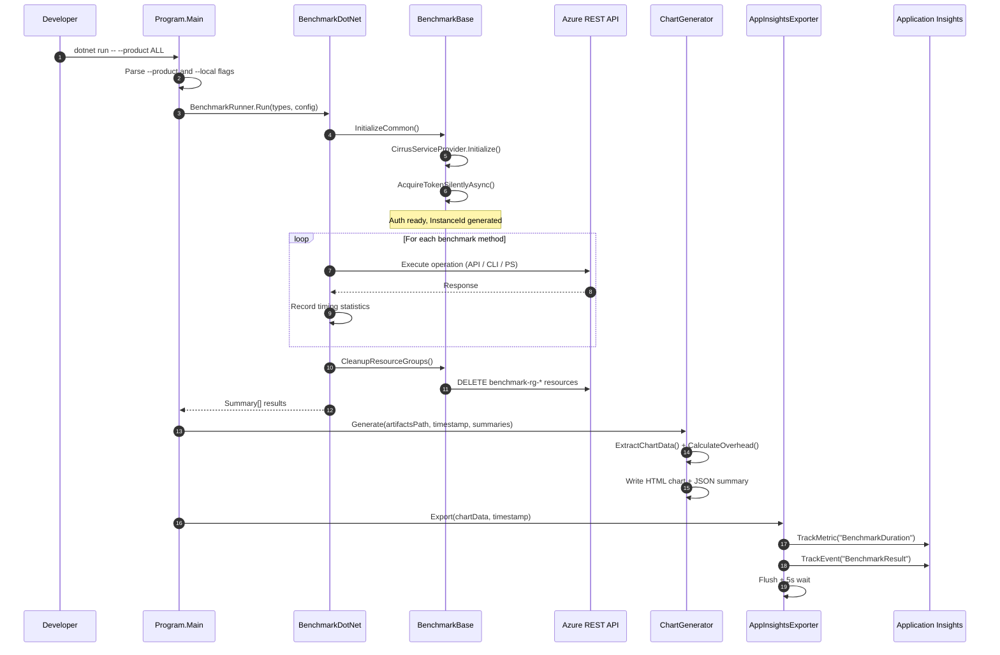

# Testing & Benchmarking

Cirrus employs a two-tier quality assurance strategy: **xUnit-based unit and integration tests** for correctness, and **BenchmarkDotNet performance benchmarks** for measuring execution overhead across the API, CLI, and PowerShell surfaces. Both tiers integrate with the CI pipeline and Application Insights for tracking quality over time.

## Test Architecture Overview

```mermaid
flowchart TB
    subgraph Tests["tests/"]
        direction TB
        subgraph Unit["Cli.Tests"]
            EDT["ExtensionDispatcherTests<br>Parse validation"]
            PFT["ProgramFallbackTests<br>Fallback behavior"]
        end
        subgraph Perf["Benchmark"]
            Prog["Program.cs<br>Runner + Config"]
            Base["BenchmarkBase<br>Auth + Cleanup"]
            API["API.ResourceGroupBenchmarks"]
            CLIB["CLI.ResourceGroupBenchmarks"]
            PSB["PS.ResourceGroupBenchmarks"]
            AIE["AppInsightsExporter"]
            CG["ChartGenerator"]
        end
    end

    subgraph Infra["Test Infrastructure"]
        direction TB
        Coverlet["Coverlet<br>Code Coverage"]
        xUnit["xUnit 2.9.3<br>Test Runner"]
        BDN["BenchmarkDotNet 0.13.12<br>Performance"]
        AppIns["Application Insights<br>Metric Storage"]
    end

    EDT --> xUnit
    PFT --> xUnit
    xUnit --> Coverlet

    API --> Base
    CLIB --> Base
    PSB --> Base
    Prog --> BDN
    Prog --> CG
    Prog --> AIE
    AIE --> AppIns

    style Tests fill:#161b22,stroke:#30363d,color:#e6edf3
    style Unit fill:#161b22,stroke:#30363d,color:#e6edf3
    style Perf fill:#161b22,stroke:#30363d,color:#e6edf3
    style Infra fill:#161b22,stroke:#30363d,color:#e6edf3
    style EDT fill:#2d333b,stroke:#6d5dfc,color:#e6edf3
    style PFT fill:#2d333b,stroke:#6d5dfc,color:#e6edf3
    style Prog fill:#2d333b,stroke:#6d5dfc,color:#e6edf3
    style Base fill:#2d333b,stroke:#6d5dfc,color:#e6edf3
    style API fill:#2d333b,stroke:#6d5dfc,color:#e6edf3
    style CLIB fill:#2d333b,stroke:#6d5dfc,color:#e6edf3
    style PSB fill:#2d333b,stroke:#6d5dfc,color:#e6edf3
    style AIE fill:#2d333b,stroke:#6d5dfc,color:#e6edf3
    style CG fill:#2d333b,stroke:#6d5dfc,color:#e6edf3
    style Coverlet fill:#2d333b,stroke:#6d5dfc,color:#e6edf3
    style xUnit fill:#2d333b,stroke:#6d5dfc,color:#e6edf3
    style BDN fill:#2d333b,stroke:#6d5dfc,color:#e6edf3
    style AppIns fill:#2d333b,stroke:#6d5dfc,color:#e6edf3
```



## xUnit Test Framework Setup

### Test Project Configuration

The test project `Cli.Tests.csproj` (`tests/Cli.Tests/Cli.Tests.csproj:1`) references three source projects:

```xml
<ProjectReference Include="../../src/CLI/Core.Cli.csproj" />        <!-- line 4 -->
<ProjectReference Include="../../src/Core/Core.Engine/Core.Engine.csproj" />   <!-- line 5 -->
<ProjectReference Include="../../src/Core/Core.Agent/Core.Agent.csproj" />     <!-- line 6 -->
```

This enables testing the CLI entry point (`Program.Main`), the engine's extension dispatcher, and the AI agent fallback path.

### Directory.Build.props

The shared test configuration (`tests/Directory.Build.props:1`) sets properties for all test projects:

| Property | Value | Line |
|---|---|---|
| `TargetFramework` | `net9` | 4 |
| `ImplicitUsings` | `enable` | 5 |
| `Nullable` | `enable` | 6 |
| `IsPackable` | `false` | 7 |
| `EnableNETAnalyzers` | `true` | 8 |
| `AnalysisLevel` | `latest` | 9 |
| `EnforceCodeStyleInBuild` | `true` | 10 |
| `TreatWarningsAsErrors` | `false` | 11 |

Notably, `CA1707` (identifiers should not contain underscores) is suppressed (`tests/Directory.Build.props:13`) to allow the `MethodName_ShouldBehavior_WhenCondition` test naming convention.

### Test Dependencies

The test infrastructure packages (`tests/Directory.Build.props:16`):

| Package | Version | Purpose |
|---|---|---|
| `coverlet.collector` | 6.0.4 | Code coverage collection |
| `Microsoft.NET.Test.Sdk` | 17.14.1 | Test platform SDK |
| `xunit` | 2.9.3 | Test framework |
| `xunit.runner.visualstudio` | 3.1.4 | VS Test adapter |

A global `<Using Include="Xunit" />` directive (`tests/Directory.Build.props:24`) makes xUnit types available without explicit `using` statements.

## ExtensionDispatcherTests

`ExtensionDispatcherTests` (`tests/Cli.Tests/ExtensionDispatcherTests.cs:11`) validates the core routing logic of the `ExtensionDispatcher` class—the component that loads extension assemblies and dispatches commands.

### Test Cases

**`Parse_ShouldThrowArgumentException_WhenArgsEmpty`** (`tests/Cli.Tests/ExtensionDispatcherTests.cs:14`) — `[Fact]`

Verifies that passing empty arguments throws an `ArgumentException` with the message `"Arguments cannot be empty"`:

```csharp
var dispatcher = new ExtensionDispatcher();           // line 18
var emptyArgs = Array.Empty<string>();                 // line 19
var exception = Assert.Throws<ArgumentException>(
    () => dispatcher.Parse(emptyArgs));                // line 22
Assert.Contains("Arguments cannot be empty", exception.Message);  // line 23
```

**`Parse_ShouldThrowDispatchHelpException_WhenHelpFlagProvided`** (`tests/Cli.Tests/ExtensionDispatcherTests.cs:26`) — `[Theory]`

Tests five help flag variants using `[InlineData]`:

| Inline Data | Line |
|---|---|
| `"--help"` | 27 |
| `"-h"` | 28 |
| `"help"` | 29 |
| `"?"` | 30 |
| `"-?"` | 31 |

Each variant must throw a `DispatchHelpException` (`tests/Cli.Tests/ExtensionDispatcherTests.cs:39`), confirming the dispatcher recognizes all standard help patterns.

## ProgramFallbackTests

`ProgramFallbackTests` (`tests/Cli.Tests/ProgramFallbackTests.cs:10`) validates the AI agent fallback mechanism—the behavior when structured extension parsing fails and the system falls back to natural language processing.

### Automated Test

**`Fallback_ShouldNotBeInvoked_ForHelpFlags`** (`tests/Cli.Tests/ProgramFallbackTests.cs:12`) — `[Fact]`

Verifies that help flags are handled before the fallback path:

```csharp
var args = new[] { "--help" };                        // line 16
var exitCode = await Core.Cli.Program.Main(args);     // line 19
Assert.Equal(0, exitCode);                            // line 22
```

### Skipped Integration Tests

Four tests are marked with `[Fact(Skip = "Requires AI agent with interactive prompts - manual test only")]`:

| Test | Line | What It Tests |
|---|---|---|
| `Fallback_ShouldBeInvoked_WhenExtensionParsingFails` | 29 | Unknown command triggers agent fallback |
| `Fallback_ShouldHandleNaturalLanguage` | 42 | Natural language input (`"create a resource group"`) |
| `Fallback_ShouldUseDefaultFlavor_WhenNotSet` | 55 | Default `"azure cli"` flavor with spinner |
| `Fallback_ShouldUsePowerShellFlavor_WhenSet` | 76 | `AZURECLI_FLAVOR=azure powershell` variant |

These tests require interactive AI prompts and are designed for manual integration testing. The `AZURECLI_FLAVOR` environment variable tests (`tests/Cli.Tests/ProgramFallbackTests.cs:80`) validate flavor-specific behavior with proper cleanup in `finally` blocks.

## Coverlet Code Coverage

Coverlet is configured via the `coverlet.collector` package (`tests/Directory.Build.props:17`) and runs with:

```bash
dotnet test --collect:"XPlat Code Coverage"
```

The CI pipeline (`build-and-test.yml`) runs tests with `--verbosity normal` (`.github/workflows/build-and-test.yml:29`), and the build pipeline (`build.yml`) runs tests as part of the matrix build (`.github/workflows/build.yml:57`).

## BenchmarkDotNet Integration

The benchmark project provides performance comparison across all three product surfaces: direct API calls, CLI invocations, and PowerShell cmdlet execution.

### Benchmark Project Structure

`Benchmark.csproj` (`tests/Benchmark/Benchmark.csproj:1`) is configured as an executable:

| Property | Value | Line |
|---|---|---|
| `OutputType` | `Exe` | 4 |
| `TargetFramework` | `net9.0` | 5 |
| `RootNamespace` | `Benchmark` | 6 |
| `StartupObject` | `Benchmark.Program` | 9 |

Dependencies include:
- `BenchmarkDotNet` 0.13.12 (`tests/Benchmark/Benchmark.csproj:13`)
- `Microsoft.PowerShell.SDK` 7.4.0 (`tests/Benchmark/Benchmark.csproj:14`)
- `Microsoft.ApplicationInsights` 2.22.0 (`tests/Benchmark/Benchmark.csproj:15`)

Project references connect to Core.Runtime, Core.DependencyInjection, and Extensions.Resources (`tests/Benchmark/Benchmark.csproj:19`).

### Program.cs — Benchmark Runner

`Program.cs` (`tests/Benchmark/Program.cs:14`) configures and runs benchmarks with rich output:

**Configuration** (`tests/Benchmark/Program.cs:30`):
- Column providers: Mean, StdDev, Median statistics
- Exporters: `JsonExporter.Brief` and `MarkdownExporter.GitHub`
- Time unit: seconds (`tests/Benchmark/Program.cs:42`)
- Optimization validator disabled for realistic measurements

**Product filtering** via `--product` flag (`tests/Benchmark/Program.cs:102`):

```bash
dotnet run -- --product CLI    # Only CLI benchmarks
dotnet run -- --product API    # Only API benchmarks
dotnet run -- --product ALL    # All benchmarks (default)
dotnet run -- --local          # Skip App Insights upload
```

**Benchmark types** are statically defined (`tests/Benchmark/Program.cs:81`):

```csharp
typeof(API.ResourceGroupBenchmarks),   // line 83
typeof(CLI.ResourceGroupBenchmarks),   // line 84
typeof(PS.ResourceGroupBenchmarks)     // line 85
```

After running, the pipeline generates charts and optionally exports to Application Insights (`tests/Benchmark/Program.cs:53`).

### BenchmarkBase Class

`BenchmarkBase` (`tests/Benchmark/BenchmarkBase.cs:16`) provides common setup for all benchmark classes:

**Protected state**:
- `SubscriptionId`, `AccessToken` — authentication credentials (`tests/Benchmark/BenchmarkBase.cs:18`)
- `InstanceId` — unique ID per run to avoid conflicts (`tests/Benchmark/BenchmarkBase.cs:20`)
- `CreatedResourceGroups` — list for cleanup tracking (`tests/Benchmark/BenchmarkBase.cs:23`)

**Constants**:
- `TestLocation = "eastus"` (`tests/Benchmark/BenchmarkBase.cs:26`)
- `TestRgPrefix = "benchmark-rg-"` (`tests/Benchmark/BenchmarkBase.cs:27`)
- `ApiVersion = "2025-04-01"` (`tests/Benchmark/BenchmarkBase.cs:28`)

**`InitializeCommon`** (`tests/Benchmark/BenchmarkBase.cs:33`) bootstraps the DI container via `CirrusServiceProvider.Initialize(clientType)`, locates the repo root by searching for `cirrus.slnx`, and acquires an auth token using `IAuthService.AcquireTokenSilentlyAsync` (`tests/Benchmark/BenchmarkBase.cs:51`).

**`CleanupResourceGroups`** (`tests/Benchmark/BenchmarkBase.cs:65`) iterates `CreatedResourceGroups` and sends DELETE requests to the Azure Resource Manager API with Bearer authentication (`tests/Benchmark/BenchmarkBase.cs:74`).

**`RunProcess`** (`tests/Benchmark/BenchmarkBase.cs:100`) executes external processes (CLI binary, PowerShell) with stdout/stderr capture and deadlock prevention.

**`BenchmarkEventListener`** (`tests/Benchmark/BenchmarkBase.cs:145`) is a no-op `IEventListener` implementation used during API-level benchmarks to avoid telemetry overhead.

## Benchmark Data Flow



## AppInsightsExporter

`AppInsightsExporter` (`tests/Benchmark/AppInsightsExporter.cs:14`) sends benchmark results to Application Insights for historical tracking and Grafana dashboards.

### Connection Configuration

The connection string resolution follows a priority chain (`tests/Benchmark/AppInsightsExporter.cs:29`):

1. Constructor parameter `connectionString`
2. `APPLICATIONINSIGHTS_CONNECTION_STRING` environment variable
3. Default hardcoded connection string (`tests/Benchmark/AppInsightsExporter.cs:20`)

### Export Format

Each benchmark result produces two telemetry items (`tests/Benchmark/AppInsightsExporter.cs:42`):

**MetricTelemetry** (`tests/Benchmark/AppInsightsExporter.cs:47`):
- Name: `"BenchmarkDuration"`
- Sum: Mean execution time in seconds
- Dimensions: Product, Operation, Resource, Method, Timestamp, Machine

**EventTelemetry** (`tests/Benchmark/AppInsightsExporter.cs:65`):
- Name: `"BenchmarkResult"`
- Same dimensions plus `DurationSeconds` and `DurationMs` metrics

### Operation Parsing

The `ParseMethod` helper (`tests/Benchmark/AppInsightsExporter.cs:90`) extracts operation type from method names:

| Contains | Operation |
|---|---|
| `list` | `List` |
| `create` / `new` | `Create` |
| `get` / `show` | `Get` |
| `delete` / `remove` | `Delete` |

## ChartGenerator

`ChartGenerator` (`tests/Benchmark/ChartGenerator.cs:12`) produces visual outputs from benchmark summaries.

### Output Artifacts

The `Generate` method (`tests/Benchmark/ChartGenerator.cs:21`) produces three files:

1. **Grouped bar chart** (`benchmark-comparison-{timestamp}.html`) — Chart.js interactive chart comparing API, CLI, and PS times (`tests/Benchmark/ChartGenerator.cs:29`)
2. **Details chart** (`benchmark-details-{timestamp}.html`) — horizontal bar chart with per-method breakdown (`tests/Benchmark/ChartGenerator.cs:34`)
3. **JSON summary** (`benchmark-summary-{timestamp}.json`) — machine-readable results and overhead calculations (`tests/Benchmark/ChartGenerator.cs:39`)

### Data Models

```csharp
// ChartGenerator.cs:434
public record ChartDataPoint(string Method, string Product, double MeanSeconds);
```

```csharp
// ChartGenerator.cs:436
internal class OverheadData
{
    public string Operation { get; set; }
    public double ApiTime { get; set; }
    public double CliTime { get; set; }
    public double PsTime { get; set; }
}
```

### Overhead Calculation

`CalculateOverhead` (`tests/Benchmark/ChartGenerator.cs:79`) compares API times against CLI and PS times for three operations: `"List RG"`, `"Create RG"`, and `"Get RG"`. The HTML chart displays overhead as `+Xs` relative to the API baseline (`tests/Benchmark/ChartGenerator.cs:218`).

### Chart.js Configuration

The grouped bar chart (`tests/Benchmark/ChartGenerator.cs:99`) uses:

- Three datasets: API (green `#10b981`), CLI (blue `#3b82f6`), PS (purple `#8b5cf6`)
- Responsive layout with `maintainAspectRatio: false`
- Y-axis in seconds with `beginAtZero: true`
- Custom tooltip showing `{value}s` format

## CI Test Pipeline

### build-and-test.yml

The `Build and Test` workflow (`.github/workflows/build-and-test.yml:1`) runs on pull requests and manual dispatch:

| Step | Command | Line |
|---|---|---|
| Restore | `dotnet restore cirrus.slnx` | 22 |
| Build | `dotnet build cirrus.slnx --no-restore --configuration Debug` | 25 |
| Unit tests | `dotnet test cirrus.slnx --no-build --configuration Debug` | 29 |
| E2E CLI | `./artifacts/Debug/Core.Cli/azv2 --help` | 33 |
| E2E PowerShell | `Import-Module ./src/PS/Login/Login.psd1` | 44 |

The PowerShell E2E step validates module import and command discovery (`.github/workflows/build-and-test.yml:46`).

### build.yml

The full build pipeline (`.github/workflows/build.yml:6`) runs a matrix strategy with `[Debug, Release]` × `[win-x64]` configurations (`.github/workflows/build.yml:19`). It includes unit test execution as part of the build-cli job (`.github/workflows/build.yml:56`).

## References

| Source File | Key Elements |
|---|---|
| `tests/Cli.Tests/ExtensionDispatcherTests.cs` | `[Fact]` empty args, `[Theory]` help flags |
| `tests/Cli.Tests/ProgramFallbackTests.cs` | Fallback behavior, skipped AI integration tests |
| `tests/Cli.Tests/Cli.Tests.csproj` | Project references to CLI, Engine, Agent |
| `tests/Directory.Build.props` | xUnit 2.9.3, Coverlet 6.0.4, analyzer config |
| `tests/Benchmark/Program.cs` | BenchmarkDotNet runner, product filtering, chart generation |
| `tests/Benchmark/BenchmarkBase.cs` | Auth setup, resource cleanup, `BenchmarkEventListener` |
| `tests/Benchmark/Benchmark.csproj` | BenchmarkDotNet 0.13.12, PowerShell SDK 7.4.0 |
| `tests/Benchmark/AppInsightsExporter.cs` | Metric and event telemetry export |
| `tests/Benchmark/ChartGenerator.cs` | Chart.js HTML, JSON summary, overhead calculation |
| `.github/workflows/build-and-test.yml` | PR test pipeline with E2E steps |
| `.github/workflows/build.yml` | Matrix build with test execution |
