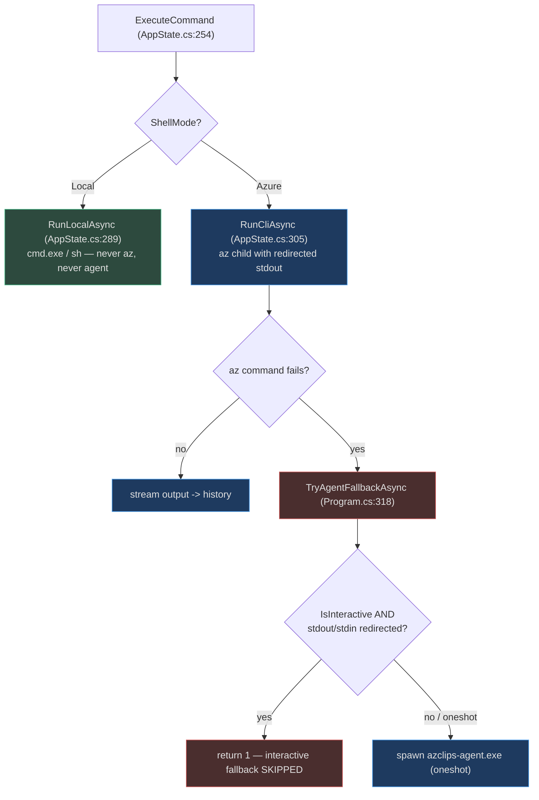
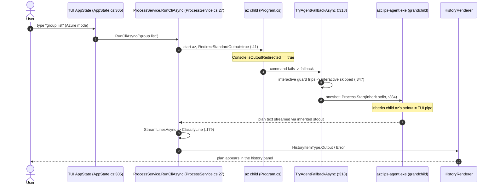

# TUI Agent Mode & Fallback Interplay

## The correction this page exists to make

A persistent piece of stale documentation claimed that the interactive Terminal
UI (`Core.Tui`) hosts "agent mode." **It does not.** The TUI never references
`Core.Agent`: its only project reference is `Core.DependencyInjection`
(`TUI/Core.Tui.csproj:28`), it constructs no `ChatAgent`, and the
`HistoryItemType.ToolCall` enum value has a render case but **no producer**
(`TUI/Rendering/HistoryRenderer.cs:49`). The AI agent always runs as the separate
`azclips-agent.exe` process spawned by the classic CLI.

So where does the TUI meet the agent? Through a subtle, second-order effect: when
you run a command in the TUI's **Azure mode**, the TUI launches the real `az`
binary as a **child process with redirected output**. That redirection changes
the environment the CLI's own fallback logic inspects — silently disabling the
*interactive* agent style while leaving the *one-shot* style working. That seam is
worth its own page because it is easy to get wrong.

## Where the TUI touches `az`: ShellMode branching

`AppState.ExecuteCommand` (`TUI/AppState.cs:254`) branches on `ShellMode`
(`TUI/Models.cs:6`):

- **Local mode** runs your system shell via `ProcessService.RunLocalAsync`
  (`TUI/AppState.cs:289`). It never invokes `az` and therefore can never reach
  the agent.
- **Azure mode** prefixes the input with `az` and calls
  `ProcessService.RunCliAsync` (`TUI/AppState.cs:305`). This is the only path
  through which the CLI's agent fallback is reachable from the TUI.



## The redirection mechanic

`ProcessService.RunCliAsync` (`TUI/services/ProcessService.cs:27`) starts the `az`
child with **stdout and stderr redirected** so it can stream lines into the
history panel — but it does **not** redirect stdin
(`TUI/services/ProcessService.cs:41`):

```csharp
StartInfo = new ProcessStartInfo
{
    FileName = CliPath,           // az
    Arguments = args,
    UseShellExecute = false,
    RedirectStandardOutput = true,  // :41
    RedirectStandardError = true,   // :42
    CreateNoWindow = true,
}
```

The consequence is the crux: inside that child `az` process,
`Console.IsOutputRedirected` is now **true** (its stdout is a pipe to the TUI, not
a terminal).

## How the CLI fallback reacts

When the `az` command fails, `Program.Main` routes to `TryAgentFallbackAsync`
(`src/CLI/Program.cs:318`). Its interactive guard is
(`src/CLI/Program.cs:347`):

```csharp
if (agentOptions.IsInteractive &&
    (Console.IsInputRedirected || Console.IsOutputRedirected))
    return 1;
```

Because the TUI redirected stdout, `Console.IsOutputRedirected` is true, so:

- **`agent.sessionStyle = interactive` is silently skipped** — the guard returns
  `1` and the original error surfaces. This is correct behavior: an interactive
  chat loop would try to read `y`/`n` from a terminal that the child `az` does
  not actually own, and would hang or corrupt the TUI.
- **`agent.sessionStyle = oneshot` still runs** — it is deliberately **not**
  gated (one-shot only prints a plan; it never reads approvals), so it proceeds
  to spawn the agent.

The in-code comment at `src/CLI/Program.cs:340` documents exactly this rationale.

## The three-level process tree

When one-shot fallback fires from inside the TUI, three processes are stacked, and
stdio inheritance is what makes the agent's output reach the screen. The CLI
spawns the agent with **no redirection** (`RedirectStandardInput/Output/Error =
false`, `src/CLI/Program.cs:384`), so the grandchild agent **inherits the child
`az`'s stdout** — which is the TUI's capture pipe:



The agent's streamed plan comes back through the same redirected pipe the TUI
already reads. `ProcessService.StreamLinesAsync` feeds each line through
`ClassifyLine` (`TUI/services/ProcessService.cs:179`), which strips ANSI, drops
`[DEBUG]`/`[VERBOSE]` noise, and tags the rest as `Output` or `Error` — so the
one-shot plan renders in the TUI's history like any other command output.

## The recursion guard

The fallback also protects against nesting. Before spawning, it checks the
`AZCLIPS_IN_AGENT_MODE` environment variable (`src/CLI/Program.cs:26`); if it is
`"1"`, it returns without spawning (`src/CLI/Program.cs:355`). The agent sets this
variable on the children it launches, so an `az` invoked by an agent's
`bash`/`powershell` step can't recursively spawn another agent. The TUI itself
does not set this variable, so a first-level fallback from the TUI works normally
— but if the TUI were ever launched from *inside* an agent session, the guard
would (correctly) prevent a nested spawn.

## Summary of behaviors

| Scenario | Reaches agent? | Which style works |
|----------|----------------|-------------------|
| TUI Local mode command fails | No — never runs `az` | n/a |
| TUI Azure mode, `agent.enabled=false` | No | n/a |
| TUI Azure mode, `sessionStyle=oneshot` | Yes | one-shot (plan streamed into history) |
| TUI Azure mode, `sessionStyle=interactive` | No — TTY guard trips | interactive skipped, original error shown |
| Direct `az` in a real terminal | Yes | both, per config |

## Related pages

- [Agent Architecture](./agent-architecture.md) — the standalone process the CLI spawns.
- [AI Agent Fallback Quickstart](../01-getting-started/agent-mode-quickstart.md) — the gates and session styles.
- [TUI Interactive Shell & Azure VFS](./tui-interactive-shell.md) — the non-agent half of the TUI.

## References

- `TUI/Core.Tui.csproj:28` — the TUI references only `Core.DependencyInjection`, never `Core.Agent`.
- `TUI/services/ProcessService.cs:27` — `RunCliAsync`, the redirected `az` child.
- `TUI/services/ProcessService.cs:41` — `RedirectStandardOutput=true` (makes `Console.IsOutputRedirected` true in the child).
- `TUI/services/ProcessService.cs:179` — `ClassifyLine`, classifying streamed agent output.
- `src/CLI/Program.cs:347` — the interactive non-TTY guard.
- `src/CLI/Program.cs:384` — the agent spawn with inherited stdio.
- `src/CLI/Program.cs:26` — the `AZCLIPS_IN_AGENT_MODE` recursion guard.
- `TUI/AppState.cs:254` — `ExecuteCommand`, the ShellMode branch.
- `TUI/Models.cs:6` — the `ShellMode` enum.
