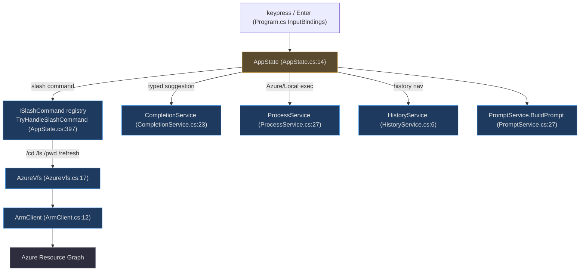
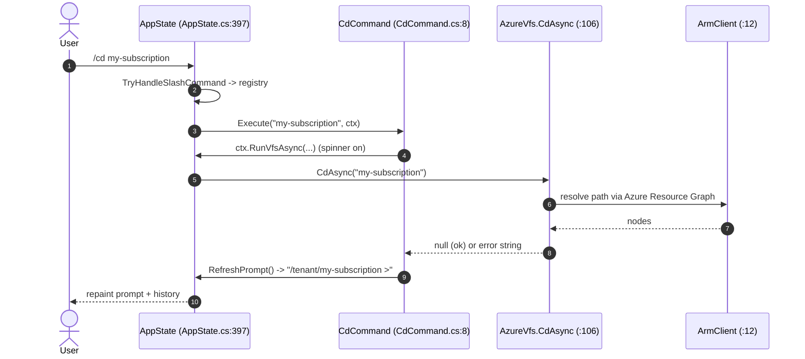

# TUI Interactive Shell & Azure VFS

## Why a virtual file system

The Terminal UI's headline feature is that it makes your Azure estate feel like a
filesystem: subscriptions, resource groups, and resources become a path you can
`cd` into and `ls`. This turns "which resource group holds that VM?" from a
scripted query into interactive navigation. The whole non-agent half of the TUI
is built to make that ergonomic — a stateful `AppState` coordinator, an Azure
Virtual File System (VFS) backed by Azure Resource Graph, live autocomplete, and
per-mode command history. This page traces those pieces. (For the agent seam, see
[TUI Agent Mode & Fallback Interplay](./tui-agent-mode.md).)

## Customizing the shared DI container

The TUI does **not** fork the engine — it customizes the same
`AzclipsServiceProvider` composition root the CLI uses. `Program.Main`
(`TUI/Program.cs:20`) does this in three steps before initializing:

1. **`PrependRegistration`** (`TUI/Program.cs:22`) registers the TUI-only
   services as singletons: `ArmClient`, `AzureVfs`, `ProcessService`,
   `PromptService`, `HistoryService`, and `AppState`.
2. **`OverrideRegistration`** (`TUI/Program.cs:31`) replaces two services with
   TUI-safe implementations: a silent `TuiLoggingService` (so stray
   `[VERBOSE]`/`[DEBUG]` lines don't corrupt the full-screen buffer) and a
   `TUITelemetryProvider`.
3. **`Initialize(ClientType.TUI)`** (`TUI/Program.cs:40`) builds the container.

This is the extension seam that lets four client surfaces share one engine while
each customizes what it needs.

## AppState: the coordinator

`AppState` (`TUI/AppState.cs:14`) is the hub every keystroke flows through. It
delegates to the services rather than doing the work itself:

- **Input buffer.** `InputText`/`CursorPos` are thin wrappers over a shared
  Hex1b `TextBoxState` (`TUI/AppState.cs:29`), so the visible `TextBox` widget and
  `AppState` operate on the same cursor and text.
- **Thread-safe history.** The scrollback list is guarded by a lock;
  `AddHistory`, `ClearHistory`, and `GetHistorySnapshot`
  (`TUI/AppState.cs:60`) let the render thread iterate a snapshot safely while
  background process output appends entries.
- **Suggestions.** `UpdateSuggestions` (`TUI/AppState.cs:195`) delegates to
  `CompletionService` (`TUI/services/CompletionService.cs:23`), handling both
  slash-command completion and mode-aware command completion.
- **Command execution.** `ExecuteCommand` (`TUI/AppState.cs:254`) records the
  command in per-mode history and dispatches — slash commands via the registry,
  otherwise to `az` (Azure) or the local shell (Local).

## The Azure Virtual File System

`AzureVfs` (`TUI/Azure/AzureVfs.cs:17`) presents Azure as a path tree:
`/<tenant>/<subscription>/<resourceGroup>/<resource>` (`TUI/Azure/AzureVfs.cs:7`).
The tenant comes from the active profile (`IProfileService`); subscriptions,
resource groups, and resources all come from **Azure Resource Graph**.

At startup, `TryAuthenticateAsync` (`TUI/Azure/AzureVfs.cs:41`) silently acquires
a token from the shared MSAL cache and `SetInitialPathAsync`
(`TUI/Azure/AzureVfs.cs:62`) resolves the initial path to the signed-in tenant +
subscription. Navigation is provided by `CdAsync` (`TUI/Azure/AzureVfs.cs:106`),
`LsAsync` (`TUI/Azure/AzureVfs.cs:123`), `TreeAsync`
(`TUI/Azure/AzureVfs.cs:141`), and `GetCompletionsAsync`
(`TUI/Azure/AzureVfs.cs:224`).

Underneath, `ArmClient` (`TUI/Azure/ArmClient.cs:12`) is a lightweight HTTP client
that reuses the same `IAuthService` token path as the rest of Azclips
(`TUI/Azure/ArmClient.cs:50`) and runs a single ARG query to fetch the resource
tree (`FetchResourceTreeAsync`, `TUI/Azure/ArmClient.cs:61`). Because VFS queries
touch the network, `/cd` and `/ls` run through `AppState.RunVfsAsync`
(`TUI/AppState.cs:436`) — a wrapper that shows a spinner, supports cancellation,
and keeps the UI responsive while the query is in flight.

## The slash-command registry

Slash commands are registered in the `AppState` constructor
(`TUI/AppState.cs:99`) and dispatched by `TryHandleSlashCommand`
(`TUI/AppState.cs:397`). Each implements `ISlashCommand`
(`TUI/commands/ISlashCommand.cs:28`) and receives a `CommandContext`
(`TUI/commands/ISlashCommand.cs:8`) carrying the VFS, mode, history callbacks, and
prompt actions:

| Command | Class | Notes |
|---------|-------|-------|
| `/cd` | `CdCommand` (`TUI/commands/CdCommand.cs:8`) | VFS or local-dir navigation; supports completion |
| `/ls` | `LsCommand` (`TUI/commands/LsCommand.cs`) | list children of the current node |
| `/pwd` | `PwdCommand` (`TUI/commands/PwdCommand.cs`) | print current VFS path |
| `/mode` | `ModeCommand` (`TUI/commands/ModeCommand.cs:6`) | toggle Azure/Local |
| `/refresh` | `RefreshCommand` (`TUI/commands/RefreshCommand.cs`) | invalidate + re-query VFS |
| `/copy` | `CopyCommand` (`TUI/commands/CopyCommand.cs`) | copy output to clipboard |
| `/exit` | `ExitCommand` (`TUI/commands/ExitCommand.cs`) | quit the TUI |

Commands that support completion (like `/cd`, `TUI/commands/CdCommand.cs:21`)
resolve suggestions against the VFS in Azure mode and the local filesystem in
Local mode.

## Completion and history services

- **`CompletionService`** (`TUI/services/CompletionService.cs:10`) produces
  suggestions from `GetSuggestions` (`TUI/services/CompletionService.cs:23`),
  combining slash-command completion, the static command tree
  (`TUI/services/CommandTree.cs`), and history-based hints, and supports async VFS
  completions via a callback.
- **`HistoryService`** (`TUI/services/HistoryService.cs:6`) keeps command history
  **per mode**: `Record` (`TUI/services/HistoryService.cs:32`) on each command,
  `Navigate` (`TUI/services/HistoryService.cs:43`) for Up/Down recall, and
  `GetHistory` (`TUI/services/HistoryService.cs:17`) to seed completions.
- **`PromptService`** (`TUI/services/PromptService.cs:12`) builds the prompt
  string via `BuildPrompt` (`TUI/services/PromptService.cs:27`) and reads the git
  branch via `GetGitBranch` (`TUI/services/PromptService.cs:41`).

## Two input strategies in the tree

The shipped input path is the **Hex1b `TextBox` widget** wired in `BuildUI`
(`TUI/Program.cs:77`): it binds `state.EditorState` and raises
`UpdateSuggestions` on change, with key bindings for history, suggestions, and
editing (`TUI/Program.cs:204`).

Alongside it, the codebase also contains a self-contained raw-input adapter,
`CustomShellWorkload` (`TUI/services/AzclipsShellWorkload.cs:13`), which implements
`IHex1bTerminalWorkloadAdapter` and hand-rolls line editing: its `HandleInput`
(`TUI/services/AzclipsShellWorkload.cs:108`) parses raw bytes for arrow keys,
Home/End, `Ctrl+A`/`E`/`K`/`U`/`W`, and UTF-8 multi-byte characters, and renders
the prompt with explicit ANSI cursor moves. It is a complete alternative prompt
implementation, but the current `BuildUI` uses the widget-based `TextBox` — the
raw-byte adapter is present in the tree and is not instantiated by the shipped
entry point. It is useful reading for how the prompt line's editing semantics are
defined, even though the widget path is what runs today.

## Related pages

- [Terminal UI Quickstart](../01-getting-started/tui-quickstart.md) — driving the shell as a user.
- [TUI Agent Mode & Fallback Interplay](./tui-agent-mode.md) — how the CLI's agent fallback surfaces through the TUI's redirected `az` child.
- [Core Engine & Orchestration](./core-engine-orchestration.md) — the shared DI/engine the TUI customizes.
- [Rendering & Terminal UX](./rendering-and-terminal-ux.md) — the Hex1b widget tree that draws this shell.

## References

- `TUI/Program.cs:22` — `PrependRegistration`/`OverrideRegistration` of TUI services.
- `TUI/Program.cs:40` — `Initialize(ClientType.TUI)`.
- `TUI/Azure/AzureVfs.cs:17` — the Azure VFS path model and navigation.
- `TUI/Azure/ArmClient.cs:12` — the Azure Resource Graph client.
- `TUI/AppState.cs:14` — the `AppState` coordinator.
- `TUI/AppState.cs:254` — `ExecuteCommand`, slash-command + shell dispatch.
- `TUI/services/AzclipsShellWorkload.cs:13` — `CustomShellWorkload`, the raw-input adapter.
- `TUI/commands/ISlashCommand.cs:28` — the slash-command contract and `CommandContext`.
