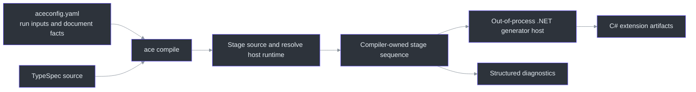
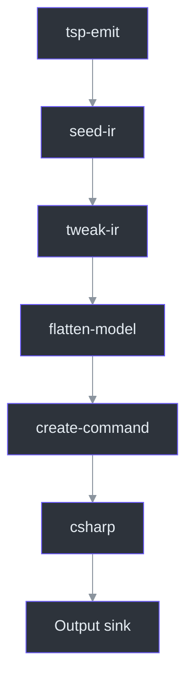

# TypeSpec Code Generation

## Overview — why a separate compiler

Azure APIs supply models and operations, but not every command-line naming choice or multi-step
workflow. The Azure Client Engine (ACE) toolkit turns TypeSpec into C# extension code through a
shared intermediate representation (IR). Runtime extensions still execute through `IEngine`;
the toolkit is a **generation-time** dependency, not an extra runtime dispatch layer
(`toolkit/packages/cli/src/compile-command.ts:1`,
`src/Core/Core.Abstractions/IExtensionIndex.cs:10`).

The central boundary is between **compiler policy** and **host mechanics**. The compiler owns
stage ordering and dependency validation. The CLI owns configuration-file loading, staging,
filesystem output, diagnostics, and cleanup. This keeps pipeline logic reusable without
embedding Node filesystem or console operations in the compiler
(`toolkit/packages/compiler/src/compile.ts:1`,
`toolkit/packages/cli/src/compile-command.ts:1`).

## Architecture



### Package map

| Package / location | Responsibility |
| --- | --- |
| `toolkit/packages/ir` | Shared IR contract and schema |
| `toolkit/packages/typespec-emitter` | TypeSpec emission into the IR |
| `toolkit/packages/transformers` | IR transformations consumed by the compiler |
| `toolkit/packages/compiler` | Stage planning and sequential execution |
| `toolkit/packages/cli` | `ace compile` host, source staging, generator-host integration |
| `toolkit/packages/generator` | Standalone .NET generator and its process host |

The five TypeScript packages are npm workspaces; the .NET generator is **not** included in
`npm run build` (`toolkit/package.json:6`, `toolkit/build.ps1:9`).

## One IR, one ordered pipeline

`STAGE_CATALOG` defines the actual sequence
(`toolkit/packages/compiler/src/stages.ts:81`):

| Stage | Kind | Default / dependency |
| --- | --- | --- |
| `tsp-emit` | Emit | Mandatory |
| `seed-ir` | Transform | Mandatory; supplies document facts |
| `tweak-ir` | Transform | Enabled |
| `flatten-model` | Transform | Enabled |
| `create-command` | Transform | Enabled; requires `seed-ir` |
| `csharp` | Generate | Enabled; requires `create-command` |

Configuration can disable optional stages; it cannot insert or reorder them. Disabling a
required prerequisite is a planning error. Each enabled stage sees the accumulated IR from
the preceding stages. There are no parallel branches or implicit copies
(`toolkit/packages/compiler/src/stages.ts:1`).



`compile()` checks cancellation at stage boundaries and stops after the first failed stage.
Artifacts leave through an injected output delegate, and errors are returned as structured
diagnostics rather than a compiler-owned `process.exit`
(`toolkit/packages/compiler/src/compile.ts:15`).

## Inputs and diagnostic artifacts

Every `ace compile` run requires an `aceconfig.yaml`, supplied by path or found in the current
directory. The CLI's usage text lists the supported run-input overrides
(`toolkit/packages/cli/src/compile-command.ts:34`):

```bash
# From toolkit/, after restoring and building the toolkit
node packages/cli/dist/src/cli.js compile /path/to/aceconfig.yaml --capture-ir --capture-source
```

| Input | Meaning |
| --- | --- |
| `tsp-location` | TypeSpec source location |
| `additional-directories` | Extra source folders needed by imports |
| `entrypoints` | Entry path and API-version selection |
| `output-dir` | Generated artifact root |
| `root-namespace`, `description` | Document facts passed to the compiler |
| `stages` | Per-stage options and optional-stage toggles |

Paths in the file resolve relative to the file, not the caller's working directory. CLI flags
override run inputs, not document facts or stage configuration. By default, staged `source/`
and intermediate `ir/` are not retained; `--capture-source` and `--capture-ir` retain them
for investigation (`toolkit/README.md:62`,
`toolkit/packages/cli/src/compile-command.ts:65`).

## Build and verification

Run npm commands from **`toolkit/`**, which owns the workspace manifest:

```bash
cd toolkit
npm ci
npm run build
npm test
npm run lint:deps
npm run schema:check
```

For the complete TypeScript **and** .NET build, use:

```powershell
pwsh -File toolkit/build.ps1 -Configuration Release
```

The full build publishes the generator host into `toolkit/packages/cli/generator-host`, the
location the CLI uses. A standalone `dotnet build` of the generator updates its build output
but does **not** refresh this staged host (`toolkit/build.ps1:20`,
`toolkit/build.ps1:75`). This distinction matters when a generator fix appears not to affect
newly generated output.

Generated code does not by itself establish CLI/PowerShell compatibility. Review command
metadata, shared customization, surface-specific binding, and scenario behavior before exposing
a migrated command. See [Extensions](./extension-system.md) and
[Testing & Benchmarking](./testing-benchmarking.md).

## References

- `toolkit/packages/compiler/src/stages.ts:81` — stage catalogue and declared dependencies.
- `toolkit/packages/compiler/src/compile.ts:53` — compiler execution entry point.
- `toolkit/packages/cli/src/compile-command.ts:91` — CLI orchestration.
- `toolkit/build.ps1:75` — generator-host publication.
- `toolkit/package.json:6` — workspaces and verification scripts.
- `toolkit/README.md:58` — configuration and source-staging contract.
