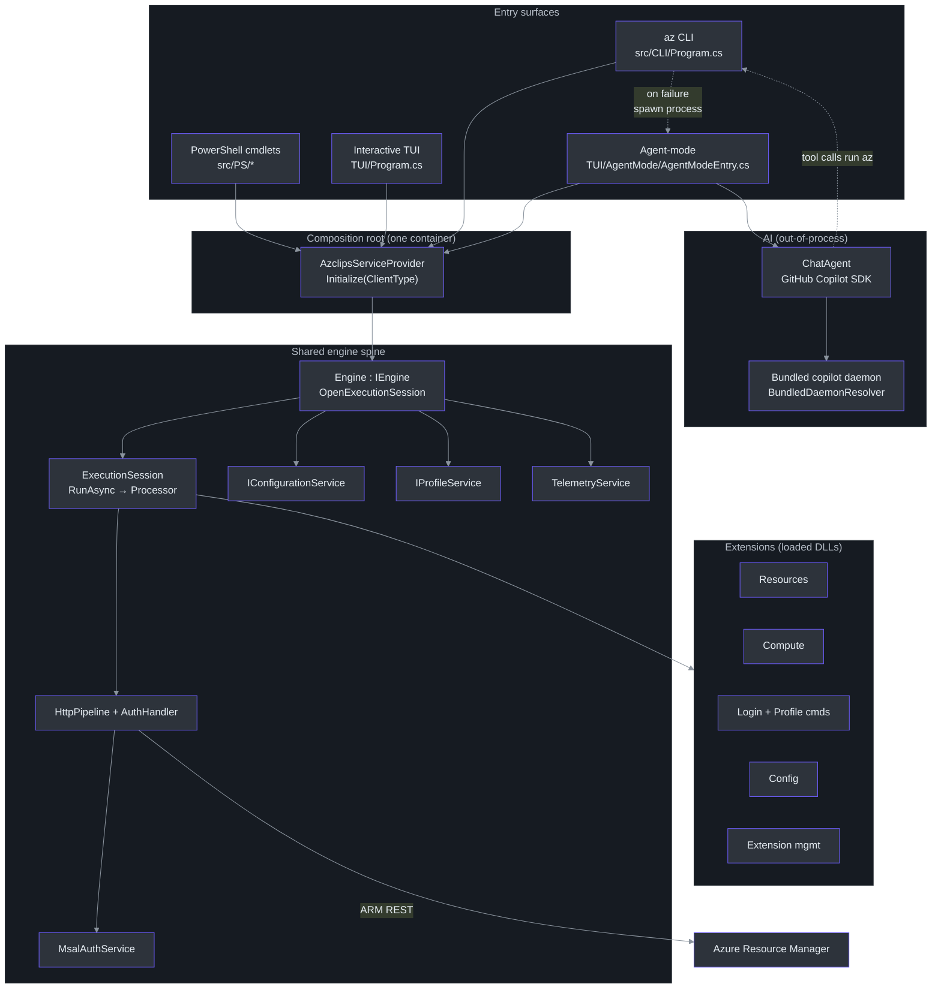
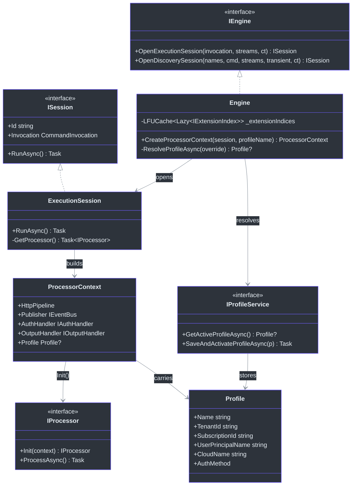
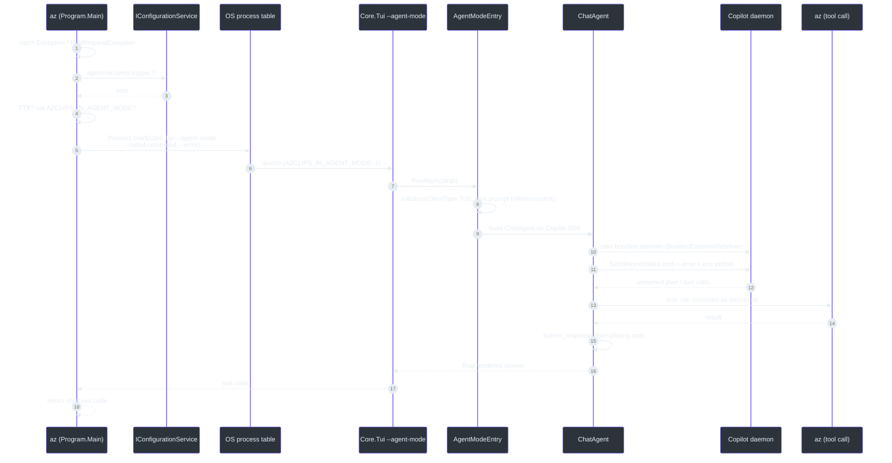

# Project Azclips — Principal-Level Onboarding Guide

> **Audience.** Senior/principal engineers who need the _why_ behind Azclips, not a click-by-click tutorial. This guide assumes you can read C# fluently, know what a DI container is, and have shipped a CLI before. It trades breadth for depth: we pick the _one_ architectural idea that explains most of the codebase and follow it all the way down to `file:line`.
>
> **Freshness contract.** This guide was regenerated against the current working tree. Where the in-repo prose docs (`README.md`, `AGENTS.md`, `eng-docs/spec/ARCHITECTURE.md`) disagree with the code, **the code wins** and the disagreement is called out explicitly. Notably:
>
> - Target framework is **net10.0** (`global.json:3`, `src/Directory.Build.props:5`) — _not_ .NET 9.
> - The project codename is **Azclips** (the shipping products are **Azure CLI** and **Azure PowerShell**); user state lives under **`~/.azclips`** (`src/Core/Core.Abstractions/HomePaths.cs:14`).
> - There is **no `Bootstrapper` class**; the composition root is the static **`AzclipsServiceProvider`**.
> - The AI fallback is **out-of-process** and runs on the **GitHub Copilot SDK + a bundled daemon** — _not_ an in-process `AgentEngine` calling Azure OpenAI.

---

## Table of contents

1. [The one idea: a single composition root with an out-of-process escape hatch](#1-the-one-idea)
2. [System architecture at a glance](#2-system-architecture-at-a-glance)
3. [The domain model](#3-the-domain-model)
4. [Reading order — how to onboard your eyes](#4-reading-order)
5. [Deep trace: a command from `argv` to Azure and back](#5-deep-trace)
6. [The AI fallback, precisely](#6-the-ai-fallback-precisely)
7. [Key abstractions and why they exist](#7-key-abstractions)
8. [Decision log (with the roads not taken)](#8-decision-log)
9. [Failure modes and how the system degrades](#9-failure-modes)
10. [Performance characteristics](#10-performance-characteristics)
11. [Dependency rationale](#11-dependency-rationale)
12. [What is genuinely hard here](#12-what-is-hard)
13. [Appendix A: fact vs. stale-doc ledger](#13-appendix-ledger)
14. Appendix B: extending the system — a principal's checklist

---

---

## 0. Thirty-second orientation

Before the deep dive, the shape of the thing in one breath:

- **What it is.** `Azclips` builds `az` — an Azure management CLI — plus a PowerShell projection, an interactive terminal UI, and an opt-in AI agent. All in C# on **net10.0**.
- **How it hangs together.** One DI container (`AzclipsServiceProvider`) → one session-based engine (`IEngine`) → extensions (DLLs) implementing `IProcessor` → a hand-rolled HTTP pipeline → Azure Resource Manager. Auth is MSAL; connection state is a `Profile`.
- **The clever bit.** When a structured command fails and you've opted in, the CLI _spawns a second process_ (the TUI in `--agent-mode`) that runs an LLM agent on the GitHub Copilot SDK to reinterpret your intent — then that agent calls `az` back through structured tools.
- **The trap.** The in-repo prose docs are stale on four counts (framework version, `Bootstrapper`/`Orchestrator` classes, Azure OpenAI, `.azclips` paths). Trust the code; use the ledger in §13.

If you read nothing else, read §1 and §5.

---

<a name="1-the-one-idea"></a>

## 1. The one idea: a single composition root with an out-of-process escape hatch

If you internalize exactly one thing about Azclips, make it this:

> **Every entry surface — the `az` CLI, the PowerShell cmdlets, the interactive TUI, and the AI agent-mode — boots the _same_ dependency-injection container (`AzclipsServiceProvider`) and drives the _same_ session-based `IEngine`. When a structured command fails in a way the system can't resolve, the CLI does not recover in-process; it _spawns a separate process_ (the TUI in `--agent-mode`) that hosts an LLM agent to reinterpret the user's intent.**

This single sentence is doing a lot of work, so let's unpack the two halves.

### 1.1 One container, many faces

A naïve multi-surface CLI grows four copies of "wire up logging, auth, HTTP, config, telemetry, the engine." Azclips refuses that. There is exactly one registration routine —

```csharp
// src/Core/Core.DependencyInjection/AzclipsServiceProvider.cs:53
public static void RegisterAzclipsServices(this IServiceCollection services) =>
    services
        .RegisterConfigurationServices()
        .RegisterTelemetryServices()
        .RegisterRuntimeServices()
        .RegisterAuthenticationServices()
        .RegisterEngineServices()
        .RegisterAssemblyLoadingServices()
        .RegisterArgumentParsingServices();
```

— and each surface customizes it through two hooks _before_ the container is built:

- `PrependRegistration(...)` — runs **before** the defaults (`AzclipsServiceProvider.cs:29`).
- `OverrideRegistration(...)` — runs **after** the defaults, relying on DI last-wins semantics to swap an implementation (`AzclipsServiceProvider.cs:44`).

The CLI, for example, prepends its extension-dispatch services and _overrides_ the assembly-loading / argument-parsing / telemetry providers with CLI-flavored ones:

```csharp
// src/CLI/Program.cs:56
AzclipsServiceProvider.PrependRegistration(services =>
{
    services.AddSingleton<IExtensionLoader, BundledExtensionLoader>();
    services.AddSingleton<IExtensionLoader, InstalledExtensionLoader>();
    services.AddSingleton<PropertyParser>();
    services.AddCliExtensionDispatch();
});
AzclipsServiceProvider.OverrideRegistration(services =>
{
    services.AddSingleton<IAssemblyLoadingProvider, CLIAssemblyLoadingProvider>();
    services.AddSingleton<IArgumentParsingProvider, CLIArgumentParsingProvider>();
    services.AddSingleton<ITelemetryProvider, CLITelemetryProvider>();
    services.AddSingleton<IUserAgentHandler, CLIUserAgentHandler>();
});
AzclipsServiceProvider.Initialize(ClientType.CLI);   // builds the container, once
```

The TUI does the analogous thing with _its_ providers (a silent logger so it doesn't corrupt the screen, a TUI telemetry provider) at `TUI/Program.cs:23`. The **only** thing that differs between surfaces is the `ClientType` seed and this thin ring of prepend/override registrations. Everything downstream — the engine, the HTTP pipeline, MSAL auth, config, telemetry — is identical machinery.

In Python terms, the pattern is:

```python
# Pseudocode mirror of AzclipsServiceProvider
class AzclipsServiceProvider:
    _provider = None                 # built lazily, exactly once
    _prepend, _override = [], []     # registration hooks

    @classmethod
    def prepend(cls, fn):
        if cls._provider: raise RuntimeError("already initialized")
        cls._prepend.append(fn)

    @classmethod
    def override(cls, fn):
        if cls._provider: raise RuntimeError("already initialized")
        cls._override.append(fn)

    @classmethod
    def initialize(cls, client_type):
        if cls._provider:            # idempotent: first caller wins
            return
        with cls._lock:
            if cls._provider:
                return
            services = ServiceCollection()
            services.add_singleton(ClientType, client_type)
            for fn in cls._prepend: fn(services)     # before defaults
            register_azclips_services(services)       # the shared spine
            for fn in cls._override: fn(services)    # after defaults (last wins)
            cls._provider = services.build()
```

Two properties matter for a principal reviewer:

- **Idempotent init.** `Initialize` bails immediately if the provider already exists, under a double-checked lock (`AzclipsServiceProvider.cs:67`). PowerShell imports modules that each may try to initialize; the CLI initializes once at startup. Making init a no-op after the first call means "import three cmdlet modules" doesn't rebuild the world three times.
- **Ordering is a feature, not an accident.** Prepend-then-defaults-then-override is what lets a surface both _add_ new services (prepend) and _replace_ a default (override) without editing the shared spine. The comments at `:38-42` spell out the last-wins contract deliberately.

### 1.2 The escape hatch: fail _out_ of the process, not _around_ it

The second half of the idea is the fallback. Most CLIs that bolt on "natural language mode" do it in-process: catch the parse error, call an SDK, print a suggestion. Azclips deliberately does **not**. When the structured path throws, the CLI's top-level handler spawns **a different executable** — the TUI, launched with `--agent-mode` — and hands it the failed command and the error text:

```csharp
// src/CLI/Program.cs:320 (inside TryAgentFallbackAsync)
var tuiExe = FindTuiExe();
...
psi.Environment["AZCLIPS_IN_AGENT_MODE"] = "1";  // recursion guard
psi.ArgumentList.Add("--agent-mode");
psi.ArgumentList.Add("--failed-command");
psi.ArgumentList.Add(JoinShellQuoted(args));
if (!string.IsNullOrWhiteSpace(errorText))
{
    psi.ArgumentList.Add("--error");
    psi.ArgumentList.Add(errorText);
}
using var proc = Process.Start(psi) ...
await proc.WaitForExitAsync();
return proc.ExitCode;
```

Why pay the cost of a whole second process? Because the agent is a _fundamentally different kind of workload_ than a CLI command:

- It streams tokens and needs a live TTY it fully owns (stdin for `y/n` approvals, stdout for streaming). The CLI's stdio model (write-a-line, exit) is wrong for it.
- It bundles a native daemon (the Copilot CLI) and a heavier dependency graph (`GitHub.Copilot.SDK`, `Microsoft.Extensions.AI`, Azure SDKs). Keeping that out of the hot path means the _structured_ CLI stays lean and fast — you don't pay for the LLM machinery on every `az group list`.
- Process isolation gives a clean cancellation and teardown boundary: Ctrl+C, token cancellation, and daemon kill are the child's problem, and the parent just `WaitForExitAsync`.

The handoff is guarded three ways, and understanding the guards _is_ understanding the design intent:

```csharp
// src/CLI/Program.cs:281 TryAgentFallbackAsync — the three gates
// 1. Opt-in: agent.recovery.trigger must be auto (default off; manual saves for az troubleshoot analyze)
if (!config.GetConfiguration<AgentOptions>().Recovery.IsAutomatic) return 1;
// 2. Interactivity: no TTY (CI, a pipe, a script) → surface the real error, don't hang
if (Console.IsInputRedirected || Console.IsOutputRedirected) return 1;
// 3. Recursion: an az failing *inside* an already-running agent must not spawn another
if (Environment.GetEnvironmentVariable("AZCLIPS_IN_AGENT_MODE") == "1") return 1;
```

The recursion guard is the subtle one. Agent-mode can itself run `az` (via PowerShell tool calls); if that inner `az` fails, we must **not** recursively open another agent-mode TUI. The `AZCLIPS_IN_AGENT_MODE=1` env var, set on the child's `ProcessStartInfo` at `:339`, is the fuse.

> **Fact vs. stale doc.** `AGENTS.md:16` and `eng-docs/spec/ARCHITECTURE.md` describe an in-process `OrchestratorEngine` that "tries `DefaultCommandEngine` first, falls back to `AgentEngine`." That design is **not in the current tree** — `grep` finds no `OrchestratorEngine`/`AgentEngine`/`Bootstrapper` types (only unrelated `*Processor_Orchestrator` classes inside the Resources/Compute extensions). The _actual_ orchestration is the try/catch in `Program.Main` plus the process spawn in `TryAgentFallbackAsync`. Treat the spec's "theoretical vs actual" table as historical.

---

<a name="2-system-architecture-at-a-glance"></a>

## 2. System architecture at a glance



The diagram encodes three truths worth stating plainly:

1. **All four surfaces converge on `AzclipsServiceProvider`.** There is no second wiring path.
2. **The AI box is dashed and separate.** The solid arrows are the structured hot path; the dashed arrows are the fallback and the agent's tool-calls-back-into-`az`. The dashed boundary is a _process_ boundary.
3. **Extensions are leaves, not core.** `Resources`, `Compute`, `Accounts`, `Config`, `Extension` are DLLs discovered and loaded at runtime; the core knows them only through `IExtensionIndex` and `IProcessor`.

### 2.1 The project map (from `azclips.slnx`)

| Group                | Projects                                                                                                                                                                                                         | Role                                                                          |
| -------------------- | ---------------------------------------------------------------------------------------------------------------------------------------------------------------------------------------------------------------- | ----------------------------------------------------------------------------- |
| `src/CLI`            | `Core.Cli`                                                                                                                                                                                                       | The `az` binary: parse args, open session, orchestrate fallback               |
| `src/Core` (10)      | `Core.Abstractions`, `Core.ArgumentParsing`, `Core.AssemblyLoading`, `Core.Authentication`, `Core.Configuration`, `Core.DependencyInjection`, `Core.Engine`, `Core.Extensions`, `Core.Runtime`, `Core.Telemetry` | The shared spine: contracts + implementations for every cross-cutting concern |
| `src/Extensions` (6) | `ExtensionRuntime`, `Extension`, `Resources`, `Accounts`, `Config`, `Compute`                                                                                                                                       | Command packages + the (de)serialization runtime they use                     |
| `TUI`                | `Core.Tui`                                                                                                                                                                                                       | Interactive shell **and** agent-mode host (Hex1b terminal library)            |
| `Agent`              | `Core.Agent` (+ `Core.Agent.Tests`)                                                                                                                                                                              | The LLM agent: `ChatAgent`, tools, renderers, daemon resolver                 |
| `src/PS`             | `Cmdlets.Common/Compute/Config/Accounts/Resources`                                                                                                                                                                  | PowerShell projection of the same engine                                      |
| `tests`              | `Cli.Tests`, `Cmdlets.Tests`, `Core.Extensions.Tests`, `Core.Telemetry.Tests`, `Common`, `Benchmark`, `Fixtures/*`                                                                                               | xUnit + BenchmarkDotNet + fixture extensions                                  |
| `tools`              | `Help/*`                                                                                                                                                                                                         | Help-artifact generation tool and its tests                                   |

Notice `Core.Abstractions` has **no** dependencies on the concrete Core projects — it is the interface hub (`IEngine`, `IAuthService`, `IConfigurationService`, `IProfileService`, `IExtensionIndex`, `IProcessor`, `ISession`). That is what lets extensions and the engine reference each other's _shapes_ without a dependency cycle. Keep it that way.

### 2.2 `ClientType` — the one seed that differentiates surfaces

The only value threaded through the entire container that says "which surface am I" is `ClientType`, registered as a singleton at the very top of `Initialize` (`AzclipsServiceProvider.cs:79`). The CLI seeds `ClientType.CLI`, the TUI and agent-mode seed `ClientType.TUI`, PowerShell seeds its own. Downstream services branch on it sparingly — the `Engine` constructor takes it (`Engine.cs:22`), sessions embed it in their `Id` for traceability (`ExecutionSession.cs:36`), and telemetry tags it. The discipline here is important: `ClientType` is for _observability and a handful of surface-specific defaults_, **not** a license to fork behavior. When you find yourself writing `if (clientType == ...)` deep in a command, that is a smell — the surface difference should have been expressed as a prepend/override registration at the composition root instead.

This is the crux of why the design scales to four surfaces without four codebases: surface variation is pushed to the _edges_ (registration hooks + output delegate + `ClientType` seed) and the _center_ stays uniform.

---

<a name="3-the-domain-model"></a>

## 3. The domain model



The nouns you must know cold:

- **`CommandInvocation`** — the parsed intent: extension name, command path, parameter bag, transient flag. Produced by `ExtensionDispatcher.Parse` (`src/CLI/Parser/ExtensionDispatcher.cs:44`).
- **`ISession` / `ExecutionSession`** — one _invocation's_ worth of isolated execution: its own event bus, its own output channel, its own logging scope (`src/Core/Core.Engine/ExecutionSession.cs:12`). This is the unit of concurrency.
- **`ProcessorContext`** — the record injected into every command via `Init(...)`. It carries the composed HTTP pipeline, the event publisher, the auth handler, the output handler, and the resolved `Profile?` (`src/Core/Core.Engine/Engine.cs:123`).
- **`IProcessor`** — the command contract. Every leaf command (e.g. `SetConfigCommand`, `LoginProcessor`, `NewVMProcessor`) implements `Init(context)` then `ProcessAsync()`.
- **`Profile`** — the single source of truth for connection state (tenant, subscription, UPN, cloud, auth method). It **replaced** the old `AuthContext`/`context.json` (see §8, Decision D5). Managed by `IProfileService` (`src/Core/Core.Abstractions/IProfileService.cs`).

The relationship that surprises people: **the `Profile` is resolved _before_ command-specific arguments are bound.** The engine must build `ProcessorContext` (which carries `Profile?`) and inject it via `Init()` _before_ the binder runs, so the global `--profile` value is extracted in a dedicated pre-binding pass (`openspec/changes/profile-management/design.md`, Decision 4). Hold that thought for §5.

---

<a name="4-reading-order"></a>

## 4. Reading order — how to onboard your eyes

Don't read the tree alphabetically. Read it in dependency order, spine-first:

1. **`src/Core/Core.Abstractions/`** — start with `IEngine.cs`, `ISession.cs`, `IProcessor` (in `CLIContracts.cs`/`Runtime`), `IProfileService.cs`, `IConfigurationService.cs`, `IAuthService.cs`. One afternoon here and you know every seam in the system.
2. **`src/Core/Core.DependencyInjection/AzclipsServiceProvider.cs`** — the composition root (~130 lines). Now you know how the seams get filled.
3. **`src/CLI/Program.cs`** — the whole CLI lifecycle including the fallback, in one 441-line file. Read `Main` (`:31`) top to bottom, then `TryAgentFallbackAsync` (`:281`).
4. **`src/Core/Core.Engine/Engine.cs` + `ExecutionSession.cs`** — the mediator and the per-invocation unit. Focus on `CreateProcessorContext` (`Engine.cs:99`) and `RunAsync`/`GetProcessor` (`ExecutionSession.cs:57`).
5. **One extension, end to end** — `src/Extensions/Config/` is the smallest complete example: `ExtensionIndex.cs` (registry) + `Commands/ConfigCommandBase.cs` + `Commands/SetConfigCommand.cs`. You now understand how a command is discovered, instantiated, and run.
6. **`src/Core/Core.Runtime/HttpPipeline.cs` + `ProfileService.cs`** — the execution and persistence layers.
7. **`src/Core/Core.Authentication/MsalAuthService.cs`** — MSAL specifics.
8. **The AI + interactive layer last** — `Agent/ChatAgent.cs`, `Agent/BundledDaemonResolver.cs`, `TUI/Program.cs`, `TUI/AgentMode/AgentModeEntry.cs`. It's the most code but the least load-bearing for understanding the _core_.

If you only have two hours: read steps 1–3. That is 80% of the mental model for 20% of the pages.

---

<a name="5-deep-trace"></a>

## 5. Deep trace: a command from `argv` to Azure and back

Let's follow `az group list --profile prod` all the way through. Every step cites real code.

```mermaid
%%{init: {'theme':'base','themeVariables':{'primaryColor':'#2d333b','primaryBorderColor':'#6d5dfc','primaryTextColor':'#e6edf3','lineColor':'#8b949e','clusterBkg':'#161b22','clusterBorder':'#30363d','fontFamily':'monospace'}}}%%
sequenceDiagram
    autonumber
    participant U as User shell
    participant P as Program.Main
    participant DI as AzclipsServiceProvider
    participant D as ExtensionDispatcher
    participant E as Engine
    participant S as ExecutionSession
    participant PR as IProfileService
    participant PC as ProcessorContext
    participant CMD as IProcessor (group list)
    participant H as HttpPipeline + AuthHandler
    participant A as MsalAuthService
    participant ARM as Azure Resource Manager

    U->>P: az group list --profile prod
    P->>DI: PrependRegistration / OverrideRegistration
    P->>DI: Initialize(ClientType.CLI)
    P->>D: dispatcher.Parse(args)
    D-->>P: CommandInvocation(ext=group, params)
    P->>E: resolve IEngine from container
    P->>E: OpenExecutionSession(invocation, streams, ct)
    E->>S: new ExecutionSession(...)
    P->>S: RunAsync()
    S->>S: pre-bind global --profile = "prod"
    S->>E: CreateProcessorContext(session, "prod")
    E->>PR: ResolveProfileAsync("prod")
    PR-->>E: Profile(prod, tenant, sub, upn)
    E->>PC: build(HttpPipeline+AuthHandler, Profile)
    S->>CMD: bind args, Init(PC)
    S->>CMD: ProcessAsync()
    CMD->>H: send ARM request
    H->>A: AcquireTokenSilentlyAsync(tenant)
    A-->>H: bearer token
    H->>ARM: GET /subscriptions/.../resourcegroups
    ARM-->>H: 200 JSON
    H-->>CMD: response
    CMD-->>S: WriteOutput(rows) via channel
    S-->>U: printed lines
    P-->>U: exit 0 ; spawn --upload-telemetry
```

### 5.1 Boot and parse

`Main` first special-cases the telemetry uploader (`Program.cs:34`) — a re-entrant `az --upload-telemetry` used by the detached flush process (see §10). Then it registers CLI providers and calls `Initialize` (`:40-53`). Completion generation gets a chance to short-circuit (`:56`), because shell tab-completion must resolve `IEngine` directly and exit before we do "real" work.

`ExtensionDispatcher.Parse` (`:76`, impl at `ExtensionDispatcher.cs:44`) turns `argv` into a `CommandInvocation`. Help / version are classified upstream by `GlobalArgParser.Parse` (`src/CLI/Parser/GlobalArgParser.cs`) into `GlobalArgs.Help` / `GlobalArgs.Version` and dispatched directly through `RuntimeHelpDispatcher` / `RuntimeVersionDispatcher` — no control-flow-via-exceptions on the cold path. Bare `az` produces `Help.Path == []` **and** triggers the ASCII welcome banner in `Program.Main` (`WelcomeBanner.cs`); user-typed help (`az --help`, `az -h`, `az help`) skips the banner. `ExtensionDispatcher` resolves the verb against a **leaf index** built once by discovery over both loader tiers (Bundled + Installed); no static verb seed.

### 5.2 Open the session, resolve the profile, build the context

`engine.OpenExecutionSession` (`Engine.cs:39`) creates an `ExecutionSession`, subscribes the engine's event handlers to the session's `EventBus`, and wires a set of delegates onto the session — crucially:

```csharp
// src/Core/Core.Engine/Engine.cs:57
session.CreateProcessorContext = (s, profileName) => CreateProcessorContext(s, profileName);
```

`ExecutionSession.RunAsync` (`ExecutionSession.cs:57`) is deceptively short: `await (await GetProcessor()).ProcessAsync();`. The interesting work is in `GetProcessor()`, which performs the **global-parameter pre-binding pass**: it resolves command metadata, extracts and normalizes the `--profile` value using the command's parameter aliases, and passes that name into `CreateProcessorContext` _before_ binding the command-specific arguments (design: `openspec/changes/profile-management/design.md`, Decision 4).

`CreateProcessorContext` (`Engine.cs:99`) is where connection state and the HTTP pipeline are assembled:

```csharp
// src/Core/Core.Engine/Engine.cs:99
Profile? profile = await ResolveProfileAsync(profileNameOverride);   // "prod" → Profile
IAuthHandler authHandler = new AuthHandler {
    Profile = profile,
    AcquireTokenAsyncDefault = authService.AcquireTokenSilentlyAsync,
    ApplyOverride = false
};
IRuntimeHttpPipeline httpPipeline = new HttpPipeline(
    httpTransportFactory,
    session.Option.Http.MaxRetries,
    session.Option.Http.MaxRetriesFor429) { PollingInterval = 15 };
ProcessorContext context = new ProcessorContext(
    HttpPipeline: httpPipeline.Prepend(authHandler.SendAsync),   // auth first
    Publisher: session.EventBus,
    AuthHandler: authHandler,
    OutputHandler: new OutputHandler { WriteOutput = session.ProcessorOutputWriter },
    Profile: profile);
httpPipeline.Prepend(httpPipelineService.HttpPipelineTerminatingStep); // mock hook
httpPipeline.Append(httpPipelineService.HttpRequestMessageTracingStep); // record/playback
```

`ResolveProfileAsync` (`Engine.cs:143`) encodes a small but important policy: an **explicit** `--profile` that names a nonexistent profile is an _error_; a stale _active_ pointer simply resolves to `null` (bootstrap commands like `login` and `profile list` must run without a profile).

### 5.3 Execute and route output

The bound `IProcessor` gets `Init(context)` then `ProcessAsync()`. The command talks to Azure through the composed pipeline: its request passes through the auth handler (which calls `MsalAuthService.AcquireTokenSilentlyAsync` using `Profile.TenantId`), then the terminating step (passthrough in production, a mock terminator in tests), out to ARM, and back through the tracing step.

Output does **not** go straight to `Console`. Each session owns a `Channel<object>` (`ExecutionSession.cs:26`); the worker writes to the channel, and the caller's thread pumps it into the surface's output delegate. For the CLI that delegate is `Console.WriteLine` (`Program.cs:169`); for PowerShell it is `$PSCmdlet.WriteObject`. This is the mechanism that makes the _same_ engine safe to host inside a thread-affinity-sensitive cmdlet (`Engine.cs:13-21` documents the rationale).

### 5.4 Teardown

`Main`'s `finally` disposes the container and calls `SpawnTelemetryUploader` (`Program.cs:148-149`), a fire-and-forget detached `az --upload-telemetry`. The command's traces were buffered to disk during execution; the uploader flushes them without blocking the user's shell.

### 5.5 The same trace, under PowerShell

The payoff of the single-container design is that the PowerShell path is _the same trace with a different mouth_. A cmdlet like `New-VMCmdlet` (`src/PS/Compute/Cmdlets/NewVMCmdlet.cs`) calls `AzclipsServiceProvider.Initialize(...)` on module import, resolves `IEngine`, and calls `OpenExecutionSession` exactly as the CLI does. The one true difference is the output delegate: instead of `Console.WriteLine`, the session's channel is pumped into `$PSCmdlet.WriteObject`, wired through `CmdletOutputStreamsFactory` (`src/PS/Common/CmdletOutputStreamsFactory.cs`). Because cmdlet APIs are thread-affine (you may only `WriteObject` from the cmdlet's own thread), the channel-per-invocation design isn't a nicety here — it's load-bearing: the worker writes to the channel from any thread, and the _cmdlet thread_ drains it into `WriteObject`. Everything between parse and ARM — auth, profile resolution, HTTP pipeline, telemetry — is byte-for-byte the CLI's code. That is the whole point of §1.1.

---

<a name="6-the-ai-fallback-precisely"></a>

## 6. The AI fallback, precisely

Now the interesting path: what happens when §5 throws.

`Main`'s catch ladder (`Program.cs`) is a deliberate triage. Help and version are handled _before_ the ladder — they're record fields on `GlobalArgs`, dispatched inline. The catches themselves only run on real command failures:

| Exception               | Handling                                                                   | Fallback?                      |
| ----------------------- | -------------------------------------------------------------------------- | ------------------------------ |
| `AzclipsErrorException` | Known error → `EmitKnownError`, return `ex.ExitCode` | **No** — intent is unambiguous |
| `InvalidInputException` | Malformed user input → agent first, then `EmitKnownError` if the agent doesn't run | **Yes**, then known error |
| `HttpRequestException`  | Network/ARM failure → `TryAgentFallbackAsync`                              | **Yes**                        |
| `Exception` (any other) | Unknown failure → `TryAgentFallbackAsync`                                  | **Yes**                        |

The key judgment call: **known errors skip the agent, with one exception.** If the failure is well-known (`AzclipsErrorException` at `:233`), the user's intent was understood and the answer is "here's the specific problem." Spending an LLM round-trip there would be worse UX, not better. `InvalidInputException` is the exception: it is malformed user input, so it is offered to the agent before the known error is printed. Usage errors (unknown flags, missing values, unknown subcommands under a known group) are known errors too, so they skip the agent. The exception is an unknown top-level command group: no extension owns it, so it throws a plain `KeyNotFoundException` and does reach the agent. The agent is also used for unclassified failures: `HttpRequestException` and other exceptions that aren't `AzclipsErrorException`.



### 6.1 What the agent actually is

`ChatAgent` (`Agent/ChatAgent.cs:23`) is a thin, opinionated wrapper over the **GitHub Copilot SDK** (`GitHub.Copilot`, `GitHub.Copilot.Rpc`; package `GitHub.Copilot.SDK` 1.0.0, `Agent/Core.Agent.csproj:31`). It talks to a **bundled native Copilot CLI daemon** located by `BundledDaemonResolver.Resolve()` (`Agent/BundledDaemonResolver.cs:12`) under `runtimes/<rid>/native/copilot`. The SDK owns the daemon's lifecycle (it kills it by PID / process tree).

> **Fact vs. stale doc.** `eng-docs/spec/ARCHITECTURE.md` says the agent uses "Azure OpenAI Service (GPT-4o-mini) with streaming, configured via .env file." That is **not** the current implementation. The current agent is the Copilot SDK + bundled daemon; the Azure OpenAI story is historical.

### 6.2 The "act through tools" contract

The most important invariant in `ChatAgent` is that a turn must end by calling a **turn-closing tool** — `propose_plan` or `submit_response` — not by emitting bare prose. The class tracks this per-turn:

```csharp
// Agent/ChatAgent.cs:34
// Tracks whether the in-flight SendAsync called a turn-closing tool
// (propose_plan asks for plan approval; submit_response ends the session).
// A turn that only queried (get_command/bash) then replied in prose is a
// protocol violation the host forces a correction on.
private int _sendCalledClosingTool;
public bool LastSendCalledClosingTool => Volatile.Read(ref _sendCalledClosingTool) != 0;
```

Why enforce this? Because it makes the agent's behavior _auditable and interruptible_. Every consequential action is a structured tool call the host can render, gate behind a `y/n` approval (`Agent/Hosting/ConsoleApprovalPrompt.cs`), or record to a JSONL trace (`TraceAgentRenderer`). Prose-only turns would be an unobservable side channel. The host reads `LastSendCalledClosingTool` after each `SendAsync` and forces a self-correction if the agent tried to answer in prose.

The tool set (`Agent/Tools/`):

- **`ProposePlanTool`, `SubmitResponseTool`** — the two turn-closers.
- **Help tools** (`Tools/Help/HelpTools.cs`, backed by `HelpIndex.json`/`HelpManifest.json`) — let the agent look up real command syntax instead of hallucinating it.
- **Cache tools** (`Tools/Cache/`) — an ARM _resource cache_ (`ResourceCache`, `CachedResourceTools`, `ArmDetailsClient`, with `AuthServiceTokenCredential` bridging MSAL into the Azure SDK) so the agent can answer "what VMs do I have" without re-querying every turn.
- **SKU/location tools** (`Tools/Sku/AvailableLocationsTool.cs`).

### 6.3 One-shot vs. interactive

`AgentModeEntry` (`TUI/AgentMode/AgentModeEntry.cs`) picks the prompt and mode from `AgentOptions.IsInteractive`: `oneshot.md` (single answer then exit, banner suppressed) vs `inline.md` (conversation stays open). There is also an escape valve — soft reminder at 12 user↔agent turns, a hard stop at 20 (`EscapeValveSoftTurns`/`HardTurns`) — so a misbehaving loop can't run forever. The `tui.md` prompt exists for a future full-screen entry point nothing spawns yet.

---

<a name="7-key-abstractions"></a>

## 7. Key abstractions and why they exist

### 7.1 `IEngine` / `ISession` — mediator over per-invocation units

`IEngine` (`src/Core/Core.Abstractions/IEngine.cs:8`) exposes exactly two verbs: `OpenExecutionSession` (run a command) and `OpenDiscoverySession` (introspect extensions for help/completions). Everything else is a session concern. This keeps the engine a _mediator_ (its own XML doc calls it that, `Engine.cs:13`) rather than a god-object: it owns cross-invocation state (the `LFUCache` of extension indices) and hands each invocation an isolated `ExecutionSession`.

The `ICommandEngine` interface also in `IEngine.cs:15` (with `ExtractedCommand`/`ExecuteCommandAsync`) is a **vestige** of the old orchestrator design — it is defined but not the live execution path. Don't build new work on it without confirming it's still wired.

### 7.2 `ProcessorContext` — the per-command capability bundle

Rather than injecting six services into every command, the engine composes one `ProcessorContext` record (`Engine.cs:123`) carrying exactly the capabilities a command may use: the HTTP pipeline (already auth-wrapped), the event publisher, the auth handler, the output handler, and the resolved `Profile?`. Commands receive it via `Init(context)` and never touch the DI container directly for these. (They _can_ reach the container for ambient services — `ConfigCommandBase.GetConfigurationService()` does exactly that at `src/Extensions/Config/Commands/ConfigCommandBase.cs:35` — but connection/HTTP/output flow through the context.)

### 7.3 `Profile` / `IProfileService` — connection state as data

`Profile` is the single record for "who am I connected as, where." `IProfileService` (`src/Core/Core.Abstractions/IProfileService.cs`) is deliberately small but has two _native_ combined operations — `GetActiveProfileAsync()` and `SaveAndActivateProfileAsync()` — that exist purely to halve file I/O and close lost-update windows (they resolve-and-load, or persist-and-activate, under a single lock). `ProfileService` (`src/Core/Core.Runtime/ProfileService.cs:14`) backs it with `{LocalApplicationData}/.azclips/profiles.json` + a separate `active-profile` pointer file, atomic temp-plus-rename writes, and an in-process `SemaphoreSlim _gate`.

The profile _lifecycle_ is a small state machine worth internalizing, because login, logout, `--profile`, and `profile set/remove` all move a profile between these states:

```mermaid
%%{init: {'theme':'base','themeVariables':{'primaryColor':'#2d333b','primaryBorderColor':'#6d5dfc','primaryTextColor':'#e6edf3','lineColor':'#8b949e','clusterBkg':'#161b22','clusterBorder':'#30363d','fontFamily':'monospace'}}}%%
stateDiagram-v2
    [*] --> NoProfile
    NoProfile --> Default: az login (bare) → reserved "default", activated
    NoProfile --> Named: az login --out-profile prod → created + activated
    Default --> Named: az login --out-profile prod
    Named --> Active: profile set prod
    Active --> Reauth: az login --profile prod (refresh tokens)
    Reauth --> Active: overwrite + reactivate
    Active --> Inactive: az logout (clear pointer, keep definition,<br>remove UPN from MSAL cache)
    Inactive --> Active: profile set prod
    Named --> [*]: profile remove prod
    Active --> [*]: profile remove prod (also clears pointer)
```

Two invariants fall out of this diagram and are enforced in code: an explicit `--profile` naming a nonexistent profile is a hard error (`Engine.ResolveProfileAsync`, `Engine.cs:156`), while a stale _active_ pointer degrades to `null`; and logout clears the pointer but **keeps the definition** so the connection can be re-activated later (`design.md` Decision 6). The `"default"` name is reserved — bare login always targets it, and users cannot create it directly (`design.md` Decision 3).

### 7.4 `IExtensionIndex` / `IProcessor` — the extension contract

An extension is a DLL exposing an `IExtensionIndex` (its command registry) whose leaves are `IProcessor`s. The core loads the DLL (`IAssemblyLoadingService`), gets its index, caches it (`Engine.CacheGetOrAdd`, `Engine.cs:81`), binds arguments to the processor, and runs it. This is the entire extension SPI — small on purpose.

### 7.5 The event bus and scoped logging

Each session has a `RuntimeEventBus` (`src/Core/Core.Runtime/RuntimeEventBus.cs`) carrying the cancellation token and pub/sub events (`SessionCreated`, etc.). Logging is _scoped_ per session via `ScopedLoggingService.UseScope` (`ExecutionSession.cs:42`) so concurrent invocations (in a PowerShell host, say) don't cross-contaminate output. The TUI swaps in a **silent** logger (`TuiLoggingService`) precisely because the default writes `[VERBOSE]`/`[DEBUG]` to the console, which would corrupt a full-screen UI (`TUI/Program.cs:34`).

### 7.6 Configuration as typed options

Config is not a loose string bag. `IConfigurationService` (`src/Core/Core.Abstractions/IConfigurationService.cs`, impl in `src/Core/Core.Configuration/`) exposes `GetConfiguration<TOptions>()`, projecting the on-disk `~/.azclips/config.json` into strongly-typed records — `CoreOptions`, `AgentOptions`, `TelemetryOptions`, `AssemblyLoadingOptions`. This is why the engine can write `configurationService.GetConfiguration<CoreOptions>().Engine.ExtensionIndexCacheSize` (`Engine.cs:83`) and the CLI can gate the agent on `GetConfiguration<AgentOptions>().Enabled` (`Program.cs:290`) without any stringly-typed lookups leaking into business logic. The `Config` extension's `SetConfigCommand` is the _write_ side: it normalizes the key (dot/colon notation collapse, `ConfigCommandBase.NormalizeKey`, `src/Extensions/Config/Commands/ConfigCommandBase.cs:39`), parses the value, and persists through `IConfigurationService.SetConfigurationAsync` (`SetConfigCommand.cs:24`). Unknown keys are rejected unless `--force` is passed — a guard that keeps typos from silently creating dead config.

The reason this matters architecturally: **config keys are the public control surface of the whole system.** `telemetry.enabled`, `agent.recovery.trigger`, `agent.trace.enabled`/`agent.trace.path`, the HTTP retry counts, the extension-cache size — all of them are typed options resolved through this one service. When you add a feature flag, add it to a typed options record, not to an ad-hoc read.

### 7.7 The telemetry privacy model

Telemetry is worth a principal's attention because it is _on by default_ and touches every command. The design goal (stated in `README.md:153`) is: collect command names, parameter **names**, success/failure, and coarse environment — never parameter _values_, URLs, or user content. That guarantee is enforced structurally, not by convention:

- `TelemetryService` (`src/Core/Core.Telemetry/TelemetryService.cs`) starts a root `Activity` and per-command activities via a `System.Diagnostics` `ActivitySource` (`Program.cs:67,79`).
- Before export, `DefaultTelemetryPropertyFilter` / `DefaultTelemetryPropertyFilterProcessor` and the activity-name equivalents strip anything not on the allow-list (`src/Core/Core.Telemetry/DefaultTelemetryPropertyFilter.cs`). The filters are _interfaces_ (`ITelemetryPropertyFilter`, `ITelemetryActivityNameFilter`) so a surface can tighten them but not loosen the core guarantee.
- Export is two-stage and off the hot path: a `FileExporter` writes traces to disk, and a **detached** `az --upload-telemetry` (`Program.cs:410`) later calls `TelemetryUpload.RunPending()` (`src/Core/Core.Telemetry/TelemetryUpload.cs`), which orchestrates `TraceUploader` → `TracerProviderExportSink` → `WellKnownEndpoints`.

Opt-out is a single typed config write: `az config set --key telemetry.enabled --value false` (or `Set-AzConfig`), read back through `GetConfiguration<TelemetryOptions>()`. See §10 and the Telemetry deep-dive page for the flush sequence.

### 7.8 Concurrency model

The concurrency story is "isolate per invocation, cache across invocations, serialize the file writes":

- **Per-invocation isolation.** Each `ExecutionSession` owns a `Channel<object>` for output, a `RuntimeEventBus`, and a logging scope. Two commands running in the same process (e.g. a PowerShell pipeline) do not share mutable output state.
- **Cross-invocation sharing done safely.** The engine's `LFUCache<Lazy<IExtensionIndex>>` is shared, but every entry is a `Lazy<T>` so the factory runs _exactly once per key_ even under concurrent first-touch (`Engine.cs:34-36,81-89`).
- **File writes serialized.** `ProfileService` guards read-modify-write with a `SemaphoreSlim _gate` in-process and atomic temp-plus-rename on disk (`ProfileService.cs`), the strongest guarantee available without a lock server.

This is why the engine's XML doc opens with an explicit thread-safety contract (`Engine.cs:13-21`): it is _designed_ for concurrent execution, and the isolation boundaries above are the mechanisms that make that claim true.

---

<a name="8-decision-log"></a>

## 8. Decision log (with the roads not taken)

These are the load-bearing decisions. Where the codebase records rationale (notably `openspec/changes/profile-management/design.md`), it is cited; where the rationale is implicit in the code, it is marked _(inferred)_.

**D1 — Single static composition root (`AzclipsServiceProvider`).**
_Chosen:_ one static container with prepend/override hooks, idempotent init.
_Rejected:_ per-surface wiring. _Why:_ four surfaces would otherwise duplicate registration and drift. _Trade-off:_ a _static_ container is a global singleton — awkward for parallel tests that want different graphs. Mitigated by `Dispose()` clearing the provider and the hooks (`AzclipsServiceProvider.cs:119`).

**D2 — Session-based mediator engine, not a linear command bus.** _(inferred from `Engine.cs`)_
_Chosen:_ `IEngine` opens isolated `ISession`s with per-invocation channels and event buses.
_Why:_ the engine must be safely hostable inside PowerShell's thread-affine cmdlet model; per-invocation output channels are what make that safe (`Engine.cs:13-21`).

**D3 — Out-of-process AI fallback.**
_Chosen:_ spawn `Core.Tui --agent-mode` on failure.
_Rejected:_ in-process `AgentEngine` (the design in `AGENTS.md`/`ARCHITECTURE.md`). _Why:_ the agent needs full TTY ownership, streaming, a native daemon, and a heavy dependency graph that shouldn't burden the structured hot path; process isolation gives clean cancellation/teardown. _Trade-off:_ process-spawn latency and the need for env-var guards (recursion, TTY).

**D4 — `--profile` resolved in a pre-binding pass.** (`design.md` Decision 4)
_Chosen:_ extract/normalize `--profile` using command metadata _before_ full argument binding, because `ProcessorContext` (carrying `Profile?`) is injected at `Init()` _before_ binding.
_Rejected:_ (a) build the full global-parameter framework first — out of scope; (b) resolve after binding — too late, context already built; (c) read raw params without metadata — would miss alias/casing normalization. _Trade-off:_ per-processor `--profile` declarations (Resource/Compute/Login) until a general framework lands — a documented maintenance burden.

**D5 — `Profile` replaces `AuthContext`/`context.json` entirely.** (`design.md` Decision 5)
_Chosen:_ delete `AuthContext`, `IAuthContextService`, `context.json`; the auth pipeline reads tenant/subscription straight off the resolved `Profile`.
_Rejected:_ keep both — reintroduces "two ways to do the same thing" kept in sync. _Trade-off:_ `Profile?` is nullable on `ProcessorContext`; commands that need it (resource/compute) must guard and fail at point-of-use with a clear message.

**D6 — Bare `az login` writes a reserved `"default"` profile.** (`design.md` Decision 3)
_Chosen:_ no `--out-profile` → overwrite the disposable `"default"` profile and activate it.
_Rejected:_ keep old non-profile login path (dual code paths); auto-generate a name from tenant/user (long, defeats the purpose). _Trade-off:_ bare login silently clobbers the previous default — by design; named persistence needs `--out-profile`.

**D7 — Logout targets one account by UPN, not a blanket cache clear.** (`design.md` Decision 6)
_Chosen:_ `LogoutAsync(userPrincipalName)` removes only the matching MSAL account and clears the active pointer (`MsalAuthService.cs:29`).
_Why:_ the MSAL cache is shared across profiles; a blanket clear would sign out other profiles' accounts.

**D8 — Telemetry flushed by a detached re-invocation of `az`.** _(inferred from `Program.cs`)_
_Chosen:_ buffer traces to disk, then `SpawnTelemetryUploader` starts a detached `az --upload-telemetry` (`Program.cs:410`).
_Why:_ the user's shell must return instantly; upload is best-effort and must survive the foreground process exiting. _Trade-off:_ an extra short-lived process per command (guarded so it only runs from the real `az` binary, `:417`).

**D9 — net10.0, warnings-as-errors, nullable + implicit usings.** (`src/Directory.Build.props`)
_Chosen:_ strict build gate (`TreatWarningsAsErrors`, analyzers, `EnforceCodeStyleInBuild`).
_Why:_ a framework with dynamically loaded extensions benefits from maximal static enforcement in core.

**D10 — Privacy enforced by filters, not by reviewer vigilance.** _(inferred from `Core.Telemetry`)_
_Chosen:_ an allow-list applied by `DefaultTelemetryPropertyFilter`/`...ActivityNameFilter` before export, behind swappable interfaces.
_Rejected:_ "just don't log values" as a code-review convention. _Why:_ structural enforcement survives refactors and new contributors; a convention does not. _Trade-off:_ the allow-list must be maintained as new tags appear.

**D11 — TUI built on a declarative terminal library (Hex1b), with a silent logger.** _(inferred from `TUI/Program.cs`)_
_Chosen:_ `Hex1bTerminal.CreateBuilder()` (nodes/widgets/layout) plus a `TuiLoggingService` that drops log lines.
_Rejected:_ raw ANSI throughout, and reusing the default console logger. _Why:_ a full-screen UI cannot tolerate stray `[DEBUG]` writes; declarative layout is far more maintainable than cursor math. _Trade-off:_ a dependency on Hex1b and a second rendering model distinct from the CLI's line-based output.

---

<a name="9-failure-modes"></a>

## 9. Failure modes and how the system degrades

| Failure                          | Where it surfaces                            | Behavior                                                                  | Notes                                                        |
| -------------------------------- | -------------------------------------------- | ------------------------------------------------------------------------- | ------------------------------------------------------------ |
| Unknown command / typo           | `ExtensionDispatcher.Parse` throws           | If agent enabled + TTY → agent-mode reinterprets; else exit 1 with error  | The intended "typo correction" UX                            |
| Known domain error               | `AzclipsErrorException` at `Program.cs:128`  | `EmitKnownError` (`ERROR: [code] msg`), return `ex.ExitCode`             | **No** agent fallback — intent was clear                     |
| Network / ARM failure            | `HttpRequestException` at `:121`             | `TryAgentFallbackAsync`                                                   | Agent can suggest fixes / retries                            |
| Malformed user input             | `InvalidInputException`                      | Agent first; if it doesn't run, print `ERROR: [InvalidInput]`, exit 2     | Only known error that is agent-eligible                      |
| Agent disabled                   | `agent.recovery.trigger` is not `auto`               | `TryAgentFallbackAsync` returns 1, original error stands                  | Fail-safe: unreadable config ⇒ treated as disabled (`:295`)  |
| Non-interactive (CI, pipe)       | `Console.IsInputRedirected/OutputRedirected` | No agent; original error surfaced                                         | Prevents hangs on `y/n` prompts (`:308`)                     |
| Recursive agent spawn            | `AZCLIPS_IN_AGENT_MODE=1`                    | No second agent-mode                                                      | Guards agent's own `az` tool calls (`:315`)                  |
| TUI binary missing               | `FindTuiExe()` returns null                  | Log error, exit 1                                                         | Agent mode simply unavailable (`:321`)                       |
| Nonexistent explicit `--profile` | `ResolveProfileAsync`                        | `ProfileNotFound` (exit 1) — hard error                                   | Explicit override must exist (`Engine.cs:176`)               |
| Stale active-profile pointer     | `ResolveProfileAsync`                        | Resolves to `null`, command runs profile-less                             | Bootstrap commands tolerate it (`Engine.cs:150`)             |
| Concurrent profile writes        | `ProfileService._gate` + atomic rename       | Serialized in-process; atomic on disk                                     | Cross-process still races the file, mitigated by temp+rename |
| Telemetry upload fails           | `SpawnTelemetryUploader` catch               | Silently ignored; traces stay on disk                                     | Retried on next invocation (`:436`)                          |

The through-line: **degrade to the plain error, never to a hang or a hallucination.** Every agent gate defaults _off_ on ambiguity.

---

<a name="10-performance-characteristics"></a>

## 10. Performance characteristics

- **DI init is on the hot path** and is measured — the TUI logs `[startup] DI init: {ms}` at `TUI/Program.cs:41`. Because init is idempotent and singleton-heavy, it runs once; the cost is registration + `BuildServiceProvider`, not per-command.
- **Extension index caching.** Loading and reflecting over an extension DLL is expensive, so `Engine` caches `IExtensionIndex` in an `LFUCache<Lazy<IExtensionIndex>>` (`Engine.cs:36,81`), sized by `CoreOptions.Engine.ExtensionIndexCacheSize`. `Lazy<T>` guarantees a single initialization per key even under concurrent access. `--no-cache` (classified by `GlobalArgParser` into `GlobalArgs.NoCache`; `Program.Main` sets `AZCLIPS_NO_EXTENSION_CACHE=true`) bypasses this for benchmarking.
- **Transient vs cached sessions.** `OpenDiscoverySession(..., isTransient)` and `Invocation.IsTransient` (`ExecutionSession.cs:48`) let one-off/help paths skip the cache entirely.
- **HTTP retries.** Pipeline retry counts (`MaxRetries`, `MaxRetriesFor429`) and a 15s polling interval come from config (`Engine.cs:117-121`), so throttling behavior is tunable without a rebuild.
- **Telemetry never blocks the user.** Traces buffer to a `FileExporter`; the flush is a _detached_ background `az --upload-telemetry` (`Program.cs:410`). The foreground command returns as soon as its work is done.
- **Agent-mode is heavy by design** and kept off the structured path (§1.2). The bundled daemon start-up and LLM round-trips are only paid when the user has opted in _and_ a command failed _and_ the session is interactive.

For benchmarking, `tests/Benchmark` (BenchmarkDotNet) plus the in-process/`--no-cache` hooks let you measure cold vs warm command dispatch; see `eng-docs/spec/benchmark-workflows.md`.

---

<a name="11-dependency-rationale"></a>

## 11. Dependency rationale

- **`Microsoft.Identity.Client` (MSAL) + `.Extensions.Msal`** — auth is MSAL public-client against ARM (`https://management.core.windows.net//.default`), with a persisted, shared token cache (`MsalAuthService.cs:11`). Chosen over rolling bespoke OAuth because token cache persistence, device-code, and broker flows are non-trivial and MSAL is the supported path.
- **`GitHub.Copilot.SDK` (1.0.0) + `Microsoft.Extensions.AI`** — the agent runtime. The SDK ships a native daemon that Azclips bundles and resolves per-RID (`BundledDaemonResolver.cs`). `Microsoft.Extensions.AI` provides the common chat/tool abstractions.
- **`Azure.Identity` / `Azure.ResourceManager`** — used by the agent's ARM _cache_ tools (`Agent/Tools/Cache/`) to enumerate resources for context, bridged to MSAL via `AuthServiceTokenCredential`. Note the core command path uses the _hand-rolled_ `HttpPipeline`, not the Azure SDK — the Azure SDK appears only in the agent's read-only cache.
- **`Hex1b`** — the terminal-UI library the interactive TUI is built on (`TUI/Program.cs` uses `Hex1bTerminal.CreateBuilder()`). Keeps the TUI declarative (nodes/widgets/layout) rather than raw ANSI (though `TUI/Rendering/Ansi.cs` exists for low-level bits).
- **`DotNetEnv`** — `.env` loading for the agent's local dev configuration.
- **`Microsoft.Extensions.DependencyInjection`** — the container behind `AzclipsServiceProvider`.

Architectural smell to watch: two HTTP stacks (hand-rolled `HttpPipeline` for commands, Azure SDK for the agent cache). This is intentional today (the pipeline needs the record/playback tracing seam for tests) but is a candidate for consolidation.

---

<a name="12-what-is-hard"></a>

## 12. What is genuinely hard here

1. **The pre-binding profile pass.** The ordering constraint — context (with `Profile?`) is injected at `Init()` _before_ argument binding — is subtle and easy to break. If you touch `ExecutionSession.GetProcessor` or add a new global parameter, re-read `design.md` Decision 4 first.
2. **Single-reader stdin in agent-mode.** The approval pump and the prompt share one stdin reader; the `AbortKeyWatcher` is _paused_ (not destroyed) while approvals read `y/n` (`TUI/AgentMode/AgentModeEntry.cs`). Terminal ownership is also split with the parent CLI (both intercept Ctrl+C to avoid "terminal hijack", `Program.cs:349-366`). This is the fiddliest code in the repo.
3. **The "act through tools" invariant.** It spans `ChatAgent` (tracking), the host (forcing corrections), and each tool (turn-closing vs diagnostic). Changing one side silently breaks auditability.
4. **Shared MSAL cache across profiles.** Logout must scope to one UPN; a careless `RemoveAsync` loop would sign out unrelated profiles (`MsalAuthService.cs:29`, `design.md` Decision 6).
5. **Stale in-repo docs.** The single biggest onboarding hazard is trusting `eng-docs/spec/ARCHITECTURE.md` or `AGENTS.md`'s architecture section. Cross-check every architectural claim against code; use the ledger below.

---

<a name="13-appendix-ledger"></a>

## 13. Appendix A: fact vs. stale-doc ledger

| Claim in old docs                                                                                          | Reality in code                                                                             | Evidence                                                       |
| ---------------------------------------------------------------------------------------------------------- | ------------------------------------------------------------------------------------------- | -------------------------------------------------------------- |
| "Target framework .NET 9.0" (`README.md:18,53`)                                                            | **net10.0**, SDK 10.0.203                                                                   | `global.json:3`, `src/Directory.Build.props:5`                 |
| "`Core.Engine.Bootstrapper` returns `ICommandEngine`" (`AGENTS.md:15`)                                     | No `Bootstrapper` type; root is `AzclipsServiceProvider`; `Engine : IEngine`                | `AzclipsServiceProvider.cs:17`, `Engine.cs:22`                 |
| "`OrchestratorEngine` tries `DefaultCommandEngine` then `AgentEngine`" (`AGENTS.md:16`, `ARCHITECTURE.md`) | No such types; fallback is a **process spawn** of `Core.Tui --agent-mode`                   | `grep` (none found), `Program.cs:281-373`                      |
| "Azure OpenAI GPT-4o-mini, .env config" (`ARCHITECTURE.md`)                                                | **GitHub Copilot SDK** + bundled daemon                                                     | `Agent/Core.Agent.csproj:31`, `Agent/BundledDaemonResolver.cs` |
| "Config/state in `.azclips`"                                                                               | `.azclips`                                                                                  | `HomePaths.cs:14`                                              |
| "`src/Agent`, `src/Group`, `Core.Implementation`" (`README.md`, `AGENTS.md`)                               | `Agent/` and `TUI/` are **top-level**; Core has 10 named projects; no `Core.Implementation` | `azclips.slnx`                                                 |
| "`AuthContext`/`context.json` per invocation"                                                              | Removed; replaced by `Profile`                                                              | `design.md` Decision 5, `ProfileService.cs`                    |
| `src/ARCHITECTURE.md` referenced by `AGENTS.md:52`                                                         | File does not exist                                                                         | `ls src/ARCHITECTURE.md` → not found                           |

**Bottom line for a principal reviewer:** the mental model is _one container, one engine, many faces, and a deliberately isolated LLM escape hatch that fails safe._ Everything else is detail hanging off that spine. Read the spine (steps 1–4 in §4), keep this ledger next to the old docs, and you will not be misled.

---

## 14. Appendix B: extending the system — a principal's checklist

New engineers most often need to add a **command** or a whole **extension**. Here is the smallest correct path, and the seams you must respect.

### 14.1 Adding a command to an existing extension

Using `Config` as the template (the smallest complete extension):

1. **Write the processor.** Create a class implementing `IProcessor` (or extend the extension's base, e.g. `ConfigCommandBase`). Declare parameters with `[ArgumentInfo(...)]` — the binder reads these attributes (`SetConfigCommand.cs:11-18`). Implement `ProcessAsync()`; start a telemetry activity (`StartActivity(...)`) and write results through `context.OutputHandler.WriteOutput`, **never** `Console` directly (that would bypass the per-invocation channel).
2. **Register it in the extension index.** Add the verb → processor mapping in the extension's `ExtensionIndex.cs`. This is what `Engine.CacheGetOrAdd` will hand back.
3. **Add help.** Drop a markdown page under `src/CLI/Help/Docs/<verb>/…/<command>.md` (nested — filesystem mirrors the command tree, with `index.md` at each group level); it is parsed by `MarkdownCommandHelpProvider`/`FrontmatterParser` and surfaced by `RuntimeHelpDispatcher`.
4. **Mirror in PowerShell (if user-facing).** Add a cmdlet under `src/PS/<Module>/Cmdlets/` that opens a session for the same verb; add its help markdown under `src/PS/<Module>/help/`.
5. **Test both surfaces.** A `Cli.Tests` fact for the CLI path and a `Cmdlets.Tests` fact for PowerShell. Use the pipeline's terminating/tracing steps to mock ARM (see §5.2 and the Testing deep-dive page).

Seams you must not cross: don't reach into the DI container for connection/HTTP/output — take them from `ProcessorContext`. Don't add a global parameter without reading `design.md` Decision 4 (the pre-binding pass). Don't add a config key as a raw string — add a typed options field (§7.6).

### 14.2 Adding a whole extension

1. Create `src/Extensions/<Name>/Extensions.<Name>.csproj` (net10.0 inherits from `src/Directory.Build.props`); add it to `azclips.slnx`.
2. Implement `IExtensionIndex` as the command registry and one `IProcessor` per verb.
3. Use `ExtensionRuntime` (`src/Extensions/ExtensionRuntime/`) for ARM payload (de)serialization rather than hand-rolling `JsonConverter`s — its `Conversions/Instances/*` cover the primitive and collection cases, and `JsonConverterAttribute` lets you register custom ones.
4. Decide packaging: extensions that must ship in every install go into `devops/scripts/packaging/config/{lean,full}_package.config`; others are installable at runtime via `az extension add`. Dispatch is uniform — no runtime tier distinction.
5. Version deliberately: the loader supports side-by-side versions (`InstalledExtensionLoader`), and the engine caches indices per `name-version` key (`Engine.cs:84`).

### 14.3 State on disk — the reference you'll want at 2am

| Path                                             | Written by                                | Contents                                                    |
| ------------------------------------------------ | ----------------------------------------- | ----------------------------------------------------------- |
| `~/.azclips/config.json`                         | `IConfigurationService` / `az config set` | Typed options (telemetry, agent, http, …)                   |
| `{LocalApplicationData}/.azclips/profiles.json`  | `ProfileService`                          | Named connection profiles (atomic writes)                   |
| `{LocalApplicationData}/.azclips/active-profile` | `ProfileService`                          | The active profile name pointer                             |
| `{LocalApplicationData}/.azclips/MSAL.cache`     | MSAL token cache                          | Bearer tokens keyed by tenant+user (shared across profiles) |
| `~/.azclips/extensions/registry.json`            | Extension mgmt                            | Installed-extension registry                                |
| `~/.azclips/trace/`                              | Telemetry                                 | Buffered trace files                                        |
| `{LocalApplicationData}/.azclips/agent/trace/`   | Agent trace                               | JSONL agent traces (default `agent.trace.path`)             |
| `{LocalApplicationData}/.azclips/agent/arm/`     | Agent ARM cache                           | Cached resource enumerations for agent context              |

All of these constants live in one place — `src/Core/Core.Abstractions/HomePaths.cs` — so if you need to relocate or namespace them, change them there and nowhere else. That centralization is itself a design decision (avoid scattered path literals) and is why the `.azclips` → `.azclips` rename (#349) was a one-file change rather than a grep-and-pray.

### 14.4 Where to go next in the wiki

This guide is the map; the Deep Dive pages are the territory. Follow up in this order:

- **Core Engine & Orchestration** — the authoritative expansion of §1, §5, §6 with every delegate wired in `Engine`/`ExecutionSession`.
- **Configuration & Profile Management** — the `Config` extension and `ProfileService` in full, grounded in the `openspec/changes/profile-management/` proposal, design, tasks, and three delta specs.
- **AI Agent** and **Terminal UI (TUI)** — the two halves of the escape hatch: the `ChatAgent`/tools/daemon, and the Hex1b interactive shell + agent-mode host.
- **Authentication (MSAL)**, **HTTP Pipeline & Runtime** — the execution substrate every command shares.
- **Telemetry & Observability**, **Testing & Benchmarking**, **Build & CI/CD** — the operational surround.

Each of those pages cites the same `file:line` anchors used here, so you can always triangulate a claim back to code. When a page and this guide disagree, prefer whichever cites the _current_ tree — and if neither does, open the file. That habit — _claim nothing without a code reference_ — is the one you most want to carry into this codebase, precisely because its prose docs have drifted before.
