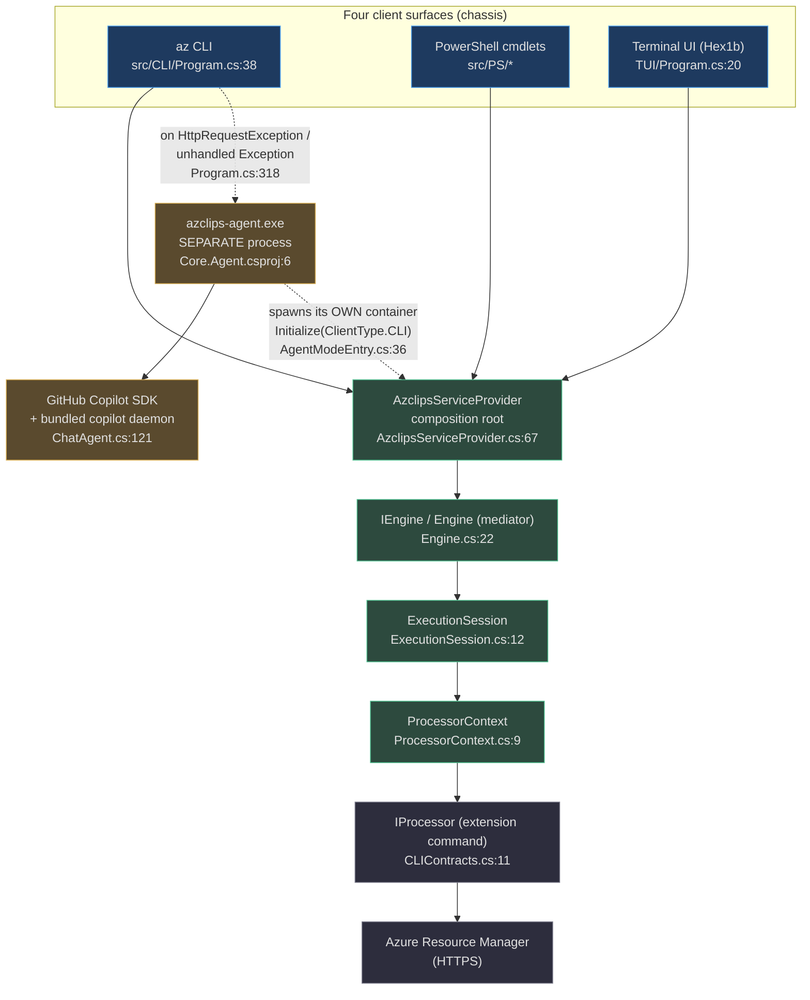
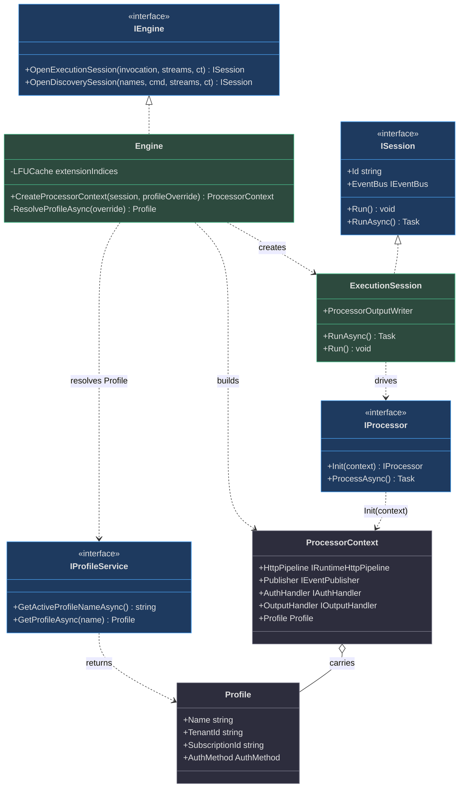
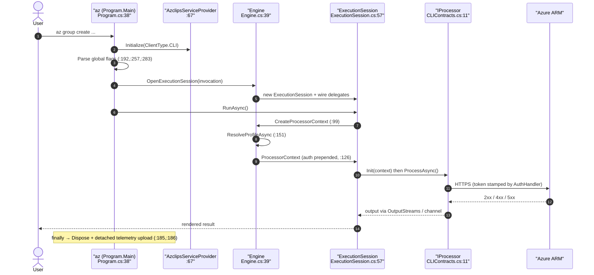
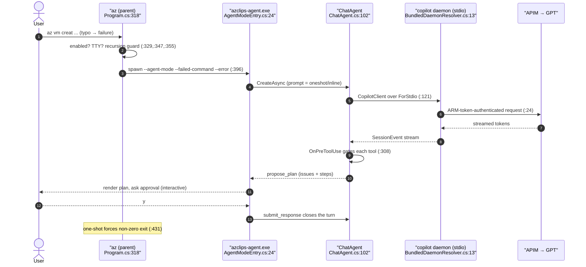
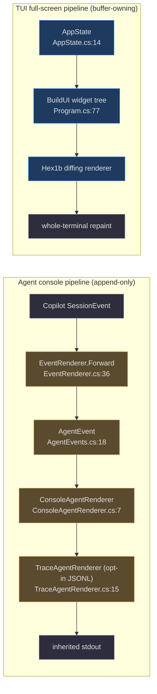
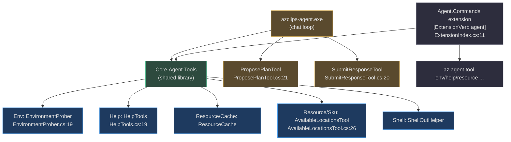
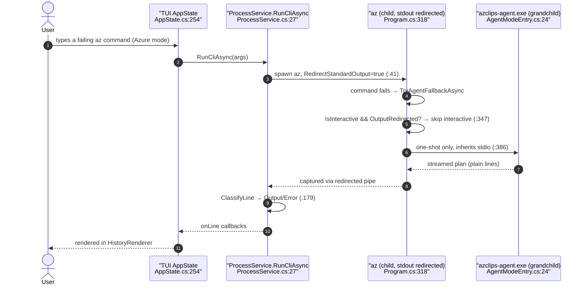
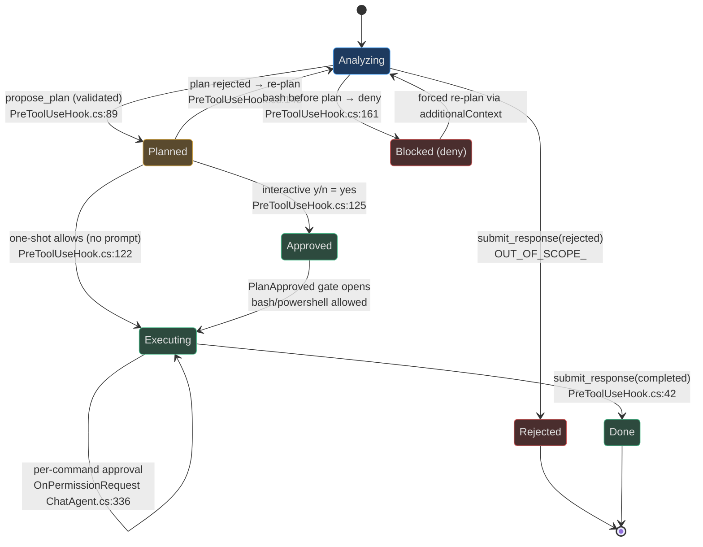

# Azclips — Principal-Level Onboarding Guide

> **Audience.** Senior and principal engineers who need the *load-bearing* mental model of this codebase in one sitting — not a tour, a blueprint. Every architectural claim below cites the file and line it is grounded in. Where older documentation drifted from the code, this guide sides with the code and says so.
>
> **Repository vs. product identity.** The Git remote is `github.com/Azure/cirrus.git`, but every namespace, binary, and on-disk directory uses the **Azclips** identity: `<Product>Azclips</Product>` (`Shared.props:3`) and the `~/.azclips` state root (`src/Core/Core.Abstractions/HomePaths.cs:12`). "Cirrus" and "Azclips" are the same codebase — do not treat them as two products.

## Table of contents

- [0. Thirty-second orientation](#_0-thirty-second-orientation)
- [1. The one core insight](#_1-the-one-core-insight)
- [2. The Engine-vs-Car analogy](#_2-the-engine-vs-car-analogy)
- [3. System architecture at a glance](#_3-system-architecture-at-a-glance)
- [4. The domain model](#_4-the-domain-model)
- [5. Deep trace: a command from argv to Azure and back](#_5-deep-trace-a-command-from-argv-to-azure-and-back)
- [6. The AI fallback, precisely](#_6-the-ai-fallback-precisely)
- [7. The plan-gate state machine](#_7-the-plan-gate-state-machine)
- [8. Key abstractions and why they exist](#_8-key-abstractions-and-why-they-exist)
- [9. Configuration, storage, and the on-disk contract](#_9-configuration-storage-and-the-on-disk-contract)
- [10. Decision log — the roads not taken](#_10-decision-log-the-roads-not-taken)
- [11. Failure modes and graceful degradation](#_11-failure-modes-and-graceful-degradation)
- [12. Testing topology](#_12-testing-topology)
- [13. Reading order — how to onboard your eyes](#_13-reading-order-how-to-onboard-your-eyes)
- [14. Fact vs. stale-doc ledger](#_14-fact-vs-stale-doc-ledger)
- [15. Appendix: a principal's extension checklist](#_15-appendix-a-principals-extension-checklist)

> **Special-depth subsections** (the parts most likely to bite you): §5.6 the discovery path · §6.4 the two rendering systems · §6.5 the agent tool catalog · §6.6 the redirected-output seam · §8.1 the HTTP delegating-handler chain · §8.3 the concurrency model · §11.1 what is genuinely hard here.

---

## 0. Thirty-second orientation

Azclips is a **.NET 10** (`net10.0`, `global.json:2`, `src/Directory.Build.props:4`) extension-based CLI framework shipped as the `az` binary. Four *client surfaces* drive Azure resource management, and all four are assembled from **one** dependency-injection composition root:

1. **CLI** — the `az` binary (`src/CLI/Program.cs:38`).
2. **PowerShell cmdlets** — binary/script modules under `src/PS/` that call the same engine (`src/PS/Common/CmdletOutputStreamsFactory.cs:28`).
3. **Interactive Terminal UI** — a full-screen Hex1b shell (`TUI/Program.cs:20`) that browses Azure resources as a virtual filesystem.
4. **Out-of-process AI agent** — a *separate* executable, `azclips-agent.exe` (`Agent/Core.Agent.csproj:6`), spawned only when a command fails and only if the user opted in.

The single most important sentence in this guide: **when a command fails, the CLI does not catch the error and call an AI in-process — it spawns a different process and hands it the failure** (`src/CLI/Program.cs:318`). Understand that seam and the rest of the architecture falls into place.

---

## 1. The one core insight

::: tip THE CORE INSIGHT
**Azclips is one composition root with an out-of-process escape hatch.** Every surface shares a single `IServiceProvider` built by `AzclipsServiceProvider` (`src/Core/Core.DependencyInjection/AzclipsServiceProvider.cs:17`), and the AI assistant is not a feature *inside* that container — it is a **second process** the CLI *fails out to* (`src/CLI/Program.cs:318`, `src/CLI/Program.cs:369-387`). The system fails **out of** the process, not **around** the error.
:::

Two design forces meet at this insight:

**(a) One container, many faces.** `AzclipsServiceProvider.Initialize` is idempotent and seeded with a single `ClientType` value (`AzclipsServiceProvider.cs:67`, `:79`). Every surface calls the *same* `RegisterAzclipsServices` chain (`AzclipsServiceProvider.cs:53`) and customizes it through two ordered hooks — `PrependRegistration` (runs before defaults, `:29`) and `OverrideRegistration` (runs after, last-wins, `:44`). There is no per-client fork of the engine; there is one engine and three registration deltas.

**(b) The escape hatch is a boundary, not a branch.** The CLI's `Main` wraps execution in a `try/catch` ladder (`src/CLI/Program.cs:87-181`). A well-known structured failure (`AzclipsErrorException`) renders and returns with **no** AI involvement (`:165-172`). Only an `HttpRequestException` (`:158`) or a truly unhandled `Exception` (`:173`) routes to `TryAgentFallbackAsync` (`:163`, `:180`), which — after opt-in and TTY checks — launches `azclips-agent.exe` as a child process with inherited stdio (`:369-387`). The agent has its **own** dependency graph, its **own** NuGet dependencies (`Agent/Core.Agent.csproj:47-51`), and its **own** crash domain.

Why this matters to a principal: it means the AI subsystem can carry heavyweight, fast-moving dependencies (the GitHub Copilot SDK and a bundled native daemon) **without** bloating the hot `az` startup path or coupling the engine's lifetime to a chat loop. The blast radius of an agent crash is a non-zero exit code, not a corrupted CLI process.

Here is the whole idea in Python pseudocode — a faithful mirror of `AzclipsServiceProvider` and the fallback ladder:

```python
# Mirror of AzclipsServiceProvider (src/Core/Core.DependencyInjection/AzclipsServiceProvider.cs)
class AzclipsServiceProvider:
    _provider = None                 # volatile singleton (:19)
    _prepend  = []                   # ConcurrentQueue (:21)
    _override = []                   # ConcurrentQueue (:22)

    @classmethod
    def prepend_registration(cls, fn):        # (:29) must precede Initialize
        assert cls._provider is None
        cls._prepend.append(fn)

    @classmethod
    def override_registration(cls, fn):       # (:44) last-wins semantics
        assert cls._provider is None
        cls._override.append(fn)

    @classmethod
    def initialize(cls, client_type):         # (:67) idempotent
        if cls._provider is not None:
            return
        services = ServiceCollection()
        services.add_singleton(ClientType, client_type)   # the one seed (:79)
        for fn in cls._prepend:   fn(services)            # (:80)
        register_azclips_services(services)              # (:84) the shared chain
        for fn in cls._override:  fn(services)            # (:85)
        cls._provider = services.build()                 # (:89)


# Mirror of Program.Main's failure ladder (src/CLI/Program.cs:87-181)
def main(args):
    AzclipsServiceProvider.prepend_registration(add_cli_dispatch)   # (:57)
    AzclipsServiceProvider.override_registration(add_cli_providers) # (:64)
    AzclipsServiceProvider.initialize(ClientType.CLI)               # (:71)
    try:
        session = engine.open_execution_session(invocation, streams)  # (:107)
        session.run()                                                 # (:108)
        return 0
    except AzclipsErrorException as e:      # well-known → render, NO fallback (:165)
        emit_structured_error(e)
        return e.exit_code
    except HttpRequestException as e:       # transport failure → fallback (:158)
        return try_agent_fallback(args, e.message)
    except Exception as e:                  # anything else → fallback (:173)
        return try_agent_fallback(args, e.message)
    finally:
        AzclipsServiceProvider.dispose()    # (:185)
        spawn_telemetry_uploader()          # detached background upload (:186)
```

---

## 2. The Engine-vs-Car analogy

If you retain one metaphor, retain this one — it maps 1:1 onto the type system.

| Analogy part | Azclips reality | Source anchor |
|---|---|---|
| **The crate engine** — one motor, mass-produced | `IEngine` / `Engine` (a partial *mediator* class) | `src/Core/Core.Abstractions/IEngine.cs:8`, `src/Core/Core.Engine/Engine.cs:22` |
| **Four chassis** bolted around the same engine | CLI, PowerShell, TUI, Agent surfaces | `src/CLI/Program.cs:38`, `src/PS/...`, `TUI/Program.cs:20`, `Agent/Program.cs:9` |
| **The VIN/trim plate** that tells the line which body to build | `ClientType { PowerShell, CLI, TUI }` | `src/Core/Core.Abstractions/ClientType.cs:9` |
| **The assembly line** that drops the engine into a chassis | `AzclipsServiceProvider` composition root | `AzclipsServiceProvider.cs:53`, `:67` |
| **One journey** — ignition to parking | `ISession` / `ExecutionSession` | `src/Core/Core.Abstractions/ISession.cs:6`, `src/Core/Core.Engine/ExecutionSession.cs:12` |
| **The dashboard + fuel line + steering** wired for *that* trip | `ProcessorContext` (HTTP pipeline, auth, output, profile) | `src/Core/Core.Abstractions/Models/ProcessorContext.cs:9`, built at `Engine.cs:99` |
| **The roadside-assistance truck** — a *separate vehicle* dispatched when yours breaks down | `azclips-agent.exe`, spawned out-of-process | `src/CLI/Program.cs:318`, `Agent/Core.Agent.csproj:6` |

The analogy's punchline is the last row. The agent is **not** a warning light on your dashboard; it is a different truck with a different engine that shows up *because* your car stopped. That is the out-of-process escape hatch made physical.

---

## 3. System architecture at a glance



### 3.1 The project map (from `azclips.slnx`)

- **`src/CLI` → `Core.Cli`** — the `az` host and its failure ladder (`src/CLI/Program.cs`).
- **`src/Core/Core.*`** — the shared platform: `Abstractions`, `ArgumentParsing`, `AssemblyLoading`, `Authentication`, `Configuration`, `DependencyInjection`, `Engine`, `Extensions`, `Runtime`, `Telemetry`.
- **`src/Extensions/*`** — the six shipping extensions: `Compute`, `Config`, `Extension`, `ExtensionRuntime`, `Login`, `Resources`.
- **`src/PS/*`** — six PowerShell module projects: `Az`, `Common`, `Compute`, `Config`, `Login`, `Resources`, plus `TelemetryHelper.ps1`.
- **`TUI` → `Core.Tui`** — the interactive shell.
- **`Agent`** — three projects: `Core.Agent` (the exe), `Agent.Commands` (an extension exposing tools as `az agent tool ...`), and `Tools/Core.Agent.Tools` (shared tool library).
- **`tests/` and `Agent/tests/`** — xUnit suites plus BenchmarkDotNet.

### 3.2 `ClientType` — the one seed that differentiates surfaces

`ClientType` has exactly three values (`ClientType.cs:9`). Note that **the agent has no `ClientType` of its own** — `AgentModeEntry` deliberately initializes as `ClientType.CLI` (`Agent/AgentMode/AgentModeEntry.cs:36`), with an in-code comment recording that it *was* `TUI` back when the entry lived inside `Core.Tui`. That single line is the archaeological proof that the agent moved out of the TUI; the current architecture treats it as a CLI-flavored container running in a standalone process.

---

## 4. The domain model



The vocabulary you must internalize:

- **`IEngine`** (`IEngine.cs:8`) is the mediator. It exposes two verbs: `OpenExecutionSession` (run a command) and `OpenDiscoverySession` (enumerate commands for help/completions). It is `IDisposable` because it owns the extension-index cache.
- **`ISession`** (`ISession.cs:6`) is a *single* command's unit of work — it has an `Id`, an `EventBus`, and both a synchronous `Run()` and an async `RunAsync()`. The dual API is not redundancy; see §5.5.
- **`ProcessorContext`** (`ProcessorContext.cs:9`) is an immutable `record` bundling the four capabilities a command needs: the HTTP pipeline (with auth already prepended), the event publisher, the auth handler, the output handler, and the resolved `Profile`.
- **`IProcessor`** (`CLIContracts.cs:11`) is the command contract every extension implements: `Init(ProcessorContext)` then `ProcessAsync()`. Two methods, no more.
- **`Profile`** (`src/Core/Core.Abstractions/Models/Profile.cs:10`) is *connection state as data* — a named record of tenant, subscription, cloud, and auth method. It is the **single source of truth** for "who am I and where am I pointed," superseding the former singleton `AuthContext` (see the record's own XML doc at `Profile.cs:3-9`).

---

## 5. Deep trace: a command from `argv` to Azure and back

### 5.1 Boot and parse

`Main` first handles cold-path escape hatches before touching DI: the detached `--upload-telemetry` uploader (`src/CLI/Program.cs:43`) and a hidden print-probe (`:51`). Then it registers the CLI's DI deltas — extension loaders and the dispatcher via `PrependRegistration` (`:57`), and the CLI provider set (assembly-loading, argument-parsing, telemetry, user-agent) via `OverrideRegistration` (`:64`) — and calls `Initialize(ClientType.CLI)` (`:71`).

Global flags are stripped *before* dispatch, each by a dedicated parser: `--debug` (`:192`), `--output json|plain` (`:257`), and `--no-cache`, which sets the `AZCLIPS_NO_EXTENSION_CACHE` environment variable read downstream by assembly loading (`:283`, `:289`). The `ExtensionDispatcher.Parse` call turns `argv` into a `CommandInvocation` (`:98`).

### 5.2 Open the session, resolve the profile, build the context

`engine.OpenExecutionSession(invocation, streams, token)` (`:107`) constructs an `ExecutionSession` and wires its delegates — assembly loading, argument binding, and crucially `CreateProcessorContext` (`Engine.cs:57`). When the session later needs the context, `Engine.CreateProcessorContext` (`Engine.cs:99`) does the heavy lifting:

1. **Resolve the profile** — `ResolveProfileAsync` (`Engine.cs:151`) honors an explicit `--profile` override, else the active profile name, else `null`. An explicit-but-missing profile is an error; a stale active pointer degrades to `null`.
2. **Prepend the auth handler** — an `AuthHandler` bound to the resolved profile and `authService.AcquireTokenSilentlyAsync` is prepended to the HTTP pipeline (`Engine.cs:103`, `:126`), so *every* outgoing request carries a bearer token without the command author writing auth code.
3. **Stack the delegating handlers** — user-agent stamping (`Engine.cs:133`), a passthrough/terminating step used for client mocking (`:135`), and request tracing (`:137`).
4. **Announce context creation** — publishing `ProcessorContextCreated` (`Engine.cs:141`) lets the telemetry subscriber enrich the root span with profile-derived tags.

### 5.3 Execute and route output

`session.RunAsync()` (`ExecutionSession.cs:57`) acquires the processor and calls `processor.ProcessAsync()` (`:64`). Output routing is the subtle part. In async CLI mode, output flows straight to the wired `OutputStreams` delegates (`Program.cs:205`). In the *synchronous* `Run()` path (`ExecutionSession.cs:78`), output is marshalled through an unbounded `Channel<object>` (`:83`): a worker task writes results into the channel and the **caller's** thread pumps them out (`:90`, `:113`). This exists for exactly one reason — PowerShell's `$PSCmdlet.WriteObject` has hard thread-affinity (`ExecutionSession.cs:118-129`).

### 5.4 Teardown

`Main`'s `finally` block disposes the container (`Program.cs:185`) and fire-and-forgets a **detached** telemetry uploader — a second copy of the `az` binary invoked with `--upload-telemetry` (`Program.cs:186`, `:486`). The CLI never blocks on the upload.

### 5.5 The same trace, under PowerShell

A cmdlet's `ProcessRecord` calls `AzclipsServiceProvider.Initialize(ClientType.PowerShell)` (`AzclipsServiceProvider.cs:67`), resolves `IEngine`, and opens an execution session exactly as the CLI does — but its `OutputStreams` are built by `CmdletOutputStreamsFactory.Create` (`src/PS/Common/CmdletOutputStreamsFactory.cs:30`), whose `WriteOutput` delegate calls `cmdlet.WriteObject` (`:43`, `:47`). This is why the channel-based `Run()` exists: it lets the async engine feed a synchronous, thread-affine cmdlet without a `PSInvalidOperationException`.



### 5.6 The discovery path (help & completions)

Not every invocation opens an *execution* session. Help and shell tab-completion take a colder path that never loads a command's implementation. `Main` short-circuits completion requests *before* the try/catch via `CompletionGenerator.TryHandleAsync` / `TryHandleCandidatesAsync` (`src/CLI/Program.cs:74`, `:78`), and help throws `DispatchHelpException` / `RuntimeExtensionHelpException` that `Main` catches to render a help tree (`:113`, `:127`). Both resolve metadata through `IEngine.OpenDiscoverySession` (`IEngine.cs:12`, implemented at `Engine.cs:62`), which enumerates extension indices without building a `ProcessorContext` — there is no profile, no auth, no HTTP. This asymmetry is why `az --help` is fast and side-effect-free: it never touches the network or your credentials.

---

## 6. The AI fallback, precisely

### 6.1 What the agent actually *is*

When `TryAgentFallbackAsync` (`src/CLI/Program.cs:318`) decides to proceed, it does **not** call a model. It:

1. Reads `AgentOptions` from config and bails unless `agent.enabled` is `true` (`:329`). If config can't be read, it treats the agent as disabled and surfaces the original error — fail-safe, not fail-open (`:334-338`).
2. Applies the **interactive guard**: if `sessionStyle` is `interactive` *and* stdin or stdout is redirected, it returns the original error instead of spawning a chat loop that would hang on a non-TTY (`:347-351`). One-shot is deliberately **not** gated, because it needs no approval turn.
3. Applies the **recursion guard**: if `AZCLIPS_IN_AGENT_MODE == "1"` it refuses to spawn again (`:355`) — this is what stops an agent-invoked `az` from spawning a grandchild agent.
4. Locates `azclips-agent.exe` next to `az` or in the dev-loop sibling directory (`FindAgentExe`, `:460`, candidates `:469-474`).
5. Spawns it with **inherited** stdio (`RedirectStandardInput/Output/Error = false`, `:384-386`), sets `AZCLIPS_IN_AGENT_MODE=1` and forwards the caller's real cwd via `AZCLIPS_CALLER_CWD` (`:388`, `:394`), and passes `--agent-mode --failed-command <cmd> --error <text>` (`:396-403`).
6. Intercepts Ctrl+C in the parent so the child owns cancellation without a "terminal hijack" (`:410-411`), then waits (`:416`).

The exit-code contract is worth memorizing: **one-shot forces a non-zero exit** even if the agent returned 0, because the user's original command still failed (`:431`); **interactive passes the child's exit code through** because it may have actually fixed things (`:427-429`).

On the child side, `Agent/Program.cs:9` dispatches `--agent-mode` to `AgentModeEntry.RunAsync` (`Agent/AgentMode/AgentModeEntry.cs:24`), which builds its own container, selects the prompt (`oneshot.md` vs `inline.md`) from `AgentOptions.IsInteractive` (`:47`), sets quiet mode for one-shot (`:50`), constructs a `ChatAgent` (`:92`), and runs the turn loop (`RunChatLoopAsync`, `:136`).

### 6.2 The Copilot SDK seam

`ChatAgent.CreateAsync` (`Agent/ChatAgent.cs:102`) builds a `CopilotClient` whose transport is `RuntimeConnection.ForStdio` pointed at a **bundled native daemon** resolved by `BundledDaemonResolver.Resolve()` (`ChatAgent.cs:121`, `Agent/BundledDaemonResolver.cs:13`). The daemon binary (`copilot` / `copilot.exe`) lives under a `runtimes/<rid>/native/` layout whose base path is decided at **compile time** by `AgentInstallLayout` (`Agent/AgentInstallLayout.cs:22`): packaged builds read `Extensions/Microsoft.Azure.Azclips.Extensions.Agent/deps/runtimes/<rid>/native/`, dev builds read NuGet's default next to the exe, distinguished by the `AGENT_DEV_BUILD` constant (`AgentInstallLayout.cs:24-28`, defined in `Agent/Core.Agent.csproj:22`).

The model endpoint is *also* not a direct call. The default `builtin` provider (`BuiltinProviderConfig.BuildAsync`, `Agent/Providers/BuiltinProviderConfig.cs:16`) acquires an **ARM-scoped** MSAL token via the *same* `IAuthService.AcquireTokenSilentlyAsync` the engine uses (`:24`) and constructs an `azure`-type `ProviderConfig` pointed at an APIM-fronted GPT endpoint (`:49-58`; defaults in `src/Core/Core.Abstractions/AgentOptions.cs:56-59`). The alternative `github` provider uses the user's own Copilot subscription (`ChatAgent.cs:221`). So the "AI" is: your CLI's MSAL identity → APIM → GPT, brokered by a native daemon over stdio.

### 6.3 The "act through tools" contract

The agent is forbidden from replying in bare prose. Each turn must close with a *turn-closing tool*: `propose_plan` or `submit_response`. `ChatAgent` tracks `_sendCalledClosingTool` (`ChatAgent.cs:43`, exposed as `LastSendCalledClosingTool`, `:52`); if a turn ends without one, `AgentModeEntry.SendWithToolEnforcementAsync` (`:226`) re-prompts up to `MaxToolEnforcementRetries = 3` times (`:216`, correction text `:248`). Diagnostic tools like `get_command` and `bash` do **not** count as closing (`ChatAgent.cs:49-52`). A session-level **escape valve** caps runaway conversations: a soft reminder at 12 exchanges and a hard stop at 20 (`AgentModeEntry.cs:21-22`, enforced `:199-208`).



### 6.4 The two rendering systems

Azclips has **two** completely separate rendering stacks, and knowing which is which prevents a class of confusion.

**(a) Agent console rendering** (`Agent/Hosting/`) is an *append-only* stream, chosen precisely because the agent runs as a child process with **inherited** stdio (§6.1). `IAgentRenderer` (`Agent/Hosting/IAgentRenderer.cs`) is implemented by `ConsoleAgentRenderer` (`Agent/Hosting/ConsoleAgentRenderer.cs:7`), which prints plain lines and suppresses trailing model prose once `submit_response` has rendered (wired via `SetOnFinalRendered`, `AgentModeEntry.cs:108`). `TraceAgentRenderer` (`Agent/Hosting/TraceAgentRenderer.cs:15`) decorates it to also append a JSONL trace when `agent.trace.enabled`. `SpinnerService` shows a busy indicator raced against the approval pump, `AbortKeyWatcher` owns Ctrl+C during a turn, and `RendererLoggingService` funnels Azclips-internal `Warn`/`Error` logs through the renderer's lock instead of racing stdout (`AgentModeEntry.cs:90`). The stream of `SessionEvent`s from the SDK is normalized by `EventRenderer.Forward` (`Agent/EventRenderer.cs:36`) into the host-agnostic `AgentEvent` hierarchy (`Agent/AgentEvents.cs:18`), with streaming-dedup so a non-streaming aggregate message doesn't double-print (`EventRenderer.cs:19-21`, `:45-60`).

**(b) TUI full-screen rendering** (`TUI/Rendering/`) owns the *entire* terminal buffer via the Hex1b widget library. `BuildUI` (`TUI/Program.cs:77`) assembles a `VStack`/`HStack` widget tree from `HeaderRenderer`, `FooterRenderer`, `HistoryRenderer`, `MenuBarRenderer`, `SuggestionRenderer`, and `HelpRenderer`, themed by `TuiTheme` (`TUI/Rendering/TuiTheme.cs`) with raw-ANSI helpers in `TUI/Rendering/Ansi.cs`. Hex1b repaints via its own diffing engine.



### 6.5 The agent tool catalog

The agent acts through a fixed set of tools, split across two projects and re-exposed as CLI commands — a three-way arrangement that is easy to miss.

**(1) `Core.Agent.Tools`** (`Agent/Tools/Core.Agent.Tools.csproj`) — consumed by *both* the agent exe and the CLI extension:

| Tool group | Entry point | What it does |
|---|---|---|
| Env | `EnvironmentProber.ProbeAsync` (`Agent/Tools/Env/EnvironmentProber.cs:19`) | Builds an environment snapshot (OS, shell, cwd forwarded via `AZCLIPS_CALLER_CWD`) |
| Help | `HelpTools` (`Agent/Tools/Help/HelpTools.cs:19`) | `list_commands` / `get_command` by shelling `az agent tool help` |
| Resource/Cache | `Agent/Tools/Resource/Cache/ResourceCache.cs` (+ `CachedResourceTools`, `ArmCacheRefresher`, `ArmDetailsClient`) | `find` / `show` / `tree` against a local ARM cache |
| Resource/Sku | `AvailableLocationsTool` (`Agent/Tools/Resource/Sku/AvailableLocationsTool.cs:26`) | VM SKU / region availability |
| Shell | `Agent/Tools/Shell/ShellOutHelper.cs` | Process-execution wrapper for the help/resource tools |

**(2) Turn-closing tools** live in `Agent/Hosting/` as `Microsoft.Extensions.AI` `AIFunction`s: `ProposePlanTool` (`Agent/Hosting/ProposePlanTool.cs:21`) and `SubmitResponseTool` (`Agent/Hosting/SubmitResponseTool.cs:20`). Their bodies only log — the real validation and rendering happen in `PreToolUseHook` (§7). The SDK's own built-ins (`bash`, `view`, `edit`, `grep`, `glob`, `web_fetch`, `web_search`, `todo`) are also available (`ChatAgent.cs:303-305`).

**(3) The same internal tools are re-exposed as first-class `az agent tool ...` commands** via a separate extension, `Agent.Commands` (`Agent/Commands/ExtensionIndex.cs:11`, `[ExtensionVerb("agent")]`), with processors under `Agent/Commands/Processors/` (`EnvProcessor`, `HelpProcessor`, `ResourceFindProcessor`, `ResourceShowProcessor`, `ResourceTreeProcessor`, `ResourceSkuProcessor`, `ResourceRefreshProcessor`). This is why external programs — the Copilot CLI, Claude Code Skills — can invoke Azclips's resource intelligence *without* a full chat loop.



### 6.6 The redirected-output seam: TUI → az → agent

This is the subtlest interaction in the codebase and worth its own trace. The TUI does **not** host a chat mode; in Azure mode it runs the `az` binary as a redirected child (`ProcessService.RunCliAsync`, `TUI/services/ProcessService.cs:27`) with `RedirectStandardOutput=true` and `RedirectStandardError=true` (`:41-42`) — but **not** stdin. That single fact makes `Console.IsOutputRedirected` return `true` inside that child `az`, which the fallback's interactive guard checks (`Program.cs:347-351`). The consequence:

- **Interactive** agent style is silently disabled from inside the TUI (it would need a TTY to read y/n approvals).
- **One-shot** still runs — it is not gated, and the child agent inherits stdio (`RedirectStandardInput=false`, `Program.cs:386`), so its streamed plan reaches the TUI's captured stdout and is classified into `HistoryItemType.Output/Error` by `ProcessService.ClassifyLine` (`:179`).
- **`ShellMode.Local`** (`TUI/Models.cs:6`) never touches `az` or the agent at all — `AppState.ExecuteCommand` (`TUI/AppState.cs:254`) routes Local commands straight to the system shell (`:292`).
- The `AZCLIPS_IN_AGENT_MODE` recursion guard (`Program.cs:355`) still applies, so a nested spawn can never occur.



---

## 7. The plan-gate state machine

The agent's human-in-the-loop safety is a state machine enforced entirely in one place — `PreToolUseHook.HandleAsync` (`Agent/Hooks/PreToolUseHook.cs:19`) — reading and mutating a per-session `SessionState` (`Agent/SessionState.cs:11`). The SDK calls this hook before **every** tool invocation (wired at `ChatAgent.cs:308`).



The gates, in code:

- **Post-terminator gate.** Once `SubmittedThisTurn` is set, any further tool call is denied — the hook refuses rather than cancelling the turn, because cancellation would surface as `OperationCanceledException` and be misread as Ctrl+C (`PreToolUseHook.cs:30`, rationale `:26-29`).
- **`submit_response` is the sole terminator.** It is validated (`PlanArgsParser.ValidateSubmitResponse`, `:44`), renders the final outcome, and sets `SubmitRendered` + `SubmittedThisTurn` (`:66`, `:72`). Status must be `completed | rejected | failed`, and a `rejected` message must start with `OUT_OF_SCOPE_` (`PlanArgsParser.cs:34`).
- **`propose_plan` is a mid-turn artifact.** It never ends the session; one-shot allows it silently (`:122`), interactive asks for y/n and opens the `PlanApproved` gate on yes (`:125`, `:131`).
- **Execution requires an approved plan.** `bash`/`powershell` are denied unless `PlanApproved` is set (`:161-171`).
- **Placeholder and danger guards.** A command containing an unfilled placeholder is denied (`PlaceholderDetector.TryDetect`, `:184`); a step whose command contains a danger verb (`delete`, `remove`, `purge`, …) is auto-flagged destructive even if the model didn't say so (`PlanArgsParser.HasDangerVerb`, `:172`, verb list `:169-170`).

Python pseudocode of the load-bearing branch:

```python
# Mirror of PreToolUseHook.HandleAsync (Agent/Hooks/PreToolUseHook.cs:19)
def handle(tool, args, state):
    if state.submitted_this_turn:                 # (:30)
        return deny("this turn already ended with submit_response")

    if tool == "submit_response":                 # sole terminator (:42)
        err = validate_submit(args)               # status enum + OUT_OF_SCOPE_ (:44)
        if err: return deny_and_correct(err)
        render_final_outcome(args, state)
        state.submit_rendered = True              # (:66)
        state.submitted_this_turn = True          # (:72)
        return allow()

    if tool == "propose_plan":                    # mid-turn artifact (:89)
        err = validate_plan(args)                 # >=1 issue, steps with label+cmd (:91)
        if err: return deny_and_correct(err)
        state.remember_plan(args)
        if state.is_one_shot:                     # (:122)
            return allow()
        if request_plan_approval(args):           # interactive y/n (:125)
            state.plan_approved = True            # gate opens (:131)
            return allow_with_context("run the steps in order")
        state.plan_approved = False               # rejected → re-plan (:149)
        return deny_and_correct("ask what to change, then re-propose")

    if tool in ("bash", "powershell") and not state.plan_approved:   # (:161)
        return deny("execution requires an approved plan first")

    return rewrite_bare_az_to_absolute_path(args) # PATH-safety (:193)
```

---

## 8. Key abstractions and why they exist

| Abstraction | Role | Why it exists | Anchor |
|---|---|---|---|
| `IEngine` / `Engine` | Mediator over per-invocation units | One engine, many surfaces; caches extension indices via `LFUCache` under concurrency | `IEngine.cs:8`, `Engine.cs:22`, `:36` |
| `ISession` / `ExecutionSession` | One command's unit of work | Isolated output + event bus per invocation; sync `Run()` bridges thread-affine PowerShell | `ISession.cs:6`, `ExecutionSession.cs:12`, `:78` |
| `ProcessorContext` | Per-command capability bundle | Hands each command an auth-stamped HTTP pipeline + output + profile without boilerplate | `ProcessorContext.cs:9`, built `Engine.cs:99` |
| `IProcessor` | Extension command contract | Two-method surface (`Init`, `ProcessAsync`) keeps extensions trivial to author | `CLIContracts.cs:11` |
| `Profile` / `IProfileService` | Connection state as data | Single source of truth for tenant/subscription/auth; supersedes singleton `AuthContext` | `Profile.cs:10`, `IProfileService.cs:8` |
| `IAuthService` / `MsalAuthService` | MSAL token broker | Shared by engine *and* agent so there's one credential path, not two | `MsalAuthService.cs:10`, `:135` |
| `IConfigurationService` | Typed config binding | `GetConfiguration<T>()` binds `config.json` into option records like `AgentOptions` | `ConfigurationService.cs:14`, `:43` |
| `ITelemetryService` | Activity-based telemetry | Root/per-command `Activity` spans with a privacy filter and detached upload | `TelemetryService.cs:13`, `:28` |
| `IAgentRenderer` | Agent console rendering | Append-only stream readable when spawned with inherited stdio | `Agent/Hosting/IAgentRenderer.cs`, `ConsoleAgentRenderer.cs:7` |
| `EventRenderer` | SDK-event translation | Maps Copilot `SessionEvent`s into host-agnostic `AgentEvent`s | `Agent/EventRenderer.cs:22`, `Agent/AgentEvents.cs:18` |

Two abstractions deserve a closer look:

**`ProcessorContext` is deliberately a `record`.** Immutability means a command cannot accidentally mutate the auth handler or profile mid-flight; a new context is built per invocation at `Engine.cs:124`. The HTTP pipeline inside it is already a *composed* delegating-handler chain (auth → user-agent → terminating → tracing, `Engine.cs:126-137`), so a command author writes `HttpPipeline.SendAsync(request)` and gets authentication, telemetry, and test-time mocking for free.

**The event bus is the cross-cutting spine.** `ExecutionSession` owns a `RuntimeEventBus` (`ExecutionSession.cs:39`); the engine's `SubscribeAll` (`Engine.cs:44`) attaches subscribers, and lifecycle milestones (`SessionCreated`, `ProcessorContextCreated`, `ProcessorAcquired`) are published as the session progresses (`Engine.cs:46`, `:141`, `ExecutionSession.cs:63`). Telemetry enrichment rides these events rather than being threaded through every call site.

### 8.1 The HTTP pipeline as a delegating-handler chain

Every command's network I/O flows through `HttpPipeline` (`src/Core/Core.Runtime/HttpPipeline.cs:15`, implementing `IRuntimeHttpPipeline`), which composes delegating handlers around `HttpClientFactory`-produced clients. The order is set in `Engine.CreateProcessorContext` and is load-bearing: the auth handler is **prepended** so the token is attached first (`Engine.cs:126`), then user-agent stamping (`:133`), then a passthrough/terminating step used to short-circuit real network calls during client mocking (`:135`), then request tracing (`:137`). Command authors never write auth or retry code — they call into a pipeline that already has it.

The test seam lives here too: `SendAsyncFactory` and `SendAsyncTerminalFactory` (`src/Core/Core.Runtime/`) let tests swap in a mocked terminal sender so a command can be exercised without a live ARM endpoint. And `ScopedLoggingService.UseScope` (`src/Core/Core.Runtime/ScopedLoggingService.cs`) is exactly what the agent process overrides with `RendererLoggingService` (`AgentModeEntry.cs:90`) so its internal logs don't race the spinner.


### 8.2 Telemetry and the privacy model

`TelemetryService` (`src/Core/Core.Telemetry/TelemetryService.cs:13`) starts a root activity per process and a child activity per command via a `System.Diagnostics` `ActivitySource` (`:25`, `:28`). The privacy posture is enforced by filters — `DefaultTelemetryPropertyFilter` and `DefaultTelemetryActivityNameFilter` (plus their `*Processor` variants) strip parameter **values** and URLs, keeping only parameter *names*, success/failure, and basic environment data. Export is deliberately off the hot path: `FileExporter` / `FileTelemetrySender` buffer traces to disk, then a **detached** `--upload-telemetry` process (`src/CLI/Program.cs:43`, spawned at `:186`) drains them through `DirectTelemetrySender` to `WellKnownEndpoints` (`src/Core/Core.Telemetry/WellKnownEndpoints.cs:6`). Each surface supplies its own `ITelemetryProvider`; the TUI registers a `TUITelemetryProvider` (`TUI/Telemetry/TUITelemetryProvider.cs:13`) via `OverrideRegistration` (`TUI/Program.cs:37`) that gates entirely on `telemetry.enabled` before wiring OpenTelemetry. Opt out with `az config set --key telemetry.enabled --value false`.

### 8.3 Concurrency model

The engine is designed for concurrent invocation, and the concurrency primitives are chosen per component:

- **Extension indices** are cached in an `LFUCache` of `Lazy` values (`Engine.cs:36`, `:81-89`) so an index's factory runs *exactly once* per key even under concurrent access — the classic "cache stampede" avoidance.
- **Each invocation is isolated**: its own `ExecutionSession`, its own `RuntimeEventBus` (`ExecutionSession.cs:39`), and — in the synchronous PowerShell path — its own unbounded `Channel<object>` with `SingleReader=true` (`ExecutionSession.cs:83-87`).
- **`SessionState` is intentionally *not* thread-safe** (`Agent/SessionState.cs:5-9`) because the SDK invokes the `OnPreToolUse` hook serially per session — adding locks would be cargo-culting.
- **`ChatAgent` uses lock-free primitives** where the SDK's event callbacks touch shared fields: `Volatile.Read/Write` for `_sendCalledClosingTool` (`ChatAgent.cs:52`, `:183`) and `Interlocked.Exchange` for the active-turn cancellation source (`:356`).

### 8.4 Performance characteristics

- **Startup is the headline metric.** The extension LFU cache (`Engine.cs:36`) avoids re-loading assemblies per invocation, and `--no-cache` exists purely to bypass it for benchmarking (`Program.cs:283`). Continuous startup benchmarks are tracked in dedicated dashboards (see `wiki/index.md`).
- **Telemetry never blocks.** Upload is a detached background process (`Program.cs:186`), so tracing adds no synchronous latency to `az`.
- **The agent stays out of the hot path.** It is a separate binary in a hybrid packaging layout that shares the CLI's runtime pack while keeping agent-only NuGet dependencies and the native daemon under a separate extension directory (`Agent/AgentInstallLayout.cs:32-45`), so `az` startup pays nothing for the Copilot SDK until a failure actually spawns the agent.
- **BenchmarkDotNet** guards regressions via `tests/Benchmark`.

---

## 9. Configuration, storage, and the on-disk contract

### 9.1 Typed configuration keys

`GetConfiguration<T>()` (`ConfigurationService.cs:43`) binds JSON into option records. The agent surface alone contributes these keys (all under `AgentOptions`, `src/Core/Core.Abstractions/AgentOptions.cs:6`):

| Config key | Type | Default | Anchor |
|---|---|---|---|
| `agent.enabled` | bool | `false` (opt-in for private preview) | `AgentOptions.cs:11` |
| `agent.provider` | string | `builtin` (or `github`) | `AgentOptions.cs:12` |
| `agent.sessionStyle` | string | `oneshot` (or `interactive`) | `AgentOptions.cs:17` |
| `agent.interactive.verbose` | bool | `false` | `AgentOptions.cs:40` |
| `agent.trace.enabled` | bool | `false` | `AgentOptions.cs:46` |
| `agent.trace.path` | string | `~/.azclips/trace` | `AgentOptions.cs:51` |
| `agent.builtin.endpoint` | string | APIM GPT endpoint | `AgentOptions.cs:56` |
| `agent.builtin.scope` | string | `https://management.core.windows.net//.default` | `AgentOptions.cs:57` |
| `agent.builtin.modelId` | string | `gpt-5.4` | `AgentOptions.cs:58` |
| `agent.builtin.apiVersion` | string | `2025-04-01-preview` | `AgentOptions.cs:59` |

Set them with `az config set --key agent.enabled --value true`; the fallback path reads them at `Program.cs:328`. Telemetry has a parallel opt-out (`telemetry.enabled`, bound into `TelemetryOptions`).

### 9.2 The on-disk state contract

All user state is centralized in `HomePaths` (`src/Core/Core.Abstractions/HomePaths.cs:10`) so path literals never scatter:

| Path | Purpose | Anchor |
|---|---|---|
| `~/.azclips/config.json` | User configuration | `HomePaths.cs:15`, `:35` |
| `~/.azclips/extensions/registry.json` | Installed-extension registry | `HomePaths.cs:13-14`, `:32-33` |
| `~/.azclips/trace/*.jsonl` | Agent session traces (opt-in) | `HomePaths.cs:16`, `AgentOptions.cs:51` |
| `~/.azclips/arm-cache/` | Local ARM cache for agent resource tools | `HomePaths.cs:17`, `:44` |
| `{LocalApplicationData}/.azclips/context.json` | Auth context file | `HomePaths.cs:18`, `:56` |

Note the deliberate split: user-visible config lives under the profile home (`~/.azclips`), while the auth context lands under `LocalApplicationData` (`HomePaths.cs:47-57`) — machine-local, not roamed.

---

## 10. Decision log — the roads not taken

| Decision | Chosen | Rejected alternative | Rationale (in code) |
|---|---|---|---|
| AI failure handling | Spawn a **separate** `azclips-agent.exe` | In-process AI call inside `Main`'s catch | Isolation of heavy SDK deps + crash domain; `Program.cs:318`, `Core.Agent.csproj:6` |
| Default session style | `oneshot` | `interactive` by default | One-shot is safe with redirected stdio (no approval turn); `AgentOptions.cs:17`, `Program.cs:347` |
| Model transport | Copilot SDK over a **bundled daemon** (stdio) | Direct HTTP from managed code | SDK owns streaming, tools, retries; native daemon isolates provider quirks; `ChatAgent.cs:121` |
| Command execution safety | **Plan-gate** — `propose_plan` before any `bash` | Auto-run model commands | Human-in-the-loop; deny-until-approved; `PreToolUseHook.cs:161` |
| Destructiveness signal | Model flag **OR** host danger-verb backstop | Trust the model's `destructive` flag alone | Defense in depth; `PlanArgsParser.cs:172` |
| DI shape | One root + `Prepend`/`Override` deltas | A container per client surface | Shared engine, minimal divergence; `AzclipsServiceProvider.cs:29`, `:44` |
| PowerShell output | Channel-pumped sync bridge | Async output to `WriteObject` | `WriteObject` thread-affinity; `ExecutionSession.cs:118-129` |
| Agent `ClientType` | Reuse `ClientType.CLI` | A new `Agent` enum value | Agent is a CLI-flavored process; comment records the TUI history; `AgentModeEntry.cs:36` |
| Install footprint | Install to `~/.local/share` **without** touching PATH | Global PATH shim | Coexist with classic azure-cli; `install/README.md` |

---

## 11. Failure modes and graceful degradation

- **Config unreadable during fallback** → agent is treated as disabled and the *original* error is surfaced (fail-safe, `Program.cs:334-338`).
- **Non-TTY + interactive style** → interactive fallback is silently skipped; one-shot still runs (`Program.cs:347-351`).
- **Agent binary missing** → logged, original error returned; the CLI never hard-fails because the agent is absent (`Program.cs:361-364`).
- **Bundled daemon missing** → `BundledDaemonResolver.Resolve` throws a diagnostic that names the exact expected path per packaged/dev layout (`BundledDaemonResolver.cs:15-19`).
- **`builtin` provider with no Azure login** → a targeted message telling the user to `az login` or switch to the `github` provider (`BuiltinProviderConfig.cs:61-72`).
- **Model replies in prose** → up to three tool-enforcement re-prompts, then the turn is let through to avoid an infinite loop (`AgentModeEntry.cs:216`, `:237-253`).
- **Runaway conversation** → soft reminder at 12 exchanges, hard abort at 20 (`AgentModeEntry.cs:199-208`).
- **Telemetry upload spawn fails** → best-effort; traces stay on disk for the next invocation (`Program.cs:511-514`).

### 11.1 What is genuinely hard here

A principal should know where the sharp edges are — the places where the code carries a comment because someone got burned:

- **Single-reader stdin.** The agent's approval pump and its `> ` prompt loop must share *one* stdin reader; the `AbortKeyWatcher` is *paused*, not destroyed, while the approval pump reads y/n (`AgentModeEntry.cs:77-85`). Two readers on one console is a race that eats keystrokes.
- **Deny, don't cancel.** The `submit_response` terminator sets a flag and *denies* subsequent tool calls rather than cancelling the turn, because cancellation surfaces as `OperationCanceledException` and would be misread as Ctrl+C (`PreToolUseHook.cs:26-29`, `:67-72`).
- **Tool enforcement is a backstop, not a guarantee.** The SDK offers no way to forbid bare prose up front, so "act through tools" is enforced *after the fact* with up to three re-prompts; the durable fix (`tool_choice=required`) is noted as future work (`AgentModeEntry.cs:223-225`).
- **Sync-over-async for PowerShell.** The channel pump in `ExecutionSession.Run()` intentionally blocks the caller's thread to honor `WriteObject` thread-affinity — an "anti-pattern" that is correct here (`ExecutionSession.cs:118-129`).
- **`.NET` doesn't expand `~`.** Trace paths must be expanded by hand or they land in a literal `~` directory (`AgentModeEntry.cs:353-362`).
- **Terminal hijack on Ctrl+C.** The parent intercepts Ctrl+C (without acting) so the child agent's remaining output doesn't print onto a redrawn shell prompt (`Program.cs:405-411`).

---

## 12. Testing topology

| Test project | Covers | Anchor |
|---|---|---|
| `tests/Cli.Tests` | Parsing, dispatch, profile CLI behavior | `tests/Cli.Tests/ProfileCliTests.cs` |
| `tests/Cmdlets.Tests` | PowerShell cmdlet surface | `tests/Cmdlets.Tests` |
| `tests/Core.Engine.Tests` | Engine/session seam | `tests/Core.Engine.Tests/ExecutionSessionSeamTests.cs` |
| `tests/Core.Extensions.Tests` | Extension resolution & compatibility | `tests/Core.Extensions.Tests` |
| `tests/Core.Telemetry.Tests` | Privacy filters | `tests/Core.Telemetry.Tests` |
| `tests/Benchmark` | BenchmarkDotNet startup/throughput | `tests/Benchmark` |
| `tests/Fixtures` | Assembly-loading / multi-version | `tests/Fixtures` |
| `Agent/tests/Core.Agent.Tests` | Pure plan/submit validation, event snapshots, tool logic | `Agent/tests/Core.Agent.Tests/ProposePlanValidationTests.cs` |

The agent's design pays off in testability: `PlanArgsParser` and `PreToolUseHook` are pure and static, so `ProposePlanValidationTests.cs` and `SubmitResponseValidationTests.cs` drive them directly without hosting the live SDK (`PlanArgsParser.cs:9-12` documents this "no session state, no I/O" contract).

---

## 13. Reading order — how to onboard your eyes

Read the wiki in this order; each row builds on the previous. All links use current catalogue slugs.

| # | Page | Why here |
|---|---|---|
| 1 | [Overview & Architecture](/01-getting-started/overview) | The four surfaces + shared engine in one picture |
| 2 | [Core Engine & Orchestration](/02-deep-dive/core-engine-orchestration) | The composition root and session model (this guide's spine) |
| 3 | [HTTP Pipeline & Runtime](/02-deep-dive/http-pipeline-runtime) | The delegating-handler chain a command runs on |
| 4 | [Authentication](/02-deep-dive/authentication) | The MSAL path shared by engine and agent |
| 5 | [Extension System](/02-deep-dive/extension-system) | How commands are packaged and resolved |
| 6 | [Agent Architecture](/02-deep-dive/agent-architecture) | The standalone process lifecycle |
| 7 | [Copilot SDK Integration](/02-deep-dive/copilot-sdk-integration) | Daemon, provider, event translation |
| 8 | [Prompts & Plan Mode](/02-deep-dive/prompts-and-plan-mode) | The `propose_plan`/`submit_response` protocol |
| 9 | [Agent Tools](/02-deep-dive/agent-tools) | The tool catalog and its dual exposure |
| 10 | [TUI ↔ Agent Fallback Interplay](/02-deep-dive/tui-agent-mode) | The redirected-stdio seam |
| 11 | [Configuration](/02-deep-dive/configuration-management) · [Telemetry](/02-deep-dive/telemetry-observability) · [Packaging](/02-deep-dive/packaging-and-distribution) · [Testing](/02-deep-dive/testing-and-build) | Cross-cutting platform concerns |

New to C#/.NET or coming from Python? Start with the [Zero-to-Hero Contributor Guide](/zero-to-hero-guide) instead, then return here.

---

## 14. Fact vs. stale-doc ledger

A principal should know where the *narrative* drifted from the *code*. These are the corrections this refresh encodes, each grounded in source:

| Stale claim (older docs) | Current reality | Proof |
|---|---|---|
| "The TUI hosts the AI fallback" | The fallback is a **separate** `azclips-agent.exe` process | `Program.cs:318`, `Core.Agent.csproj:6`, `AgentModeEntry.cs:36` |
| "The agent calls Azure OpenAI directly" | It drives the **GitHub Copilot SDK** over a bundled daemon; the `builtin` provider authenticates via MSAL to an APIM GPT endpoint | `ChatAgent.cs:121`, `BuiltinProviderConfig.cs:16` |
| "Agent chat loop lives in `Core.Tui`" | It moved to `Agent/AgentMode/` — the in-code comment even records the migration | `AgentModeEntry.cs:33-36` |
| Old slugs `ai-agent.md` / `terminal-ui.md` | Replaced by `agent-architecture`, `copilot-sdk-integration`, `tui-interactive-shell`, `tui-agent-mode`, `rendering-and-terminal-ux` | `wiki/index.md` navigation |
| "Two PowerShell modules (Login/Resources)" | Six module folders: `Az, Common, Compute, Config, Login, Resources` | `azclips.slnx`, `src/PS/*` |

---

## 15. Appendix: a principal's extension checklist

### 15.1 Adding a command to an existing extension

1. Implement `IProcessor` — `Init(ProcessorContext)` then `ProcessAsync()` (`CLIContracts.cs:11`). Use `context.HttpPipeline` for ARM calls; auth is already prepended (`Engine.cs:126`).
2. Register the command name → processor mapping in that extension's `IExtensionIndex` (e.g. `src/Extensions/Compute/ExtensionIndex.cs`).
3. Add help metadata via `ProcessorInfoAttribute` / `ArgumentInfoAttribute` (`CLIContracts.cs:24`, `:39`).
4. Cover it with a `tests/Cli.Tests` case and, if it has a cmdlet twin, a `tests/Cmdlets.Tests` case.

### 15.2 Adding a whole extension

1. Create `src/Extensions/<Name>/` with an `ExtensionIndex : IExtensionIndex` and a `Compatibility.cs` declaration (the `CompatibilityGuard` enforces it).
2. Add it to `azclips.slnx` and, if built-in, to `BuiltInExtensions`.
3. It inherits the shared build shape from `Shared.props` (`OutputPath=$(RepoArtifacts)$(Configuration)/$(ExtName)/`, `Shared.props:9`) and `src/Directory.Build.props` (`net10.0`, nullable, warnings-as-errors).

### 15.3 State on disk — the reference you'll want at 2 a.m.

`~/.azclips/config.json` (config), `~/.azclips/extensions/registry.json` (installed extensions), `~/.azclips/trace/*.jsonl` (agent traces), `~/.azclips/arm-cache/` (agent resource cache), and `{LocalApplicationData}/.azclips/context.json` (auth) — all defined in `HomePaths.cs:12-18`.

### 15.4 Where to go next

Trace a live failure end-to-end with the [Agent Fallback Quickstart](/01-getting-started/agent-mode-quickstart), then read [Agent Architecture](/02-deep-dive/agent-architecture) and [Prompts & Plan Mode](/02-deep-dive/prompts-and-plan-mode) with `Agent/Hooks/PreToolUseHook.cs` open beside them. The hook is where the whole safety model lives — everything else is plumbing around it.

### 15.5 Five questions to check your model

If you can answer these from memory, you have the architecture:

1. When `az foo` fails, what *exactly* decides whether the agent runs, and where is that decision? (`Program.cs:329`, `:347`, `:355`)
2. Why can the same `Engine` serve a streaming CLI process and a thread-affine PowerShell cmdlet? (`ExecutionSession.cs:57` vs `:78`)
3. Why is the agent a separate process instead of an in-process call? (isolation of the Copilot SDK + crash domain; `Program.cs:318`, `Core.Agent.csproj:47-51`)
4. What stops the agent from running `az group delete` without asking? (the plan gate + danger-verb backstop; `PreToolUseHook.cs:161`, `PlanArgsParser.cs:172`)
5. Why does one-shot fallback still work inside the redirected TUI, but interactive does not? (`Program.cs:347-351`, `ProcessService.cs:41`)
