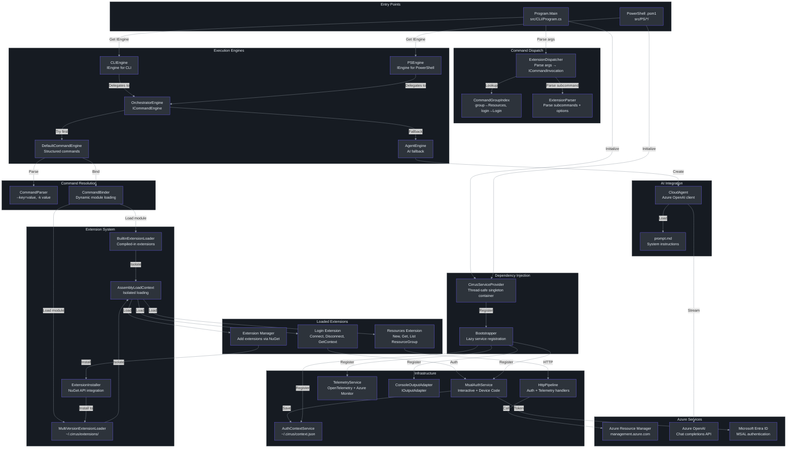

# Principal-Level Onboarding Guide

## 1. Executive Summary

Cirrus is an extension-based CLI framework for Azure resource management that ships as a single binary (`azv2`) and a set of PowerShell modules (`Cirrus.Login`, `Cirrus.Resources`). The architecture centers on an `OrchestratorEngine` that first attempts structured command dispatch through dynamically-loaded extension DLLs — each extension registering commands via an `IExtensionIndex` with separate CLI and PowerShell lookup tables — and falls back to an AI-powered `AgentEngine` backed by Azure OpenAI when structured parsing fails. Extensions are loaded into isolated `AssemblyLoadContext` instances, sharing only `Core.*` assemblies with the host process via `ExcludeAssets=runtime` in their `.csproj` files. PowerShell modules wrap the same C# core through `CirrusServiceProvider`, a thread-safe singleton DI container initialized once per process. The target API surface is Azure Resource Manager (`management.azure.com`), with authentication handled by MSAL and all operations instrumented via OpenTelemetry with export to local files, Azure Monitor, and Zipkin (debug builds only). The system is pinned to .NET 9.0.308 via `global.json` with `rollForward: latestMinor`.

---

## 2. The Core Architectural Insight

The defining architectural decision in Cirrus is **exception-driven orchestration with AI fallback**. Rather than explicitly routing commands through a type-safe dispatch tree, the `OrchestratorEngine` tries the structured path first and catches exceptions to trigger AI assistance. This is deliberate: it means any new extension command is automatically available without modifying routing logic, and unrecognized natural-language input gracefully degrades to AI help.

Here is the pattern expressed as Python pseudocode to clarify the C# control flow:

```python
# Python pseudocode for the OrchestratorEngine pattern
def execute_command(args):
    flavor = os.environ.get("AZURECLI_FLAVOR", "azure cli")
    if flavor == "azure powershell":
        return agent_engine.execute(args)  # Direct AI

    for attempt in range(5):
        try:
            default_engine.execute(args)  # Structured parsing
            return
        except NotImplementedError:
            print(f"Warning: {e}")
            return
        except Exception:
            agent_engine.execute(args)  # AI fallback
            extracted = agent_engine.extracted_command
            if not extracted:
                return
            args = extracted.split()[1:]  # Retry with AI suggestion
```

**Why exceptions instead of explicit routing?** Three reasons:

1. **Open-closed principle for extensions.** New extensions only need to implement `IExtensionIndex` and `ICommand`. No central router to modify.
2. **Natural language is the default.** If you type `azv2 "create a resource group in eastus"`, that string will fail structured parsing and fall through to the AI — exactly the desired behavior.
3. **AI can fix your typos.** If you type `azv2 gropu list`, the structured parser throws, the AI recognizes the intent, extracts `azv2 group list`, and the retry loop executes it correctly.

The tradeoff is that exception-based control flow is expensive (stack unwinding, allocation) and harder to debug. For a CLI that runs once and exits, this is acceptable. For a long-running service, it would not be.

---

## 3. System Architecture



### Architecture Walk-Through

**CLI path:** `Program.Main` → `CirrusServiceProvider.Initialize(ClientType.CLI)` → `ExtensionDispatcher.Parse(args)` produces an `ICommandInvocation` → `IEngine.Process()` on `CLIEngine` → delegates to `OrchestratorEngine.ExecuteCommandAsync()`.

**PowerShell path:** `.psm1` module root calls `CirrusServiceProvider.Initialize(ClientType.PowerShell)` → cmdlet `.ps1` scripts build a `PSCommandInvocation` → `PSEngine.Process()` runs the command on a worker thread, pumps output back to the caller's runspace via `Channel<T>`.

**AI path:** When `DefaultCommandEngine` throws (command not found, parse error), `OrchestratorEngine` catches the exception and calls `AgentEngine.ExecuteCommandAsync()` → `CloudAgent.CreateAsync(flavor)` → streams response from Azure OpenAI → parses JSON response → if `type == "executable_command"`, extracts the command and retries the structured path.

---

## 4. Domain Model

```mermaid
classDiagram
    class IEngine {
        <<interface>>
        +Process(ICommandInvocation, CommandOutputDelegate, CancellationToken) void
    }

    class ICommandEngine {
        <<interface>>
        +ExtractedCommand string
        +ExecuteCommandAsync(string[], CancellationToken) Task
    }

    class CLIEngine {
        -IAuthContextService _authContextService
        -IAuthService _authService
        -ITelemetryService _telemetryService
        -ILoggingService _logger
        -HttpClient _httpClient
        +Process(ICommandInvocation, CommandOutputDelegate, CancellationToken) void
        +GetProcessor(ICommandInvocation) IProcessor
    }

    class PSEngine {
        -LFUCache _extensionIndices
        -HttpClient _httpClient
        +ClientType ClientType
        +Process(ICommandInvocation, CommandOutputDelegate, CancellationToken) void
        +GetProcessor(ICommandInvocation) IProcessor
    }

    class OrchestratorEngine {
        -DefaultCommandEngine _defaultEngine
        -AgentEngine _agentEngine
        -CommandParser _parser
        -CommandBinder _binder
        -ILoggingService _logger
        -IOutputAdapter _output
        +ExtractedCommand string
        +ExecuteCommandAsync(string[], CancellationToken) Task
    }

    class DefaultCommandEngine {
        -CommandParser _parser
        -CommandBinder _binder
        -ILoggingService _logger
        +ExtractedCommand string
        +ExecuteCommandAsync(string[], CancellationToken) Task
    }

    class AgentEngine {
        -IOutputAdapter _output
        -string _flavor
        -CloudAgent _agent
        +ExtractedCommand string
        +ExecuteCommandAsync(string[], CancellationToken) Task
    }

    class ICommand {
        <<interface>>
        +ExecuteAsync(IServiceProvider, IDictionary, CancellationToken) Task
    }

    class IProcessor {
        <<interface>>
        +ProcessAsync() Task
        +Init(IProcessorContext) IProcessor
    }

    class IModule {
        <<interface>>
        +GetCommands() IEnumerable~ICommand~
    }

    class IExtensionIndex {
        <<interface>>
        +GetCommandMetaData(string, ClientType) ICommandMetadata
        +GetAllCommands(ClientType) IEnumerable~ICommandMetadata~
    }

    class ICommandMetadata {
        <<interface>>
        +Name string
        +FullName string
        +AssemblyName string
        +ProcessorType Type
    }

    class IAuthService {
        <<interface>>
        +LoginAsync(LoginRequest, CancellationToken) Task~AuthResult~
        +LogoutAsync(CancellationToken) Task
        +AcquireTokenSilentlyAsync(string[], string, bool, CancellationToken) Task~AuthResult~
    }

    class IAuthContextService {
        <<interface>>
        +GetCurrentContextAsync(CancellationToken) Task~AuthContext~
        +SaveContextAsync(AuthContext, CancellationToken) Task
        +ClearContextAsync(CancellationToken) Task
    }

    class AuthContext {
        +TenantId string
        +SubscriptionId string
        +ToString() string
    }

    class ITelemetryService {
        <<interface>>
        +ActivitySource ActivitySource
        +StartActivity(string, ActivityKind) Activity
        +Flush() void
    }

    class IOutputAdapter {
        <<interface>>
        +IsInteractive bool
        +WriteLineAsync(string) Task
        +WriteAsync(string) Task
        +ReadLineAsync(string) Task~string~
        +WriteWarningAsync(string) Task
        +WriteErrorAsync(string) Task
        +WriteColoredAsync(string, OutputColor) Task
    }

    class CloudAgent {
        -AIAgent _innerAgent
        -List~ChatMessage~ _conversationHistory
        +CreateAsync(string) Task~CloudAgent~$
        +RunStreamingAsync(string) IAsyncEnumerable
        +ClearHistory() void
    }

    class CommandParser {
        +Parse(string[]) ParseResult
    }

    class CommandBinder {
        -ILoggingService _logger
        +Bind(ParseResult) ICommand
    }

    IEngine <|.. CLIEngine
    IEngine <|.. PSEngine
    ICommandEngine <|.. OrchestratorEngine
    ICommandEngine <|.. DefaultCommandEngine
    ICommandEngine <|.. AgentEngine
    OrchestratorEngine --> DefaultCommandEngine
    OrchestratorEngine --> AgentEngine
    AgentEngine --> CloudAgent
    DefaultCommandEngine --> CommandParser
    DefaultCommandEngine --> CommandBinder
    CLIEngine --> IExtensionIndex
    PSEngine --> IExtensionIndex
    IExtensionIndex --> ICommandMetadata
    IAuthService --> AuthContext
    IAuthContextService --> AuthContext

    style IEngine fill:#2d333b,stroke:#6d5dfc,color:#e6edf3
    style ICommandEngine fill:#2d333b,stroke:#6d5dfc,color:#e6edf3
    style CLIEngine fill:#2d333b,stroke:#6d5dfc,color:#e6edf3
    style PSEngine fill:#2d333b,stroke:#6d5dfc,color:#e6edf3
    style OrchestratorEngine fill:#2d333b,stroke:#6d5dfc,color:#e6edf3
    style DefaultCommandEngine fill:#2d333b,stroke:#6d5dfc,color:#e6edf3
    style AgentEngine fill:#2d333b,stroke:#6d5dfc,color:#e6edf3
    style ICommand fill:#2d333b,stroke:#6d5dfc,color:#e6edf3
    style IProcessor fill:#2d333b,stroke:#6d5dfc,color:#e6edf3
    style IModule fill:#2d333b,stroke:#6d5dfc,color:#e6edf3
    style IExtensionIndex fill:#2d333b,stroke:#6d5dfc,color:#e6edf3
    style ICommandMetadata fill:#2d333b,stroke:#6d5dfc,color:#e6edf3
    style IAuthService fill:#2d333b,stroke:#6d5dfc,color:#e6edf3
    style IAuthContextService fill:#2d333b,stroke:#6d5dfc,color:#e6edf3
    style AuthContext fill:#2d333b,stroke:#6d5dfc,color:#e6edf3
    style ITelemetryService fill:#2d333b,stroke:#6d5dfc,color:#e6edf3
    style IOutputAdapter fill:#2d333b,stroke:#6d5dfc,color:#e6edf3
    style CloudAgent fill:#2d333b,stroke:#6d5dfc,color:#e6edf3
    style CommandParser fill:#2d333b,stroke:#6d5dfc,color:#e6edf3
    style CommandBinder fill:#2d333b,stroke:#6d5dfc,color:#e6edf3
```



### Key Relationships

- **Two engine hierarchies exist.** `IEngine` is the top-level process-oriented interface (synchronous `Process` method for PowerShell runspace affinity). `ICommandEngine` is the async internal interface for the orchestration layer.
- **`IProcessor` vs `ICommand`.** `IProcessor` is the modern contract used by `PSEngine` and `CLIEngine` — processors implement `Init(IProcessorContext)` and `ProcessAsync()`. `ICommand` is the older contract used by `CommandBinder` in `DefaultCommandEngine`. Both coexist; extension commands typically implement `IProcessor` through base classes like `ResourceProcessorBase`.
- **`IExtensionIndex` is per-extension.** Each extension DLL contains exactly one `ExtensionIndex` class with two dictionaries — `_psTable` and `_cliTable` — mapping command names to `ICommandMetadata` instances.

---

## 5. Component Types & Execution Paths

| Component | Type | Source File | Code Path |
|-----------|------|-------------|-----------|
| `Program.Main` | Entry point | `src/CLI/Program.cs` | Parse → Dispatch → Engine → Execute |
| `ExtensionDispatcher` | CLI parser | `src/CLI/Parser/ExtensionDispatcher.cs` | `args[0]` → `CommandGroupIndex` → `ExtensionParser` → `CLICommandInvocation` |
| `CommandGroupIndex` | Static lookup | `src/CLI/Parser/CommandGroupIndex.cs` | Maps CLI nouns to extension names: `"Group"→"Resources"`, `"Login"→"Login"` |
| `CLIEngine` | `IEngine` | `src/Core/Core.Engine/CLIEngine.cs` | Loads extension via `AssemblyLoadContext` → finds `ExtensionIndex` → gets `IProcessor` → `ProcessAsync()` |
| `PSEngine` | `IEngine` | `src/Core/Core.Engine/PSEngine.cs` | Same as CLI but uses `Channel<T>` for output routing, `LFUCache` for extension caching |
| `OrchestratorEngine` | `ICommandEngine` | `src/Core/Core.Engine/OrchestratorEngine.cs` | Try `DefaultCommandEngine` → catch → `AgentEngine` → extract → retry (up to 5×) |
| `DefaultCommandEngine` | `ICommandEngine` | `src/Core/Core.Engine/DefaultCommandEngine.cs` | `CommandParser.Parse()` → `CommandBinder.Bind()` → `ICommand.ExecuteAsync()` |
| `AgentEngine` | `ICommandEngine` | `src/Core/Core.Engine/AgentEngine.cs` | `CloudAgent.CreateAsync()` → stream response → parse JSON → extract command or display help |
| `CommandParser` | Parser | `src/Core/Core.Engine/CommandParser.cs` | Tokenize `--key=value`, `--key value`, `-k value` → `ParseResult` |
| `CommandBinder` | Module loader | `src/Core/Core.Engine/CommandBinder.cs` | Find module DLL in subdirectory → `Assembly.LoadFrom` → find `IModule` → match subcommand |
| `CloudAgent` | AI client | `src/Core/Core.Agent/CloudAgent.cs` | Load `.env` → create `AzureOpenAIClient` → stream chat completions |
| `Bootstrapper` | DI setup | `src/Core/Core.Engine/Bootstrapper.cs` | `Lazy<Task<IServiceProvider>>` → register all singletons |
| `CirrusServiceProvider` | Global DI | `src/Core/Core.DependencyInjection/CirrusServiceProvider.cs` | Double-checked locking → `ServiceCollection` → `BuildServiceProvider()` |
| `LoginProcessor` | Extension cmd | `src/Extensions/Login/Processors/Login.cs` | MSAL interactive/device-code → save `AuthContext` |
| `NewResourceGroupProcessor` | Extension cmd | `src/Extensions/Resources/Processors/NewResourceGroup.cs` | PUT to `management.azure.com` → parse response |
| `AddExtensionProcessor` | Extension cmd | `src/Extensions/Extension/Add.cs` | `ExtensionInstaller` → NuGet resolve → extract to `~/.cirrus/extensions/` |

### Execution Flow: `azv2 group list --SubscriptionId abc123`

```mermaid
sequenceDiagram
    autonumber
    participant User
    participant Program as Program.Main
    participant CSP as CirrusServiceProvider
    participant ED as ExtensionDispatcher
    participant CGI as CommandGroupIndex
    participant Engine as CLIEngine
    participant OE as OrchestratorEngine
    participant DCE as DefaultCommandEngine
    participant CP as CommandParser
    participant CB as CommandBinder
    participant ALC as AssemblyLoadContext
    participant Cmd as ListResourceGroupProcessor
    participant ARM as management.azure.com

    User->>Program: azv2 group list --SubscriptionId abc123
    Program->>CSP: Initialize(ClientType.CLI)
    CSP->>CSP: Register all singletons
    Program->>ED: Parse(["group", "list", "--SubscriptionId", "abc123"])
    ED->>CGI: getExtensionNameByCommandGroupName("Group")
    CGI-->>ED: "Resources"
    ED-->>Program: CLICommandInvocation(ext="Resources", cmd="list", params)
    Program->>Engine: Process(invocation, outputDelegate)
    Engine->>OE: ExecuteCommandAsync(args)
    OE->>DCE: ExecuteCommandAsync(args)
    DCE->>CP: Parse(args)
    CP-->>DCE: ParseResult(commands=["list"], options=SubscriptionId: "abc123")
    DCE->>CB: Bind(parseResult)
    CB->>ALC: LoadFrom(Resources DLL)
    ALC-->>CB: IModule with commands
    CB-->>DCE: ListResourceGroupProcessor
    DCE->>Cmd: ExecuteAsync(serviceProvider, options)
    Cmd->>ARM: GET /subscriptions/abc123/resourcegroups?api-version=2025-04-01
    ARM-->>Cmd: JSON response
    Cmd-->>Program: Output resource groups

    rect rgb(22, 27, 34)
    Note over OE,DCE: If DCE throws, OE catches and routes to AgentEngine
    end

    style User fill:#2d333b,stroke:#6d5dfc,color:#e6edf3
    style Program fill:#2d333b,stroke:#6d5dfc,color:#e6edf3
    style CSP fill:#2d333b,stroke:#6d5dfc,color:#e6edf3
    style ED fill:#2d333b,stroke:#6d5dfc,color:#e6edf3
    style CGI fill:#2d333b,stroke:#6d5dfc,color:#e6edf3
    style Engine fill:#2d333b,stroke:#6d5dfc,color:#e6edf3
    style OE fill:#2d333b,stroke:#6d5dfc,color:#e6edf3
    style DCE fill:#2d333b,stroke:#6d5dfc,color:#e6edf3
    style CP fill:#2d333b,stroke:#6d5dfc,color:#e6edf3
    style CB fill:#2d333b,stroke:#6d5dfc,color:#e6edf3
    style ALC fill:#2d333b,stroke:#6d5dfc,color:#e6edf3
    style Cmd fill:#2d333b,stroke:#6d5dfc,color:#e6edf3
    style ARM fill:#2d333b,stroke:#6d5dfc,color:#e6edf3
```

### Execution Flow: Natural Language Input

When the user types a natural-language string like `azv2 "create a resource group called mygroup"`, the `ExtensionDispatcher.Parse()` call fails because `"create a resource group called mygroup"` does not map to any known command group. `Program.Main` catches this exception and calls `TryAgentFallbackAsync(args)`:

1. `AgentEngine.ExecuteCommandAsync()` is invoked with the raw args.
2. `CloudAgent.CreateAsync(flavor)` loads `.env`, creates an `AzureOpenAIClient`, and loads `prompt.md` with `{{flavor}}` replaced by `"azure cli"`.
3. The user's string is sent as a chat message. The AI responds with JSON — possibly `type: "question"` asking for missing parameters (location, subscription).
4. After the user provides the info, the AI responds with `type: "executable_command"` containing the full structured command.
5. The orchestrator extracts the command string, splits it, and retries via `DefaultCommandEngine`.

---

## 6. Extension System Deep Dive

### Extension Loading Architecture

```mermaid
graph TB
    subgraph Loading["Extension Loading"]
        style Loading fill:#161b22,stroke:#30363d,color:#e6edf3
        IEL["IExtensionLoader<br>LoadExtension(folder, name, version)"]
        BEL["BuiltinExtensionLoader<br>Built-in extensions dir"]
        MVEL["MultiVersionExtensionLoader<br>~/.cirrus/extensions/"]
    end

    subgraph Isolation["Assembly Isolation"]
        style Isolation fill:#161b22,stroke:#30363d,color:#e6edf3
        ALC1["ExtensionLoadContext<br>Builtin: AssemblyDependencyResolver"]
        ALC2["ExtensionLoadContext<br>MultiVersion: Directory-based"]
        SKIP["Skip Rule<br>Core.* and DI assemblies → null<br>Falls back to parent context"]
    end

    subgraph Install["Extension Installation"]
        style Install fill:#161b22,stroke:#30363d,color:#e6edf3
        EI["ExtensionInstaller<br>NuGet API client"]
        FEED["NuGet Feed<br>nuget.org or custom"]
        LOCAL["Local .nupkg<br>PackageArchiveReader"]
        DIR["~/.cirrus/extensions/<br>packageId/version/"]
    end

    IEL <|.. BEL
    IEL <|.. MVEL
    BEL --> ALC1
    MVEL --> ALC2
    ALC1 --> SKIP
    ALC2 --> SKIP
    EI --> FEED
    EI --> LOCAL
    EI --> DIR
    DIR --> MVEL

    style IEL fill:#2d333b,stroke:#6d5dfc,color:#e6edf3
    style BEL fill:#2d333b,stroke:#6d5dfc,color:#e6edf3
    style MVEL fill:#2d333b,stroke:#6d5dfc,color:#e6edf3
    style ALC1 fill:#2d333b,stroke:#6d5dfc,color:#e6edf3
    style ALC2 fill:#2d333b,stroke:#6d5dfc,color:#e6edf3
    style SKIP fill:#2d333b,stroke:#6d5dfc,color:#e6edf3
    style EI fill:#2d333b,stroke:#6d5dfc,color:#e6edf3
    style FEED fill:#2d333b,stroke:#6d5dfc,color:#e6edf3
    style LOCAL fill:#2d333b,stroke:#6d5dfc,color:#e6edf3
    style DIR fill:#2d333b,stroke:#6d5dfc,color:#e6edf3

    linkStyle default stroke:#8b949e
```

### BuiltinExtensionLoader vs MultiVersionExtensionLoader

| Aspect | `BuiltinExtensionLoader` | `MultiVersionExtensionLoader` |
|--------|--------------------------|-------------------------------|
| **Source** | `src/Core/Core.Engine/ExtensionLoader.cs` | Same file |
| **Directory** | Build output directory (e.g., `artifacts/Debug/`) | `~/.cirrus/extensions/` |
| **Version support** | None — returns `null` if version specified | Full semantic versioning via `NuGetVersion` |
| **Resolution** | `AssemblyDependencyResolver` (reads `.deps.json`) | Directory-based: scans for DLLs by name |
| **Version selection** | N/A | Latest semantic version if version not specified |
| **Use case** | Extensions compiled and shipped with the CLI | User-installed extensions via `azv2 extension add` |

### AssemblyLoadContext Isolation

Each extension loads in its own `AssemblyLoadContext` to prevent version conflicts. The critical design decision is the **skip rule**: when the load context is asked to load `Core.*` or `Microsoft.Extensions.DependencyInjection.*` assemblies, it returns `null`, causing the runtime to fall back to the default (parent) context. This ensures:

1. All extensions share the same `Core.Abstractions` types (interfaces are identity-equal).
2. DI registrations from extensions resolve against the same container.
3. Extensions can carry their own third-party dependencies without conflicting with the host.

```csharp
// From BuiltinExtensionLoader.ExtensionLoadContext
protected override Assembly? Load(AssemblyName assemblyName)
{
    if (assemblyName.Name != null &&
        (assemblyName.Name.StartsWith("Core.") ||
         assemblyName.Name.StartsWith("Microsoft.Extensions.DependencyInjection")))
        return null;  // Fall through to parent context

    string? assemblyPath = _resolver.ResolveAssemblyToPath(assemblyName);
    return assemblyPath != null ? LoadFromAssemblyPath(assemblyPath) : null;
}
```

### ExcludeAssets=runtime Pattern

All extension `.csproj` files reference `Core.*` projects with `<ExcludeAssets>runtime</ExcludeAssets>` and `<Private>false</Private>`:

```xml
<!-- From src/Extensions/Resources/Extensions.Resources.csproj -->
<ProjectReference Include="..\..\Core\Core.Abstractions\Core.Abstractions.csproj">
    <Private>false</Private>
    <ExcludeAssets>runtime</ExcludeAssets>
</ProjectReference>
```

**What this does:** The extension can compile against `Core.Abstractions` types (IntelliSense, type checking) but the DLL is **not copied** to the extension's output directory. At runtime, the `AssemblyLoadContext` skip rule ensures `Core.Abstractions.dll` is loaded from the host process, not from the extension folder.

**Why not static linking?** If each extension bundled its own `Core.Abstractions.dll`, the types would be different (different assembly identity), and casting across extension boundaries would fail. Interface-based contracts require type identity, which requires sharing the same assembly instance.

### ExtensionInstaller NuGet API Usage

`ExtensionInstaller` (`src/Extensions/Extension/ExtensionInstaller.cs`, ~298 lines) is a full NuGet client that can:

1. **Resolve packages** from configured NuGet feeds or a custom feed URL.
2. **Download and extract** the correct framework-specific DLLs using `NuGet.Packaging`, `NuGet.Protocol`, and `NuGet.Resolver`.
3. **Install from local `.nupkg`** files using `PackageArchiveReader`.
4. **Select the nearest framework** via `NuGetFramework(".NETCoreApp", Environment.Version)`.

Installation directory structure: `~/.cirrus/extensions/{packageId}/{version}/`

### Command Registration via ExtensionIndex

Each extension contains an `ExtensionIndex` class implementing `IExtensionIndex`:

```csharp
// From src/Extensions/Resources/ExtensionIndex.cs
public class ExtensionIndex : IExtensionIndex
{
    private readonly IDictionary<string, ICommandMetadata> _psTable;
    private readonly IDictionary<string, ICommandMetadata> _cliTable;

    public ExtensionIndex()
    {
        _psTable.Add("New-ResourceGroup", new CommandMetadata(
            name: "NewResourceGroupProcessor",
            fullName: "Microsoft.Azure.Cirrus.Extensions.Resources.Processors.NewResourceGroupProcessor",
            assemblyName: "Microsoft.Azure.Cirrus.Extensions.Resources",
            processorType: typeof(Processors.NewResourceGroupProcessor)));

        _cliTable.Add("create", new CommandMetadata(/* ... */));
        _cliTable.Add("list",   new CommandMetadata(/* ... */));
        _cliTable.Add("get",    new CommandMetadata(/* ... */));
    }
}
```

Discovery is reflection-based: `Type.GetType($"{assemblyName}.ExtensionIndex, {assemblyName}")` — every extension must have an `ExtensionIndex` class in its root namespace.

### Extension Name Resolution Pipeline

The naming pipeline converts CLI nouns to fully-qualified assembly names:

```
CLI noun → CommandGroupIndex → Extension folder → EngineExtension.ResolveAssemblyName()
"group"  → "Resources"       → "Resources"     → "Microsoft.Azure.Cirrus.Extensions.Resources"
"login"  → "Login"           → "Login"         → "Microsoft.Azure.Cirrus.Extensions.Login"
```

From `EngineExtension` (`src/Core/Core.Engine/EngineExtension.cs`):

```csharp
public static string ResolveAssemblyName(this string extensionName)
    => $"Microsoft.Azure.Cirrus.Extensions.{extensionName}";
```

---

## 7. Storage & Data Architecture

### File System Layout

```
~/.cirrus/                              # Main application data directory
├── context.json                        # Active authentication context (JSON)
└── extensions/                         # User-installed extensions
    └── {packageId}/
        └── {version}/
            ├── {packageId}.dll         # Extension assembly
            ├── {packageId}.deps.json   # Dependency manifest
            └── ...                     # Extension dependencies

~/.local/share/AzureCLI/                # Telemetry data (Linux)
%LOCALAPPDATA%/AzureCLI/                # Telemetry data (Windows)
└── traces/                             # OpenTelemetry trace files
    └── *.json                          # Individual trace exports
```

### Authentication Context: `~/.cirrus/context.json`

Managed by `AuthContextService` (`src/Core/Core.Authentication/AuthContextService.cs`):

```csharp
private static readonly string ContextDirectory =
    Path.Combine(Environment.GetFolderPath(
        Environment.SpecialFolder.LocalApplicationData), ".cirrus");
private static readonly string ContextFilePath =
    Path.Combine(ContextDirectory, "context.json");
```

Content structure:

```json
{
    "SubscriptionId": "xxxxxxxx-xxxx-xxxx-xxxx-xxxxxxxxxxxx",
    "TenantId": "xxxxxxxx-xxxx-xxxx-xxxx-xxxxxxxxxxxx"
}
```

Operations:
- **`SaveContextAsync`** — Serializes `AuthContext` with `WriteIndented = true`, creates directory if needed.
- **`GetCurrentContextAsync`** — Reads and deserializes with `PropertyNameCaseInsensitive = true`.
- **`ClearContextAsync`** — Deletes the file.

### MSAL Token Cache

Managed by `MsalAuthService` (`src/Core/Core.Authentication/MsalAuthService.cs`):

```csharp
await RegisterTokenCacheAsync(app, plaintextUnsafe: true);
```

The MSAL Extensions library handles platform-specific cache storage. The `plaintextUnsafe: true` parameter stores tokens without encryption — see [Design Decisions](#11-key-design-decisions--tradeoffs) for the rationale.

### MSAL Configuration Constants

| Constant | Value | Purpose |
|----------|-------|---------|
| Client ID | `1950a258-227b-4e31-a9cf-717495945fc2` | Azure CLI public client (shared with `az` CLI) |
| Default Scope | `https://management.core.windows.net//.default` | ARM API access |
| Fallback Tenant | `72f988bf-86f1-41af-91ab-2d7cd011db47` | Microsoft internal tenant |
| Redirect URI | `http://localhost:50000` | Local auth callback server |

### Telemetry: Trace Storage

The `TelemetryService` writes trace files via a custom `FileExporter` (`src/Core/Core.Telemetry/FileExporter.cs`):

```csharp
var logDirectory = Path.Combine(
    Environment.GetFolderPath(Environment.SpecialFolder.LocalApplicationData),
    serviceName,  // "AzureCLI"
    "traces");
```

Three export targets are configured:
1. **`FileExporter`** — Local JSON trace files for offline analysis.
2. **Azure Monitor** — Application Insights (hardcoded instrumentation key).
3. **Zipkin** — Only in `#if DEBUG` builds, endpoint configurable via `ZIPKIN_ENDPOINT`.

### Extensions: `~/.cirrus/extensions/`

Managed by `ExtensionInstaller` (`src/Extensions/Extension/ExtensionInstaller.cs`):

```csharp
InstallPath = installPath ?? Path.Combine(
    Environment.GetFolderPath(Environment.SpecialFolder.UserProfile),
    ".cirrus", "extensions");
```

Extensions are stored as flat directories of extracted NuGet package contents, organized by package ID and semantic version.

---

## 8. API Surface & Protocols

### Azure ARM Endpoints

All resource commands target `https://management.azure.com` with API version `2025-04-01`:

| Operation | HTTP Method | URL Pattern | Source |
|-----------|-------------|-------------|--------|
| Create Resource Group | PUT | `/subscriptions/{subId}/resourcegroups/{name}?api-version=2025-04-01` | `NewResourceGroup.cs` |
| Get Resource Group | GET | `/subscriptions/{subId}/resourcegroups/{name}?api-version=2025-04-01` | `GetResourceGroup.cs` |
| List Resource Groups | GET | `/subscriptions/{subId}/resourcegroups?api-version=2025-04-01` | `ListResourceGroup.cs` |

Authentication is via Bearer token obtained from `IAuthService.AcquireTokenSilentlyAsync()`. The `HttpPipeline` (`src/Core/Core.Runtime/HttpPipeline.cs`) automatically injects auth headers and telemetry via handler chain:

- `AuthHandler` — Adds `Authorization: Bearer {token}` header.
- `TelemetryHandler` — Creates OpenTelemetry `Activity` spans for each request.
- `OutputHandler` — Routes response output through `IOutputAdapter`.

### CLI Argument Formats

The `CommandParser` (`src/Core/Core.Engine/CommandParser.cs`) supports four formats:

```bash
# Long option with equals
azv2 group create --Name=mygroup --Location=eastus

# Long option with space
azv2 group create --Name mygroup --Location eastus

# Short option (single letter)
azv2 group create -n mygroup -l eastus

# Flags (no value = "true")
azv2 login --UseDeviceCode
```

Options are stored in a case-insensitive `Dictionary<string, string>(StringComparer.OrdinalIgnoreCase)`.

### PowerShell Cmdlet Signatures

| Cmdlet | Module | Parameters | Underlying Command |
|--------|--------|------------|-------------------|
| `Connect-CirrusAccount` | Login | `-SubscriptionId` (required), `-TenantId` (required) | `LoginProcessor` |
| `Disconnect-CirrusAccount` | Login | (none) | `LogoutProcessor` |
| `Get-CirrusAccount` | Login | (none) | `GetContextProcessor` |
| `New-ResourceGroup` | Resources | `-Name` (required), `-Location` (required), `-SubscriptionId` | `NewResourceGroupProcessor` |
| `Get-ResourceGroup` | Resources | `-Name`, `-SubscriptionId` | `GetResourceGroupProcessor` / `ListResourceGroupProcessor` |

All cmdlets use `[CmdletBinding(SupportsShouldProcess = $true, ConfirmImpact = 'Medium')]` for `-WhatIf` / `-Confirm` support.

### AI Response Protocol

The `AgentEngine` expects Azure OpenAI to return strict JSON (enforced by `prompt.md`):

```json
{
    "response": "The command or explanation text",
    "type": "executable_command|sample_command|question|confirmation|exit"
}
```

| Response Type | Behavior |
|--------------|----------|
| `executable_command` | Complete command with actual values — extracted, parsed, retried via structured path |
| `sample_command` | Syntax help with `<placeholder>` values — displayed to user, then exit |
| `question` | Ask for more info — prompt user on CLI, exit on PowerShell (no stdin) |
| `confirmation` | Seek approval — include full command in response text |
| `exit` | User wants to quit — exit gracefully |

PowerShell-specific behavior: The `AgentEngine` outputs `__PSEXEC__<command>` markers that PowerShell modules can intercept and execute directly.

---

## 9. Configuration & Environment

### Azure OpenAI Configuration (`.env` file)

The `CloudAgent` searches for `.env` files in this order:

1. `{AppContext.BaseDirectory}/.env`
2. `{Directory.GetCurrentDirectory()}/.env`
3. `{Assembly.Location directory}/.env`
4. `{CWD}/bin/.env`

Required variables:

```bash
# .env (see .env.example in src/Core/Core.Agent/)
AZURE_OPENAI_ENDPOINT=https://your-resource.openai.azure.com/
AZURE_OPENAI_API_KEY=your-api-key-here
AZURE_OPENAI_DEPLOYMENT=your-deployment-name
```

All three are required — `CloudAgent.CreateAsync()` throws `InvalidOperationException` if any is missing.

### AZURECLI_FLAVOR Environment Variable

Controls the execution mode of the `OrchestratorEngine`:

| Value | Behavior | Set By |
|-------|----------|--------|
| `"azure cli"` (default) | Full orchestration: structured → AI fallback | Default |
| `"azure powershell"` | Skip structured parsing, go direct to `AgentEngine` | PowerShell modules |

Read in `Bootstrapper.RegisterServices()` and injected into `AgentEngine` constructor. Also used to customize the AI system prompt via `{{flavor}}` template replacement in `prompt.md`.

### ZIPKIN_ENDPOINT

```bash
# Default (DEBUG builds only)
ZIPKIN_ENDPOINT=http://localhost:9411/api/v2/spans

# In dev container (set via docker-compose)
ZIPKIN_ENDPOINT=http://zipkin:9411/api/v2/spans
```

Only active in `#if DEBUG` builds. The Zipkin exporter is compiled out of Release builds entirely.

### global.json SDK Pinning

```json
{
    "sdk": {
        "version": "9.0.308",
        "rollForward": "latestMinor"
    }
}
```

The `rollForward: "latestMinor"` policy means any 9.x SDK will work, but prefers 9.0.308. CI and local builds must have a compatible .NET 9.x SDK installed.

### Dev Container Environment

The `.devcontainer/devcontainer.json` configures:

- **Docker Compose** with app container + Zipkin sidecar.
- **Port forwarding**: 50000-50009 (MSAL auth redirects), 9411 (Zipkin UI).
- **PATH injection**: Adds `artifacts/Debug/Core.Cli` and `artifacts/Release/Core.Cli` to `$PATH` so `azv2` is directly invocable after build.
- **Features**: .NET SDK, GitHub CLI, Node.js LTS, PowerShell 7.5.4.

---

## 10. Testing & Development

### Test Framework Stack

| Component | Version | Purpose |
|-----------|---------|---------|
| xUnit | 2.9.3 | Test framework (`[Fact]`, `[Theory]`) |
| xunit.runner.visualstudio | 3.1.4 | VS/CLI test runner |
| Microsoft.NET.Test.Sdk | 17.14.1 | Test infrastructure |
| Coverlet | 6.0.4 | Code coverage collection |
| BenchmarkDotNet | 0.13.12 | Performance benchmarking |

### Running Tests

```bash
# Unit tests
dotnet test tests/Cli.Tests/Cli.Tests.csproj

# With coverage
dotnet test --collect:"XPlat Code Coverage"

# Benchmarks (requires authenticated Azure session)
dotnet run --project tests/Benchmark/Benchmark.csproj
```

### Test Projects

**`tests/Cli.Tests/`** — Unit tests for CLI dispatch and fallback:

- `ExtensionDispatcherTests.cs` — Tests `Parse()` with empty args, help flags, valid commands.
- `ProgramFallbackTests.cs` — Tests help flag handling and AI fallback triggering.

Test naming convention: `MethodName_ShouldBehavior_WhenCondition`:

```csharp
[Fact]
public void Parse_ShouldThrowArgumentException_WhenArgsEmpty()

[Theory]
[InlineData("--help")]
[InlineData("-h")]
[InlineData("help")]
public void Parse_ShouldThrowDispatchHelpException_WhenHelpFlagProvided(string helpFlag)
```

**`tests/Benchmark/`** — Performance benchmarks for API, CLI, and PowerShell paths:

- `API/ResourceGroupBenchmarks.cs` — Pure HTTP performance (no CLI overhead).
- `CLI/ResourceGroupBenchmarks.cs` — End-to-end CLI invocation performance.
- `PS/ResourceGroupBenchmarks.cs` — PowerShell cmdlet performance.
- `BenchmarkBase.cs` — Shared setup: authenticate, create/cleanup resource groups.
- `ChartGenerator.cs` — Generate benchmark result charts.
- `AppInsightsExporter.cs` — Export benchmark results to Application Insights.

Benchmark configuration:

```csharp
[MemoryDiagnoser]
[WarmupCount(1)]
[IterationCount(5)]
[SimpleJob(RunStrategy.Monitoring, iterationCount: 5)]
public class ResourceGroupBenchmarks : BenchmarkBase
```

### Dev Container with Zipkin

The dev container (`/.devcontainer/`) provisions a Zipkin instance automatically:

```yaml
# docker-compose.yml
zipkin:
    image: openzipkin/zipkin
    ports:
      - "9411:9411"
    restart: unless-stopped
    healthcheck:
      test: ["CMD", "wget", "--no-verbose", "--tries=1",
             "--spider", "http://localhost:9411/health"]
```

Access Zipkin at `http://localhost:9411` to inspect distributed traces. Every `Activity` started via `ITelemetryService.StartActivity()` appears as a span, including HTTP requests (auto-instrumented by `AddHttpClientInstrumentation()`).

### Build & Deploy

```bash
# Build entire solution
dotnet build cirrus.slnx

# Deploy (build + publish + copy PS modules)
./scripts/deploy.sh

# Run CLI after deploy
./bin/azv2 group list
./bin/azv2 "create a resource group"

# Import PowerShell modules
Import-Module ./bin/Cirrus.psd1
```

### Debug Configuration

The VS Code dev container includes C# Dev Kit extensions. Set breakpoints in:

- `Program.Main` — Entry point for CLI debugging.
- `OrchestratorEngine.ExecuteCommandAsync` — Watch the structured → AI fallback transition.
- `CloudAgent.RunStreamingAsync` — Inspect AI response streaming.

---

## 11. Key Design Decisions & Tradeoffs

### 1. Exception-Driven Fallback (Why Not Explicit Routing?)

**Decision:** `OrchestratorEngine` uses try/catch to trigger AI fallback rather than checking command existence before execution.

**Arguments for:**
- **Zero-config extension discovery.** New extensions just need to exist in the right directory. No central registry to update.
- **Natural language is inherently unstructured.** Any input that fails structured parsing is a candidate for AI processing. Exceptions are the natural boundary.
- **Simplicity.** The orchestrator is ~120 lines. An explicit router with command existence checking, fuzzy matching, and AI routing would be significantly more complex.

**Arguments against:**
- **Performance.** Exceptions allocate stack traces and unwind the call stack. For a CLI that exits immediately, this is ~1ms — acceptable.
- **Debugging.** First-chance exception breakpoints fire constantly. Use exception filters or conditional breakpoints.
- **Semantics.** "Command not found" is not truly exceptional. Purists would argue for a `Result<T>` pattern.

**Verdict:** Pragmatic choice. The CLI process lives for <5 seconds. Exception overhead is noise in a system that makes HTTP calls to Azure.

### 2. Dynamic Loading with ExcludeAssets=runtime (Why Not Static Linking?)

**Decision:** Extensions are dynamically loaded DLLs in isolated `AssemblyLoadContext` instances, with core assemblies excluded from extension packages.

**Arguments for:**
- **Independent deployment.** Extensions can be updated without rebuilding the CLI.
- **Version isolation.** Extension A can use Newtonsoft.Json 13.x while Extension B uses 12.x.
- **Package size.** Each extension package only carries its unique dependencies.

**Arguments against:**
- **Complexity.** `AssemblyLoadContext` is one of the most misunderstood .NET APIs. Debugging type-loading failures across contexts is painful.
- **Startup cost.** Each extension load creates a new context and scans directories.
- **Testing.** Integration tests must replicate the isolation model or risk false positives.

**Verdict:** Correct for an extensible CLI. The alternative — statically linking all extensions into one binary — would prevent third-party extension development entirely.

### 3. Singleton DI for CLI (Why Not Scoped?)

**Decision:** `Bootstrapper.RegisterServices()` registers everything as `AddSingleton<T>()`.

**Arguments for:**
- **CLI processes are ephemeral.** A CLI command runs once and exits. There is exactly one "scope" — the process lifetime.
- **Simplicity.** No scope management, no `IServiceScope`, no disposal tracking.
- **Performance.** Singleton resolution is a dictionary lookup. Scoped resolution adds overhead.

**Arguments against:**
- **Resource leaks in long-running scenarios.** If the CLI ever becomes a daemon or REPL, singletons like `HttpClient` and `TelemetryService` will accumulate state.
- **Testability.** Singletons make test isolation harder. Tests that modify shared state (e.g., environment variables) can interfere.

**Verdict:** Correct for the current architecture. If the CLI evolves into a long-running process, this will need to change.

### 4. MSAL Plaintext Cache (Why Not Encrypted?)

**Decision:** `MsalAuthService` calls `RegisterTokenCacheAsync(app, plaintextUnsafe: true)`.

**Arguments for:**
- **Cross-platform simplicity.** Encrypted storage requires platform-specific APIs (DPAPI on Windows, Keychain on macOS, libsecret on Linux). Plaintext works everywhere.
- **Dev-first.** Cirrus is in alpha. The priority is developer velocity, not production security.
- **Parity with Azure CLI.** The `az` CLI also uses plaintext token caching in certain configurations.

**Arguments against:**
- **Security.** Tokens on disk in plaintext can be exfiltrated by any process running as the same user.
- **Compliance.** Enterprise environments may prohibit plaintext credential storage.

**Verdict:** Acceptable for alpha. Must migrate to encrypted storage before GA. MSAL Extensions supports `MsalCacheHelper` with encrypted storage on all platforms.

### 5. Hardcoded Telemetry Configuration

**Decision:** The Azure Monitor instrumentation key is hardcoded in `TelemetryService.cs`.

**Concern:** All installations report to the same Application Insights instance. No opt-out mechanism exists. For an internal/alpha tool this is acceptable; for public distribution, telemetry must be opt-in with a configurable destination.

### 6. Channel-Based PSEngine Output Routing

**Decision:** `PSEngine` uses `Channel<T>` (System.Threading.Channels) to route output from worker threads back to the caller's PowerShell runspace thread.

**Why:** PowerShell runspace commands must write output on the thread that owns the runspace. Extension commands run async on thread pool threads. The channel bridges this gap — the worker writes to `ChannelWriter<object>`, the caller's thread reads from `ChannelReader<object>` in a synchronous pump loop.

This is the most architecturally sophisticated part of the codebase. It solves a real concurrency problem that most CLI frameworks ignore (because they don't need to interop with PowerShell's threading model).

---

## 12. Where to Go Deep

### Recommended Reading Order

Read these source files in order to build a complete mental model:

1. **`src/Core/Core.Abstractions/IEngine.cs`** — The two engine interfaces. Understand `IEngine` vs `ICommandEngine`.
2. **`src/Core/Core.Abstractions/CLIContracts.cs`** — `IProcessor`, `ArgumentInfoAttribute`, `ProcessorInfoAttribute`. The extension contract.
3. **`src/Core/Core.Abstractions/IExtensionIndex.cs`** and **`ICommandMetadata.cs`** — How extensions register commands.
4. **`src/CLI/Program.cs`** — The entry point. Follow the control flow from `Main` through dispatch to execution.
5. **`src/CLI/Parser/ExtensionDispatcher.cs`** — How CLI args become `ICommandInvocation`.
6. **`src/CLI/Parser/CommandGroupIndex.cs`** — The static mapping from CLI nouns to extension names.
7. **`src/Core/Core.Engine/OrchestratorEngine.cs`** — The core orchestration loop. This is the architectural centerpiece.
8. **`src/Core/Core.Engine/DefaultCommandEngine.cs`** — The structured command path.
9. **`src/Core/Core.Engine/AgentEngine.cs`** — The AI fallback path. Study the response type handling.
10. **`src/Core/Core.Agent/CloudAgent.cs`** — Azure OpenAI integration. Note the `.env` search order.
11. **`src/Core/Core.Agent/prompt.md`** — The AI system prompt. Understand `{{flavor}}` and the JSON response format.
12. **`src/Core/Core.Engine/ExtensionLoader.cs`** — Both loaders and their `AssemblyLoadContext` implementations.
13. **`src/Core/Core.Engine/CommandParser.cs`** and **`CommandBinder.cs`** — Argument parsing and dynamic module loading.
14. **`src/Core/Core.Engine/PSEngine.cs`** — The PowerShell engine with `Channel<T>` output routing.
15. **`src/Core/Core.DependencyInjection/CirrusServiceProvider.cs`** — Thread-safe global DI container.
16. **`src/Core/Core.Engine/Bootstrapper.cs`** — All service registrations in one place.
17. **`src/Extensions/Resources/Processors/NewResourceGroup.cs`** — A complete processor implementation showing ARM API calls.
18. **`src/Extensions/Resources/ExtensionIndex.cs`** — How commands are registered per-extension.
19. **`src/Extensions/Extension/ExtensionInstaller.cs`** — NuGet API integration for extension management.
20. **`src/Core/Core.Authentication/MsalAuthService.cs`** — MSAL integration, token cache, auth flows.

### Key Source Files Quick Reference

| File | Lines | Purpose |
|------|-------|---------|
| `src/CLI/Program.cs` | ~149 | CLI entry point, fallback logic |
| `src/Core/Core.Engine/OrchestratorEngine.cs` | ~120 | Core orchestration with retry loop |
| `src/Core/Core.Engine/AgentEngine.cs` | ~231 | AI integration with streaming, spinner, JSON parsing |
| `src/Core/Core.Engine/PSEngine.cs` | ~206 | PowerShell engine with Channel-based output |
| `src/Core/Core.Engine/ExtensionLoader.cs` | ~137 | Both extension loaders with AssemblyLoadContext |
| `src/Core/Core.Engine/CommandBinder.cs` | ~142 | Dynamic module discovery and loading |
| `src/Core/Core.Agent/CloudAgent.cs` | ~115 | Azure OpenAI client with conversation history |
| `src/Extensions/Extension/ExtensionInstaller.cs` | ~298 | Full NuGet API client for extension install |
| `src/Core/Core.DependencyInjection/CirrusServiceProvider.cs` | ~75 | Global DI container |
| `src/Core/Core.Telemetry/TelemetryService.cs` | ~80 | OpenTelemetry setup with 3 exporters |

### Project Structure Map

```
/workspaces/cirrus/
├── src/
│   ├── Core/
│   │   ├── Core.Abstractions/          # Interfaces: IEngine, ICommand, IProcessor,
│   │   │                               # IExtensionIndex, IAuthService, ITelemetryService
│   │   ├── Core.Agent/                 # CloudAgent, prompt.md, .env loading
│   │   ├── Core.Authentication/        # MsalAuthService, AuthContextService
│   │   ├── Core.DependencyInjection/   # CirrusServiceProvider (global DI)
│   │   ├── Core.Engine/                # OrchestratorEngine, DefaultCommandEngine,
│   │   │                               # AgentEngine, PSEngine, CLIEngine,
│   │   │                               # Bootstrapper, ExtensionLoader,
│   │   │                               # CommandParser, CommandBinder
│   │   ├── Core.Runtime/               # ConsoleOutputAdapter, HttpPipeline,
│   │   │                               # Handler/ (Auth, Output, Telemetry)
│   │   └── Core.Telemetry/             # TelemetryService, FileExporter
│   ├── CLI/                            # Program.cs, Parser/ (ExtensionDispatcher,
│   │                                   # CommandGroupIndex), Help/, Exceptions/
│   ├── Extensions/
│   │   ├── Login/                      # Login, Logout, GetContext + ExtensionIndex
│   │   ├── Resources/                  # New/Get/List ResourceGroup + ExtensionIndex
│   │   └── Extension/                  # ExtensionInstaller, Add + ExtensionIndex
│   └── PS/
│       ├── Login/                      # Login.psm1, Login.psd1, exports/*.ps1
│       └── Resources/                  # Resources.psm1, Resources.psd1, exports/*.ps1
├── tests/
│   ├── Cli.Tests/                      # xUnit: dispatch and fallback tests
│   └── Benchmark/                      # BenchmarkDotNet: API, CLI, PS benchmarks
├── build/                              # PowerShell build scripts
├── scripts/                            # deploy.sh
├── docs/spec/                          # Design specifications
├── global.json                         # .NET SDK 9.0.308 pin
├── cirrus.slnx                         # Solution file
└── AGENTS.md                           # Repository coding guidelines
```

### Architectural Invariants

These are properties that must be preserved across all changes:

1. **Bootstrapper pattern.** All DI registration goes through `Bootstrapper` / `CirrusServiceProvider`. Do not instantiate services manually in `Program.cs`.
2. **Extension isolation.** Every extension must load in its own `AssemblyLoadContext`. Never add extension assemblies to the host's default context.
3. **ExcludeAssets=runtime.** Every extension project must use `<ExcludeAssets>runtime</ExcludeAssets>` for Core references. Without this, extension NuGet packages will bundle Core DLLs and cause type identity failures.
4. **Exception-based fallback.** The orchestrator's try/catch pattern is intentional. Do not replace it with explicit command existence checks unless you also handle natural language routing.
5. **PowerShell runspace affinity.** `PSEngine` output must flow through `Channel<T>` back to the caller's thread. Direct `Console.Write` from worker threads will corrupt PowerShell's output pipeline.
6. **`ExtensionIndex` convention.** Every extension assembly must contain a class named `ExtensionIndex` implementing `IExtensionIndex` in the assembly's root namespace.
7. **Flavor injection.** The `AZURECLI_FLAVOR` variable must be read at DI registration time and injected into `AgentEngine`. Do not read it at execution time — it is a process-lifetime constant.

---

*This guide reflects the codebase as of the current commit. File paths, line numbers, and API versions should be verified against HEAD when architectural changes are in flight.*
