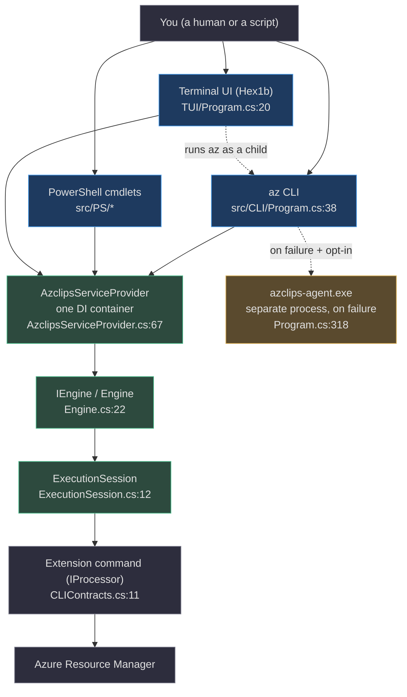
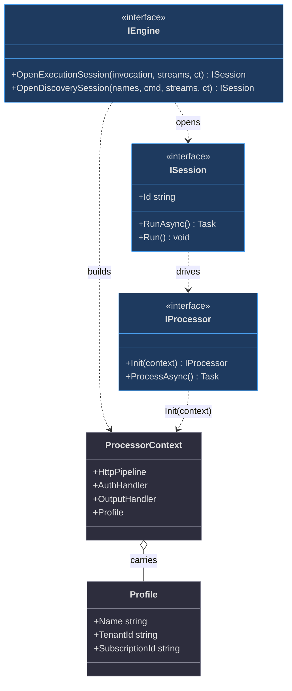
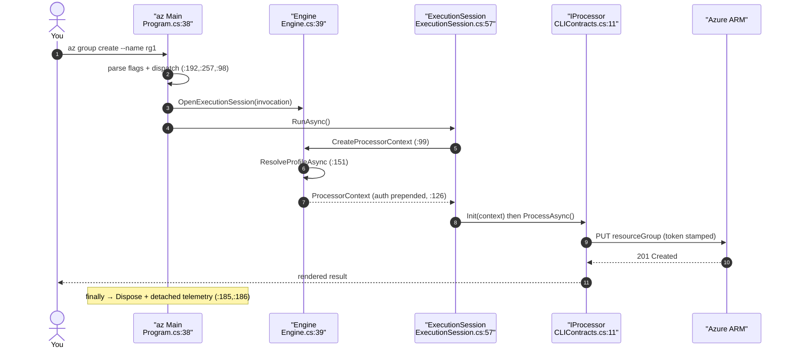
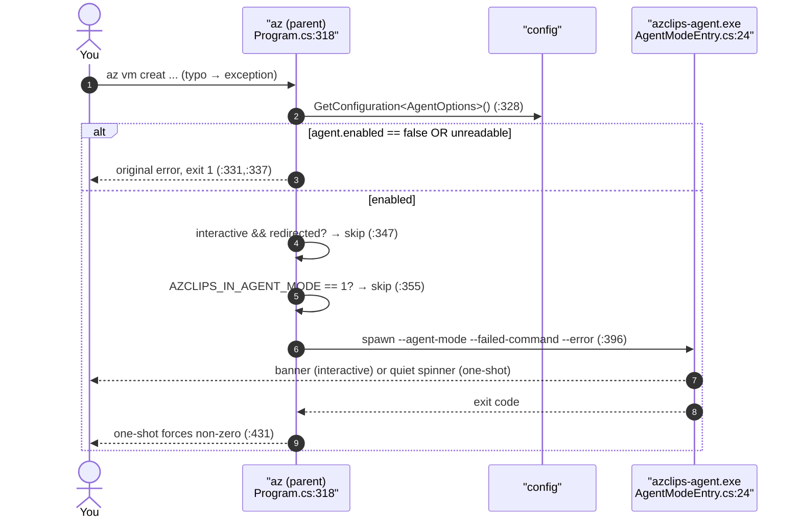
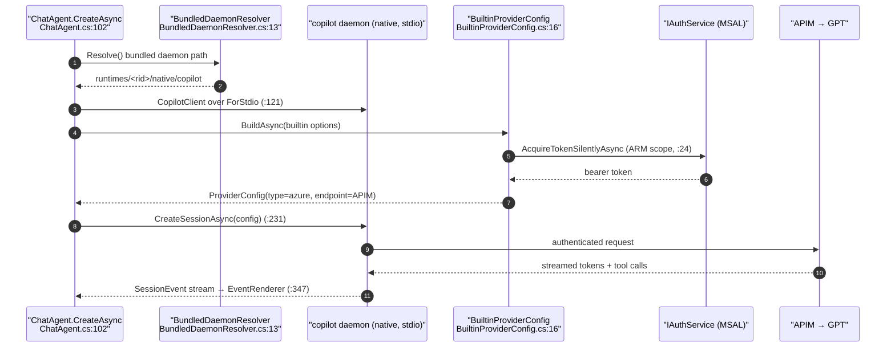
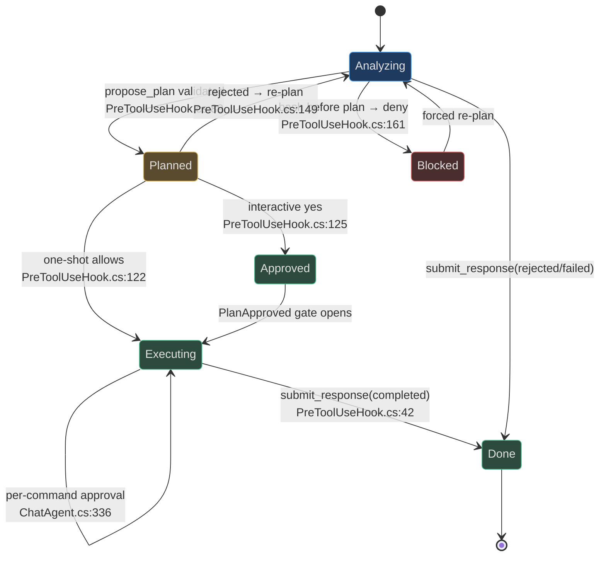
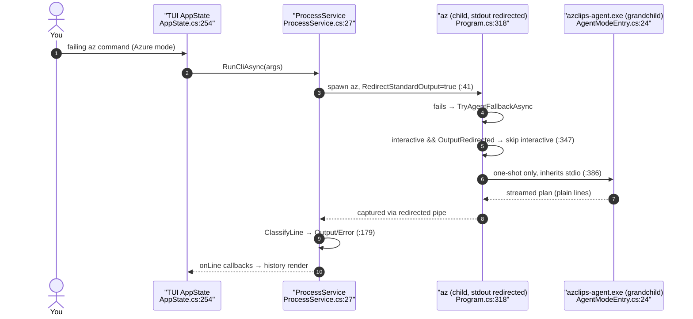

# Azclips — Zero-to-Hero Contributor Guide

> **Audience.** You are new to this codebase and possibly new to C#/.NET. Maybe you come from Python. This guide takes you from "I cloned the repo" to "I shipped a reviewed change" without hand-waving. It is long on purpose — skim the parts you know, read the parts you don't.
>
> **Repository vs. product name.** The Git repository is **`Azure/cirrus`**, but everything in the code — namespaces, the `az` binary, the `~/.azclips` state directory — uses the **Azclips** identity (`Shared.props:3`, `src/Core/Core.Abstractions/HomePaths.cs:12`). They are the same project. This guide always says *Azclips*.
>
> **How to use it.** **Part I** teaches just enough C#/.NET to read Azclips, always by comparison to Python, and folds in first-principles primers on dependency injection, async, configuration, the HTTP pipeline, the GitHub Copilot SDK, and terminals. **Part II** is a guided tour of the real architecture — the CLI, PowerShell, the Terminal UI, and the out-of-process AI agent. **Part III** is the practical loop: setup, build, test, debug, contribute. At the end there is a **40+ term glossary** and a **key-file reference**.
>
> **One rule this guide lives by:** every architectural claim points at a real file and line. If you doubt a sentence, open the file.

## Table of contents

**Part I — C#/.NET foundations for Python engineers**
- [1. The mental-model shift: compiled, typed, DI-first](#_1-the-mental-model-shift)
- [2. Syntax you will see on every page](#_2-syntax-you-will-see-on-every-page)
- [3. Async/await, Tasks, and cancellation](#_3-async-await-tasks-and-cancellation)
- [4. Interfaces, DI, and programming to abstractions](#_4-interfaces-di-and-programming-to-abstractions)
- [5. Records, nullability, and pattern matching](#_5-records-nullability-and-pattern-matching)
- [6. Delegates, Func/Action, attributes, and reflection](#_6-delegates-func-action-attributes-and-reflection)
- [7. Projects, assemblies, and the build](#_7-projects-assemblies-and-the-build)
- [8. First principles: DI, async, config, HTTP, Copilot SDK, terminals](#_8-first-principles)
- [9. Ten gotchas coming from Python](#_9-ten-gotchas-coming-from-python)

**Part II — The Azclips architecture, guided**
- [10. The 60-second architecture](#_10-the-60-second-architecture)
- [11. Boot: one container for every surface](#_11-boot-one-container-for-every-surface)
- [12. A command's life, step by step](#_12-a-commands-life-step-by-step)
- [13. The failure path and the agent](#_13-the-failure-path-and-the-agent)
- [14. The GitHub Copilot SDK integration](#_14-the-github-copilot-sdk-integration)
- [15. Plan mode, tools, and permissions](#_15-plan-mode-tools-and-permissions)
- [16. The Terminal UI and the redirected-output seam](#_16-the-terminal-ui-and-the-redirected-output-seam)
- [17. Extensions, auth, config, telemetry, packaging](#_17-extensions-auth-config-telemetry-packaging)

**Part III — Doing the work**
- [18. Environment setup](#_18-environment-setup)
- [19. Build, run, and poke at it](#_19-build-run-and-poke-at-it)
- [20. Testing strategy](#_20-testing-strategy)
- [21. Your first change, end to end](#_21-your-first-change-end-to-end)
- [22. Debugging playbook](#_22-debugging-playbook)
- [23. Contribution workflow](#_23-contribution-workflow)
- [24. Where to read next](#_24-where-to-read-next)

**Appendices**
- [A. Glossary (40+ terms)](#appendix-a-glossary)
- [B. Key-file reference](#appendix-b-key-file-reference)
- [C. Where to go next, by goal](#appendix-c-where-to-go-next-by-goal)

---

# Part I — C#/.NET foundations for Python engineers

## 1. The mental-model shift

If Python is your home language, four differences will explain 90% of your early friction.

**Compiled, not interpreted.** Azclips is built with `dotnet build`, which produces `.dll` assemblies ahead of time. Type errors, unused variables, and even style violations are caught at *build* time, not runtime — and this repo treats warnings as errors (`src/Directory.Build.props:10`), so a build either fully succeeds or fully fails. There is no "it ran until it hit the bad line."

**Statically typed, with inference.** Every variable has a compile-time type. `var x = 5;` is still statically typed — `var` just means "infer it," resolved once, at compile time. You will see explicit types everywhere because they *are* the documentation.

**DI-first, not import-first.** In Python you often reach for a dependency by importing it. In Azclips, components receive their dependencies through constructors, and a *container* wires them together. The whole app is assembled by one `AzclipsServiceProvider` (`src/Core/Core.DependencyInjection/AzclipsServiceProvider.cs:17`). You almost never `new` up a service; you *ask* for one.

**Namespaces and assemblies, not modules and packages.** A C# `namespace` is roughly a Python package path; an *assembly* (`.dll`) is roughly an installed wheel. One project (`.csproj`) compiles to one assembly.

```python
# Python: dependencies via import + direct construction
from services import AuthService
auth = AuthService()          # you build it yourself
```

```csharp
// C#: dependencies via constructor + container
public class Engine(IAuthService authService)   // asks for it (Engine.cs:22)
{
    // the container decides which IAuthService implementation to hand you
}
```

## 2. Syntax you will see on every page

A Rosetta stone for the constructs Azclips uses constantly.

**Namespaces & usings.**

```csharp
using Core.Abstractions;        // like `import`
namespace Core.Engine;          // like a package declaration
```

**Classes, properties, and primary constructors.** A *property* is a field with get/set accessors. A *primary constructor* (C# 12) puts constructor parameters right on the class declaration — Azclips uses it for the engine:

```csharp
// src/Core/Core.Engine/Engine.cs:22 — primary constructor
public partial class Engine(
    ClientType clientType,
    HttpClient httpClient,
    IProfileService profileService,
    IAuthService authService /* ... */) : IEngine
{
    private bool _disposed;               // private field
    public string Model => _model;        // read-only property (expression-bodied)
}
```

```python
# Python equivalent
class Engine:
    def __init__(self, client_type, http_client, profile_service, auth_service):
        self._disposed = False
    @property
    def model(self): return self._model
```

**`partial` classes** let one class span multiple files — `Engine` is `partial` (`Engine.cs:22`) so its event-subscriber wiring lives in a sibling file. Think of it as splitting a big class across modules.

**Records** are immutable value types with structural equality — perfect for data. `Profile` is a record (`src/Core/Core.Abstractions/Models/Profile.cs:10`) and `ProcessorContext` is a positional record (`src/Core/Core.Abstractions/Models/ProcessorContext.cs:9`):

```csharp
public record ProcessorContext(
    IRuntimeHttpPipeline HttpPipeline,
    IEventPublisher Publisher,
    IAuthHandler AuthHandler,
    IOutputHandler OutputHandler,
    Profile? Profile = null);
```

```python
# Python: a frozen dataclass is the closest analogue
from dataclasses import dataclass
@dataclass(frozen=True)
class ProcessorContext:
    http_pipeline: object
    publisher: object
    auth_handler: object
    output_handler: object
    profile: object | None = None
```

**String interpolation** uses `$"..."`, like Python's f-strings: `$"{session.Id} created"` (`Engine.cs:49`).

**Enums** are named integer constants. The one that differentiates surfaces is tiny (`src/Core/Core.Abstractions/ClientType.cs:9`):

```csharp
public enum ClientType { PowerShell, CLI, TUI }
```

### Generics — the angle brackets everywhere

Generics let a type or method work over a *type parameter*, written in angle brackets. `List<string>` is "a list of strings"; `Task<int>` is "a task producing an `int`"; `Func<Profile, bool>` is "a function from `Profile` to `bool`." Azclips leans on them heavily: the engine caches extension indices in an `LFUCache<Lazy<IExtensionIndex>>` (`Engine.cs:36`), output is bridged through a `Channel<object>` (`ExecutionSession.cs:83`), and config binding is a generic method, `GetConfiguration<T>()` (`ConfigurationService.cs:43`). In Python you would write `list[str]` or `Callable[[Profile], bool]`; the ideas match, but C# enforces them at compile time and you cannot "sneak" the wrong element type in.

### Collections and LINQ

LINQ is C#'s query layer over collections — the equivalent of Python comprehensions plus `itertools`. You will read fluent chains like the agent assembling its tool list (`ChatAgent.cs:301`):

```csharp
Tools = cacheTools.All.Concat(helpTools.All).Concat(skuTools.All)
    .Concat(submitTool.All).Concat(planTool.All)
    .Cast<AIFunctionDeclaration>().ToList();
```

or the CLI stripping a flag (`Program.cs:200`):

```csharp
return args.Where(a => !a.Equals("--debug", StringComparison.OrdinalIgnoreCase)).ToArray();
```

```python
# Python equivalents
tools = [*cache_tools.all, *help_tools.all, *sku_tools.all, submit_tool, plan_tool]
args  = [a for a in args if a.lower() != "--debug"]
```

The operators you will meet: `Where` (filter), `Select` (map), `Concat` (chain), `Any`/`All`, `FirstOrDefault` (next-or-null), `Cast`, and `ToList`/`ToArray` (materialize a lazy query). LINQ is lazy until materialized, exactly like a generator.

### Exceptions are typed — and typing *is* routing

C# exceptions are classes, and `catch` blocks match by **type**. This is not cosmetic — in Azclips the *type* of a failure is a routing decision. `Main`'s catch ladder (`Program.cs:158-181`) sends a structured `AzclipsErrorException` to a renderer with **no** AI (`:165`), while `HttpRequestException` and the catch-all `Exception` both route to the agent fallback (`:158`, `:173`). Custom exceptions carry data: `AzclipsErrorException` exposes `Code`, `Message`, `Details`, and an `ExitCode` (`:301-303`, `:171`).

```python
# Python parallel — most-specific except first
try:
    run()
except AzclipsError as e:       # structured → render, no AI
    emit(e); return e.exit_code
except (ConnectionError, Exception) as e:   # transport/unknown → agent
    return try_agent_fallback(e)
```

The lesson for a reader: when you see a new `catch (SomethingException)`, ask "what does the *type* decide?" — often it decides whether the user ever sees the agent.

## 3. Async/await, Tasks, and cancellation

A `Task` is a promise of a future value — the C# equivalent of a Python coroutine/`Future`. A method returning `Task` or `Task<int>` is asynchronous; you `await` it to get the result without blocking a thread. This maps almost 1:1 onto Python's `async`/`await`:

```python
async def main(args) -> int:      # Python
    session = engine.open(args)
    await session.run()
    return 0
```

```csharp
public static async Task<int> Main(string[] args)   // C# (src/CLI/Program.cs:38)
{
    using ISession session = engine.OpenExecutionSession(invocation, streams, token);
    await session.RunAsync();
    return 0;
}
```

Three things that differ from Python and matter here:

**`CancellationToken` is explicit and threaded everywhere.** Instead of cancelling a task object, C# passes a `CancellationToken` down the call chain; code checks it (`token.ThrowIfCancellationRequested()`) or hands it to the next `await`. The agent creates one tied to Ctrl+C and threads it through every SDK hook (`Agent/AgentMode/AgentModeEntry.cs:27-28`, `Agent/ChatAgent.cs:94-101`).

**`using` = deterministic cleanup.** `using var x = ...;` disposes `x` when the scope exits — like Python's `with`, but as a variable declaration. `Main` uses it for the session and for telemetry activities (`Program.cs:106`, `:89`).

**`await Task.WhenAny(...)`** races multiple tasks and returns the first to finish — the agent races "the model is thinking" against "the user pressed a key" with it (`AgentModeEntry.cs:282`).

## 4. Interfaces, DI, and programming to abstractions

This is *the* pattern to internalize, because Azclips is built on it top to bottom.

An **interface** (`interface IEngine`) is a contract: method signatures with no bodies (`src/Core/Core.Abstractions/IEngine.cs:8`). A class *implements* it (`Engine : IEngine`). Consumers depend on the interface, not the class — so the implementation can be swapped (for tests, for a different surface) without changing callers. That is "programming to abstractions."

**Dependency injection (DI)** is how the right implementation reaches each consumer. You *register* mappings ("when someone asks for `IEngine`, give them `Engine`") into a container, then *resolve* from it. Azclips registers services in one chained call (`AzclipsServiceProvider.cs:53`) and resolves with `GetRequiredService<T>()` (`:96`).

Here is a hand-rolled Python DI container so the C# feels concrete:

```python
# A tiny DI container — the mental model behind AzclipsServiceProvider
class Container:
    def __init__(self):
        self._registrations = {}          # interface -> factory
        self._singletons = {}

    def add_singleton(self, iface, impl):
        self._registrations[iface] = impl

    def resolve(self, iface):
        if iface not in self._singletons:
            impl = self._registrations[iface]
            # (a real container recursively resolves impl's ctor args)
            self._singletons[iface] = impl()
        return self._singletons[iface]

c = Container()
c.add_singleton("IEngine", Engine)        # register
engine = c.resolve("IEngine")             # resolve — you never new up Engine yourself
```

The real `AzclipsServiceProvider` adds three ideas on top of this toy:

1. **Lifetimes.** `AddSingleton` means "one instance for the whole process." (`Microsoft.Extensions.DependencyInjection`, the library Azclips uses, also has scoped/transient lifetimes.)
2. **Ordered customization.** `PrependRegistration` runs *before* the defaults; `OverrideRegistration` runs *after* (last-wins) — so each surface tweaks the same container (`AzclipsServiceProvider.cs:29`, `:44`).
3. **Idempotent init.** `Initialize` builds the provider exactly once, guarded by a lock (`:67-91`).

```csharp
// The shared registration chain every surface runs (AzclipsServiceProvider.cs:53)
public static void RegisterAzclipsServices(this IServiceCollection services) =>
    services
        .RegisterConfigurationServices()
        .RegisterTelemetryServices()
        .RegisterRuntimeServices()
        .RegisterAuthenticationServices()
        .RegisterEngineServices()
        .RegisterAssemblyLoadingServices()
        .RegisterArgumentParsingServices();
```

## 5. Records, nullability, and pattern matching

**Nullable reference types.** This repo enables them (`src/Directory.Build.props:6`), so `string` cannot be null but `string?` can. The `?` is a promise you must honor — the compiler warns if you dereference a `string?` without checking. You will see `Profile?` (nullable) all over the engine because "no active profile" is a real state (`Engine.cs:101`, `:151`).

**Pattern matching & switch expressions.** C# can branch on shape and value compactly. The agent's provider selection is a switch (`Agent/ChatAgent.cs:213`):

```csharp
switch (options.Provider?.ToLowerInvariant())
{
    case "builtin": /* build the Azure/MSAL provider */ break;
    case "github":  /* use the user's own Copilot subscription */ break;
    default: throw new ArgumentException(/* ... */);
}
```

```python
# Python 3.10+ match/case is the closest analogue
match (options.provider or "").lower():
    case "builtin": ...
    case "github":  ...
    case _: raise ValueError(...)
```

You will also see `is` patterns: `if (ev is SessionErrored err)` binds `err` when `ev` has that type (`ChatAgent.cs:174`) — like Python's `isinstance` plus an assignment.

## 6. Delegates, Func/Action, attributes, and reflection

**Delegates** are typed function pointers. `Func<int>` is "a function returning `int`"; `Action<string>` is "a function taking a `string`, returning nothing." Azclips wires behavior with them constantly — `OutputStreams` is a bundle of delegates for writing output/verbose/error (`src/CLI/Program.cs:205`), and the TUI passes an `Action<HistoryItemType, string>` callback to stream process output line by line (`TUI/services/ProcessService.cs:27`).

```python
# Python: functions are already first-class, so a delegate is just a callable
def run_cli(args, on_line):        # on_line: Callable[[str, str], None]
    ...
```

**Attributes** are metadata annotations (like Python decorators, but declarative). Azclips uses them to describe commands and arguments so the framework can bind them by reflection. An extension declares its verb with `[ExtensionVerb("agent")]` (`Agent/Commands/ExtensionIndex.cs:10`), and argument metadata is carried by `ArgumentInfoAttribute` (`src/Core/Core.Abstractions/CLIContracts.cs:24`).

**Reflection** reads that metadata at runtime to bind `argv` onto a processor's properties, so command authors never write manual parsing.

## 7. Projects, assemblies, and the build

- A **`.csproj`** is a project file (XML) describing one assembly's sources, references, and settings. `Agent/Core.Agent.csproj` builds the agent exe.
- A **solution** (`azclips.slnx`) lists all projects. Azclips uses the newer XML `.slnx` format.
- **`Directory.Build.props`** files apply shared settings to every project beneath them — `src/Directory.Build.props` sets `net10.0`, nullable, and warnings-as-errors (`:4`, `:6`, `:10`); `Shared.props` sets the product name and output path (`Shared.props:3`, `:9`).
- **Target framework** is `net10.0` everywhere, pinned to SDK `10.0.203` with `rollForward: latestMinor` (`global.json:2-5`).

```xml
<!-- Agent/Core.Agent.csproj — the shape of a project file -->
<TargetFramework>net10.0</TargetFramework>       <!-- (:4) -->
<OutputType>Exe</OutputType>                     <!-- it's an executable (:5) -->
<AssemblyName>azclips-agent</AssemblyName>       <!-- → azclips-agent.exe (:6) -->
<PackageReference Include="GitHub.Copilot.SDK" Version="1.0.0" /> <!-- (:49) -->
```

`dotnet build -c Release azclips.slnx` compiles everything; each project's output lands under `artifacts/Release/<ExtName>/` per the `OutputPath` convention (`Shared.props:9`).

## 8. First principles

Six short primers on the *ideas* the architecture rests on. Skip any that already click.

### 8.1 Dependency injection — why bother?

DI exists to make code testable and swappable. If `Engine` said `new MsalAuthService()` internally, a unit test could never substitute a fake. Because `Engine` instead *asks for* `IAuthService` (`Engine.cs:26`), a test hands it a stub (`tests/Common/Stubs/StubProfileService.cs` does exactly this for profiles). The container is just the machinery that supplies the real implementation in production and lets tests supply fakes. **Rule of thumb in this repo: constructors receive interfaces; nobody news up a service.**

### 8.2 Async — why not just call the function?

Network and process I/O are slow; blocking a thread while waiting wastes it. `async`/`await` lets a thread do other work while an ARM call is in flight. In a CLI this mostly buys responsiveness and clean cancellation, but in PowerShell it creates a genuine hazard: `$PSCmdlet.WriteObject` must run on the runspace thread. Azclips solves this with a **channel bridge** — the async worker writes results into a `Channel<object>` and the runspace thread pumps them out (`src/Core/Core.Engine/ExecutionSession.cs:83-129`). Understanding "async core, sync shell" explains the whole `Run()` vs `RunAsync()` split.

### 8.3 Configuration — typed options over a JSON file

Azclips stores user config as JSON at `~/.azclips/config.json` (`HomePaths.cs:15`). Rather than reading raw keys, code binds sections into strongly-typed *option records* via `GetConfiguration<T>()` (`src/Core/Core.Configuration/Implementation/ConfigurationService.cs:43`). For example, `AgentOptions` (`src/Core/Core.Abstractions/AgentOptions.cs:6`) turns `agent.enabled`, `agent.sessionStyle`, etc. into a typed object with defaults baked into the class. The mental model: **the JSON file is the storage; the option record is the API.**

### 8.4 The HTTP pipeline — delegating handlers

An HTTP *delegating handler* is middleware in a chain: each handler can inspect/modify a request, call the next handler, then inspect the response — like WSGI/ASGI middleware in Python. Azclips composes a chain per command so authentication, user-agent stamping, and tracing are automatic. The auth handler is *prepended* so the token is attached first (`Engine.cs:126`), then user-agent (`:133`), a mock-seam terminating step (`:135`), and tracing (`:137`). A command author just calls the pipeline and gets all of it for free.

### 8.5 The GitHub Copilot SDK — what an agentic SDK is

An "agentic" SDK does more than call a model: it runs a loop where the model can *call tools*, and it emits a stream of *events* (tokens, tool-start, tool-complete, usage, errors). Azclips builds on `GitHub.Copilot.SDK` (`Agent/Core.Agent.csproj:49`). Two facts are load-bearing:

1. **The SDK talks to a native daemon over stdio**, not directly to an HTTP endpoint. Azclips ships that daemon (`copilot`/`copilot.exe`) and points the SDK at it via `RuntimeConnection.ForStdio` (`Agent/ChatAgent.cs:121`, resolved by `Agent/BundledDaemonResolver.cs:13`).
2. **Hooks let the host veto tool calls.** The SDK calls `OnPreToolUse` before every tool; Azclips uses it to enforce plan approval and rewrite commands (`ChatAgent.cs:308` → `Agent/Hooks/PreToolUseHook.cs:19`). This is how a *language model* is made *safe* enough to run shell commands.

### 8.6 Terminals, TTYs, and redirected stdio

A terminal (TTY) is interactive — a human can type into it. When a program's output is captured by another program (a pipe, a file, or a parent reading its stdout), stdout is *redirected* and `Console.IsOutputRedirected` becomes `true`. This one bit changes Azclips's behavior: the agent's *interactive* mode refuses to run when stdout is redirected (it cannot read y/n approvals), while *one-shot* mode runs anyway (`src/CLI/Program.cs:347-351`). The Terminal UI runs `az` as a redirected child, which is exactly why one-shot works there but interactive does not (§16).

### 8.7 How the six principles combine

None of these ideas stands alone — Azclips is what happens when you stack them. **DI** gives you one container that assembles four surfaces from one engine. **Async** lets that engine serve a streaming CLI and a thread-affine PowerShell cmdlet from the same code. **Typed configuration** turns a JSON file into the `agent.enabled` switch that decides whether a failure ever reaches the AI. The **HTTP pipeline** means a command author writes zero auth code. The **Copilot SDK over a bundled daemon** keeps the heavy AI dependency out of the hot `az` path — it only matters after a failure. And the **terminal/TTY distinction** is the hinge that makes the agent safe to spawn from inside the TUI. If you hold those six together, the one-sentence architecture lands: *one composition root, four faces, and an out-of-process AI escape hatch that the CLI fails out to.* Everything in Part II is that sentence in detail.

## 9. Ten gotchas coming from Python

1. **No truthiness.** `if (x)` needs a `bool`. `if (list)` won't compile; write `if (list.Count > 0)`.
2. **`==` on reference types is identity by default** (records override it to be structural). Use `.Equals`/`string.Equals` with a `StringComparison` for strings.
3. **Null is not `None`-with-methods.** Dereferencing null throws `NullReferenceException`. Heed the `?` and use `?.` (null-conditional) and `??` (null-coalescing).
4. **`var` is not `Any`.** It is a fully-typed variable; the type is just inferred.
5. **Everything lives in a class.** No bare module-level functions; even `Main` is a static method on `Program`.
6. **Interfaces over duck typing.** You cannot pass "anything with a `.run()`"; it must implement the interface.
7. **Exceptions are typed and matched.** `catch (HttpRequestException ex)` vs `catch (AzclipsErrorException ex)` route differently (`Program.cs:158`, `:165`).
8. **`await` needs `async`.** You cannot `await` in a non-async method; you propagate the `Task` up.
9. **Warnings are errors here.** A stray unused `using` fails the build (`src/Directory.Build.props:10`).
10. **Dispose what you open.** `using`/`IDisposable` is manual-ish; forgetting it leaks (the container, sessions, and activities are all disposable).

---

# Part II — The Azclips architecture, guided

## 10. The 60-second architecture

Azclips is one .NET 10 platform with **four client surfaces**, all assembled from a single dependency-injection composition root and all driving the same engine:



How the four surfaces actually differ:

| Surface | Entry point | How output leaves | `ClientType` |
|---|---|---|---|
| **CLI** (`az`) | `Program.Main` (`src/CLI/Program.cs:38`) | `OutputStreams` delegates → `Console` (`Program.cs:205`) | `CLI` |
| **PowerShell** | a cmdlet's `ProcessRecord` | channel → `$PSCmdlet.WriteObject` (`CmdletOutputStreamsFactory.cs:43`) | `PowerShell` |
| **Terminal UI** | `Program.Main` (`TUI/Program.cs:20`) | Hex1b widget tree (`TUI/Program.cs:77`) | `TUI` |
| **AI agent** | `Program.Main` (`Agent/Program.cs:9`) → `AgentModeEntry` | append-only console renderer (`ConsoleAgentRenderer.cs:7`) | reuses `CLI` (`AgentModeEntry.cs:36`) |

The agent is the odd one out: it is a **separate executable** (`azclips-agent.exe`, `Agent/Core.Agent.csproj:6`), not a mode inside the others, and it has no `ClientType` of its own — it initializes as `ClientType.CLI` with an in-code comment recording that it used to live in the TUI (`AgentModeEntry.cs:33-36`).

## 11. Boot: one container for every surface

Every surface follows the same three-step boot: (1) add its own registrations, (2) call `Initialize(clientType)`, (3) resolve and run. The differences are entirely in step 1.

```csharp
// CLI (src/CLI/Program.cs:57-71)
AzclipsServiceProvider.PrependRegistration(s => { /* dispatcher, loaders */ });     // :57
AzclipsServiceProvider.OverrideRegistration(s => { /* CLI providers */ });          // :64
AzclipsServiceProvider.Initialize(ClientType.CLI);                                  // :71

// TUI (TUI/Program.cs:22-40)
AzclipsServiceProvider.PrependRegistration(s => { /* ArmClient, AzureVfs, AppState */ }); // :22
AzclipsServiceProvider.OverrideRegistration(s => { /* silent logging, TUI telemetry */ });// :31
AzclipsServiceProvider.Initialize(ClientType.TUI);                                  // :40

// Agent (Agent/AgentMode/AgentModeEntry.cs:36)
AzclipsServiceProvider.Initialize(ClientType.CLI);   // its own process, CLI-flavored
```

`PrependRegistration` runs **before** the shared defaults; `OverrideRegistration` runs **after** and wins ties (DI last-registration-wins). So the TUI can swap in a silent logger (so `[VERBOSE]` lines never corrupt the full-screen UI) and its own telemetry provider without forking the engine (`TUI/Program.cs:36-37`). This is the entire reason there is one engine and not four.

### The vocabulary in one diagram

These are the types you will see on nearly every page. Learn this small graph and the code reads itself:



- `IEngine` (`IEngine.cs:8`) opens **sessions** and builds **contexts**.
- `ISession` / `ExecutionSession` (`ISession.cs:6`, `ExecutionSession.cs:12`) is one command's run.
- `ProcessorContext` (`ProcessorContext.cs:9`) is the toolbox handed to a command — an auth-stamped HTTP pipeline, an output handler, and the resolved `Profile`.
- `IProcessor` (`CLIContracts.cs:11`) is the command itself: `Init(context)` then `ProcessAsync()`.
- `Profile` (`Profile.cs:10`) is who-you-are-and-where-you-point, as data.

## 12. A command's life, step by step

Follow `az group create ...` from keypress to result:

1. **Parse.** `Main` strips global flags — `--debug` (`Program.cs:192`), `--output json|plain` (`:257`), `--no-cache` (`:283`) — then the dispatcher turns `argv` into a `CommandInvocation` (`:98`).
2. **Open a session.** `engine.OpenExecutionSession(invocation, streams, token)` (`:107`) builds an `ExecutionSession` and wires its delegates (`Engine.cs:39`).
3. **Build the context.** When the session needs it, `Engine.CreateProcessorContext` (`Engine.cs:99`) resolves the active `Profile` (`:151`), prepends an auth handler that stamps a bearer token on every request (`:126`), and stacks user-agent/tracing handlers (`:133`, `:137`).
4. **Execute.** `session.RunAsync()` (`ExecutionSession.cs:57`) acquires the extension's `IProcessor` and calls `ProcessAsync()` (`:64`); the processor talks to ARM through the pre-authenticated pipeline.
5. **Route output & tear down.** Output flows through `OutputStreams`; `Main`'s `finally` disposes the container and fire-and-forgets a detached telemetry uploader (`Program.cs:185-186`).



The same journey under PowerShell is identical except step 5: a cmdlet's `OutputStreams` route through `CmdletOutputStreamsFactory` into `$PSCmdlet.WriteObject` (`src/PS/Common/CmdletOutputStreamsFactory.cs:43`), and the synchronous channel bridge (`ExecutionSession.cs:78`) honors PowerShell's thread-affinity.

### Help and completions take a colder path

Not every invocation runs a command. `az --help` and shell tab-completion never load a command's implementation. `Main` handles completion *before* the try/catch (`CompletionGenerator.TryHandleAsync`, `Program.cs:74`), and help throws a `DispatchHelpException` that `Main` catches to render a help tree (`:113`). Both resolve metadata through `IEngine.OpenDiscoverySession` (`Engine.cs:62`), which enumerates extensions **without** building a `ProcessorContext` — no profile, no auth, no network. That is why `az --help` is instant and side-effect-free: it never touches your credentials.

## 13. The failure path and the agent

Now the interesting half. `Main` wraps execution in a typed catch ladder (`Program.cs:87-181`):

- A **structured** `AzclipsErrorException` renders and returns its exit code — **no** AI (`:165-172`). The failure is well-understood; there is nothing to assist.
- An `HttpRequestException` (`:158`) or any **other** unhandled `Exception` (`:173`) routes to `TryAgentFallbackAsync` (`:163`, `:180`).

`TryAgentFallbackAsync` (`:318`) is conservative. It runs the agent only if **all** of these hold:

1. `agent.enabled` is `true` in config (`:329`); if config can't be read, it treats the agent as off and re-surfaces the original error (`:334-338`).
2. Not (interactive-style **and** stdio redirected) — the interactive guard (`:347-351`).
3. Not already inside an agent (`AZCLIPS_IN_AGENT_MODE != "1"`, the recursion guard, `:355`).

If it proceeds, it spawns `azclips-agent.exe` (`FindAgentExe`, `:460`) with **inherited** stdio and `--agent-mode --failed-command <cmd> --error <text>` (`:396-403`). One-shot forces a non-zero exit even if the agent returns 0 (your command still failed), while interactive passes the child's exit code through (`:427-431`).



## 14. The GitHub Copilot SDK integration

Inside the agent process, `AgentModeEntry.RunAsync` (`Agent/AgentMode/AgentModeEntry.cs:24`) selects a prompt (`oneshot.md` vs `inline.md`) by `AgentOptions.IsInteractive` (`:47`), builds a `ChatAgent` (`:92`), and runs a turn loop (`RunChatLoopAsync`, `:136`). The `ChatAgent` is where the SDK lives.

`ChatAgent.CreateAsync` (`Agent/ChatAgent.cs:102`) creates a `CopilotClient` whose transport is a **bundled native daemon** over stdio — `RuntimeConnection.ForStdio(path: BundledDaemonResolver.Resolve())` (`:121`). `BundledDaemonResolver` (`Agent/BundledDaemonResolver.cs:13`) finds the `copilot`/`copilot.exe` binary under a `runtimes/<rid>/native/` layout whose base directory is chosen at compile time by `AgentInstallLayout` (`Agent/AgentInstallLayout.cs:22`): packaged builds read a staged extension directory, dev builds read next to the exe, distinguished by the `AGENT_DEV_BUILD` constant (`AgentInstallLayout.cs:24-28`).

The model itself is reached through a **provider**. The default `builtin` provider (`Agent/Providers/BuiltinProviderConfig.cs:16`) acquires an ARM-scoped MSAL token via the *same* `IAuthService` the engine uses (`:24`) and builds an `azure`-type `ProviderConfig` pointed at an APIM-fronted GPT endpoint (defaults in `AgentOptions.cs:56-59`). The alternative `github` provider uses the user's own Copilot subscription (`ChatAgent.cs:221`).



The SDK emits `SessionEvent`s (token deltas, tool start/complete, usage, errors). `EventRenderer.Forward` (`Agent/EventRenderer.cs:36`) translates them into Azclips's host-agnostic `AgentEvent` types (`Agent/AgentEvents.cs:18`) so the renderers never touch SDK types directly. See [Copilot SDK Integration](/02-deep-dive/copilot-sdk-integration) for the full event table.

## 15. Plan mode, tools, and permissions

The agent can run shell commands, so safety is not optional. The entire safety model is a state machine enforced in one method — `PreToolUseHook.HandleAsync` (`Agent/Hooks/PreToolUseHook.cs:19`), wired as the SDK's `OnPreToolUse` hook (`ChatAgent.cs:308`) — reading a per-session `SessionState` (`Agent/SessionState.cs:11`).

The contract:

- The agent must **act through tools**, never bare prose. Each turn closes with `propose_plan` or `submit_response`; a prose-only turn is re-prompted up to three times (`AgentModeEntry.cs:216`, `:237-253`).
- `propose_plan` (`PreToolUseHook.cs:89`) renders a structured plan (issues + ordered steps). Interactive mode asks the user y/n and opens the `PlanApproved` gate on yes (`:125`, `:131`); one-shot renders and allows without prompting (`:122`).
- **No execution before approval.** `bash`/`powershell` tool calls are denied unless `PlanApproved` is set (`:161-171`).
- `submit_response` (`:42`) is the *sole* terminator; its `status` must be `completed | rejected | failed`, and a `rejected` message must start with `OUT_OF_SCOPE_` (`Agent/Plan/PlanArgsParser.cs:34`).
- **Safety backstops:** a command with an unfilled placeholder is denied (`PlaceholderDetector.TryDetect`, `:184`); a step whose command contains a danger verb (`delete`, `remove`, `purge`, …) is auto-flagged destructive even if the model didn't say so (`PlanArgsParser.HasDangerVerb:172`).



The tools themselves live in `Core.Agent.Tools` (env, help, resource-cache, sku, shell) and are *also* exposed as `az agent tool ...` commands via the `Agent.Commands` extension (`[ExtensionVerb("agent")]`, `Agent/Commands/ExtensionIndex.cs:11`) — so external programs can call Azclips's resource intelligence without a chat loop. Full catalog: [Agent Tools](/02-deep-dive/agent-tools) and [Prompts & Plan Mode](/02-deep-dive/prompts-and-plan-mode).

## 16. The Terminal UI and the redirected-output seam

The Terminal UI (`TUI/Program.cs:20`) is a full-screen Hex1b shell that browses Azure as a virtual filesystem. It has two modes — `ShellMode.Azure` and `ShellMode.Local` (`TUI/Models.cs:6`), toggled by F2 (`AppState.ToggleMode`, `TUI/AppState.cs:173`). In Azure mode, typing a command calls `AppState.ExecuteCommand` (`:254`), which shells out to the `az` binary through `ProcessService.RunCliAsync` (`TUI/services/ProcessService.cs:27`).

Here is the subtle part every contributor eventually trips over. `RunCliAsync` launches `az` with `RedirectStandardOutput=true` and `RedirectStandardError=true` (`:41-42`) so it can stream output into the history panel — but that makes `Console.IsOutputRedirected` **true** inside the child `az`. Therefore, when a TUI-run command fails and the agent would kick in, the *interactive* guard disables interactive agent mode (`Program.cs:347-351`), but *one-shot* still runs and streams its plan back through the redirected pipe, where `ProcessService.ClassifyLine` (`:179`) sorts each line into output/error history entries.



`ShellMode.Local` never touches `az` or the agent — it runs the system shell directly (`AppState.cs:292`). Deep dives: [TUI Interactive Shell & Azure VFS](/02-deep-dive/tui-interactive-shell) and [TUI ↔ Agent Fallback Interplay](/02-deep-dive/tui-agent-mode).

## 17. Extensions, auth, config, telemetry, packaging

The remaining subsystems, in one paragraph each — follow the links for depth.

**Extensions** are how commands are packaged. Each extension implements `IExtensionIndex` mapping command names to `IProcessor` implementations (e.g. `src/Extensions/Compute/ExtensionIndex.cs`); the registry lives at `~/.azclips/extensions/registry.json` (`HomePaths.cs:13-14`), and a `CompatibilityGuard` enforces per-extension version declarations. → [Extension System](/02-deep-dive/extension-system).

**Authentication** is MSAL-based. `MsalAuthService` (`src/Core/Core.Authentication/MsalAuthService.cs:10`) does `LoginAsync` (`:19`), `LogoutAsync` (`:30`), and — the method everything else calls — `AcquireTokenSilentlyAsync` (`:135`), reused by both the engine's auth handler and the agent's `builtin` provider. The resolved `Profile` (`src/Core/Core.Abstractions/Models/Profile.cs:10`) is the single source of truth for tenant/subscription. → [Authentication](/02-deep-dive/authentication).

**Configuration** binds `~/.azclips/config.json` into typed option records through `ConfigurationService.GetConfiguration<T>()` (`ConfigurationService.cs:43`), validated against a schema; the `az config set/get/list/delete/info` commands share `ConfigCommandBase`. → [Configuration Management](/02-deep-dive/configuration-management).

**Telemetry** captures `System.Diagnostics` activities (`TelemetryService.cs:13`), strips parameter *values* via privacy filters, buffers to disk, and uploads from a **detached** background process (`Program.cs:43`, `:186`). Opt out with `telemetry.enabled=false`. → [Telemetry & Observability](/02-deep-dive/telemetry-observability).

**Packaging** builds each project to `artifacts/<config>/<ExtName>/` (`Shared.props:9`), stages the agent's daemon + prompts into a separate extension directory (`AgentInstallLayout.cs:32-45`), and ships install scripts (`install/azcli-install.ps1`/`.sh`) that install to `~/.local/share` **without** modifying PATH so Azclips coexists with classic azure-cli. → [Packaging & Distribution](/02-deep-dive/packaging-and-distribution).

---

# Part III — Doing the work

## 18. Environment setup

**Prerequisites.**

- **.NET 10 SDK**, pinned to exactly `10.0.203` with `rollForward: latestMinor` (`global.json:2-5`). Anything in the 10.0.x line at or above the pin works.
- **PowerShell 7+** if you will touch the `src/PS/` modules.
- **`Microsoft.PowerShell.PlatyPS`** only if you regenerate help artifacts — installed by `build/Install-BuildDependencies.ps1`.

**Confirm the SDK matches the pin:**

```powershell
dotnet --info        # the SDK version line should satisfy global.json (10.0.203+)
```

**Clone and restore:**

```powershell
git clone https://github.com/Azure/cirrus.git
cd cirrus
dotnet restore azclips.slnx
```

If `dotnet --info` shows an older SDK, install .NET 10 before continuing — the build will refuse to run on a mismatched major version.

## 19. Build, run, and poke at it

**Build everything** (Release, matching the repo's shipping config):

```powershell
dotnet build -c Release azclips.slnx
```

Per-project output lands under `artifacts/Release/<ExtName>/` (`Shared.props:9`). The CLI binary is:

```powershell
./artifacts/Release/Core.Cli/az --help
```

(In a Debug build it is `artifacts/Debug/Core.Cli/az` — the TUI's `ProcessService.FindCliPath` looks there, `TUI/services/ProcessService.cs:199`.)

**Try structured commands** (the real surface, from `README.md`):

```powershell
az group create --ResourceGroupName mygroup --Location eastus --SubscriptionId <sub-id> --AccessToken <token>
az config set --key agent.enabled --value true      # opt into the agent
```

**Trigger the agent** — run a broken or natural-language command on an interactive terminal after enabling it:

```powershell
az vm creat --name oops        # typo → HttpRequestException/Exception → fallback (Program.cs:318)
```

With `agent.sessionStyle=oneshot` (the default, `AgentOptions.cs:17`) the agent proposes a fix and exits; with `interactive` it opens a chat loop (only on a real TTY).

**Run the Terminal UI:**

```powershell
dotnet run --project TUI/Core.Tui.csproj      # or launch the built binary
```

**Stage the PowerShell modules** with `build/build.ps1` and `build/Set-ModuleConfiguration.ps1`, then `Import-Module` the staged module (e.g. `Compute`, `Login`).

### 19.4 A guided first session

Put the four ideas from Part II together in one sitting:

```powershell
# 1. Build and put the CLI on PATH for this shell
dotnet build -c Release azclips.slnx
$env:PATH = "$PWD/artifacts/Release/Core.Cli;$env:PATH"

# 2. A cold-path command — no network, no auth (the discovery path, §12)
az --help                      # renders the help tree via OpenDiscoverySession

# 3. A structured command — opens a real session, resolves your profile
az login                       # MSAL flow (MsalAuthService.cs:19)
az group create --ResourceGroupName demo --Location eastus --SubscriptionId <sub> --AccessToken <token>

# 4. Opt into the agent, then make something fail (the escape hatch, §13)
az config set --key agent.enabled --value true    # writes ~/.azclips/config.json
az vm creat --name oops         # typo → failure → azclips-agent.exe proposes a fix

# 5. See where your state lives
Get-Content ~/.azclips/config.json          # your config
Get-ChildItem ~/.azclips/extensions         # the extension registry
```

Every line above traces to a section: step 2 is the discovery path (§12), step 3 is a command's life (§12), step 4 is the failure path and the agent (§13), and step 5 is the on-disk contract (§22). If you can narrate what each line does and *why*, you have Part II.

## 20. Testing strategy

Run one project's tests directly (fast inner loop):

```powershell
dotnet test tests/Core.Engine.Tests/Core.Engine.Tests.csproj
```

The suites, and what each is for:

| Project | What it exercises |
|---|---|
| `tests/Cli.Tests` | Argument parsing, dispatch, profile CLI behavior |
| `tests/Cmdlets.Tests` | PowerShell cmdlet surface |
| `tests/Core.Engine.Tests` | The engine/session seam (`ExecutionSessionSeamTests.cs`) |
| `tests/Core.Extensions.Tests` | Extension resolution & compatibility |
| `tests/Core.Telemetry.Tests` | Privacy filters |
| `tests/Benchmark` | BenchmarkDotNet performance |
| `tests/Fixtures` | Assembly-loading / multi-version scenarios |
| `Agent/tests/Core.Agent.Tests` | Plan/submit validation, event snapshots, tool logic |

The agent tests are the friendliest place to start reading tests: `PlanArgsParser` and `PreToolUseHook` are pure and static (`PlanArgsParser.cs:9-12`), so `ProposePlanValidationTests.cs` and `SubmitResponseValidationTests.cs` drive them directly without hosting the live SDK. Framework is xUnit; shared settings live in `tests/Directory.Build.props`.

### xUnit at a glance (for pytest users)

xUnit is the test framework here. The mapping to pytest is small:

| pytest | xUnit | Notes |
|---|---|---|
| a `test_*` function | a `[Fact]` method | one test, no parameters |
| `@pytest.mark.parametrize` | a `[Theory]` + `[InlineData(...)]` | table-driven tests |
| `assert x == y` | `Assert.Equal(y, x)` | note: **expected first** in xUnit |
| `with pytest.raises(E)` | `Assert.Throws<E>(() => ...)` | asserts an exception type |
| a fixture | a constructor / `IClassFixture` | setup per test / per class |

```csharp
// The shape of a validation test (see Agent/tests/Core.Agent.Tests/*ValidationTests.cs)
[Theory]
[InlineData("completed", null)]
[InlineData("rejected", "OUT_OF_SCOPE_billing")]
public void ValidSubmit_Passes(string status, string? message)
{
    var args = new { status, message };
    Assert.Null(PlanArgsParser.ValidateSubmitResponse(args));   // PlanArgsParser.cs:20
}
```

Because the code under test is pure, these run in milliseconds and need no Azure, no daemon, and no model — which is exactly why the safety-critical logic was factored to be pure in the first place.

## 21. Your first change, end to end

A safe, high-signal first change is adding a *config default* or tightening a *pure validator*. Here is the loop for touching the agent's plan validation:

1. **Find the code.** The rule you want lives in `Agent/Plan/PlanArgsParser.cs` (e.g. the danger-verb list at `:169-170`).
2. **Write the test first.** Add a case to `Agent/tests/Core.Agent.Tests/ProposePlanValidationTests.cs` asserting the new behavior.
3. **Make the change.** Because the parser is pure, no SDK or network is involved.
4. **Build & test:**
   ```powershell
   dotnet build azclips.slnx
   dotnet test Agent/tests/Core.Agent.Tests/Core.Agent.Tests.csproj
   ```
5. **Run it live.** Enable the agent and trigger a failure; watch the plan render (`ConsoleAgentRenderer.cs:7`).

For a CLI-facing change (a new flag or command), the parallel path is: implement `IProcessor` (`CLIContracts.cs:11`), register it in the extension's `IExtensionIndex`, and cover it in `tests/Cli.Tests`.

## 22. Debugging playbook

### 22.1 Where state lives on disk

When behavior looks wrong, inspect the on-disk contract (all defined in `HomePaths.cs:12-18`):

| Path | Holds |
|---|---|
| `~/.azclips/config.json` | Your config (including `agent.*`, `telemetry.*`) |
| `~/.azclips/extensions/registry.json` | Installed-extension registry |
| `~/.azclips/trace/*.jsonl` | Agent session traces (when `agent.trace.enabled=true`) |
| `~/.azclips/arm-cache/` | The agent's local ARM resource cache |
| `{LocalApplicationData}/.azclips/context.json` | Auth context |

To watch the agent think, set `agent.trace.enabled=true`; each session writes a JSONL trace via `TraceAgentRenderer` (`Agent/Hosting/TraceAgentRenderer.cs:15`) to `agent.trace.path` (default `~/.azclips/trace`, `AgentOptions.cs:51`).

### 22.2 Useful flags

- `--debug` raises log verbosity (`Program.cs:192`).
- `--output json` renders structured errors as JSON (`Program.cs:257`, `:293`).
- `--no-cache` bypasses the extension index cache for clean benchmarking (`Program.cs:283`).

### 22.3 Reading a stack trace

C# stack frames read top-down (innermost first) and are namespaced. A frame like `Core.Engine.ExecutionSession.RunAsync` maps directly to `src/Core/Core.Engine/ExecutionSession.cs`, method `RunAsync` (`:57`) — namespace segments mirror the folder path, so you can jump to the file without searching.

### 22.4 Watching the agent think

The agent is the hardest subsystem to reason about from the outside, so it can record every turn. Set `agent.trace.enabled=true` and each session appends a JSONL file under `agent.trace.path` (default `~/.azclips/trace`, `AgentOptions.cs:51`) via `TraceAgentRenderer` (`Agent/Hosting/TraceAgentRenderer.cs:15`). Each line is one event — a session-start note, streamed tokens, a tool start/complete, a rendered plan, the final `submit_response`. Reading a trace top-to-bottom is the fastest way to answer "why did the agent do that?" because it is the exact `AgentEvent` stream the console renderer saw (`Agent/AgentEvents.cs:18`). Because `PlanArgsParser` and `PreToolUseHook` are pure (`PlanArgsParser.cs:9-12`), you can usually reproduce a puzzling decision in a unit test using the arguments captured in the trace — no live model required.

## 23. Contribution workflow

Azclips is in **private preview**, so contributions are scoped: fixes, docs, and preview-aligned changes; for anything substantial, open or link an issue first (`CONTRIBUTING.md`). Never include secrets, customer data, or internal details in code, tests, logs, or docs.

**The design-doc process** is OpenSpec: proposals live under `openspec/changes/` (see `openspec/changes/profile-management/` as a worked example of proposal → design → tasks → specs). Substantial changes start there.

**CI gate.** Pull requests are validated by `devops/scripts/ci/check_pull_request.py`; the packaging pipeline consumes the build output afterward.

### 23.1 Your first-PR checklist

- [ ] `dotnet build azclips.slnx` is clean (remember: **warnings are errors**, `src/Directory.Build.props:10`).
- [ ] `dotnet test` passes for every project you touched.
- [ ] New behavior has a test (prefer the pure suites — `Agent/tests/Core.Agent.Tests`, `tests/Cli.Tests`).
- [ ] No secrets or customer data anywhere in the diff.
- [ ] An issue is linked for anything beyond a scoped fix.
- [ ] Docs/help updated if you changed a user-facing surface.

## 24. Where to read next

You now have the whole map. Go deep in this order, all current catalogue slugs:

| Start here | Then | Then |
|---|---|---|
| [Overview & Architecture](/01-getting-started/overview) | [Core Engine & Orchestration](/02-deep-dive/core-engine-orchestration) | [HTTP Pipeline & Runtime](/02-deep-dive/http-pipeline-runtime) |
| [CLI Usage](/01-getting-started/cli-usage) | [Extension System](/02-deep-dive/extension-system) | [Authentication](/02-deep-dive/authentication) |
| [Agent Fallback Quickstart](/01-getting-started/agent-mode-quickstart) | [Agent Architecture](/02-deep-dive/agent-architecture) | [Copilot SDK Integration](/02-deep-dive/copilot-sdk-integration) |
| [TUI Quickstart](/01-getting-started/tui-quickstart) | [TUI Interactive Shell & Azure VFS](/02-deep-dive/tui-interactive-shell) | [TUI ↔ Agent Fallback Interplay](/02-deep-dive/tui-agent-mode) |
| [PowerShell Usage](/01-getting-started/powershell-usage) | [PowerShell Cmdlet Architecture](/02-deep-dive/powershell-cmdlet-architecture) | [Prompts & Plan Mode](/02-deep-dive/prompts-and-plan-mode) |

For the dense, principal-level version of everything above, read the [Principal-Level Onboarding Guide](/onboarding-guide).

---

# Appendix A: Glossary

Terms you will meet across the codebase and this wiki (40+).

| Term | Meaning |
|---|---|
| **Assembly** | A compiled `.dll`/`.exe`; roughly a Python wheel. One `.csproj` → one assembly. |
| **Namespace** | A logical grouping of types (`Core.Engine`); mirrors folder paths. |
| **`.csproj` / `.slnx`** | Project file / solution file (`azclips.slnx` lists all projects). |
| **Target framework** | The runtime a project targets — here `net10.0` everywhere. |
| **Dependency Injection (DI)** | Supplying a component's dependencies from outside rather than constructing them inside. |
| **Composition root** | The one place the object graph is assembled — `AzclipsServiceProvider` (`AzclipsServiceProvider.cs:17`). |
| **`PrependRegistration` / `OverrideRegistration`** | Hooks to add DI registrations before/after the shared defaults (`:29`, `:44`). |
| **Singleton** | A DI lifetime: one instance per process. |
| **`ClientType`** | Enum `{ PowerShell, CLI, TUI }` seeding the container (`ClientType.cs:9`). |
| **`IEngine` / `Engine`** | The mediator that opens sessions and builds contexts (`IEngine.cs:8`, `Engine.cs:22`). |
| **`ISession` / `ExecutionSession`** | One command's unit of work (`ISession.cs:6`, `ExecutionSession.cs:12`). |
| **`ProcessorContext`** | Per-command bundle: HTTP pipeline, publisher, auth, output, profile (`ProcessorContext.cs:9`). |
| **`IProcessor`** | The command contract: `Init(context)` then `ProcessAsync()` (`CLIContracts.cs:11`). |
| **`Profile`** | Connection state as data — tenant, subscription, auth method (`Profile.cs:10`). |
| **`IProfileService`** | Resolves the active/ named profile (`IProfileService.cs:8`). |
| **Extension** | A pluggable command bundle implementing `IExtensionIndex`. |
| **`IExtensionIndex`** | Maps command names to `IProcessor`s (e.g. `src/Extensions/Compute/ExtensionIndex.cs`). |
| **`ExtensionRegistry`** | Persistent record of installed extensions (`registry.json`). |
| **`CompatibilityGuard`** | Enforces per-extension version compatibility. |
| **`OutputStreams`** | A bundle of write delegates (output/error/verbose/...) (`Program.cs:205`). |
| **`Channel<object>`** | The async→sync output bridge for PowerShell (`ExecutionSession.cs:83`). |
| **`CancellationToken`** | Cooperative cancellation passed down the call chain. |
| **`Task` / `async` / `await`** | .NET's promise + coroutine model; ≈ Python `asyncio`. |
| **`record`** | Immutable value type with structural equality (`Profile`, `ProcessorContext`). |
| **Primary constructor** | Constructor params on the class declaration (`Engine.cs:22`). |
| **Nullable reference types** | `string` non-null vs `string?` nullable; compiler-enforced (`Directory.Build.props:6`). |
| **Delegate (`Func`/`Action`)** | A typed function value; ≈ a Python callable. |
| **Attribute** | Declarative metadata (`[ExtensionVerb("agent")]`); ≈ a Python decorator. |
| **Reflection** | Reading types/attributes at runtime to bind arguments. |
| **MSAL** | Microsoft Authentication Library, behind `MsalAuthService` (`:10`). |
| **`AcquireTokenSilentlyAsync`** | Get a token from cache without prompting (`MsalAuthService.cs:135`). |
| **`AgentOptions`** | Typed config for the agent (`AgentOptions.cs:6`). |
| **One-shot / interactive** | Agent session styles — propose-and-exit vs chat loop (`AgentOptions.cs:17`). |
| **`propose_plan` / `submit_response`** | The two turn-closing tools (`ProposePlanTool.cs:21`, `SubmitResponseTool.cs:20`). |
| **`PreToolUseHook`** | The SDK hook enforcing the plan gate (`PreToolUseHook.cs:19`). |
| **`SessionState`** | Per-session gate state: `PlanApproved`, `IsOneShot`, ... (`SessionState.cs:11`). |
| **GitHub Copilot SDK** | The agentic SDK the agent is built on (`Core.Agent.csproj:49`). |
| **`CopilotClient` / bundled daemon** | The SDK client + the native `copilot` process it drives over stdio (`ChatAgent.cs:121`). |
| **`BundledDaemonResolver`** | Locates the bundled daemon binary (`BundledDaemonResolver.cs:13`). |
| **`AgentInstallLayout`** | Decides packaged vs dev asset paths at compile time (`AgentInstallLayout.cs:22`). |
| **`builtin` / `github` provider** | Managed-GPT-via-MSAL vs the user's own Copilot subscription (`ChatAgent.cs:213`). |
| **`EventRenderer` / `AgentEvent`** | Translates SDK events into host-agnostic events (`EventRenderer.cs:36`, `AgentEvents.cs:18`). |
| **TUI / Hex1b** | The full-screen Terminal UI and its widget library (`TUI/Program.cs:77`). |
| **`AzureVfs` / `ShellMode`** | The Azure virtual filesystem and the Azure/Local mode switch (`TUI/Models.cs:6`). |
| **Redirected stdio** | Non-TTY output that flips agent behavior (`Program.cs:347`, `ProcessService.cs:41`). |
| **`AZCLIPS_IN_AGENT_MODE`** | Env flag preventing recursive agent spawns (`Program.cs:26`, `:355`). |
| **`HomePaths`** | Central definition of every `~/.azclips` path (`HomePaths.cs:10`). |

# Appendix B: Key-file reference

The files you will open most, by concern.

| File | Why it matters |
|---|---|
| `src/CLI/Program.cs` | CLI entry, flag parsing, the failure ladder, and `TryAgentFallbackAsync` (`:318`) |
| `src/Core/Core.DependencyInjection/AzclipsServiceProvider.cs` | The one composition root (`:67`) |
| `src/Core/Core.Engine/Engine.cs` | The mediator; `CreateProcessorContext` builds the HTTP pipeline (`:99`) |
| `src/Core/Core.Engine/ExecutionSession.cs` | One command's execution + the channel bridge (`:57`, `:78`) |
| `src/Core/Core.Abstractions/IEngine.cs` | The engine contract (`:8`) |
| `src/Core/Core.Abstractions/CLIContracts.cs` | `IProcessor` + argument attributes (`:11`) |
| `src/Core/Core.Abstractions/Models/ProcessorContext.cs` | The per-command capability bundle (`:9`) |
| `src/Core/Core.Abstractions/AgentOptions.cs` | Every `agent.*` config key (`:6`) |
| `src/Core/Core.Abstractions/HomePaths.cs` | The on-disk state contract (`:10`) |
| `src/Core/Core.Authentication/MsalAuthService.cs` | MSAL login + silent token acquisition (`:10`, `:135`) |
| `Agent/Program.cs` | The agent exe entry (`:9`) |
| `Agent/AgentMode/AgentModeEntry.cs` | The agent's own boot + chat loop (`:24`, `:136`) |
| `Agent/ChatAgent.cs` | The Copilot SDK client, hooks, and session config (`:102`, `:308`) |
| `Agent/BundledDaemonResolver.cs` | Finds the bundled `copilot` daemon (`:13`) |
| `Agent/AgentInstallLayout.cs` | Packaged vs dev asset layout (`:22`) |
| `Agent/Providers/BuiltinProviderConfig.cs` | The MSAL→APIM→GPT provider (`:16`) |
| `Agent/Hooks/PreToolUseHook.cs` | The plan-gate / safety enforcer (`:19`) |
| `Agent/Plan/PlanArgsParser.cs` | Pure plan/submit validation + danger verbs (`:20`, `:172`) |
| `Agent/SessionState.cs` | Per-session gate state (`:11`) |
| `TUI/Program.cs` | TUI boot + widget tree (`:20`, `:77`) |
| `TUI/AppState.cs` | TUI coordinator: mode toggle + command execution (`:173`, `:254`) |
| `TUI/services/ProcessService.cs` | Runs `az` as a redirected child (`:27`, `:41`) |
| `src/PS/Common/CmdletOutputStreamsFactory.cs` | Cmdlet output → `WriteObject` (`:28`, `:43`) |
| `Shared.props` / `src/Directory.Build.props` | Product name, output path, net10.0, warnings-as-errors |
| `global.json` | Pins the .NET SDK to `10.0.203` (`:2-5`) |

# Appendix C: Where to go next, by goal

- **"I want to add a CLI command."** Read [Extension System](/02-deep-dive/extension-system), implement `IProcessor` (`CLIContracts.cs:11`), test in `tests/Cli.Tests`.
- **"I want to understand the agent."** Read [Agent Architecture](/02-deep-dive/agent-architecture) → [Copilot SDK Integration](/02-deep-dive/copilot-sdk-integration) → [Prompts & Plan Mode](/02-deep-dive/prompts-and-plan-mode) with `Agent/Hooks/PreToolUseHook.cs` open.
- **"I want to work on the TUI."** Read [TUI Interactive Shell & Azure VFS](/02-deep-dive/tui-interactive-shell) and [Rendering & Terminal UX](/02-deep-dive/rendering-and-terminal-ux).
- **"I need the deep architectural model."** Read the [Principal-Level Onboarding Guide](/onboarding-guide).
- **"I'm debugging auth."** Read [Authentication](/02-deep-dive/authentication); inspect `{LocalApplicationData}/.azclips/context.json`.

You are now equipped to read any file in the repository and know where it sits in the whole. Open one and start.
