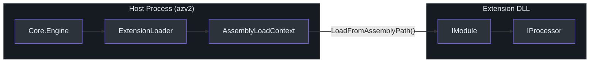
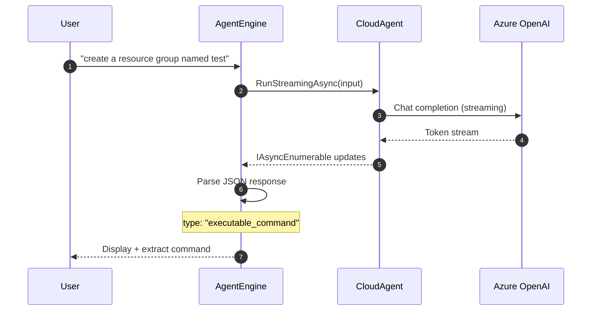
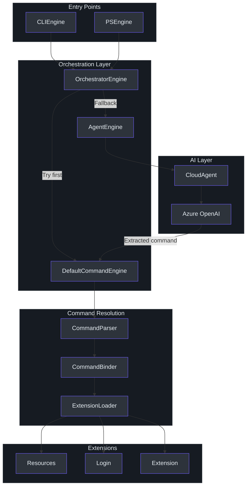
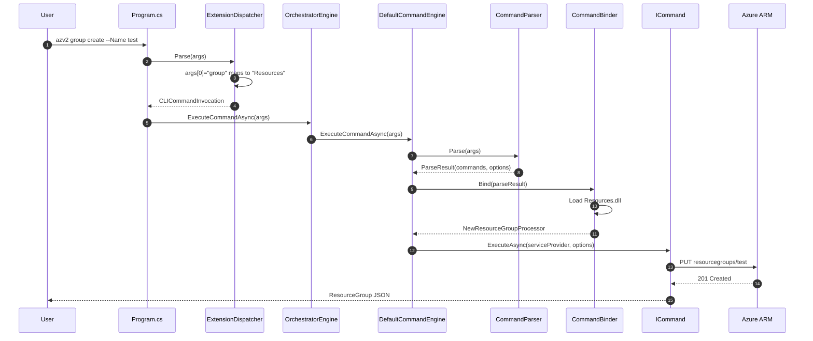

# Zero-to-Hero Learning Path

Welcome to Cirrus! This guide takes you from zero familiarity with C# and .NET to productive contributor, building each concept on the last. If you're experienced with Python (or any other language), you'll find side-by-side comparisons throughout.

---

## Part I: Foundation Skills

### 1. C# for Python Engineers

If you know Python, you already understand 80% of the concepts — C# just expresses them differently.

#### Type System & Variables

| Python | C# | Notes |
|--------|-----|-------|
| `name = "cirrus"` | `var name = "cirrus";` | C# infers type with `var` |
| `name: str = "cirrus"` | `string name = "cirrus";` | Explicit typing |
| `count: Optional[int] = None` | `int? count = null;` | Nullable value type |
| `label: str \| None = None` | `string? label = null;` | Nullable reference type |
| `PI = 3.14` | `const double PI = 3.14;` | Compile-time constant |
| `items: list[str]` | `List<string> items` | Generic collection |
| `mapping: dict[str, int]` | `Dictionary<string, int> mapping` | Generic dictionary |

#### Async/Await

Both languages have async/await, but the mechanics differ:

```python
# Python
async def fetch_data() -> str:
    result = await http_client.get("/api/data")
    return result.text
```

```csharp
// C# — same concept, Task<T> instead of Awaitable[T]
async Task<string> FetchDataAsync()
{
    var result = await _httpClient.GetAsync("/api/data");
    return await result.Content.ReadAsStringAsync();
}
```

Key difference: C# uses `Task<T>` (or `ValueTask<T>`) as the awaitable type. The `Async` suffix on method names is a convention, not a requirement.

#### LINQ vs List Comprehensions

LINQ is C#'s killer feature for data transformation — think of it as chainable list comprehensions:

```python
# Python
active_names = [u.name for u in users if u.is_active]
name_map = {u.id: u.name for u in users}
total = sum(order.amount for order in orders)
```

```csharp
// C# LINQ — same operations
var activeNames = users.Where(u => u.IsActive).Select(u => u.Name).ToList();
var nameMap = users.ToDictionary(u => u.Id, u => u.Name);
var total = orders.Sum(o => o.Amount);
```

#### Dependency Injection

Python doesn't have a built-in DI framework. C# has `Microsoft.Extensions.DependencyInjection`:

```python
# Python — manual wiring
class App:
    def __init__(self):
        self.auth = MsalAuthService()
        self.logger = ConsoleLogger()
```

```csharp
// C# — DI container wires everything
services.AddSingleton<IAuthService, MsalAuthService>();
services.AddSingleton<ILoggingService, ConsoleLoggingService>();
// Later: constructor injection automatically provides instances
public class MyEngine(IAuthService auth, ILoggingService logger) { }
```

In Cirrus, `CirrusServiceProvider.Initialize()` sets up the entire DI container (`src/Core/Core.DependencyInjection/CirrusServiceProvider.cs`).

#### Pattern Matching & Switch Expressions

```python
# Python 3.10+ match
match response_type:
    case "executable_command": execute(cmd)
    case "question": prompt_user()
    case _: print("unknown")
```

```csharp
// C# switch expression
var action = responseType switch
{
    "executable_command" => Execute(cmd),
    "question" => PromptUser(),
    _ => PrintUnknown()
};
```

#### Extension Methods

C# has a unique feature: extension methods — static methods that appear as instance methods:

```csharp
// Define: static class with static method, first parameter has 'this'
public static class DIRegisterExtensions
{
    public static IServiceCollection RegisterAuthServices(this IServiceCollection services)
    {
        services.AddSingleton<IAuthService, MsalAuthService>();
        return services;
    }
}

// Use: looks like an instance method
new ServiceCollection()
    .RegisterRuntimeServices()       // extension method
    .RegisterAuthenticationServices() // extension method
    .RegisterEngineServices(type)    // extension method
    .BuildServiceProvider();
```

Cirrus uses this pattern extensively for DI registration (`src/Core/*/DIRegisterExtensions.cs`).

---

### 2. .NET CLI Framework Concepts

#### The DI Container Pattern

At its core, DI in .NET follows three steps:

```
1. REGISTER: Tell the container what to create
   services.AddSingleton<IAuthService, MsalAuthService>();

2. BUILD: Create the container
   var provider = services.BuildServiceProvider();

3. RESOLVE: Ask for instances
   var auth = provider.GetRequiredService<IAuthService>();
```

In Cirrus, step 1 happens in `CirrusServiceProvider.Initialize()`, step 2 at the end of that method, and step 3 happens throughout the codebase via constructor injection or direct `GetRequiredService` calls.

#### Assembly Loading

.NET applications are compiled into assemblies (DLLs). Cirrus dynamically loads extension DLLs at runtime:



This is like Python's `importlib.import_module()` but with type safety and isolation. The `ExtensionLoadContext` in `src/Core/Core.Engine/ExtensionLoader.cs` prevents version conflicts between extensions.

#### Middleware Pipeline

The HTTP pipeline in Cirrus uses the chain-of-responsibility pattern — think Python decorators stacked on a function:

```python
# Python analogy
@add_auth_header
@retry_on_error
@log_request
def send_request(request):
    return http_client.send(request)
```

```csharp
// C# — same concept in Cirrus's HttpPipeline
pipeline.Prepend(commandAuthHandler.SendAsync)  // Add auth header
// Terminal handler: HttpClientFactory sends the actual request
```

---

### 3. Azure OpenAI from First Principles

#### The Problem

Users want to say `azv2 "create a resource group named test in eastus"` instead of memorizing `azv2 group create --Name test --Location eastus --SubscriptionId <guid>`. The AI agent bridges natural language to structured commands.

#### How It Works in Cirrus



The `CloudAgent` (`src/Core/Core.Agent/CloudAgent.cs`) wraps the Azure OpenAI SDK:
1. Loads a system prompt from `prompt.md` with flavor substitution (`{{flavor}}` → `"azure cli"` or `"azure powershell"`)
2. Maintains conversation history across turns
3. Streams responses token-by-token for responsive UI
4. Returns structured JSON with a `type` field

#### Response Types

| Type | Meaning | What Happens |
|------|---------|--------------|
| `executable_command` | AI generated a complete command | Extracted and executed via DefaultCommandEngine |
| `sample_command` | Help with placeholder values | Displayed to user, not executed |
| `question` | AI needs more info | User prompted, conversation continues |
| `confirmation` | Dangerous operation warning | User must confirm |
| `exit` | User wants to stop | Conversation ends |

---

### 4. MSAL Authentication from First Principles

#### The Problem

To call Azure APIs, you need a bearer token. Getting one requires OAuth2 flows — interactive browser login, device codes, token refresh, cache management. MSAL (Microsoft Authentication Library) abstracts all of this.

#### How Cirrus Uses MSAL

The `MsalAuthService` (`src/Core/Core.Authentication/MsalAuthService.cs`) provides:

1. **Interactive Login** — Opens browser, redirects to `http://localhost:50000` after auth
2. **Device Code Flow** — Displays a code for headless environments
3. **Silent Token Acquisition** — Refreshes tokens from cache without user interaction
4. **Token Cache Persistence** — Saves tokens to `~/.cirrus/MSAL.cache.plaintext`

```python
# Python pseudocode for how MSAL works in Cirrus
class MsalAuthService:
    def login(self, request):
        if request.use_device_code:
            result = self.app.acquire_token_by_device_code(scopes)
        else:
            result = self.app.acquire_token_interactive(
                scopes, redirect_uri="http://localhost:50000"
            )
        self.cache.save(result.token)
        return AuthResult(access_token=result.token, tenant=request.tenant)

    def get_token_silently(self, scopes, tenant):
        accounts = self.app.get_accounts()
        if accounts:
            return self.app.acquire_token_silent(scopes, account=accounts[0])
        raise Exception("No cached token - login required")
```

The `AuthContextService` (`src/Core/Core.Authentication/AuthContextService.cs`) persists the current `TenantId` and `SubscriptionId` to `~/.cirrus/context.json` so they're available across CLI invocations.

---

## Part II: This Codebase

### 5. The Big Picture

**Cirrus in one sentence:** An extension-based CLI framework that dynamically loads Azure management commands and falls back to AI when structured parsing fails.

#### Engine vs Car Analogy

Think of Cirrus as a **car engine**, and Azure as the **car**:

| Engine (Cirrus Owns) | Car (Azure Provides) |
|----------------------|---------------------|
| Command parsing & routing | Resource groups, VMs, storage |
| Extension loading & isolation | REST API endpoints |
| AI natural language processing | Authentication infrastructure |
| Telemetry & observability | Subscription management |
| PowerShell integration | Cloud resource lifecycle |

Cirrus never manages Azure resources directly — it orchestrates the tooling that talks to Azure.

#### Core Entities

| Entity | Interface | Purpose |
|--------|-----------|---------|
| Engine | `IEngine` | Entry point for CLI or PowerShell host |
| Command Engine | `ICommandEngine` | Executes commands (structured or AI) |
| Command | `ICommand` | Single executable command |
| Module | `IModule` | Collection of commands in an extension |
| Extension Index | `IExtensionIndex` | Registry of commands in an extension |
| Auth Service | `IAuthService` | Token acquisition |
| Auth Context | `IAuthContextService` | Persistent auth state |
| Output Adapter | `IOutputAdapter` | Host-agnostic output |
| Telemetry | `ITelemetryService` | OpenTelemetry tracing |

---

### 6. Architecture Deep Dive

#### The Heart: OrchestratorEngine

The most important file in the codebase is `src/Core/Core.Engine/OrchestratorEngine.cs`. It implements the smart fallback pattern:



#### DI Wiring

All services are registered as singletons in a chain of extension methods:

```csharp
// CirrusServiceProvider.cs — the complete registration chain
new ServiceCollection()
    .RegisterRuntimeServices()        // ILoggingService, IOutputAdapter
    .RegisterAuthenticationServices() // IAuthService, IAuthContextService
    .RegisterTelemetryServices()      // ITelemetryService
    .RegisterEngineServices(clientType) // All engines + orchestrator
    .BuildServiceProvider();
```

The `clientType` parameter (`ClientType.CLI` or `ClientType.PowerShell`) determines whether `CLIEngine` or `PSEngine` is registered as `IEngine`.

#### Environment-Driven Behavior

The `AZURECLI_FLAVOR` environment variable changes the orchestrator's behavior:
- `"azure cli"` (default) — Try structured commands first, fall back to AI
- `"azure powershell"` — Skip structured parsing, go direct to AI

---

### 7. Domain Model & Data Flow

#### Request Lifecycle



#### Data Invariants

| Entity | Invariant | Enforced By |
|--------|-----------|-------------|
| `AuthContext` | Must have `TenantId` and `SubscriptionId` | `required` keyword |
| `ParseResult` | `Commands` is never null | Constructor |
| `ICommand` | Must implement `ExecuteAsync` | Interface contract |
| `IExtensionIndex` | CLI and PS tables must be populated | Constructor |
| Extension DLLs | Must contain exactly one `IModule` | `CommandBinder.Bind()` |

---

### 8. Extension System & Command Types

#### Extension Structure

Every extension follows the same pattern:

```
src/Extensions/Name/
  ExtensionIndex.cs         # IExtensionIndex - command registry
  Extensions.Name.csproj    # EnableDynamicLoading=true
  Processors/
    VerbNounProcessor.cs      # IProcessor implementations
    BaseProcessorBase.cs      # Shared base class
  Models/                   # Data models (if needed)
```

#### How to Add a New Extension

1. **Create the project** in `src/Extensions/MyExt/`
2. **Create the .csproj** with `EnableDynamicLoading=true` and `ExcludeAssets=runtime` on Core references
3. **Implement `IExtensionIndex`** with CLI and PS command tables
4. **Create processors** implementing `IProcessor` with `[ArgumentInfo]` attributes on parameters
5. **Register in `CommandGroupIndex`** (`src/CLI/Parser/CommandGroupIndex.cs`)
6. **Add PowerShell wrapper** in `src/PS/MyExt/`
7. **Write tests** in `tests/`

---

### 9. AI Agent System

The AI agent (`src/Core/Core.Agent/CloudAgent.cs`) is configured via:

1. **Environment variables** in `.env`:
   - `AZURE_OPENAI_ENDPOINT` — Your Azure OpenAI resource URL
   - `AZURE_OPENAI_API_KEY` — API key
   - `AZURE_OPENAI_DEPLOYMENT` — Model deployment name (e.g., `gpt-4o-mini`)

2. **System prompt** (`src/Core/Core.Agent/prompt.md`):
   - Defines the JSON response schema
   - Includes `{{flavor}}` placeholder for CLI vs PowerShell context
   - Contains examples of typo correction, how-to answers, and command generation

3. **Conversation loop** (`src/Core/Core.Engine/AgentEngine.cs`):
   - Maintains chat history for multi-turn conversations
   - Displays spinner animation during AI processing
   - Parses JSON responses to determine action type
   - Feeds extracted commands back to `DefaultCommandEngine` for execution

---

## Part III: Getting Productive

### 10. Development Environment Setup

#### Prerequisites

| Tool | Version | Purpose |
|------|---------|---------|
| .NET SDK | 9.0.308 | Build & runtime |
| PowerShell | 7.0+ | PS module testing |
| Docker | Latest | Dev container |
| VS Code | Latest | IDE |
| Git | Latest | Version control |

#### Quick Start (Dev Container — Recommended)

```bash
# 1. Clone the repo
git clone https://github.com/Azure/cirrus.git && cd cirrus

# 2. Open in VS Code and reopen in container
code .
# Press Ctrl+Shift+P then "Dev Containers: Reopen in Container"

# 3. Build
dotnet build -c Release cirrus.slnx

# 4. Run the CLI
./artifacts/Release/Core.Cli/azv2 --help

# 5. Run tests
dotnet test tests/Cli.Tests/Cli.Tests.csproj
```

#### Quick Start (Local)

```bash
# 1. Verify .NET SDK version matches global.json
dotnet --info  # Should show 9.0.308

# 2. Build
dotnet build cirrus.slnx

# 3. Add CLI to PATH
export PATH="$PWD/artifacts/Debug/Core.Cli:$PATH"

# 4. Test
azv2 --help
```

#### Common Mistakes

| Problem | Cause | Fix |
|---------|-------|-----|
| SDK not found | Wrong .NET version | Install SDK 9.0.308 |
| Extension not found | Build config mismatch | Rebuild with matching config |
| MSAL error | Container browser issue | Set `BROWSER` env var |
| AI not responding | Missing `.env` file | Create `src/Core/Core.Agent/.env` |

---

### 11. Running Tests

#### Unit Tests

```bash
# Run all tests
dotnet test tests/Cli.Tests/Cli.Tests.csproj

# Run with verbose output
dotnet test tests/Cli.Tests/Cli.Tests.csproj --verbosity normal

# Run with coverage
dotnet test tests/Cli.Tests/Cli.Tests.csproj --collect:"XPlat Code Coverage"

# Run specific test
dotnet test --filter "MethodName=ExtensionDispatcher_HelpFlag_ShouldNotThrow"
```

#### What's Tested

| Test Class | Tests | Status |
|------------|-------|--------|
| `ExtensionDispatcherTests` | Empty args, help flags, unknown commands | All run |
| `ProgramFallbackTests` | Help flag handling | Runs |
| `ProgramFallbackTests` | Natural language fallback | Skipped (requires AI) |
| `ProgramFallbackTests` | PowerShell flavor | Skipped (requires AI) |

#### Benchmarks

```bash
cd tests/Benchmark
dotnet run -c Release -- --filter "*"
```

The benchmark project uses BenchmarkDotNet to measure CLI, API, and PowerShell command performance.

---

### 12. Navigating the Codebase

#### Start Here — File Reading Order

Read these files in order to understand the full architecture:

| Order | File | Why |
|-------|------|-----|
| 1 | `src/CLI/Program.cs` | Entry point — see the full flow |
| 2 | `src/Core/Core.DependencyInjection/CirrusServiceProvider.cs` | How DI wires everything |
| 3 | `src/Core/Core.Engine/OrchestratorEngine.cs` | The heart — orchestration logic |
| 4 | `src/Core/Core.Engine/DefaultCommandEngine.cs` | Structured command execution |
| 5 | `src/Core/Core.Engine/AgentEngine.cs` | AI fallback engine |
| 6 | `src/Core/Core.Abstractions/IEngine.cs` | Core contracts |
| 7 | `src/Core/Core.Abstractions/ICommand.cs` | Command interface |
| 8 | `src/Core/Core.Engine/ExtensionLoader.cs` | Dynamic loading |
| 9 | `src/Extensions/Resources/ExtensionIndex.cs` | Example extension |
| 10 | `src/Core/Core.Agent/CloudAgent.cs` | AI agent implementation |

#### How to Trace a Request

1. Start at `Program.Main()` in `src/CLI/Program.cs`
2. Follow `ExtensionDispatcher.Parse(args)` for structured commands
3. See `OrchestratorEngine.ExecuteCommandAsync()` for the orchestration loop
4. Follow `DefaultCommandEngine` → `CommandParser` → `CommandBinder` → `ICommand.ExecuteAsync()`
5. For AI fallback, follow `AgentEngine` → `CloudAgent.RunStreamingAsync()`

---

### 13. Contributing: Adding a New Extension

Here's a complete walkthrough for adding a `Storage` extension:

#### Step 1: Create Project Structure

```bash
mkdir -p src/Extensions/Storage/Processors
mkdir -p src/Extensions/Storage/Models
```

#### Step 2: Create Project File

```xml
<Project Sdk="Microsoft.NET.Sdk">
  <PropertyGroup>
    <EnableDynamicLoading>true</EnableDynamicLoading>
  </PropertyGroup>
  <ItemGroup>
    <ProjectReference Include="../../Core/Core.Abstractions/Core.Abstractions.csproj">
      <ExcludeAssets>runtime</ExcludeAssets>
    </ProjectReference>
    <ProjectReference Include="../../Core/Core.DependencyInjection/Core.DependencyInjection.csproj">
      <ExcludeAssets>runtime</ExcludeAssets>
    </ProjectReference>
  </ItemGroup>
</Project>
```

#### Step 3: Implement ExtensionIndex

```csharp
public class ExtensionIndex : IExtensionIndex
{
    private readonly Dictionary<string, ICommandMetadata> _cliTable = new();
    private readonly Dictionary<string, ICommandMetadata> _psTable = new();

    public ExtensionIndex()
    {
        _cliTable.Add("list", new CommandMetadata(
            name: "ListStorageAccounts",
            fullName: "Storage.Processors.ListStorageAccountsProcessor",
            assemblyName: "Storage",
            processorType: typeof(Processors.ListStorageAccountsProcessor)));
    }

    public Dictionary<string, ICommandMetadata> GetCLITable() => _cliTable;
    public Dictionary<string, ICommandMetadata> GetPSTable() => _psTable;
}
```

#### Step 4: Implement Command

```csharp
public class ListStorageAccountsProcessor : IProcessor
{
    [ArgumentInfo(Required = false, Description = "Subscription ID")]
    public string SubscriptionId { get; set; } = "";

    public async Task ExecuteAsync(IServiceProvider services,
        Dictionary<string, string> options, CancellationToken ct)
    {
        // Implementation here
    }
}
```

#### Step 5: Register in CommandGroupIndex

Add to `src/CLI/Parser/CommandGroupIndex.cs`:

```csharp
_index.Add("Storage", "Storage");
```

#### Step 6: Add to Solution and Build

```bash
dotnet sln cirrus.slnx add src/Extensions/Storage/Extensions.Storage.csproj
dotnet build cirrus.slnx
azv2 storage list --SubscriptionId <your-sub>
```

---

## Appendices

### Glossary

| Term | Definition |
|------|-----------|
| **azv2** | The CLI binary produced by the Cirrus project |
| **Extension** | A dynamically loaded DLL providing commands for a specific Azure service |
| **Module** | An `IModule` implementation that returns a collection of commands |
| **Command** | An `ICommand` implementation that performs a single operation |
| **OrchestratorEngine** | The smart fallback engine that tries structured parsing then AI |
| **DefaultCommandEngine** | Executes structured commands via parsing and binding |
| **AgentEngine** | Processes natural language input via Azure OpenAI |
| **CloudAgent** | Wrapper around Azure OpenAI chat completions API |
| **CLIEngine** | Entry point for CLI host (`ClientType.CLI`) |
| **PSEngine** | Entry point for PowerShell host (`ClientType.PowerShell`) |
| **Bootstrapper** | Service registration and DI container setup (used by PSEngine) |
| **CirrusServiceProvider** | Static singleton DI container (used by CLI and extensions) |
| **CommandParser** | Parses string args into `ParseResult` (commands + options) |
| **CommandBinder** | Loads extension DLLs and finds matching `ICommand` |
| **ExtensionLoader** | Loads extension assemblies with isolation |
| **BuiltinExtensionLoader** | Loads from application directory Extensions folder |
| **MultiVersionExtensionLoader** | Loads from `~/.cirrus/extensions/` with version selection |
| **ExtensionLoadContext** | `AssemblyLoadContext` for extension isolation |
| **ExtensionIndex** | `IExtensionIndex` implementation with CLI and PS command tables |
| **ExtensionDispatcher** | Routes CLI args to the correct extension |
| **CommandGroupIndex** | Maps command group names to extension names |
| **ExtensionInstaller** | Installs extensions from NuGet or local packages |
| **HttpPipeline** | Chain-of-responsibility HTTP middleware |
| **SendAsync** | HTTP pipeline step delegate |
| **ISendAsyncFactory** | Creates middleware pipeline steps |
| **ISendAsyncTerminalFactory** | Creates the terminal HTTP handler |
| **AuthHandler** | Pipeline handler that adds bearer tokens |
| **OutputHandler** | Pipeline handler for routing output |
| **TelemetryHandler** | Pipeline handler for activity tracking |
| **EventListener** | Handles signals/events during command execution |
| **EventData** | Event payload with ID, message, request/response |
| **MsalAuthService** | MSAL-based token acquisition service |
| **AuthContextService** | Persists auth state to `~/.cirrus/context.json` |
| **AuthContext** | Contains `TenantId` and `SubscriptionId` |
| **TelemetryService** | OpenTelemetry `ActivitySource` wrapper |
| **FileExporter** | Custom exporter writing traces to local files |
| **ActivitySource** | .NET API for creating distributed tracing spans |
| **ParseResult** | Parsed command structure (commands list + options dict) |
| **ArgumentInfo** | Attribute for command parameter metadata |
| **ClientType** | Enum: `CLI` or `PowerShell` |
| **IProcessor** | Interface for command execution pipeline |
| **ProcessorContext** | Composed context with auth, output, telemetry handlers |
| **AZURECLI_FLAVOR** | Environment variable controlling orchestrator behavior |
| **MSIX** | Windows application packaging format used for distribution |

### Key File Reference

| File | Purpose |
|------|---------|
| `src/CLI/Program.cs` | CLI entry point with AI fallback |
| `src/Core/Core.Abstractions/IEngine.cs` | Core engine interface |
| `src/Core/Core.Abstractions/ICommand.cs` | Command interface |
| `src/Core/Core.Abstractions/IModule.cs` | Module interface |
| `src/Core/Core.Abstractions/IExtensionIndex.cs` | Extension registry interface |
| `src/Core/Core.Abstractions/CLIContracts.cs` | IProcessor and delegates |
| `src/Core/Core.Abstractions/ClientType.cs` | CLI vs PowerShell enum |
| `src/Core/Core.DependencyInjection/CirrusServiceProvider.cs` | DI container |
| `src/Core/Core.Engine/OrchestratorEngine.cs` | Smart fallback orchestrator |
| `src/Core/Core.Engine/DefaultCommandEngine.cs` | Structured command engine |
| `src/Core/Core.Engine/AgentEngine.cs` | AI agent engine |
| `src/Core/Core.Engine/CLIEngine.cs` | CLI host engine |
| `src/Core/Core.Engine/PSEngine.cs` | PowerShell host engine |
| `src/Core/Core.Engine/Bootstrapper.cs` | Service registration |
| `src/Core/Core.Engine/ExtensionLoader.cs` | Dynamic DLL loading |
| `src/Core/Core.Engine/CommandParser.cs` | Argument parsing |
| `src/Core/Core.Engine/CommandBinder.cs` | Command resolution |
| `src/Core/Core.Agent/CloudAgent.cs` | Azure OpenAI wrapper |
| `src/Core/Core.Agent/prompt.md` | AI system prompt |
| `src/Core/Core.Authentication/MsalAuthService.cs` | MSAL auth |
| `src/Core/Core.Authentication/AuthContextService.cs` | Auth persistence |
| `src/Core/Core.Runtime/HttpPipeline.cs` | HTTP middleware |
| `src/Core/Core.Telemetry/TelemetryService.cs` | OpenTelemetry |
| `src/Core/Core.Telemetry/FileExporter.cs` | Local trace export |
| `src/Extensions/Resources/ExtensionIndex.cs` | Example extension |
| `src/CLI/Parser/ExtensionDispatcher.cs` | Command routing |
| `src/CLI/Parser/CommandGroupIndex.cs` | Extension lookup |
| `global.json` | SDK version pinning |
| `cirrus.slnx` | Solution file |

### Further Reading

- [Core Engine & Orchestration](/02-deep-dive/core-engine-orchestration) — Deep dive into the engine hierarchy
- [Extension System](/02-deep-dive/extension-system) — Extension loading and isolation
- [Authentication](/02-deep-dive/authentication) — MSAL integration details
- [AI Agent](/02-deep-dive/ai-agent) — Azure OpenAI integration
- [HTTP Pipeline](/02-deep-dive/http-pipeline) — Request middleware chain
- [Telemetry](/02-deep-dive/telemetry) — OpenTelemetry observability
- [Testing](/02-deep-dive/testing-benchmarking) — Test framework and benchmarks
- [Build & CI/CD](/02-deep-dive/build-cicd) — Build system and deployment
