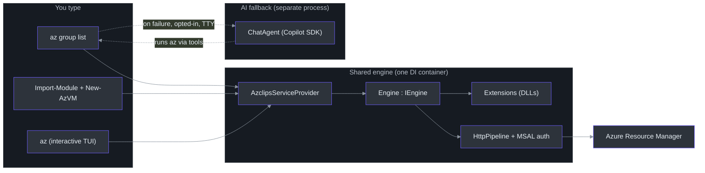
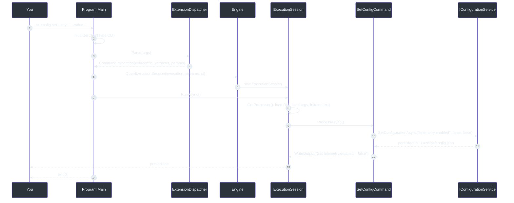
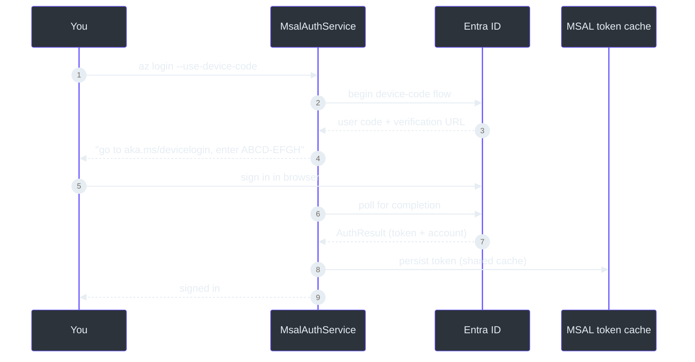
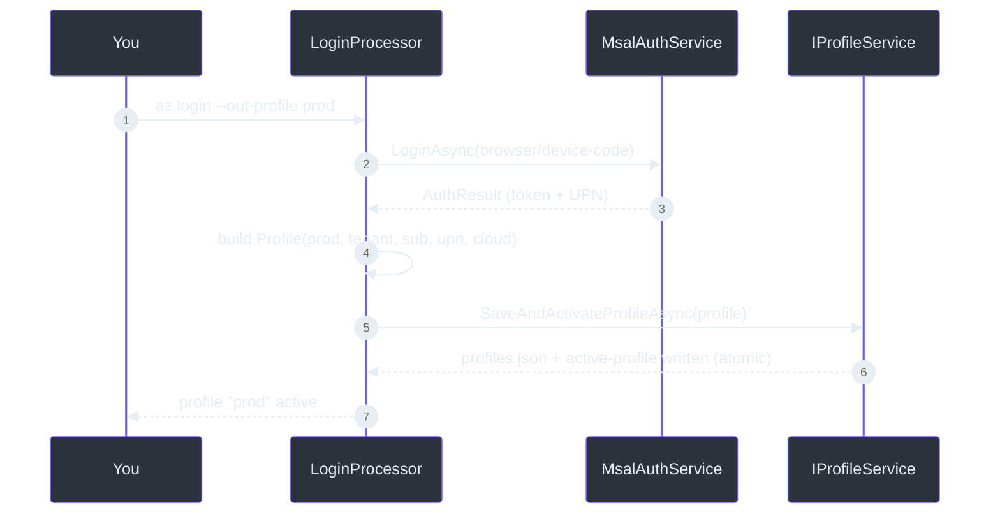
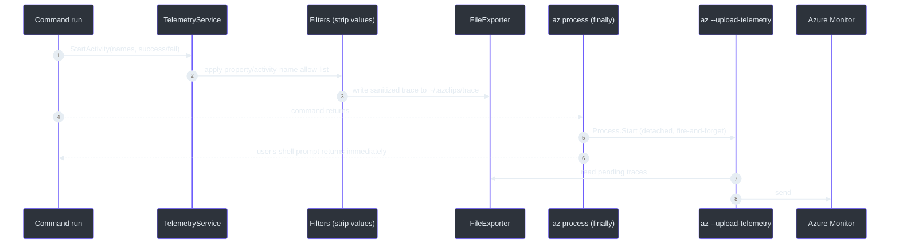

# Project Azclips — Zero-to-Hero Contributor Guide

> **Audience.** You are new to this codebase and possibly new to C#/.NET. Maybe you come from Python. This guide takes you from "I cloned the repo" to "I shipped a reviewed change" without hand-waving. It is long on purpose — skim the parts you know, read the parts you don't.
>
> **How to use it.** Part I teaches just enough C#/.NET to read Azclips, always by comparison to Python. Part II is a guided tour of the actual architecture (including the newer **TUI**, **AI Agent**, and **Config/Profile** pieces). Part III is the practical loop: setup, build, test, debug, contribute. At the end there's a **40+ term glossary** and a **key-file reference** you'll keep coming back to.
>
> **One rule this guide lives by:** every architectural claim points at a real file and line. If you ever doubt a sentence here, open the file. The prose docs in this repo (`README.md`, `AGENTS.md`, `eng-docs/spec/ARCHITECTURE.md`) have drifted from the code — this guide is written against the code as it exists now.

---

## Table of contents

- **Part I — C#/.NET foundations (for Python people)**
    - [1. The mental model shift: compiled, typed, DI-first](#p1-1)
    - [2. Syntax you'll see on every page](#p1-2)
    - [3. Async/await, Tasks, and cancellation](#p1-3)
    - [4. Interfaces, DI, and "programming to abstractions"](#p1-4)
    - [5. Nullable reference types, records, and pattern matching](#p1-5)
    - 5b. Delegates, `Func`/`Action`, and events · 5c. Attributes & reflection · 5d. Static classes & extension methods
    - [6. Projects, assemblies, and the build](#p1-6)
- **Part II — The Azclips architecture, guided**
    - [7. The 60-second architecture](#p2-7)
    - [8. Boot: one container for every surface](#p2-8)
    - [9. A command's life, step by step](#p2-9)
    - [10. Extensions: how commands are packaged](#p2-10)
    - [11. Authentication & Profiles](#p2-11)
    - [12. Configuration & Profile Management (the new bits)](#p2-12)
    - [13. The AI Agent (the new bits)](#p2-13)
    - [14. The Terminal UI (the new bits)](#p2-14)
    - [15. HTTP pipeline, telemetry, logging](#p2-15)
- **Part III — Doing the work**
    - [16. Environment setup](#p3-16)
    - [17. Build, run, and poke at it](#p3-17)
    - [18. Testing strategy](#p3-18)
    - [19. Your first change, end to end](#p3-19)
    - [20. Debugging playbook](#p3-20)
    - [21. Contribution workflow](#p3-21)
- **Reference**
    - [Glossary (40+ terms)](#glossary)
    - [Key-file reference](#keyfiles)

---

# Part I — C#/.NET foundations (for Python people)

<a name="p1-1"></a>

## 1. The mental model shift: compiled, typed, DI-first

If your instinct is Python, three things will feel different immediately.

**It's compiled, ahead of time.** There's no `python main.py`. You run `dotnet build`, which compiles C# into IL (intermediate language) inside `.dll` files, then `dotnet run` (or the produced `az` binary) executes them on the .NET runtime. Type errors, unused variables, and even style violations can _fail the build_ — this repo sets `TreatWarningsAsErrors` (`src/Directory.Build.props:11`), so a warning is a hard stop. That feels strict, but it means a green build has already caught a whole class of bugs Python would defer to runtime.

**Types are pervasive and static.** Every variable, parameter, and return has a type known at compile time. `var x = 5;` still gives `x` the type `int` — `var` just means "infer it," not "dynamic." There is no duck typing; if a method wants an `IProfileService`, you must pass something that _declares_ it implements `IProfileService`.

**Dependency Injection is the default wiring.** In Python you often just `import` and call. In .NET the idiomatic pattern is: define an interface, register a concrete implementation in a _container_, and let the container hand it to constructors. Azclips takes this all the way — there is a single container (`AzclipsServiceProvider`) that every entry point builds and pulls from. You will rarely see `new SomeService()`; you'll see a constructor parameter `ISomeService svc` that DI fills in.

Here is the same idea in both languages:

```python
# Python: implicit, duck-typed
class Engine:
    def __init__(self, auth, http):     # anything with the right methods works
        self.auth = auth
        self.http = http
```

```csharp
// C#: explicit interfaces, constructor injection
public class Engine(IAuthService authService, IHttpPipelineService httpPipelineService) : IEngine
{
    // `authService` and `httpPipelineService` are supplied by the DI container.
}
```

That second snippet is _primary constructor_ syntax (C# 12) — the parameters right after the class name become constructor parameters usable in the body. Azclips's real `Engine` uses exactly this form (`src/Core/Core.Engine/Engine.cs:22`).

<a name="p1-2"></a>

## 2. Syntax you'll see on every page

A quick Rosetta table for the constructs Azclips uses constantly:

| Concept           | Python                   | C# (as used here)                              |
| ----------------- | ------------------------ | ---------------------------------------------- |
| Variable          | `x = 5`                  | `var x = 5;` or `int x = 5;`                   |
| String interp     | `f"{a}-{b}"`             | `$"{a}-{b}"`                                   |
| Nullable          | `Optional[str]` / `None` | `string?` / `null`                             |
| List              | `list[int]`              | `List<int>` / `IList<int>`                     |
| Dict              | `dict[str, int]`         | `Dictionary<string, int>` / `IDictionary<...>` |
| Function type     | `Callable[[int], str]`   | `Func<int, string>`                            |
| Void callback     | `Callable[..., None]`    | `Action<...>`                                  |
| Interface/ABC     | `class P(Protocol):`     | `public interface IP { ... }`                  |
| Implements        | `class C(P):`            | `class C : IP`                                 |
| Decorator/attr    | `@dataclass`             | `[Attribute]` e.g. `[ArgumentInfo(...)]`       |
| Enum              | `class E(Enum):`         | `enum E { ... }`                               |
| Exception         | `raise ValueError(...)`  | `throw new ArgumentException(...);`            |
| `with` (resource) | `with open(...) as f:`   | `using var f = ...;`                           |
| Namespace         | module/package           | `namespace Core.Engine;`                       |
| Comprehension     | `[x for x in xs if p]`   | `xs.Where(p).Select(...)` (LINQ)               |

Two you'll meet within your first hour:

**`using` = deterministic cleanup.** `using var activity = telemetryService.StartRootActivity();` (`src/CLI/Program.cs:67`) means "when this scope ends, call `activity.Dispose()`." It's Python's `with`, but you can also write it as a statement (`using var x = ...;`) that disposes at the end of the enclosing block. Azclips uses it for telemetry activities, sessions, and the DI provider.

**LINQ = comprehensions on steroids.** `args.Where(a => !a.Equals("--debug", StringComparison.OrdinalIgnoreCase)).ToArray()` (`src/CLI/Program.cs:163`) filters an array. `a => ...` is a lambda (Python's `lambda a: ...`). You'll see `.Select`, `.Where`, `.FirstOrDefault`, `.ToList()` everywhere.

<a name="p1-3"></a>

## 3. Async/await, Tasks, and cancellation

Azclips is async top to bottom. If you know Python's `async`/`await`, this maps cleanly — with a couple of twists.

| Python                   | C#                                                 |
| ------------------------ | -------------------------------------------------- |
| `async def f() -> str:`  | `async Task<string> F()`                           |
| `await g()`              | `await G()`                                        |
| returns nothing          | `async Task F()` (no result)                       |
| `asyncio.CancelledError` | `CancellationToken` + `OperationCanceledException` |

`Task<T>` is the awaitable that yields a `T` (Python's coroutine/awaitable). `Task` (non-generic) is an awaitable that yields nothing. So `public static async Task<int> Main(string[] args)` (`src/CLI/Program.cs:31`) is "an async entry point that eventually returns an int exit code."

The twist Python doesn't have as a first-class citizen: **`CancellationToken`**. Instead of exceptions bubbling from a global cancel, .NET passes a _token_ down the call chain; code checks `token.ThrowIfCancellationRequested()` or passes it to awaited calls. Azclips threads a token from the CLI's `CancellationTokenSource` (`Program.cs:27`) through the session (`ExecutionSession` stores it on its `EventBus`) down to HTTP calls. When you press Ctrl+C, the token is cancelled and in-flight work unwinds cleanly.

One gotcha you'll see and should understand: `.GetAwaiter().GetResult()` (e.g. `Engine.cs:50`) is "synchronously wait for this Task." It's used in a few spots where the surrounding API can't be async (like some event publishing). Prefer `await` in new code; only block like this when you truly can't be async.

<a name="p1-4"></a>

## 4. Interfaces, DI, and "programming to abstractions"

This is the single most important .NET idea for reading Azclips.

An **interface** is a contract — a set of method/property signatures with no implementation. `IProfileService` (`src/Core/Core.Abstractions/IProfileService.cs`) says "anything that is a profile service can `GetProfileAsync`, `SaveProfileAsync`, …" A **class** then _implements_ it: `class ProfileService : IProfileService` (`src/Core/Core.Runtime/ProfileService.cs:14`) provides the actual file-backed logic.

Why bother? So the rest of the code can depend on the _contract_, not the _implementation_. The engine takes an `IProfileService`; in production it gets the real `ProfileService`, in tests it can get a fake. This is the whole reason `Core.Abstractions` exists as a project with **no dependencies on the concrete Core projects** — it's a pile of interfaces everyone can reference without creating dependency cycles.

The **DI container** is the matchmaker. Registration says "when someone asks for `IProfileService`, give them a singleton `ProfileService`." Resolution asks "give me an `IProfileService`." In Azclips:

```csharp
// Registration (inside RegisterRuntimeServices, wired by RRegisterAzclipsServices)
services.AddSingleton<IProfileService, ProfileService>();

// Resolution
var profiles = AzclipsServiceProvider.GetRequiredService<IProfileService>();
```

`AddSingleton` = one shared instance for the whole process (Python: a module-level singleton). There are also `AddScoped` and `AddTransient` lifetimes in .NET generally; Azclips leans heavily on singletons because the container is process-wide and the _per-invocation_ isolation is done by `ExecutionSession`, not by DI scopes.

Python analogy for the whole pattern:

```python
# A hand-rolled container in Python, to make the C# concrete
class Container:
    def __init__(self):
        self._singletons = {}
        self._factories = {}
    def add_singleton(self, iface, impl_factory):
        self._factories[iface] = impl_factory
    def get(self, iface):
        if iface not in self._singletons:
            self._singletons[iface] = self._factories[iface](self)
        return self._singletons[iface]

c = Container()
c.add_singleton(IProfileService, lambda c: ProfileService(c.get(ILoggingService)))
profiles = c.get(IProfileService)   # built once, reused
```

That is, conceptually, what `Microsoft.Extensions.DependencyInjection` does under `AzclipsServiceProvider`.

<a name="p1-5"></a>

## 5. Nullable reference types, records, and pattern matching

**Nullable reference types.** This repo enables `<Nullable>enable</Nullable>` (`src/Directory.Build.props:7`). That means `string` is _non-null by contract_ and `string?` is "might be null." The compiler warns (and here, errors) if you might dereference a null. You'll see careful code like `ResolveProfileAsync` returning `Profile?` and callers checking `if (profile is null)` (`Engine.cs:150`). Coming from Python where everything can be `None`, this is a guardrail: the type tells you where null is actually possible.

**Records.** A `record` is a concise immutable data type with value equality — think Python's `@dataclass(frozen=True)`. Azclips uses records for its data-carrying types: `ProcessorContext` is a record built positionally (`Engine.cs:123`), `Profile` is a record. You'll see the `with` expression for non-destructive copies (`profile with { Name = "prod" }`).

**Pattern matching.** C# has rich pattern matching you'll see in `switch` expressions and `is` checks:

```csharp
// From BundledDaemonResolver.cs — a switch expression mapping arch → string
var arch = RuntimeInformation.OSArchitecture switch
{
    Architecture.X64 => "x64",
    Architecture.Arm64 => "arm64",
    _ => null,            // the default arm, like Python's else
};
```

and null checks read like English: `if (profile is null)`, `if (agentRef is { } a)` (property pattern), `_state?.LastIssues is { Count: > 0 }` (`ChatAgent.cs:60`).

The `?.` there is the **null-conditional operator** (Python: no direct equivalent — closest is a guarded `x and x.attr`). `a?.B` yields `null` if `a` is null instead of throwing. Combined with `??` (null-coalescing, "use the right side if the left is null"), you get terse null-safe chains like `profileNameOverride?.Trim()` and `_extensionIndices ??= new(...)` (`Engine.cs:83`, "assign only if currently null").

### 5b. Delegates, `Func`/`Action`, and events

This one matters a lot because the **Engine wires itself together with delegates**, and if you don't recognize them the engine looks like magic.

A **delegate** is a typed function reference — a variable that holds a method you can call later. Python passes functions around freely; C# does too, but the _type_ is explicit:

- `Func<A, B>` — a function taking an `A`, returning a `B` (the last type param is the return).
- `Func<A, B, C>` — takes `A` and `B`, returns `C`.
- `Action<A>` — takes an `A`, returns nothing (void).
- `Func<Task>` — an async function returning a `Task` (no result).

Look at how `OpenExecutionSession` builds a session by _assigning delegates_ onto it (`Engine.cs:54-58`):

```csharp
session.LoadAssembly = assemblyLoadingService.LoadExtension;                    // Func
session.BindProcessor = argumentParsingService.BindArgumentsToProcessor;        // Func
session.CreateProcessorContext = (s, profileName) => CreateProcessorContext(s, profileName); // lambda
session.CacheGetOrAdd = (name, version, getIndex) => CacheGetOrAdd(name, version, getIndex);
```

The session doesn't _depend on_ the engine; the engine hands the session the exact functions it needs. When `ExecutionSession.RunAsync` later calls `CreateProcessorContext(...)`, it's calling back into the engine through a delegate it was given. This is dependency injection at the _method_ level, and it's the dominant style in `Engine`/`ExecutionSession`.

A **lambda** is an inline anonymous function: `(s, profileName) => CreateProcessorContext(s, profileName)` is Python's `lambda s, profile_name: create_processor_context(s, profile_name)`. Multi-statement lambdas use braces: `(value, ct) => { Console.WriteLine(...); return Task.CompletedTask; }` (`Program.cs:169`).

**Events** are a delegate-based publish/subscribe mechanism. Azclips uses an explicit `RuntimeEventBus` (`Publish`/subscribe) rather than C# `event` keyword for cross-cutting session events, but you'll also see the classic form in `Console.CancelKeyPress += handler` (`Program.cs:355`) — `+=` subscribes a handler, `-=` unsubscribes.

### 5c. Attributes and reflection — how arguments get bound

When you write `az config set --key x --value y`, _how_ does `--key` end up in `SetConfigCommand.Key`? The answer is **attributes + reflection**, and understanding it demystifies the whole command layer.

An **attribute** is metadata you attach to code with `[Brackets]` (Python's decorators are the closest cousin, though attributes are pure data, not wrappers). Azclips marks bindable parameters with `[ArgumentInfo(...)]`:

```csharp
[ArgumentInfo(Required = true, Description = "Configuration key in dot notation.", SerializedName = "Key")]
public string Key { get; set; } = string.Empty;
```

**Reflection** is inspecting types at runtime — reading their properties, attributes, and setting values dynamically (Python's `getattr`/`setattr`/`inspect`). The argument-parsing service (`IArgumentParsingService.BindArgumentsToProcessor`) reflects over a processor's properties, finds the `[ArgumentInfo]`-decorated ones, matches them to the parsed `--flags` (honoring `SerializedName` and aliases), converts the string to the property's type, and sets it. That's why a command author only _declares_ properties with attributes and never writes parsing code.

This is also why `Required = true` can be enforced centrally, and why the same processor works for both CLI (`--key`) and PowerShell (`-Key`) — the binder normalizes both to the same property.

### 5d. Static classes, extension methods, and `this`-parameters

Two idioms you meet immediately in the DI code.

A **static class** has no instances — it's just a bag of functions/state (Python: a module, or a class of `@staticmethod`s). `AzclipsServiceProvider` is static (`AzclipsServiceProvider.cs:17`), `HomePaths` is static (`HomePaths.cs`), `BundledDaemonResolver` is static.

An **extension method** lets you add methods to a type you don't own by declaring a static method whose first parameter is `this SomeType x`. That's the trick behind the fluent registration chain:

```csharp
// The `this IServiceCollection services` first param makes this callable as services.RegisterAzclipsServices()
public static void RegisterAzclipsServices(this IServiceCollection services) =>
    services.RegisterConfigurationServices().RegisterTelemetryServices() /* ... */;
```

Each `Register*Services` is an extension method (defined in each Core project's `DIRegisterExtensions.cs`) returning the collection so calls chain. LINQ (`.Where`, `.Select`) works the same way — they're extension methods on `IEnumerable<T>`. When you see `x.Something();` and `Something()` isn't defined on `x`'s class, look for an extension method.

<a name="p1-6"></a>

## 6. Projects, assemblies, and the build

A **project** is a `.csproj` XML file that compiles to one **assembly** (`.dll`). Python's nearest analog is a package that builds to a wheel, but the granularity here is finer: Azclips has ~30 projects. A **solution** (`.slnx` here, `azclips.slnx`) just lists the projects and groups them into folders.

Shared build settings live in two inherited files so you don't repeat them per project:

- `Shared.props` (repo root) — product name `Azclips`, artifact output paths.
- `src/Directory.Build.props` — `net10.0`, nullable, implicit usings, analyzers, warnings-as-errors. **This is where the framework version lives**, and it says `net10.0` (`:5`).

**Implicit usings** (`<ImplicitUsings>enable</ImplicitUsings>`) auto-import common namespaces (`System`, `System.Linq`, etc.) so files don't start with 15 `using` lines. That's why you'll see files use `List<T>` without an explicit `using System.Collections.Generic;`.

The SDK version is pinned by `global.json` (`10.0.203`, roll-forward `latestMinor`). `dotnet` picks that SDK; if you don't have it, the build tells you.

**Project references vs. package references.** Inside `.csproj` you'll see `<ProjectReference>` (depend on another project in the repo, like `Core.Abstractions`) and `<PackageReference>` (a NuGet dependency, like `Microsoft.Identity.Client`). The dependency _direction_ is the architecture: concrete Core projects reference `Core.Abstractions`, never the reverse. Keep it that way or you'll create a cycle the build rejects.

You now know enough C# to read every file we'll tour. On to the architecture.

### 6b. Ten gotchas coming from Python

Things that will bite a Python developer specifically:

1. **A warning fails the build.** `TreatWarningsAsErrors` is on. An unused variable stops compilation. Don't fight it — fix it.
2. **`==` on reference types is identity, not value** (except `record`s and `string`, which override it). Use `.Equals(...)` with a `StringComparison` for strings — you'll see `StringComparison.OrdinalIgnoreCase` everywhere (`Program.cs:157`).
3. **`null` is not `False`-y.** `if (x)` requires `x` to be a `bool`. Write `if (x is null)` / `if (string.IsNullOrWhiteSpace(s))`.
4. **Integer division is integer.** `5 / 2 == 2`. Use `5 / 2.0` for `2.5`.
5. **Everything is in a class/namespace.** There are no free functions; even `Main` is a static method on `Program`.
6. **Async is not free-threaded.** `await` doesn't spawn a thread; it yields. Blocking with `.Result`/`.GetAwaiter().GetResult()` can deadlock in some contexts — prefer `await`.
7. **`var` is static typing, not `dynamic`.** The type is fixed at compile time; you just didn't spell it.
8. **Collection interfaces vs. concretes.** APIs take `IEnumerable<T>`/`IList<T>`/`IReadOnlyCollection<T>` (contracts) and return concretes (`List<T>`). Pass the concrete, accept the interface.
9. **Exceptions are typed and caught specifically.** The catch ladder in `Program.Main` (`:91-144`) orders from specific to general — order matters, first match wins.
10. **Disposal is explicit.** If a type implements `IDisposable`, wrap it in `using` or you leak. The container, sessions, and telemetry activities are all disposable.

Keep this list next to you for your first week; each item maps to a real line you'll hit.

---

# Part II — The Azclips architecture, guided

<a name="p2-7"></a>

## 7. The 60-second architecture

Azclips is an **extension-based Azure CLI** (the `az` binary) with three companions that all share one engine: a **PowerShell** module set, an **interactive Terminal UI**, and an opt-in **AI agent**.



Read the diagram as: _four ways in, one engine, and a dashed AI escape hatch that lives in its own process._ That's the whole system. Everything below is detail.

### 7.1 How the four surfaces actually differ

Since "one engine, many surfaces" is the whole thesis, here's exactly what varies and what doesn't:

| Concern         | CLI (`az`)               | PowerShell              | Interactive TUI                | Agent-mode                        |
| --------------- | ------------------------ | ----------------------- | ------------------------------ | --------------------------------- |
| Entry           | `src/CLI/Program.cs`     | cmdlet `ProcessRecord`  | `TUI/Program.cs`               | `TUI/AgentMode/AgentModeEntry.cs` |
| `ClientType`    | `CLI`                    | (PS)                    | `TUI`                          | `TUI`                             |
| Output goes to  | `Console.WriteLine`      | `$PSCmdlet.WriteObject` | Hex1b widgets                  | streamed console                  |
| Logger          | console                  | console                 | **silent** `TuiLoggingService` | console renderer                  |
| Uses `IEngine`? | yes                      | yes                     | yes (VFS + commands)           | yes (via agent tools)             |
| Container       | `AzclipsServiceProvider` | same                    | same                           | same                              |

Everything in the last two rows is identical; everything above it is a thin edge adaptation. That is the design paying off.

### 7.2 Recommended reading order

If you're reading the source alongside this guide, go spine-first, not alphabetically:

1. `src/Core/Core.Abstractions/` — the interfaces (`IEngine`, `ISession`, `IProcessor`, `IProfileService`, `IConfigurationService`).
2. `AzclipsServiceProvider.cs` — the container.
3. `src/CLI/Program.cs` — the whole CLI lifecycle in one file.
4. `Engine.cs` + `ExecutionSession.cs` — the engine.
5. `src/Extensions/Config/` — one complete, tiny extension.
6. Then auth, HTTP, profiles, and finally the Agent/TUI.

Two hours on steps 1–4 buys you most of the mental model.

<a name="p2-8"></a>

## 8. Boot: one container for every surface

Every entry point does the same three-move dance: register surface-specific services, then initialize the container, then resolve what it needs.

```csharp
// src/CLI/Program.cs:40 — the CLI's boot
AzclipsServiceProvider.PrependRegistration(services => { /* add CLI-only services */ });
AzclipsServiceProvider.OverrideRegistration(services => { /* swap in CLI providers */ });
AzclipsServiceProvider.Initialize(ClientType.CLI);            // build the container (once)
var engine = AzclipsServiceProvider.GetRequiredService<IEngine>();   // resolve
```

The container itself (`src/Core/Core.DependencyInjection/AzclipsServiceProvider.cs`) is a static class holding:

- two queues of registration hooks (`_prependRegistrations`, `_overrideRegistrations`),
- a single lazily-built `IServiceProvider`,
- `Initialize(ClientType)` that runs prepend hooks → the shared `RegisterAzclipsServices()` → override hooks, then builds the provider (`:67-91`).

`RegisterAzclipsServices()` (`:53`) is the shared spine — it chains every module's registration:

```csharp
services
    .RegisterConfigurationServices()
    .RegisterTelemetryServices()
    .RegisterRuntimeServices()
    .RegisterAuthenticationServices()
    .RegisterEngineServices()
    .RegisterAssemblyLoadingServices()
    .RegisterArgumentParsingServices();
```

Why this matters to _you_ as a contributor: if you add a new core service, you register it in the appropriate `Register*Services()` extension method (each Core project has a `DIRegisterExtensions.cs`). If you add something surface-specific (only the CLI needs it), you add it via that surface's `PrependRegistration`/`OverrideRegistration`. You almost never `new` a service.

`Initialize` is **idempotent** — call it twice and the second call is a no-op (`:69-70`). This matters because PowerShell imports several cmdlet modules that each might initialize; only the first wins.

> **Naming note.** Old docs call this the "Bootstrapper." There is _no_ class named `Bootstrapper`. The composition root is `AzclipsServiceProvider`. If you `grep Bootstrapper src`, you get nothing.

<a name="p2-9"></a>

## 9. A command's life, step by step

Let's walk `az config set --key telemetry.enabled --value false` because `Config` is the simplest full extension.



The moving parts:

1. **Parse** — `ExtensionDispatcher.Parse` (`src/CLI/Parser/ExtensionDispatcher.cs:44`) turns the args into a `CommandInvocation` (extension `config`, verb `set`, a parameter bag). Help flags (`--help`) and bad input throw typed exceptions that `Main` catches.
2. **Open session** — `Engine.OpenExecutionSession` (`Engine.cs:39`) creates an `ExecutionSession`, wires delegates (how to load the assembly, bind args, create the processor context), and returns it.
3. **Run** — `ExecutionSession.RunAsync` (`ExecutionSession.cs:57`) is literally `await (await GetProcessor()).ProcessAsync();`. `GetProcessor` loads the `config` extension DLL, gets its `IExtensionIndex`, finds `set`, creates a `ProcessorContext`, binds `--key`/`--value`/`--force` to the processor's `[ArgumentInfo]` properties, and calls `Init(context)`.
4. **Process** — `SetConfigCommand.ProcessAsync` (`src/Extensions/Config/Commands/SetConfigCommand.cs:20`) parses the value, calls `IConfigurationService.SetConfigurationAsync`, and writes a confirmation through `context.OutputHandler.WriteOutput` (never `Console` directly).

The `SetConfigCommand` in full is short enough to internalize:

```csharp
// src/Extensions/Config/Commands/SetConfigCommand.cs
public sealed class SetConfigCommand : ConfigCommandBase
{
    [ArgumentInfo(Required = true, Description = "Configuration key in dot notation.", SerializedName = "Key")]
    public string Key { get; set; } = string.Empty;

    [ArgumentInfo(Required = true, Description = "Configuration value.", SerializedName = "Value")]
    public string Value { get; set; } = string.Empty;

    [ArgumentInfo(Required = false, Description = "Allow unknown keys.", SerializedName = "Force")]
    public bool Force { get; set; }

    public override async Task ProcessAsync()
    {
        using var _ = StartActivity($"{nameof(SetConfigCommand)}.{nameof(ProcessAsync)}", ActivityKind.Internal);
        var parsedValue = ParseValue(Value);
        await GetConfigurationService().SetConfigurationAsync(Key, parsedValue, Force, CancellationToken);
        await WriteOutput($"Set {Key} = {FormatValue(parsedValue)}", CancellationToken);
    }
}
```

Notice the four patterns you'll copy for every command: `[ArgumentInfo]` on public properties (the binder fills them), a telemetry `StartActivity` in a `using`, resolving an ambient service via the base (`GetConfigurationService()` reaches the DI container at `ConfigCommandBase.cs:35`), and output via `WriteOutput` (routed through the session's channel).

### 9.1 The failure path (and why the agent sometimes appears)

The happy path above returns `0`. The interesting behavior is what happens when a command _throws_. Help and version are dispatched from the `GlobalArgs` record before `Program.Main`'s catch ladder runs, so the ladder itself is a small triage of real failures (`src/CLI/Program.cs`):

| Thrown                  | Meaning                   | What happens                                                                    |
| ----------------------- | ------------------------- | ------------------------------------------------------------------------------- |
| `AzclipsErrorException` | a known error | print `ERROR: [code] message`, return its exit code — **no agent** |
| `InvalidInputException` | malformed user input | offered to the agent first; if the agent doesn't run, print `ERROR: [InvalidInput] message` and exit 2 |
| `HttpRequestException`  | network/ARM failure       | `TryAgentFallbackAsync`                                                         |
| any other `Exception`   | unknown failure           | `TryAgentFallbackAsync`                                                         |

The key idea: **known, well-understood errors never call the agent** — the system knew exactly what went wrong, so an LLM round-trip would only slow you down. The agent is reserved for **unclassified** failures: `HttpRequestException` and exceptions that aren't `AzclipsErrorException`, where the cause isn't known. Known errors, including usage errors such as an unknown flag, a missing value, or an unknown subcommand under a known group, are printed and exit without reaching the agent. `InvalidInputException` (a malformed value, such as a bad `--set` expression) is the exception: it is offered to the agent first, and printed as a known error only if the agent doesn't run. An unknown top-level command group is not a known error: no extension owns it, so it throws a plain `KeyNotFoundException` and does reach the agent. Even for unclassified failures, `TryAgentFallbackAsync` (`:495`) only proceeds if three gates pass:

```csharp
if (!config.GetConfiguration<AgentOptions>().Enabled) return 1;               // opted in?
if (Console.IsInputRedirected || Console.IsOutputRedirected) return 1;        // real TTY?
if (Environment.GetEnvironmentVariable("AZCLIPS_IN_AGENT_MODE") == "1") return 1; // not already inside the agent?
```

Only if all three pass does it spawn the TUI in `--agent-mode` and wait for it. This is why, on a CI runner or in a pipe, a failing `az` just prints the error and exits — it never hangs waiting for a `y/n` the script can't answer.

### 9.2 The discovery path (help & completions)

Not every invocation executes a command. Bare `az`, `az --help`, `az group --help`, and shell tab-completion all take the **discovery** path instead of the execution path. `CompletionGenerator.TryHandleAsync` (`Program.cs:56`) short-circuits before real work for completion requests, and help exceptions route to `RuntimeHelpDispatcher`, which uses `Engine.OpenDiscoverySession` (`IEngine.cs:12`) to _introspect_ extensions (load their indices, read metadata) without running anything. Keeping discovery separate from execution is why `--help` is fast and side-effect-free.

<a name="p2-10"></a>

## 10. Extensions: how commands are packaged

An **extension** is a DLL that exposes commands. Structurally each has:

- an `ExtensionIndex.cs` — the registry mapping verbs to processor types,
- one `IProcessor` per verb (the command logic),
- optionally `Customization/` and `Processors/` for multi-step flows (see `Resources`/`Compute`),
- a `Compatibility.cs` marking Azclips compatibility.

The six extensions today (`azclips.slnx`):

| Extension          | What it does                                                                                 |
| ------------------ | -------------------------------------------------------------------------------------------- |
| `ExtensionRuntime` | Not commands — the (de)serialization/type-conversion runtime extensions use for ARM payloads |
| `Extension`        | Extension _management_: `add`/`list`/`pin`/`unpin`/`remove`/`show`/`update`                  |
| `Resources`        | Resource groups & deployments (`group create`, `deployment ...`)                             |
| `Compute`          | VMs, NICs, NSGs, VNets                                                                       |
| `Accounts`            | `login`/`logout` **and** the profile commands (`profile list/show/set/remove`)               |
| `Config`           | `config get/set/list/delete/info`                                                            |

**Discovery & loading.** Every extension is discovered at runtime through the loader chain. `BundledExtensionLoader` scans `<install>/Extensions/` (and local build output); `InstalledExtensionLoader` scans `~/.azclips/extensions/`, honoring the config-driven root. `ExtensionDispatcher` uses a `LeafIndex` built from the discovery results to resolve which extension owns a verb (`ExtensionDispatcher.cs:44`). Loading the DLL is `IAssemblyLoadingService` / `CLIAssemblyLoadingProvider` (`src/CLI/AssemblyLoading/`), with side-by-side versions via `InstalledExtensionLoader` (registered at `Program.cs:59`). Because loading + reflecting is expensive, `Engine` caches each extension's `IExtensionIndex` in an `LFUCache<Lazy<IExtensionIndex>>` keyed by `name-version` (`Engine.cs:36,81`).
**ExtensionRuntime** deserves a note: it's a small JSON runtime (`src/Extensions/ExtensionRuntime/Conversions/`) with converters for every primitive and collection type (`Int32Converter`, `HashSet'1Converter`, `JsonObjectConverter`, …) plus a `JsonConverterAttribute` to register custom ones. Extensions use it instead of hand-rolling ARM (de)serialization.

### 10.1 Simple commands vs. orchestrated commands

Not every command is a single `ProcessAsync`. Look at `Resources` and `Compute`: alongside `Processors/` they have `Customization/` (e.g. `NewResourceGroupDeploymentProcessor_Orchestrator.cs`, `DeploymentOrchestratorBase.cs`). An **orchestrator** coordinates a multi-step flow — submit an ARM deployment, then poll until it completes — while the plain processor handles the single-shot case. When you author a command:

- **Single request/response** (like `config set`, `group show`) → a plain `IProcessor`.
- **Long-running / multi-call** (like a deployment with polling, or "create a VM" which also creates a NIC, NSG, and VNet) → an orchestrator that sequences several processors.

The `Compute` `NewVMProcessor_Orchestrator` is the canonical example: creating a VM fans out to network resources first, then the VM itself. You won't write one on day one, but recognize the `*_Orchestrator` suffix as "this command does more than one ARM call."

<a name="p2-11"></a>

## 11. Authentication & Profiles

**Auth is MSAL.** `MsalAuthService` (`src/Core/Core.Authentication/MsalAuthService.cs:11`) implements `IAuthService` using `Microsoft.Identity.Client`. It requests the ARM scope `https://management.core.windows.net//.default` (`:12`) as a public client, and branches between **interactive** (browser) and **device-code** flows based on the login request (`:16`). Tokens land in a persisted, **shared** MSAL cache. Silent token acquisition (`AcquireTokenSilentlyAsync`) is what the HTTP auth handler calls on every request.

**Logout is surgical.** `LogoutAsync(userPrincipalName)` (`:29`) removes only the account whose `Username` matches the given UPN from the shared cache — _not_ a blanket clear — because other profiles' tokens live in the same cache. If no UPN is supplied, it removes nothing (but callers still clear the active-profile pointer).

Here's the device-code sign-in flow, the one you'll use on a headless box:



The interactive (browser) flow is the same shape minus the device code — MSAL pops a browser instead of printing a code. Which one runs is decided by `request.UseDeviceCodeFlow` in `LoginAsync` (`MsalAuthService.cs:16`).

<a name="p2-12"></a>

## 12. Configuration & Profile Management (the new bits)

This is a **new feature area (#345)** and one of the most likely things you'll touch. There are two related concepts: **config** (key/value settings) and **profiles** (named connections).

### 12.1 Config

The `Config` extension implements `az config get/set/list/delete/info`, all sharing `ConfigCommandBase` (`src/Extensions/Config/Commands/ConfigCommandBase.cs:15`). Key behaviors:

- **Key normalization** — dot and colon notation are unified (`telemetry:enabled` → `telemetry.enabled`) by `NormalizeKey` (`:39`).
- **Typed reads** — values are surfaced through `IConfigurationService`, which projects `~/.azclips/config.json` into typed options (`CoreOptions`, `AgentOptions`, `TelemetryOptions`).
- **Unknown-key guard** — `set` rejects keys it doesn't recognize unless you pass `--force`.
- **PowerShell mirror** — `Set-AzConfig`/`Get-AzConfig` in `src/PS/Config`.

Common keys you'll actually use: `telemetry.enabled` (opt out of telemetry), `agent.enabled` (turn on the AI fallback), `agent.trace.enabled`/`agent.trace.path` (record agent runs).

### 12.2 Profiles

A **profile** is a named connection: tenant, subscription, user, cloud, auth method. `IProfileService`/`ProfileService` (`src/Core/Core.Runtime/ProfileService.cs:14`) store them in `{LocalApplicationData}/.azclips/profiles.json` with a separate `active-profile` pointer file. Writes are **atomic** (temp file + rename) and serialized in-process by a semaphore.

The design (fully documented in `openspec/changes/profile-management/design.md`) makes the profile the _single source of truth_ for connection state — it **replaced** the old `AuthContext`/`context.json`. The commands live in the `Accounts` extension (`src/Extensions/Accounts/Processors/`): `ProfileListProcessor`, `ProfileShowProcessor`, `ProfileSetProcessor`, `ProfileRemoveProcessor`.

Login/profile semantics, which trip up newcomers:

- `az login` (bare) → saves a reserved profile named **`temp`** and activates it.
- `az login --out-profile prod` → creates/overwrites the named profile `prod` and activates it.
- `az login --profile prod` → **re-authenticates** an existing profile (token refresh); tenant/sub come from that profile.
- `--profile` and `--out-profile` together → rejected (ambiguous).
- Any command with a global `--profile <name>` → overrides the active profile for that one invocation (resolved in `Engine.ResolveProfileAsync`, `Engine.cs:143`).



<a name="p2-13"></a>

## 13. The AI Agent (the new bits)

The `Agent/` project (`Core.Agent.csproj`) is the LLM agent. **Important correction to old docs:** it runs on the **GitHub Copilot SDK** (`GitHub.Copilot.SDK` 1.0.0, `Agent/Core.Agent.csproj:31`) driving a **bundled native Copilot CLI daemon** — _not_ Azure OpenAI/GPT-4o-mini. The daemon is located per-OS by `BundledDaemonResolver.Resolve()` (`Agent/BundledDaemonResolver.cs:12`).

**When does it run?** When a structured command fails _and_ you've set `agent.enabled=true` _and_ you're on an interactive terminal, the CLI spawns the TUI in `--agent-mode` (`Program.cs:281-373`). The agent reads your failed command + error, figures out what you meant, and can run corrected `az` commands via tools.

**How it behaves.** `ChatAgent` (`Agent/ChatAgent.cs:23`) wraps a Copilot session and enforces an **"act through tools"** contract: every turn must end by calling a _turn-closing tool_ — `propose_plan` (asks you to approve a plan) or `submit_response` (final answer) — not by rambling in prose (`_sendCalledClosingTool`, `:34`). This makes the agent auditable: consequential actions are structured tool calls the host can show you, gate behind a `y/n` prompt, or record to a JSONL trace.

The tool belt (`Agent/Tools/`):

- `ProposePlanTool`, `SubmitResponseTool` — the turn-closers.
- Help tools (`Tools/Help/HelpTools.cs` + `HelpIndex.json`) — look up real command syntax.
- Cache tools (`Tools/Cache/`) — an ARM resource cache so the agent knows what you have without re-querying.
- SKU/location tools (`Tools/Sku/`).

Prompts live in `Agent/prompts/` (`inline.md` for conversational mode, `oneshot.md` for single-answer mode). Rendering/approval/spinner logic is in `Agent/Hosting/`.

You won't touch the agent on day one, but you should know it exists, why it's a separate process, and that it's Copilot-powered.

<a name="p2-14"></a>

## 14. The Terminal UI (the new bits)

`TUI/` (`Core.Tui.csproj`) is a **new top-level** interactive terminal app built on the **Hex1b** terminal library. It has two personalities, chosen at startup (`TUI/Program.cs:21`):

1. **`--agent-mode`** → `AgentModeEntry.RunAsync` (`TUI/AgentMode/AgentModeEntry.cs`). This is the process the CLI spawns on failure (§13). It owns the chat loop, the banner, and stdin (single reader shared between the prompt and the `y/n` approval pump), with escape-valve turn limits (soft at 12, hard at 20).
2. **Interactive shell** (default) → a full-screen app where Azure resources are browsed like a **virtual filesystem**. `AzureVfs` (`TUI/Azure/AzureVfs.cs`) + `ArmClient` present subscriptions/groups/resources as directories; you navigate with slash commands in `TUI/commands/` (`cd`, `ls`, `pwd`, `copy`, `mode`, `refresh`, `exit`), all implementing `ISlashCommand`.

Rendering lives in `TUI/Rendering/` (`Header/Footer/History/MenuBar/Suggestion` renderers, `TuiTheme`, low-level `Ansi`). Services live in `TUI/services/` (`CommandTree`, `CompletionService`, `HistoryService`, `ProcessService`, `PromptService`, `ClipboardService`). Critically, the TUI _overrides_ two DI services (`TUI/Program.cs:34`): a **silent** `TuiLoggingService` (so log lines don't corrupt the screen) and a `TUITelemetryProvider`. It uses the same `AzclipsServiceProvider`/`IEngine` as everything else.

<a name="p2-15"></a>

## 15. HTTP pipeline, telemetry, logging

**HTTP pipeline.** Commands don't `new HttpClient()`. The engine builds a `HttpPipeline` (`src/Core/Core.Runtime/HttpPipeline.cs`) as a chain of delegating steps: auth handler prepended (adds the bearer token), a terminating step (passthrough in prod, a mock in tests), and a tracing step appended (records requests for replay in tests) — see `Engine.cs:115-135`. Retry counts come from config. This chain is _the_ seam that makes HTTP testable without hitting Azure.

**Telemetry.** On by default; **values are never collected** — only command/parameter _names_, success/failure, coarse env (`README.md:153`). `TelemetryService` starts activities; filters strip disallowed properties before export; a `FileExporter` buffers to disk; and a **detached** `az --upload-telemetry` flushes later (`Program.cs:410`) so your shell never waits. Opt out: `az config set --key telemetry.enabled --value false`.



The point of the detached uploader: **the user never waits on telemetry.** If the upload fails, traces stay on disk and go out on the next run (`Program.cs:436`).

**Logging.** `ILoggingService` with `ScopedLoggingService` per session so concurrent commands don't interleave output. The TUI swaps in a silent logger; tests can swap in a capturing one.

---

# Part III — Doing the work

<a name="p3-16"></a>

## 16. Environment setup

**Prerequisites:**

- **.NET 10 SDK**, version **10.0.203** (pinned in `global.json`; `rollForward: latestMinor` accepts 10.0.2xx). Verify: `dotnet --info` and check the SDK line.
- **PowerShell 7+** — for the cmdlet modules.
- **An Azure subscription** — only for live ARM calls; most tests mock this.
- **PlatyPS 1.0.1** — _only_ if you generate help artifacts; `build/Install-BuildDependencies.ps1` installs it.

```bash
# 1. Confirm the SDK
dotnet --info      # SDK should satisfy global.json (10.0.2xx)

# 2. Clone & restore
git clone <repo> && cd azclips-main
dotnet restore azclips.slnx
```

If `dotnet` reports a version older than 10.0.203, install the .NET 10 SDK. The repo will _refuse_ to build with an incompatible SDK because `global.json` pins it — that's a feature, not a bug.

<a name="p3-17"></a>

## 17. Build, run, and poke at it

```bash
# Build everything (Release)
dotnet build -c Release azclips.slnx

# The CLI binary lands here:
./artifacts/Release/Core.Cli/az --help

# Put it on PATH for the session:
export PATH="$PWD/artifacts/Release/Core.Cli:$PATH"

# Try structured commands:
az config list
az config set --key telemetry.enabled --value false
az login --help
az group --help
```

`scripts/deploy.sh` does a fuller build+publish (CLI + PowerShell modules); the `build/` PowerShell scripts handle help-artifact generation. For day-to-day inner-loop work, `dotnet build` + running the `az` in `artifacts/Release/Core.Cli/` is enough.

**A few commands worth knowing early:**

| Command                           | What it does                                             |
| --------------------------------- | -------------------------------------------------------- |
| `az --help`                       | Top-level help; lists installed extensions/verbs         |
| `az config list`                  | Dump current settings (`~/.azclips/config.json`)         |
| `az config set --key K --value V` | Set a setting (keys normalize `:`→`.`, case-insensitive) |
| `az config get --key K`           | Read one setting                                         |
| `az login`                        | Auth into the reserved `default` profile                 |
| `az login --out-profile prod`     | Auth into a named profile                                |
| `az --profile prod group list`    | Run a command under a specific profile                   |
| `az --upload-telemetry`           | (Internal) the detached uploader the CLI spawns for you  |

**PowerShell:**

```powershell
Import-Module ./src/PS/Accounts/Accounts.psd1
Connect-AzAccount -SubscriptionId <sub> -TenantId <tenant>
Import-Module ./src/PS/Resources/Resources.psd1
New-AzResourceGroup -Name demo -Location eastus
```

**Try the AI-based error recovery (optional):**

```bash
az config set --key agent.enabled --value true    # opt in
# now, when an az command FAILS on an interactive terminal, the failure
# hands off to agent-mode, which proposes a fix for you to review:
az group create --name demo   # missing --location: the agent proposes the fix
```

<a name="p3-18"></a>

## 18. Testing strategy

Framework is **xUnit** (`[Fact]` = a single test; `[Theory]` + `[InlineData]` = parameterized). Coverage via Coverlet is configured in `tests/Directory.Build.props`.

Test projects (`azclips.slnx`):

| Project                                    | Covers                                                                       |
| ------------------------------------------ | ---------------------------------------------------------------------------- |
| `tests/Cli.Tests`                          | CLI integration: structured commands, agent-fallback gating, typo/help paths |
| `tests/Cmdlets.Tests`                      | PowerShell cmdlets load & behave                                             |
| `tests/Core.Extensions.Tests`              | Extension loading, multi-version, argument binding                           |
| `tests/Core.Telemetry.Tests`               | Telemetry filters & senders                                                  |
| `tests/Common` (`Tests.Common`)            | Shared helpers/fakes                                                         |
| `tests/Fixtures/SharedAlpha`, `SharedBeta` | Fixture _extensions_ used to exercise assembly loading                       |
| `Agent/tests/Core.Agent.Tests`             | Agent tools, approval prompt, plan validation, snapshot rendering            |
| `tools/Help/Azclips.Help.Tool.Tests`       | Help generation                                                              |

Run them:

```bash
dotnet test                                        # everything
dotnet test tests/Cli.Tests/Cli.Tests.csproj       # one project
dotnet test --collect:"XPlat Code Coverage"        # with coverage
```

Naming convention (`AGENTS.md`): `MethodName_ShouldBehavior_WhenCondition`. Example: `SetConfig_ShouldRejectUnknownKey_WhenForceNotSet`.

**How to test a command without Azure.** The HTTP pipeline's terminating step can be swapped to a mock, and the tracing step supports record/playback. That's how CLI tests exercise `group create` without real ARM. Look at existing `Cli.Tests` for the fixture pattern before writing your own.

A minimal xUnit test looks like this — note the naming convention and the `[Fact]`/`[Theory]` split:

```csharp
public class ConfigCommandTests
{
    [Fact]  // one concrete case
    public async Task SetConfig_ShouldPersistValue_WhenKeyIsKnown()
    {
        var svc = new FakeConfigurationService();               // a test double
        var cmd = new SetConfigCommand { Key = "telemetry.enabled", Value = "false" };
        cmd.Init(TestContext.For(svc));                         // inject a fake ProcessorContext
        await cmd.ProcessAsync();
        Assert.Equal(false, svc.Get("telemetry.enabled"));
    }

    [Theory]                       // parameterized: runs once per InlineData row
    [InlineData("telemetry:enabled", "telemetry.enabled")]     // colon → dot
    [InlineData("Telemetry.Enabled", "telemetry.enabled")]     // casing
    public void NormalizeKey_ShouldCanonicalize(string input, string expected)
        => Assert.Equal(expected, ConfigCommandBase.NormalizeKey(input));
}
```

`[Fact]` marks a no-argument test; `[Theory]` + `[InlineData(...)]` runs the same body once per row (Python's `pytest.mark.parametrize`). `Assert.Equal(expected, actual)` is the workhorse. The convention `Method_ShouldBehavior_WhenCondition` (AGENTS.md) makes failures self-describing in CI output.

**Snapshot tests.** The agent tests (`Agent/tests/Core.Agent.Tests/Snapshots/`, `SnapshotTesting/`) assert that rendered output matches a stored "golden" file — great for UI/rendering where hand-writing every expected byte is impractical. If you change rendering, you regenerate the snapshot and review the diff.

**Agent tests** are worth a peek even if you're not on the agent: `ClosingToolPredicateTests`, `ProposePlanValidationTests`, and the snapshot tests (`EventRendererSnapshotTests`, `SnapshotTesting/`) show how a tool-driven agent is tested deterministically.

**Benchmarks.** `tests/Benchmark` uses BenchmarkDotNet; `--no-cache` (classified by `GlobalArgParser`) and in-process hooks let you measure cold vs warm dispatch. See `eng-docs/spec/benchmark-workflows.md`.

<a name="p3-19"></a>

## 19. Your first change, end to end

Let's add a trivial config subcommand `az config path` that prints the config file location. This touches the smallest surface and exercises the full loop.

**Step 1 — Write the processor.** Create `src/Extensions/Config/Commands/PathConfigCommand.cs`:

```csharp
// Copyright (c) Microsoft Corporation.
// Licensed under the MIT License.
using System.Diagnostics;
using Core.Abstractions;

namespace Microsoft.Azure.Azclips.Extensions.Config.Commands;

public sealed class PathConfigCommand : ConfigCommandBase
{
    public override async Task ProcessAsync()
    {
        using var _ = StartActivity($"{nameof(PathConfigCommand)}.{nameof(ProcessAsync)}", ActivityKind.Internal);
        var path = HomePaths.GetDefaultConfigFilePath();
        await WriteOutput(path, CancellationToken);
    }
}
```

Note: `HomePaths.GetDefaultConfigFilePath()` (`src/Core/Core.Abstractions/HomePaths.cs:36`) already exists — reuse it rather than rebuilding the path.

**Step 2 — Register the verb.** In `src/Extensions/Config/ExtensionIndex.cs`, add a mapping from the verb `path` to `PathConfigCommand` (follow the pattern the existing `get`/`set`/`list` entries use).

**Step 3 — Add help.** Create `src/CLI/Help/Docs/config/path.md` mirroring `get.md`'s frontmatter + body. (Single-segment leaf under `config`; nested sub-groups use `config/<sub>/<leaf>.md` with `config/<sub>/index.md` at the sub-group.)

**Step 4 — Test it.** Add a `[Fact]` in `tests/Cli.Tests` that runs `config path` and asserts the output ends with `config.json`. Name it `ConfigPath_ShouldPrintConfigFilePath_WhenInvoked`.

**Step 5 — Build & run:**

```bash
dotnet build -c Release azclips.slnx
./artifacts/Release/Core.Cli/az config path
dotnet test tests/Cli.Tests/Cli.Tests.csproj
```

**What you just learned by doing:** how a verb is registered, how a processor writes output through the context, how to reuse a Core abstraction (`HomePaths`), where help lives, and how to test a CLI command. That's the same shape as every non-trivial change.

<a name="p3-20"></a>

## 20. Debugging playbook

- **See what's happening:** run with `--debug` to raise the log level. `--output` formats successful command results only; errors remain human-readable text on stderr.
- **A command "hangs" or spawns the agent unexpectedly:** check `agent.enabled` (`az config list`) — the agent only engages when it's true _and_ you're on a TTY. In CI/pipes it's suppressed by design (`:308`).
- **"Profile 'x' does not exist" errors:** an explicit `--profile` must name a real profile; a stale _active_ pointer silently resolves to null instead (`Engine.cs:156`). Check `az profile list` and `active-profile`.
- **Auth failures:** the token cache is shared at `{LocalAppData}/.azclips/MSAL.cache`; `az logout` removes only the active profile's account. Re-run `az login --profile <name>` to refresh.
- **Extension not found / stale:** the engine caches extension indices; bypass with `--no-cache` (classified by `GlobalArgParser`, sets `AZCLIPS_NO_EXTENSION_CACHE`) to rule out a stale cache.
- **Attach a debugger:** in VS/VS Code, set the startup project to `Core.Cli`, set args in `launchSettings`/`launch.json`, and breakpoint `Program.Main`, `Engine.CreateProcessorContext`, or your processor's `ProcessAsync`.
- **Trace the agent:** `az config set --key agent.trace.enabled --value true` writes a JSONL trace under `agent.trace.path` (default `%LOCALAPPDATA%/.azclips/agent/trace`) — invaluable for understanding a turn.
- **Telemetry noise:** set `telemetry.enabled=false` while debugging to avoid the background uploader spawning.

### 20.1 Where state lives on disk

Half of "why is it doing that?" is answered by looking at the files Azclips writes. All path constants live in `src/Core/Core.Abstractions/HomePaths.cs`:

| Path                                     | Written by        | What it is                                     |
| ---------------------------------------- | ----------------- | ---------------------------------------------- |
| `~/.azclips/config.json`                 | `az config set`   | Your settings (typed options)                  |
| `{LocalAppData}/.azclips/profiles.json`  | `ProfileService`  | Named connection profiles                      |
| `{LocalAppData}/.azclips/active-profile` | `ProfileService`  | Which profile is active (a pointer)            |
| `{LocalAppData}/.azclips/MSAL.cache`     | MSAL              | Cached tokens (shared across profiles)         |
| `~/.azclips/extensions/registry.json`    | extension mgmt    | Installed extensions                           |
| `~/.azclips/trace/`                      | telemetry         | Buffered traces                                |
| `{LocalAppData}/.azclips/agent/trace/`   | agent             | JSONL agent traces (default `agent.trace.path`) |
| `{LocalAppData}/.azclips/agent/arm/`     | agent             | Cached ARM resource listings for agent context |

When a change "doesn't take," check whether you're reading the file you think you are — `config.json` is under the user profile (`~`), but profiles and the token cache are under `LocalApplicationData`, which differs by OS. Both roots are `.azclips`.

### 20.2 Reading a stack trace

.NET stack traces read top-down (innermost call first), with `at Namespace.Type.Method(...) in file:line`. The `file:line` is your friend — jump straight there. An `async` method shows up as `MoveNext()` frames (that's the compiler's state machine); look past them to the first frame in _your_ code. `AggregateException` wraps exceptions from parallel/awaited work — inspect its `InnerException(s)`.

<a name="p3-21"></a>

## 21. Contribution workflow

- **Commits:** Conventional Commits — `feat(config): add path command`, `fix(engine): null-check profile`.
- **Branch:** keep PRs small and focused; include tests for new behavior.
- **Build gate:** `TreatWarningsAsErrors` is on — a warning fails CI. Run `dotnet build -c Release` locally before pushing.
- **Style:** 4-space indent, PascalCase types/methods, camelCase locals, `I`-prefixed interfaces, one class per file. Namespaces mirror folders.
- **Design docs:** substantial changes go through the `openspec/` workflow — a change folder with `proposal.md`, `design.md`, `tasks.md`, and delta `specs/` (the profile-management change is the model to imitate).
- **Don't:** revert the DI-composition-root pattern to manual `new`; bypass `ProcessorContext` to reach services; add a raw config-key string instead of a typed option; trust the stale prose docs over the code.
- **Do:** cite `file:line` in PR descriptions when explaining behavior; update inline XML doc comments when you change design-bearing code.

CI lives in `.azure-pipelines/` and `.github/`; see `eng-docs/spec/ci.md`.

### 21.1 Your first PR checklist

Before you open a pull request, walk this list top to bottom:

1. **It builds clean.** `dotnet build -c Release` with zero warnings (they're errors here).
2. **Tests pass.** `dotnet test`. If you added behavior, you added at least one `[Fact]`/`[Theory]`.
3. **Naming.** New test methods follow `Method_ShouldBehavior_WhenCondition`. New types are one-per-file, PascalCase, namespace mirrors folder.
4. **No leaks of the framework.** You resolved services via `ProcessorContext`, not `new`; you added a typed option instead of a raw config-key string.
5. **Paths.** Any new on-disk state goes through a constant in `HomePaths.cs` under `.azclips` — never a hard-coded `.azclips` or `~/.config`.
6. **Docs.** If the change is design-bearing, you either updated the relevant `docs/spec/*.md` or opened an `openspec/changes/<name>/` folder. You did **not** rely on the stale README.
7. **Commit message.** Conventional Commits, scoped (`feat(config): …`). Squash noise.
8. **Self-review the diff.** Read it once as if you were the reviewer. Cite `file:line` in the PR body for any non-obvious behavior.

If all eight are green, you're in good shape. The single most common first-PR bounce is #1 (a stray warning) followed by #4 (reaching around the DI container).

---

<a name="glossary"></a>

## Glossary (40+ terms)

1. **`az`** — the CLI binary produced by `src/CLI/Core.Cli.csproj`.
2. **Azclips** — the project codename; it builds the `az` **Azure CLI** plus the **Azure PowerShell** modules, the TUI, and the agent.
3. **`AzclipsServiceProvider`** — the static DI composition root; `Initialize(ClientType)` builds the container once.
4. **Assembly** — a compiled `.dll` produced by one project.
5. **Assembly loading** — runtime loading of extension DLLs via `IAssemblyLoadingService`/`CLIAssemblyLoadingProvider`.
6. **`ArgumentInfo`** — attribute marking a processor property as a bindable command parameter.
7. **ARM** — Azure Resource Manager, the REST API commands ultimately call.
8. **Agent-mode** — the TUI launched with `--agent-mode`; hosts the LLM agent, spawned by the CLI on failure.
9. **`AuthContext`** — _removed_ legacy connection record; replaced by `Profile`.
10. **`AuthHandler`** — HTTP pipeline step that adds the MSAL bearer token, reading tenant from the resolved `Profile`.
11. **`BundledDaemonResolver`** — locates the bundled Copilot CLI native daemon per-OS/arch.
12. **`ChatAgent`** — the agent wrapper over the GitHub Copilot SDK enforcing the act-through-tools contract.
13. **`CancellationToken`** — .NET's cooperative cancellation primitive threaded through async calls.
14. **`ClientType`** — enum seeded into the container identifying the surface (CLI/TUI/PowerShell).
15. **`CommandInvocation`** — the parsed command (extension, verb, params) produced by `ExtensionDispatcher`.
16. **`AzclipsErrorException`** — structured, well-known error; rendered directly, except `InvalidInputException` (malformed user input), which is offered to the agent first.
17. **Composition root** — the single place services are registered/resolved (`AzclipsServiceProvider`).
18. **`Core.Abstractions`** — the interface-only project with no concrete deps; the seam hub.
19. **DI (Dependency Injection)** — supplying dependencies via constructors from a container.
20. **`DiscoverySession`** — a session for introspecting extensions (help/completions) rather than executing.
21. **`Engine`** — the mediator (`IEngine`) that opens sessions and builds processor contexts.
22. **`ExecutionSession`** — one invocation's isolated execution unit (own channel, event bus, log scope).
23. **Extension** — a DLL of commands (`IExtensionIndex` + `IProcessor`s).
24. **`ExtensionDispatcher`** — parses args and resolves which extension owns a verb.
25. **`ExtensionRuntime`** — the JSON (de)serialization/type-conversion runtime extensions use.
26. **`HomePaths`** — centralized `~/.azclips` path constants.
27. **`HttpPipeline`** — the delegating-handler chain (auth → terminate → send → trace) commands use to call ARM.
28. **`IProcessor`** — the command contract: `Init(context)` then `ProcessAsync()`.
29. **`IExtensionIndex`** — an extension's verb→processor registry.
30. **Idempotent init** — `Initialize` no-ops after the first call.
31. **`LFUCache`** — least-frequently-used cache holding extension indices in the engine.
32. **MSAL** — Microsoft Authentication Library; `MsalAuthService` implements `IAuthService`.
33. **`net10.0`** — the target framework (SDK 10.0.203); _not_ .NET 9.
34. **Nullable reference types** — compile-time null tracking (`string` vs `string?`), enabled repo-wide.
35. **`openspec/`** — the design-change workflow (proposal/design/tasks/specs), e.g. profile-management.
36. **`ProcessorContext`** — the per-command capability record (HTTP pipeline, publisher, auth, output, `Profile?`).
37. **Profile** — a named connection (tenant/subscription/UPN/cloud); the single source of connection truth.
38. **`ProfileService`** — file-backed `IProfileService` writing `profiles.json` + `active-profile` atomically.
39. **`--profile` pre-binding pass** — extracting the global profile value before command args are bound.
40. **Primary constructor** — C# 12 syntax putting ctor params on the class line (used by `Engine`).
41. **Record** — immutable value-equality data type (like a frozen dataclass).
42. **Session channel** — the per-invocation `Channel<object>` routing output to the surface's writer.
43. **`submit_response` / `propose_plan`** — the agent's turn-closing tools.
44. **`TryAgentFallbackAsync`** — the CLI method that spawns agent-mode on failure, behind three guards.
45. **TUI** — the Hex1b-based interactive terminal app (`Core.Tui`), also the agent-mode host.
46. **Turn-closing tool** — a tool that legitimately ends an agent turn; prose-only turns are violations.
47. **`using` statement** — deterministic disposal at scope end (like Python `with`).

<a name="keyfiles"></a>

## Key-file reference

**Boot & orchestration**

- `src/CLI/Program.cs` — CLI entry, arg flags, catch ladder, `TryAgentFallbackAsync` (`:281`), telemetry uploader (`:410`).
- `src/Core/Core.DependencyInjection/AzclipsServiceProvider.cs` — the container: `RegisterAzclipsServices` (`:53`), `Initialize` (`:67`).
- `azclips.slnx` — the project map.
- `global.json`, `Shared.props`, `src/Directory.Build.props` — SDK pin, product name, `net10.0` + build gates.

**Engine & runtime**

- `src/Core/Core.Engine/Engine.cs` — mediator; `OpenExecutionSession` (`:39`), `CreateProcessorContext` (`:99`), `ResolveProfileAsync` (`:143`).
- `src/Core/Core.Engine/ExecutionSession.cs` — per-invocation unit; `RunAsync` (`:57`).
- `src/Core/Core.Abstractions/IEngine.cs` — `IEngine`/`ICommandEngine` contracts.
- `src/Core/Core.Runtime/HttpPipeline.cs`, `HttpPipelineService.cs` — HTTP chain.
- `src/Core/Core.Runtime/ProfileService.cs`, `src/Core/Core.Abstractions/IProfileService.cs` — profiles.
- `src/Core/Core.Abstractions/HomePaths.cs` — `~/.azclips` paths.

**Auth, config, telemetry**

- `src/Core/Core.Authentication/MsalAuthService.cs` — MSAL auth; `LogoutAsync` (`:29`).
- `src/Extensions/Config/Commands/ConfigCommandBase.cs`, `SetConfigCommand.cs` — config commands.
- `src/Core/Core.Telemetry/TelemetryService.cs`, `FileTelemetrySender.cs` — telemetry.

**Extensions & parsing**

- `src/CLI/Parser/ExtensionDispatcher.cs` — arg parsing / verb resolution (`:44`).
- `src/Extensions/Extension/` — extension management (`add`/`update`/`pin`…).
- `src/Extensions/ExtensionRuntime/` — serialization runtime.
- `src/Extensions/Accounts/Processors/` — login/logout + profile commands.

**AI & TUI**

- `Agent/ChatAgent.cs` (`:23`), `Agent/BundledDaemonResolver.cs`, `Agent/Tools/`, `Agent/prompts/`.
- `TUI/Program.cs` (`:21`), `TUI/AgentMode/AgentModeEntry.cs`, `TUI/Azure/AzureVfs.cs`, `TUI/commands/`, `TUI/Rendering/`.

**Design docs (current)**

- `openspec/changes/profile-management/` — proposal/design/tasks/specs for the profile feature.
- `docs/spec/` — agent-experience, auth-context, extension-framework, telemetry, config-implementation, ci, benchmark-workflows.

> Reminder: `README.md`, `AGENTS.md`, and `eng-docs/spec/ARCHITECTURE.md` contain stale architecture claims (.NET 9, `Bootstrapper`/`OrchestratorEngine`, Azure OpenAI, `.azclips`). When they disagree with the files above, the files win.

---

**You are now oriented.** You can read the code, you understand the one big idea (one container, one engine, many surfaces, an isolated AI escape hatch), you know where the new TUI/Agent/Config-Profile pieces live, and you've walked a change end to end. Next: pick a `good first issue`, follow §19's shape, and lean on the Deep Dive wiki pages when you need to go deeper on any single subsystem.

---

## Where to go next (by goal)

You don't need to read the whole Deep Dive at once. Jump based on what you're about to touch:

| If you're about to…             | Read this Deep Dive page           | And these files                                      |
| ------------------------------- | ---------------------------------- | ---------------------------------------------------- |
| Add or change a command         | Extension System                   | `src/Extensions/Config/` (smallest complete example) |
| Debug a login/token problem     | Authentication                     | `MsalAuthService.cs`, `ProfileService.cs`            |
| Understand why a request failed | HTTP Pipeline & Runtime            | `HttpPipeline.cs`, `ExecutionSession.cs`             |
| Work on the AI experience       | AI Agent + Terminal UI             | `Agent/ChatAgent.cs`, `TUI/AgentMode/`               |
| Add a setting or profile field  | Configuration & Profile Management | `ConfigCommandBase.cs`, `ProfileService.cs`          |
| Touch startup / DI wiring       | Core Engine & Orchestration        | `AzclipsServiceProvider.cs`, `Program.cs`            |
| Diagnose telemetry / traces     | Telemetry & Observability          | `TelemetryService.cs`, `FileTelemetrySender.cs`      |
| Add a test or benchmark         | Testing & Benchmarking             | `tests/Cli.Tests/`, `tests/Benchmark/`               |
| Fix a CI/build failure          | Build & CI/CD                      | `.azure-pipelines/`, `Shared.props`                  |

And two habits that will save you the most time over your first month:

1. **Trust the code over the prose.** Every time this guide and a README disagree, the guide followed the code. Do the same.
2. **Start at the interface.** When a subsystem confuses you, open its `I…` contract in `Core.Abstractions` first. The interface is the design; the implementation is just one way to satisfy it.

Welcome aboard.
